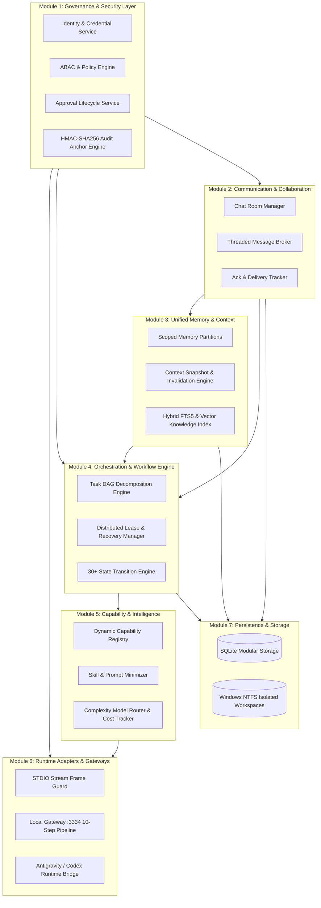
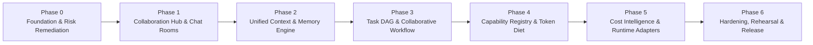

# AICO V3 MASTER BLUEPRINT — EXECUTIVE OVERVIEW & STRATEGIC ROADMAP

**Document ID:** `BP-V3-00`  
**Version:** `3.0.0-draft`  
**Date:** 2026-11-07  
**Author:** `flash-02` — Engineering & QA Lead  
**Design Phase:** Architecture & Contracts Design Only (No Implementation Authorized)  
**Baseline Git Reference:** Branch `feat/v2.2.1-implementation`, Commit `cd749107c4b34e26f61e14a238336e414f78779d`  
**Target Workspace:** `D:\AI-COMPANY`

---

## 1. VISION & STRATEGIC OBJECTIVES

### 1.1 Vision
AICO (Personal AI Software Company) is evolving from a single-task, tool-driven MCP coordinator into an **Autonomous Multi-Agent Collaborative AI Company**. In AICO V3, artificial intelligence agents operate not as isolated script runners, but as organized corporate peers with defined responsibilities, shared context, peer-to-peer and group communication channels, dynamic capability discovery, and rigorous cryptographic governance.

```mermaid
flowchart TD
    Founder[("Founder & Company Owner\n(Human Final Authority)")]
    CEO["chatgpt-01\nChief Executive Officer\n(Strategy & Main Orchestrator)"]
    CTO["flash-01\nChief Technology Officer\n(Architecture & Tech Lead)"]
    QA["flash-02\nEngineering & QA Lead\n(Verification & Quality Control)"]
    SWE["codex-01\nSoftware Implementation Engineer\n(Code Construction)"]
    Argon1["argon-01\nPrincipal Architect\n(Specialist - Manual Only)"]
    Argon2["argon-02\nIndependent Auditor\n(Specialist - Manual Only)"]

    Founder <== "Ultimate Approval & Policy Override" ==> CEO
    CEO --> "Strategic Directives & Task Intake" --> CTO
    CTO <--> "Peer Architectural Alignment & Design Review" <--> QA
    CTO --> "Technical Delegation" --> SWE
    SWE --> "Code Deliverables" --> QA
    QA --> "Verification Evidence & Gate Sign-off" --> CTO
    Founder -. "Mandatory Approval Gate (Per Invocation)" .-> Argon1
    Founder -. "Mandatory Approval Gate (Per Invocation)" .-> Argon2
```

### 1.2 Strategic Goals
1. **True Peer & Group Collaboration:** Replace rudimentary point-to-point messaging with a structured Collaboration Hub featuring direct messages, project rooms, task rooms, and executive boardroom channels with persistent thread support.
2. **Unified Context & Memory Engine:** Overcome token context fragmentation through a multi-tier memory hierarchy (company, project, task, room, and private agent memory) with provenance tracking and automatic freshness invalidation.
3. **Hierarchical Collaborative Orchestration:** Support full task decomposition into Directed Acyclic Graphs (DAGs), parallel execution via non-conflicting leases, checkpointing, and independent QA sign-offs before completion.
4. **Dynamic Capability Discovery & Token Diet:** Eliminate bloated system prompts by dynamically matching task requirements to minimal skill profiles, loading tool definitions just-in-time.
5. **Cost & Token Intelligence:** Track token expenditures across tasks, projects, models, and quota pools with model routing based on task complexity.
6. **Zero-Trust Security & Inviolable Governance:** Guarantee fail-closed ABAC at the service and data layer, prevent identity spoofing, protect Windows NTFS workspace boundaries, and ensure Argon specialist invocations remain 100% manual and bound to cryptographic Founder approvals.

---

## 2. SCOPE & NON-GOALS

### 2.1 In Scope for V3
- **Modular Monolith Core Architecture:** High-cohesion, loose-coupling design using Clean/Hexagonal Architecture patterns with clean event-driven boundaries.
- **Collaboration Hub:** Group chat rooms, direct messaging, threaded discussions, mentions (`@agent-id`), and message acknowledgement tracking.
- **Unified Memory & Context Engine:** Semantic knowledge indexing, context snapshotting, memory correction/tombstoning, and scoped context partitions.
- **Task Workflow Orchestrator:** Complex DAG task graphs, subtask fan-out/fan-in, lease ownership, heartbeat monitoring, and recovery from offline workers.
- **Dynamic Capability Registry:** Capability tagging, just-in-time skill activation, and runtime adapter abstractions.
- **Model Routing & Cost Accounting:** Quota pool telemetry, token budget hard-caps, and intelligent complexity-based model routing.
- **Security & Separation of Duties (SoD):** Multi-agent role checks, approval lifecycle management, and tamper-evident audit logging.

### 2.2 Non-Goals for V3
- **No Third-Party Control Plane Replacement:** The AICO MCP server is the canonical control plane. V3 will not outsource its company governance to AutoGen, CrewAI, LangGraph, or any black-box external orchestration platform.
- **No Premature Microservices:** V3 will not split the backend into distributed microservices communicating over network hops (gRPC/HTTP), nor introduce distributed brokers like Kafka or RabbitMQ. All modular boundaries remain within an in-process Modular Monolith with an asynchronous outbox queue.
- **No Agent Registry Expansion:** The company roster is strictly fixed to the 6 canonical principal agents (`chatgpt-01`, `flash-01`, `flash-02`, `codex-01`, `argon-01`, `argon-02`). No `flash-03` or Antigravity persona agents will be registered.
- **No Automated Argon Execution:** Argon agents will never be included in automated fan-outs, background loops, or retry queues under any circumstance.
- **No Direct Production Database Manipulation:** Production database migration remains deferred behind Gate G4; all V3 development and testing occurs in isolated sandbox environments.

---

## 3. MASTER BLUEPRINT DOCUMENTATION SUITE

This Master Blueprint comprises 12 dedicated, highly detailed architecture specifications located under `docs/blueprint/v3/`:

| Index | Document File | Subsystem / Focus Area |
| :---: | :--- | :--- |
| **00** | [00_AICO_V3_MASTER_BLUEPRINT.md](file:///D:/AI-COMPANY/docs/blueprint/v3/00_AICO_V3_MASTER_BLUEPRINT.md) | Executive Blueprint, Vision, System Overview & Phased Roadmap |
| **01** | [01_CURRENT_STATE_AND_GAP_ANALYSIS.md](file:///D:/AI-COMPANY/docs/blueprint/v3/01_CURRENT_STATE_AND_GAP_ANALYSIS.md) | Baseline Status of v2.2.1, Carry-Over Risk Register & Reusability Matrix |
| **02** | [02_TARGET_ARCHITECTURE.md](file:///D:/AI-COMPANY/docs/blueprint/v3/02_TARGET_ARCHITECTURE.md) | Hexagonal Modular Monolith, Logical Layers & Architectural Trade-offs |
| **03** | [03_DOMAIN_AND_DATABASE_DESIGN.md](file:///D:/AI-COMPANY/docs/blueprint/v3/03_DOMAIN_AND_DATABASE_DESIGN.md) | 23 Domain Entities, Schema Evolution & Zero-Loss Migration Paths |
| **04** | [04_MCP_API_AND_EVENT_CONTRACTS.md](file:///D:/AI-COMPANY/docs/blueprint/v3/04_MCP_API_AND_EVENT_CONTRACTS.md) | Standardized Envelopes, Scope Maps, ABAC Policies & Tool Contracts |
| **05** | [05_COLLABORATION_AND_CHAT_ROOM_ARCHITECTURE.md](file:///D:/AI-COMPANY/docs/blueprint/v3/05_COLLABORATION_AND_CHAT_ROOM_ARCHITECTURE.md) | Collaboration Hub, Chat Room Lifecycles, Channels, Threads & Visibility |
| **06** | [06_UNIFIED_CONTEXT_AND_MEMORY_ARCHITECTURE.md](file:///D:/AI-COMPANY/docs/blueprint/v3/06_UNIFIED_CONTEXT_AND_MEMORY_ARCHITECTURE.md) | Scoped Memory Tiers, Provenance Tracking, Snapshots & Leakage Prevention |
| **07** | [07_TASK_AND_COLLABORATIVE_ORCHESTRATION.md](file:///D:/AI-COMPANY/docs/blueprint/v3/07_TASK_AND_COLLABORATIVE_ORCHESTRATION.md) | DAG Task Workflow Engine, Parallel Leases & 30+ Transition State Machine |
| **08** | [08_SKILLS_TOOLS_AND_PLUGIN_ECOSYSTEM.md](file:///D:/AI-COMPANY/docs/blueprint/v3/08_SKILLS_TOOLS_AND_PLUGIN_ECOSYSTEM.md) | Dynamic Capability Registry, Token Diet & Sandboxed Connectors |
| **09** | [09_MODEL_ROUTING_TOKEN_AND_COST_INTELLIGENCE.md](file:///D:/AI-COMPANY/docs/blueprint/v3/09_MODEL_ROUTING_TOKEN_AND_COST_INTELLIGENCE.md) | Token Accounting, Quota Pool Telemetry & Complexity-Based Routing |
| **10** | [10_SECURITY_GOVERNANCE_AND_RUNTIME_ADAPTERS.md](file:///D:/AI-COMPANY/docs/blueprint/v3/10_SECURITY_GOVERNANCE_AND_RUNTIME_ADAPTERS.md) | Zero-Trust ABAC, SoD, Argon Manual Gate & Runtime Worker Adapters |
| **11** | [11_TEST_STRATEGY_ACCEPTANCE_GATES_AND_RELEASE_PLAN.md](file:///D:/AI-COMPANY/docs/blueprint/v3/11_TEST_STRATEGY_ACCEPTANCE_GATES_AND_RELEASE_PLAN.md) | Test Strategy, Quality Gates (V3-G0 to V3-G7) & Rollback Runbooks |

---

## 4. SYSTEM SUBSYSTEM ARCHITECTURE & DEPENDENCY MAP

The AICO V3 platform is structured into seven high-cohesion, loosely coupled core modules operating within a single Node.js runtime process:



### Module Dependency Rules:
1. **Governance & Security (Module 1)** is root and independent; all other modules depend on it for caller identity resolution and permission assertions.
2. **Persistence & Storage (Module 7)** sits at the foundation; domain logic interacts only through Abstract Repository Ports.
3. **Collaboration (Module 2)** and **Memory (Module 3)** provide shared state and context to the **Workflow Engine (Module 4)**.
4. **Runtime Adapters (Module 6)** sit at the external boundary, translating external transport requests into internal application commands without containing domain logic.

---

## 5. V3 PHASED DEVELOPMENT ROADMAP

Implementation of V3 will proceed strictly in phased increments, with every phase gated by verifiable test evidence:



| Phase | Core Objective | Primary Deliverables | Pre-requisite Gate |
| :--- | :--- | :--- | :---: |
| **Phase 0: Baseline & Risks** | Freeze baseline, remediate v2.2.1 carry-over risks | Patched approval expiration, lease timer tests, audit truncate defense | `V3-G0` |
| **Phase 1: Collaboration Hub** | Multi-agent communication | Chat rooms, membership roles, threads, mentions, read acks | `V3-G1` |
| **Phase 2: Context & Memory** | Scoped memory and context engine | Scoped memory partitions, context snapshots, knowledge search | `V3-G2` |
| **Phase 3: Workflow Engine** | Complex task collaboration | DAG subtask decomposition, parallel leases, review SoD | `V3-G3` |
| **Phase 4: Capability & Skills** | Dynamic loading & token diet | Capability profile matching, on-demand skill loader, MCP tools | `V3-G4` |
| **Phase 5: Intelligence & Cost** | Cost control & multi-runtime | Complexity-based model routing, token quota caps, runtime bridge | `V3-G5` |
| **Phase 6: Release & Audit** | Full verification & readiness | 100% test coverage, disaster recovery drills, Founder sign-off | `V3-G6` -> `V3-G7` |

---

## 6. QUALITY & ACCEPTANCE GATES (V3 SPECIFIC)

To avoid conflation with existing operational gates (such as Gate G4 for database migration), AICO V3 defines seven distinct strategic approval gates:

- **`V3-G0`: Baseline & Risk Freeze Gate** — Acceptance of the v2.2.1 risk register and baseline freeze.
- **`V3-G1`: Product Requirements & Architecture Gate** — Founder approval of the complete Master Blueprint package.
- **`V3-G2`: Domain Model & Database Schema Gate** — Approval of the 23 domain entities and backward-compatible migration plan.
- **`V3-G3`: API, MCP & Event Contracts Gate** — Approval of all MCP tool contracts and ABAC policies.
- **`V3-G4`: Security, SoD & Governance Gate** — Independent verification of Argon manual gates and threat mitigations.
- **`V3-G5`: Test Suite & Verification Harness Gate** — Approval of automated test suites and black-box verification scenarios.
- **`V3-G6`: Stage Acceptance & Production Readiness Gate** — 100% pass across all test suites on the staging sandbox.
- **`V3-G7`: Founder Implementation & Release Authorization** — Final human Founder authorization to apply changes to production environments.

> [!IMPORTANT]
> **Implementation Prohibition:** Under no circumstances will implementation code, migrations, or tool changes begin prior to formal human Founder approval of Gate `V3-G1`.
