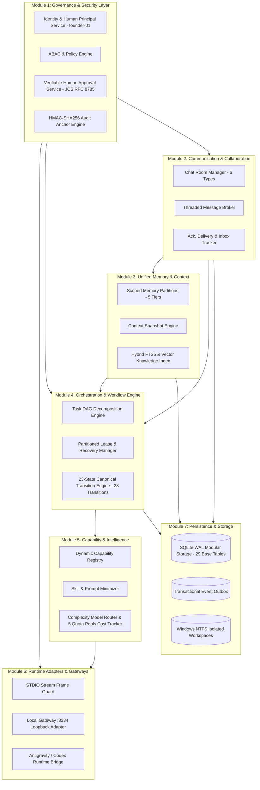
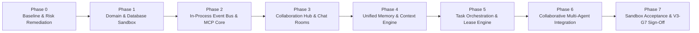

# AICO V3 MASTER BLUEPRINT — EXECUTIVE OVERVIEW & STRATEGIC ROADMAP

**Document ID:** `BP-V3-00`  
**Version:** `3.2.0-reconciled`  
**Date:** 2026-11-07  
**Author:** `flash-02` — Engineering & QA Lead  
**Design Phase:** Architecture & Contracts Design Only (No Implementation Authorized)  
**Baseline Git Reference:** Branch `feat/v2.2.1-implementation`, Actual HEAD: `6f33ba5ea5515187db0445dad443f3d06d4aa3a4`  
**Target Workspace:** `D:\AI-COMPANY`

---

## 1. VISION & STRATEGIC OBJECTIVES

### 1.1 Vision
AICO (Personal AI Software Company) is evolving from a single-task, tool-driven MCP coordinator into an **Autonomous Multi-Agent Collaborative AI Company**. In AICO V3, artificial intelligence agents operate not as isolated script runners, but as organized corporate peers with defined responsibilities, shared context, peer-to-peer and group communication channels, dynamic capability discovery, and rigorous cryptographic governance.

```mermaid
flowchart TD
    Founder[("Founder & Company Owner\n(Human Final Authority - Principal 'founder-01')")]
    CEO["chatgpt-01\nChief Executive Officer\n(Strategy & Main Orchestrator)"]
    CTO["flash-01\nChief Technology Officer\n(Architecture & Tech Lead)"]
    QA["flash-02\nEngineering & QA Lead\n(Verification & Quality Control)"]
    SWE["codex-01\nSoftware Implementation Engineer\n(Code Construction)"]
    Argon1["argon-01\nPrincipal Architect\n(Specialist - Manual Only)"]
    Argon2["argon-02\nIndependent Auditor\n(Specialist - Manual Only)"]

    Founder <== "Human Ed25519 Cryptographic Approval & Policy Override" ==> CEO
    CEO --> "Strategic Directives & Task Intake" --> CTO
    CTO <--> "Peer Architectural Alignment & Design Review" <--> QA
    CTO --> "Technical Delegation" --> SWE
    SWE --> "Code Deliverables" --> QA
    QA --> "Verification Evidence & Gate Sign-off" --> CTO
    Founder -. "Mandatory Human Approval Gate (Per Invocation)" .-> Argon1
    Founder -. "Mandatory Human Approval Gate (Per Invocation)" .-> Argon2
```

### 1.2 Strategic Goals
1. **True Peer & Group Collaboration:** Replace rudimentary point-to-point messaging with a structured Collaboration Hub featuring direct messages, project rooms, task rooms, and executive boardroom channels with persistent thread support.
2. **Unified Context & Memory Engine:** Overcome token context fragmentation through a multi-tier memory hierarchy (company, project, task, room, and private agent memory) with provenance tracking and automatic freshness invalidation.
3. **Hierarchical Collaborative Orchestration:** Support full task decomposition into Directed Acyclic Graphs (DAGs), parallel execution via non-conflicting leases, checkpointing, and independent QA sign-offs before completion.
4. **Dynamic Capability Discovery & Token Diet:** Eliminate bloated system prompts by dynamically matching task requirements to minimal skill profiles, loading tool definitions just-in-time.
5. **Cost & Token Intelligence:** Track token expenditures across tasks, projects, models, and quota pools with model routing based on task complexity.
6. **Zero-Trust Security & Verifiable Human Governance:** Guarantee fail-closed ABAC at the service and data layer, prevent identity spoofing, protect Windows NTFS workspace boundaries, and ensure Argon specialist invocations remain 100% manual, requiring verifiable human Founder authorization with cryptographic signature and payload hash binding.

---

## 2. SCOPE & NON-GOALS

### 2.1 In Scope for V3
- **Modular Monolith Core Architecture:** High-cohesion, loose-coupling design using Clean/Hexagonal Architecture patterns with clean event-driven boundaries.
- **Collaboration Hub:** Group chat rooms, direct messaging, threaded discussions, mentions (`@agent-id`), and message acknowledgement tracking.
- **Unified Memory & Context Engine:** Semantic knowledge indexing, context snapshotting, memory correction/tombstoning, and scoped context partitions.
- **Task Workflow Orchestrator:** Complex DAG task graphs, subtask fan-out/fan-in, lease ownership, heartbeat monitoring, and recovery from offline workers.
- **Dynamic Capability Registry:** Capability tagging, just-in-time skill activation, and runtime adapter abstractions.
- **Model Routing & Cost Accounting:** Quota pool telemetry across 5 pools, token budget hard-caps, and intelligent complexity-based model routing.
- **Security & Separation of Duties (SoD):** Multi-agent role checks, verifiable human Founder approval lifecycle management, and tamper-evident audit logging.

### 2.2 Non-Goals for V3
- **No Third-Party Control Plane Replacement:** The AICO MCP server is the canonical control plane. V3 will not outsource its company governance to AutoGen, CrewAI, LangGraph, or any black-box external orchestration platform.
- **No Autonomous Production DB Migrations:** Gate G4 remains strictly manual and frozen. V3 sandbox implementation under `V3-G7` does NOT implicitly open Gate G4.
- **No Automatic Argon Invocations:** Under no circumstances will Argon specialists be invoked, retried, or scheduled automatically.
- **No Public Gateway Exposure:** Port 3335, ngrok, and external network exposures remain strictly disabled.

---

## 3. MASTER BLUEPRINT DOCUMENTATION SUITE

This Master Blueprint comprises 12 dedicated, highly detailed architecture specifications located under `docs/blueprint/v3/`:

| Index | Document File | Subsystem / Focus Area |
| :---: | :--- | :--- |
| **00** | [00_AICO_V3_MASTER_BLUEPRINT.md](./00_AICO_V3_MASTER_BLUEPRINT.md) | Executive Blueprint, Vision, System Overview, Traceability & Phased Roadmap |
| **01** | [01_CURRENT_STATE_AND_GAP_ANALYSIS.md](./01_CURRENT_STATE_AND_GAP_ANALYSIS.md) | Baseline Status of v2.2.1, Carry-Over Risk Register & Reusability Matrix |
| **02** | [02_TARGET_ARCHITECTURE.md](./02_TARGET_ARCHITECTURE.md) | Hexagonal Modular Monolith, Logical Layers & Architectural Trade-offs |
| **03** | [03_DOMAIN_AND_DATABASE_DESIGN.md](./03_DOMAIN_AND_DATABASE_DESIGN.md) | 24 Domain Entities, 29 Base Tables, FTS5 Virtual Table, Triggers & Views |
| **04** | [04_MCP_API_AND_EVENT_CONTRACTS.md](./04_MCP_API_AND_EVENT_CONTRACTS.md) | 28 Standardized MCP Tools, Scope Maps, ABAC Policies & Event Contracts |
| **05** | [05_COLLABORATION_AND_CHAT_ROOM_ARCHITECTURE.md](./05_COLLABORATION_AND_CHAT_ROOM_ARCHITECTURE.md) | Collaboration Hub, 6 Chat Room Types, Threads, Mentions & Inbox Notifications |
| **06** | [06_UNIFIED_CONTEXT_AND_MEMORY_ARCHITECTURE.md](./06_UNIFIED_CONTEXT_AND_MEMORY_ARCHITECTURE.md) | Scoped Memory Tiers, Provenance Tracking, Snapshots & Leakage Prevention |
| **07** | [07_TASK_AND_COLLABORATIVE_ORCHESTRATION.md](./07_TASK_AND_COLLABORATIVE_ORCHESTRATION.md) | DAG Task Workflow Engine, 23 States, 28 Transitions & Partitioned Lease Recovery |
| **08** | [08_SKILLS_TOOLS_AND_PLUGIN_ECOSYSTEM.md](./08_SKILLS_TOOLS_AND_PLUGIN_ECOSYSTEM.md) | Dynamic Capability Registry, Token Diet & Sandboxed Connectors |
| **09** | [09_MODEL_ROUTING_TOKEN_AND_COST_INTELLIGENCE.md](./09_MODEL_ROUTING_TOKEN_AND_COST_INTELLIGENCE.md) | Token Accounting, 5 Quota Pools Telemetry & Complexity-Based Routing |
| **10** | [10_SECURITY_GOVERNANCE_AND_RUNTIME_ADAPTERS.md](./10_SECURITY_GOVERNANCE_AND_RUNTIME_ADAPTERS.md) | Zero-Trust ABAC, SoD, Human Founder Verifiable Gate & Runtime Adapters |
| **11** | [11_TEST_STRATEGY_ACCEPTANCE_GATES_AND_RELEASE_PLAN.md](./11_TEST_STRATEGY_ACCEPTANCE_GATES_AND_RELEASE_PLAN.md) | 7-Level Test Pyramid, Quality Gates (V3-G0 to V3-G7) & Safe Recovery Runbooks |

---

## 4. SYSTEM SUBSYSTEM ARCHITECTURE & DEPENDENCY MAP

The AICO V3 platform is structured into seven high-cohesion, loosely coupled core modules operating within a single Node.js runtime process:



### Module Dependency Rules:
1. **Governance & Security (Module 1)** is root and independent; all other modules depend on it for caller identity resolution and permission assertions.
2. **Persistence & Storage (Module 7)** sits at the foundation; domain logic interacts only through Abstract Repository Ports.
3. **Collaboration (Module 2)** and **Memory (Module 3)** provide shared state and context to the **Workflow Engine (Module 4)**.
4. **Runtime Adapters (Module 6)** sit at the external boundary, translating external transport requests into internal application commands without containing domain logic.

---

## 5. V3 PHASED DEVELOPMENT ROADMAP

Implementation of V3 will proceed strictly in phased increments, with every phase gated by verifiable test evidence:



| Phase | Core Objective | Primary Deliverables | Pre-requisite Gate | Target Gate |
| :--- | :--- | :--- | :---: | :---: |
| **Phase 0: Baseline & Risks** | Freeze baseline, remediate v2.2.1 carry-over risks | Patched approval expiration, lease timer tests, audit truncate defense | Pre-V3 | `V3-G0` |
| **Phase 1: Domain & DB** | Build isolated SQLite sandbox schema | 29 base tables, 1 virtual table (FTS5), 3 triggers, 4 views, 17 indexes | `V3-G0` | `V3-G3` |
| **Phase 2: Event & MCP** | Core protocol and security pipeline | Event bus, Zod contracts, token auth, error mapping | `V3-G3` | `V3-G4` |
| **Phase 3: Collaboration Hub** | Multi-agent communication | 6 chat room types, memberships, threads, mentions, notifications inbox | `V3-G4` | `V3-G4` |
| **Phase 4: Context & Memory** | Scoped memory and context engine | 5-tier memory partitions, context snapshots, FTS5 search | `V3-G4` | `V3-G4` |
| **Phase 5: Workflow Engine** | Complex task collaboration | DAG decomposition, 23 states, 28 transitions, partitioned lease recovery | `V3-G4` | `V3-G5` |
| **Phase 6: Multi-Agent E2E** | Integrated agent collaboration | JIT skill loader, complexity routing, token caps, 5 quota pools E2E suite | `V3-G5` | `V3-G6` |
| **Phase 7: Sandbox Sign-Off** | Full sandbox verification & audit | 100% test pass, zero vulnerabilities, traceability report | `V3-G6` | `V3-G7` |

---

## 6. UNIFIED V3 QUALITY GATES (`V3-G0` TO `V3-G7`)

To ensure absolute consistency across all 12 Master Blueprint documents, the definition of Gates `V3-G0` through `V3-G7` is strictly unified as follows:

| Gate | Name | Definition | Authority |
|---|---|---|---|
| **V3-G0** | Baseline & Risk Freeze | Freeze v2.2.1 baseline at 6f33ba5; catalog carry-over risks; freeze production DB at v0.3.0. | Founder |
| **V3-G1** | Product Requirements & Scope Approval | Formal approval of V3 scope, 24 domain entities, and non-goals. | Founder |
| **V3-G2** | Target Architecture & ADR Approval | Approval of Hexagonal architecture, event-driven model, and ADRs. | Founder |
| **V3-G3** | Domain & Database Design Approval | Verification of DDL in isolated sandbox; 29 base tables, 1 virtual table (FTS5), 3 triggers, 4 views, 17 indexes; zero changes to production DB. | Founder |
| **V3-G4** | MCP/API/Event Contract Approval | Approval of 28 MCP tools, event schemas, and Zod contracts. | Founder |
| **V3-G5** | Security, Governance & Runtime Approval | Verification of verifiable human approval pipeline, HMAC-SHA256 audit log, and Argon isolation. | Founder |
| **V3-G6** | Test Strategy & Acceptance Criteria Approval | Approval of 7-level test pyramid and acceptance test suites. | Founder |
| **V3-G7** | Sandbox Implementation Authorization | Formal Founder approval to begin implementation in isolated sandbox branch. Does NOT open production Gate G4. | Founder |

> [!CAUTION]
> **CRITICAL BOUNDARY ENFORCEMENT:**  
> **Gate G4 (Production Database Migration) is NOT V3-G4.** Gate G4 is a production deployment gate that remains **CLOSED** until post-V3 production rollout authorization.  
> **Gate `V3-G7` authorizes sandbox implementation completion ONLY.**  
> `V3-G7` does **NOT** authorize production deployment, does **NOT** apply Windows NTFS ACLs, and does **NOT** open production database Gate G4. Production Gate G4 is a separate, human-gated operational milestone that requires independent, explicit human Founder authorization.

---

## 7. CANONICAL REQUIREMENTS SPECIFICATION (`REQ-V3-xxx`)

The architecture and contracts of AICO V3 satisfy 32 canonical engineering requirements:

### Architecture & Transports
- **`REQ-V3-001`:** The system must implement a Hexagonal Modular Monolith where dependencies flow strictly inward.
- **`REQ-V3-002`:** All inter-subsystem domain communications must use typed in-process domain events adhering to `aico.event.v3`.
- **`REQ-V3-003`:** The system must expose tools via standard Model Context Protocol (MCP) JSON-RPC 2.0 over STDIO and HTTP loopback (`127.0.0.1:3334`).
- **`REQ-V3-004`:** Public Gateway (:3335) and external network tunnels (ngrok) must remain disabled by default.
- **`REQ-V3-005`:** STDIO transport must enforce a strict raw frame guard (2 MiB cap) and never write non-JSON logs to stdout.

### Domain & Storage
- **`REQ-V3-006`:** The domain model must encapsulate exactly 24 core domain entities.
- **`REQ-V3-007`:** The physical database schema must comprise exactly 29 base tables, 1 virtual table (`memory_fts`), 3 triggers, 4 compatibility views, and 17 indexes.
- **`REQ-V3-008`:** Database connections must enforce SQLite WAL mode (`PRAGMA journal_mode = WAL; PRAGMA busy_timeout = 5000;`).
- **`REQ-V3-009`:** The system must implement a Transactional Outbox pattern (`event_outbox`) for atomic domain event dispatch.
- **`REQ-V3-010`:** The system must maintain 4 backward-compatible views (`v_tasks_legacy`, `v_agents_legacy`, `v_quota_legacy`, `v_approvals_legacy`).

### Collaboration Hub
- **`REQ-V3-011`:** The system must support exactly 6 chat room types: `EXECUTIVE_BOARDROOM`, `ANNOUNCEMENTS`, `DEPARTMENT_OFFICE`, `PROJECT_ROOM`, `TASK_ROOM`, and `DIRECT_MESSAGE`.
- **`REQ-V3-012`:** Messages must be typed (`TEXT`, `DIRECTIVE`, `PROPOSAL`, `REVIEW_FEEDBACK`, `GATE_STATUS`, `SYSTEM_NOTICE`).
- **`REQ-V3-013`:** Discussion threads must have a full lifecycle (`OPEN`, `RESOLVED`, `CLOSED`) with resolution summaries stored in memory.
- **`REQ-V3-014`:** `@agent-id` and `@founder-01` mentions must be extracted and routed to `notifications_inbox` without bloated context dumps.
- **`REQ-V3-015`:** Ephemeral task rooms must auto-provision on complex task creation and auto-archive on task completion.

### Unified Memory & Context
- **`REQ-V3-016`:** Memory must enforce a 5-tier hierarchy: `COMPANY`, `PROJECT`, `TASK`, `ROOM`, `AGENT_PRIVATE`.
- **`REQ-V3-017`:** `AGENT_PRIVATE` memory must be strictly partitioned; zero cross-agent leakage.
- **`REQ-V3-018`:** Context Snapshots must capture verified facts, active hypotheses, and pending steps in <1,500 tokens.
- **`REQ-V3-019`:** Knowledge must support provenance tracking (agent, commit/file ref, confidence score) and tombstoning soft deletion (`is_tombstone = 1`).
- **`REQ-V3-020`:** SQLite FTS5 search must synchronize automatically via database triggers on `memory_entries` with documented manual rebuild (`INSERT INTO memory_fts(memory_fts) VALUES('rebuild');`).

### Task Orchestration & Workflow
- **`REQ-V3-021`:** The task state machine must enforce exactly 23 states and 28 valid transitions.
- **`REQ-V3-022`:** Task dependencies must form a Directed Acyclic Graph (DAG) with automated cycle detection (Kahn's algorithm).
- **`REQ-V3-023`:** Concurrent task claims must require exclusive leases with nonce tracking and 60-second heartbeats.
- **`REQ-V3-024`:** Stale lease recovery must partition tasks: standard tasks forfeit to queue (`READY_FOR_DEV`); expired Argon tasks transition to `BLOCKED_MANUAL_INTERVENTION`.
- **`REQ-V3-025`:** Technical reviews and QA verifications must enforce the Four-Eyes Principle (Separation of Duties).

### Capabilities & Model Intelligence
- **`REQ-V3-026`:** The Capability Registry must profile tasks and dynamically inject only 1-2 relevant skills per turn (Context Diet).
- **`REQ-V3-027`:** Model routing must match task complexity (`TRIVIAL`, `STANDARD`, `COMPLEX`, `SPECIALIST`) to cost-optimal models.
- **`REQ-V3-028`:** Token usage must be tracked per task across the 5 canonical quota pools and enforce soft warnings (80%) and hard cut-offs (100%).

### Security, Governance & Verification
- **`REQ-V3-029`:** The Founder must be modeled as a human security principal (`founder-01`), strictly separate from the 6 AI agents.
- **`REQ-V3-030`:** Founder approvals must require verifiable human authorization: RFC 8785 (JCS) deterministic payload hashing (`payload_hash = SHA256(JCS(canonical_payload))`), human authentication, Ed25519 signature verification, and atomic 10-step single-use consumption.
- **`REQ-V3-031`:** Argon specialists (`argon-01`, `argon-02`) must NEVER be auto-invoked, retried, or scheduled.
- **`REQ-V3-032`:** Audit events must form an immutable forward-hash chain in SQLite with external JSONL anchoring and truncation defense.

---

## 8. COMPLETE TRACEABILITY MATRIX

| Req ID | Subsystem / Architecture | Domain Entity | MCP Tool / Event | Security Rule | Acceptance Test | Phase & Gate |
| :--- | :--- | :--- | :--- | :--- | :--- | :---: |
| `REQ-V3-001` | Hexagonal Architecture | Core Domain | `aico.event.v3` | Layer Inward Rule | `test/unit/arch-boundary.test.ts` | P0 / `V3-G0` |
| `REQ-V3-002` | Event Bus | `EVENT_OUTBOX` | `AicoDomainEvent` | Payload Tamper Hash | `test/contracts/event-envelope.test.ts` | P2 / `V3-G4` |
| `REQ-V3-003` | Protocol Adapters | N/A | `company_*` Tools (28 Tools)| Timing-Safe Auth | `test/integration/http-adapter.test.ts` | P2 / `V3-G4` |
| `REQ-V3-004` | Gateway Security | N/A | Local Loopback | Localhost Binding | `test/security/gateway-binding.test.ts` | P2 / `V3-G4` |
| `REQ-V3-005` | STDIO Security | N/A | STDIO Protocol | 2 MiB Frame Cap | `test/integration/stdio-adapter.test.ts` | P2 / `V3-G4` |
| `REQ-V3-006` | Domain Model | 24 Entities | Repository Interfaces | Entity Integrity | `test/unit/domain-entities.test.ts` | P1 / `V3-G1` |
| `REQ-V3-007` | Database Persistence| 29 Base Tables, Views | SQLite WAL | Foreign Keys ON | `test/integration/sqlite-wal.test.ts` | P1 / `V3-G3` |
| `REQ-V3-008` | SQLite Engine | `ConnectionManager`| WAL + Timeout | 5000ms Busy Timeout | `test/integration/sqlite-busy.test.ts` | P1 / `V3-G3` |
| `REQ-V3-009` | Outbox Pattern | `EVENT_OUTBOX` | Event Dispatcher | Transactional Atomicity| `test/integration/outbox-dispatch.test.ts`| P2 / `V3-G4` |
| `REQ-V3-010` | Backward Compat | 4 Views | Legacy Tool Wrappers| Schema View Parity | `test/integration/legacy-views.test.ts` | P1 / `V3-G3` |
| `REQ-V3-011` | Collaboration Hub | `CHAT_ROOM` | `company_create_room` | Room Role Matrix | `test/integration/chat-rooms.test.ts` | P3 / `V3-G4` |
| `REQ-V3-012` | Chat Broker | `MESSAGE` | `company_post_message`| ABAC Room Member | `test/contracts/message-schema.test.ts` | P3 / `V3-G4` |
| `REQ-V3-013` | Thread Engine | `THREAD` | `company_resolve_thread`| Decision Capture | `test/integration/threads.test.ts` | P3 / `V3-G4` |
| `REQ-V3-014` | Mention Engine | `NOTIFICATIONS_INBOX`| `aico.chat.mention` | Scoped Inbox Read | `test/integration/mentions.test.ts` | P3 / `V3-G4` |
| `REQ-V3-015` | Room Lifecycle | `CHAT_ROOM` | Task Room Lifecycle | Auto-Archive on DONE | `test/integration/room-lifecycle.test.ts` | P3 / `V3-G4` |
| `REQ-V3-016` | Scoped Memory | `MEMORY_ENTRY` | `company_store_memory`| 5-Tier Scoping | `test/unit/memory-scoping.test.ts` | P4 / `V3-G4` |
| `REQ-V3-017` | Memory Isolation | `MEMORY_ENTRY` | `company_query_memory`| ABAC Private Guard | `test/security/memory-leakage.test.ts` | P4 / `V3-G4` |
| `REQ-V3-018` | Context Snapshot | `CONTEXT_SNAPSHOT` | `company_create_context_snapshot`| <1,500 Token Cap | `test/unit/context-snapshot.test.ts` | P4 / `V3-G4` |
| `REQ-V3-019` | Knowledge Tracking | `KNOWLEDGE_DOCUMENT`| Knowledge Indexer | Provenance & Tombstone | `test/unit/knowledge-provenance.test.ts` | P4 / `V3-G4` |
| `REQ-V3-020` | Full-Text Search | `memory_fts` | SQLite FTS5 Search | Trigger Auto-Sync | `test/integration/fts5-sync.test.ts` | P4 / `V3-G4` |
| `REQ-V3-021` | Workflow Engine | `TASK` | 28 State Transitions | Transition Matrix | `test/unit/state-machine-23.test.ts` | P5 / `V3-G5` |
| `REQ-V3-022` | DAG Engine | `TASK_DEPENDENCY` | `company_create_task` | Kahn's Cycle Check | `test/unit/dag-validator.test.ts` | P5 / `V3-G5` |
| `REQ-V3-023` | Lease Engine | `TASK_LEASE` | `company_claim_task` | Nonce & Heartbeat | `test/stress/lease-contention.test.ts` | P5 / `V3-G5` |
| `REQ-V3-024` | Lease Recovery | `TASK_LEASE` | Lease Sweeper Cron | Partitioned Recovery | `test/recovery/lease-timeout.test.ts` | P5 / `V3-G5` |
| `REQ-V3-025` | Review SoD | `TASK_EXECUTION` | `company_approve_review`| Four-Eyes Principle | `test/security/sod-enforcement.test.ts` | P5 / `V3-G5` |
| `REQ-V3-026` | Capability Registry | `SKILL`, `CAPABILITY` | JIT Skill Loader | Task Profile Match | `test/unit/token-diet.test.ts` | P6 / `V3-G6` |
| `REQ-V3-027` | Model Routing | `TOKEN_USAGE` | Complexity Router | Complexity Tiering | `test/unit/model-router.test.ts` | P6 / `V3-G6` |
| `REQ-V3-028` | Token Budgeting | `TOKEN_USAGE` | Usage Guardrails | Hard 100% Cut-Off | `test/security/budget-cutoff.test.ts` | P6 / `V3-G6` |
| `REQ-V3-029` | Human Principal | `PRINCIPAL` | Identity Service | Human vs Agent Check | `test/security/principal-auth.test.ts` | P0 / `V3-G0` |
| `REQ-V3-030` | Verifiable Approval | `APPROVAL` | `company_decide_approval`| 10-Step Human Pipeline| `test/security/verifiable-approval.test.ts`| P0 / `V3-G5` |
| `REQ-V3-031` | Argon Isolation | `APPROVAL` | Specialist Invocation| Zero Auto-Invocation | `test/security/argon-gate.test.ts` | P0 / `V3-G5` |
| `REQ-V3-032` | Audit Hash Chain | `AUDIT_EVENT` | `company_query_audit_log` | Monotonic SHA-256 | `test/security/audit-chain.test.ts` | P0 / `V3-G5` |

---

## 9. OPEN ARCHITECTURAL DECISIONS (`OPEN_DECISIONS`)

The following design decisions have been analyzed and formulated with engineering trade-offs. Each decision is submitted for formal Founder review:

### `DEC-V3-001`: Vector Search Storage Engine Selection
- **Decision Owner:** Founder (Human) & CTO (`flash-01`)
- **Context:** Memory retrieval in Phase 4 requires semantic vector similarity search in addition to keyword FTS5.
- **Options Considered:**
  1. *Option A (Recommended):* Embedded `sqlite-vec` extension compiled for Windows x64.
  2. *Option B:* In-process JavaScript Float32Array cosine similarity index stored in SQLite BLOBs.
  3. *Option C:* External standalone vector database (e.g. Qdrant / Chroma).
- **Trade-off Analysis:**
  - Option A provides native SQL vector queries (`MATCH knn`), high speed, and zero external services. Requires pre-built native DLL on Windows.
  - Option B has zero native dependencies and runs purely in Node.js, but scales poorly beyond 50,000 vectors.
  - Option C violates the local-first single-process Tenet and adds substantial operational overhead.
- **Engineering Recommendation:** Adopt **Option B** for Phase 4 sandbox baseline (100% portable pure TypeScript), with an abstraction port allowing transparent upgrade to **Option A** (`sqlite-vec`) when database scale exceeds 10,000 entries.
- **Approval Status:** `PENDING_FOUNDER_DECISION`

### `DEC-V3-002`: Human Founder Authentication Mechanism
- **Decision Owner:** Founder (Human)
- **Context:** To satisfy `REQ-V3-030`, Founder approvals require cryptographic proof of human authorization rather than simple bearer tokens.
- **Options Considered:**
  1. *Option A (Recommended):* Local Ed25519 CLI Keypair stored in Windows DPAPI / SSH agent; signs approval payloads via local CLI helper (`aico-sign.exe` / script).
  2. *Option B:* Local WebAuthn / FIDO2 hardware token portal served on `127.0.0.1:3336`.
  3. *Option C:* Time-based One-Time Password (TOTP) entered via CLI prompt.
- **Trade-off Analysis:**
  - Option A provides mathematical non-repudiation, deterministic verification in Node.js `crypto.verify`, and seamless CLI integration.
  - Option B provides touch-based physical security, but requires browser redirection and WebAuthn ceremony complexity.
  - Option C provides authentication but lacks cryptographic binding to the approval payload hash.
- **Engineering Recommendation:** Adopt **Option A** (Local Ed25519 Keypair with DPAPI private key protection).
- **Approval Status:** `PENDING_FOUNDER_DECISION`

### `DEC-V3-003`: Local Background Worker Process Architecture
- **Decision Owner:** CTO (`flash-01`) & QA Lead (`flash-02`)
- **Context:** Background maintenance tasks (stale lease sweeper, message compaction, audit log anchoring) must run periodically.
- **Options Considered:**
  1. *Option A (Recommended):* In-process Node.js `setInterval` timers within the MCP server process.
  2. *Option B:* Separate OS background process managed via Windows Task Scheduler or Windows Service (WinSW).
  3. *Option C:* Worker Threads within the main Node.js process.
- **Trade-off Analysis:**
  - Option A shares SQLite connection pools and memory state with zero IPC overhead, but stops if the MCP server process terminates.
  - Option B ensures background sweeps continue when no agent is connected, but introduces multi-process SQLite write lock contention.
  - Option C provides thread isolation while remaining in the same OS process.
- **Engineering Recommendation:** Adopt **Option A** for the V3 sandbox implementation to maintain a strictly unified single-process architecture, designing the background worker as an independent interactor that can be extracted to Option B if continuous 24/7 autonomous maintenance is required.
- **Approval Status:** `PENDING_FOUNDER_DECISION`

### `DEC-V3-004`: Outbox Dispatcher Triggering Mechanism
- **Decision Owner:** CTO (`flash-01`)
- **Context:** The `event_outbox` table must publish pending domain events to registered handlers.
- **Options Considered:**
  1. *Option A (Recommended):* Synchronous post-commit in-process event trigger with fallback background poll (hybrid).
  2. *Option B:* Pure polling sweeper running every 500ms.
  3. *Option C:* SQLite `update_hook` native callback.
- **Trade-off Analysis:**
  - Option A provides immediate, zero-latency event handling for normal flows while guaranteeing zero lost events via the polling fallback.
  - Option B introduces 500ms latency to event handling and wastes CPU cycles when idle.
  - Option C relies on undocumented native SQLite driver hooks that can destabilize `better-sqlite3`.
- **Engineering Recommendation:** Adopt **Option A** (Immediate in-process event notification with 30-second sweeper fallback).
- **Approval Status:** `PENDING_FOUNDER_DECISION`

### `DEC-V3-005`: Unified Principal Foreign Key Architecture
- **Decision Owner:** CTO (`flash-01`) & QA Lead (`flash-02`)
- **Context:** In v2.2.1, foreign keys referenced `agents(agent_id)`, making it impossible for the human Founder (`founder-01`) to directly send messages, participate in chat rooms, create threads, or own tasks without violating relational constraints or pretending to be an agent.
- **Options Considered:**
  1. *Option A (Recommended):* Unified `principals` table (`principal_id`, `principal_type: 'HUMAN' | 'AGENT'`, `agent_id` FK nullable, `human_identifier` nullable, `display_name`, `role`). All relational tables reference `principals(principal_id)`.
  2. *Option B:* Dual foreign keys on messages and tasks (`agent_id` nullable, `founder_id` nullable) with complex CHECK constraints on every table.
  3. *Option C:* Treat Founder as a pseudo-agent in `agents` table.
- **Trade-off Analysis:**
  - Option A provides pure domain modeling: Founder is a human, agents are AI. Clean single foreign key across all collaboration and task tables. Enforced by SQL CHECK constraint.
  - Option B duplicates columns across 8+ tables, significantly complicating joins and indexes.
  - Option C violates core security governance by blurring the distinction between AI agents and the human owner.
- **Engineering Recommendation:** Adopt **Option A** (Unified `principals` table).
- **Approval Status:** `PENDING_FOUNDER_DECISION`

### `DEC-V3-006`: Quota Pool Migration and Model Intelligence
- **Decision Owner:** CTO (`flash-01`)
- **Context:** The active workspace and database maintain 5 real quota pools: `google-pro-01`, `google-pro-02`, `gemini-web-01`, `gemini-web-02`, and `openai-go-shared`. The V3 architecture must properly model these pools without losing track of subscription-based versus pay-per-token pools.
- **Options Considered:**
  1. *Option A (Recommended):* Add a dedicated `quota_pools` base table (Table 4 in DDL) with fields for `pool_type: 'SUBSCRIPTION' | 'USAGE'`, reset periods, and token allocation caps.
  2. *Option B:* Keep quota pool configs purely in `company-manifest.json` and calculate usage in-memory.
- **Trade-off Analysis:**
  - Option A allows transactional tracking, historical analytics, and atomic budget limit enforcement directly in SQLite.
  - Option B risks split-brain between manifest and actual usage, and lacks ACID guarantees.
- **Engineering Recommendation:** Adopt **Option A** (Dedicated `quota_pools` table in target schema).
- **Approval Status:** `PENDING_FOUNDER_DECISION`

---

## 10. REMAINING ARCHITECTURAL RISKS

1. **Windows NTFS Path Latency:** Windows file system operations on deep directories can exhibit higher latency than Linux; all artifact scanning and Git operations must employ cached tree hashes.
2. **SQLite Write Concurrency Under Load:** Although WAL mode allows unlimited concurrent readers, write transactions are serialized. High-burst multi-agent message volume must utilize batching and retry backoffs.
3. **Model Context Window Asymmetry:** Agents utilize different models (Gemini 1M, Claude 200k, GPT-4o 128k); context snapshots must strictly format for the lowest common denominator (<128k) to avoid truncation when tasks are reassigned.
4. **Subscription Quota Reset Tracking:** Quota pools using subscription models (`openai-go-shared`, `gemini-web-01`, `gemini-web-02`) do not decrement numeric balances per request, but rather adhere to rolling rate limits; telemetry must measure both token consumption and window request frequency.
