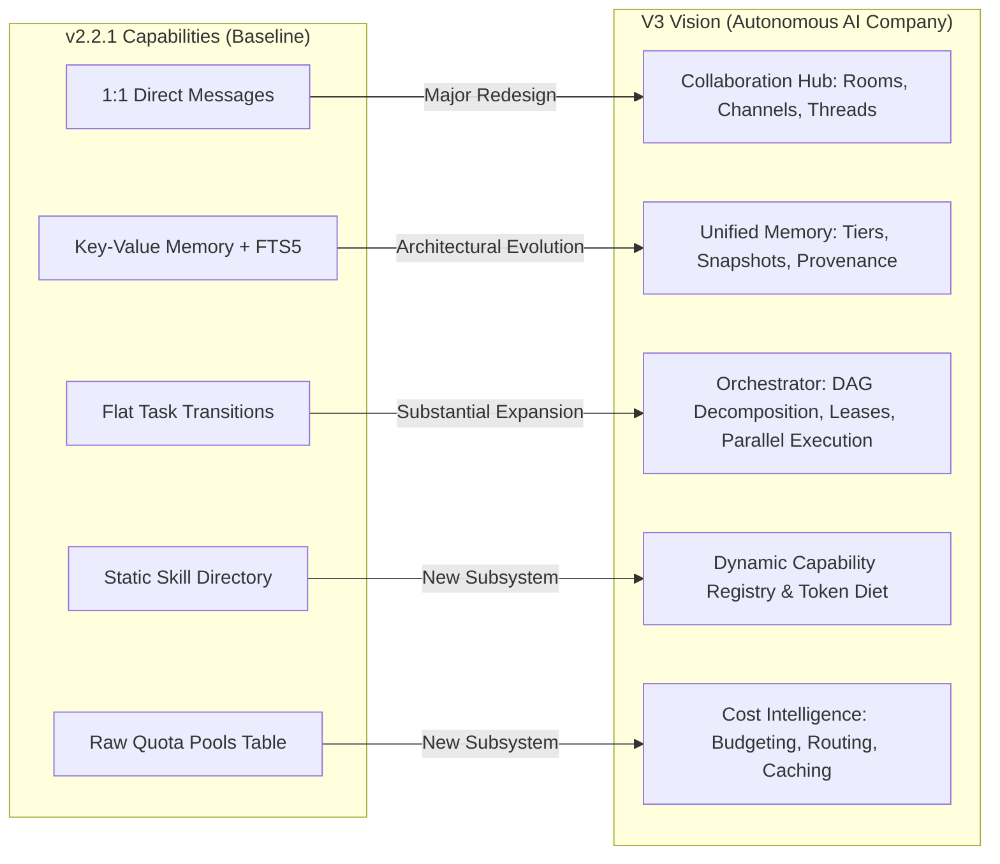

# AICO V3 — CURRENT STATE, BASELINE AUDIT & GAP ANALYSIS

**Document ID:** `BP-V3-01`  
**Version:** `3.0.0-draft`  
**Date:** 2026-11-07  
**Author:** `flash-02` — Engineering & QA Lead  
**Design Phase:** Architecture & Contracts Design Only  
**Baseline Git Reference:** Branch `feat/v2.2.1-implementation`, Commit `cd749107c4b34e26f61e14a238336e414f78779d`  
**Target Workspace:** `D:\AI-COMPANY`

---

## 1. EXECUTIVE SUMMARY

To establish a solid, honest baseline for AICO V3, this document provides an exhaustive, source-verified audit of the repository as of commit `cd749107c4b34e26f61e14a238336e414f78779d`. Rather than accepting self-reported claims at face value, every subsystem has been categorized using strict factual classifications:
- `VERIFIED_IN_SOURCE`: Directly inspected in TypeScript/SQL source code.
- `TESTED_IN_SOURCE_TEST`: Formally asserted in an existing automated test file.
- `RUNTIME_EVIDENCE_REPORTED`: Documented in test run logs executed in this environment.
- `NOT_INDEPENDENTLY_REPRODUCED`: Code exists and passes locally, but has not been confirmed on an independent third-party clean machine.
- `NOT_VERIFIED`: Documented or conceptual requirement lacking implementation or test evidence.

The audit confirms that while the repository has achieved a functional modular baseline (10 services, 38 MCP tools, 15 passing test suites), **significant technical debt and carry-over risks remain** in state machine ABAC, approval expiration, audit anchor truncation defense, and Git history inspection. These items form the **v2.2.1 Baseline Carry-Over Risk Register** and must be resolved before V3 is deployed.

---

## 2. SUBSYSTEM IMPLEMENTATION & VERIFICATION INVENTORY

| Subsystem Component | Actual File Location | Verification Status | Source & Test Reality |
| :--- | :--- | :---: | :--- |
| **S01: Registry & Manifest** | `src/services/company-registry-service.ts` | `VERIFIED_IN_SOURCE` `TESTED_IN_SOURCE_TEST` | Manifest parsed from disk; agent identities and quota pools loaded; validated against schema in `baseline.test.ts`. |
| **S02: Identity & Access** | `src/services/identity-access-service.ts` | `VERIFIED_IN_SOURCE` `TESTED_IN_SOURCE_TEST` | Token issue/revoke working; timing-safe verification implemented; live DB checks on every request. |
| **S03: Approval Lifecycle** | `src/services/approval-service.ts` | `VERIFIED_IN_SOURCE` `TESTED_IN_SOURCE_TEST` | Creation, decision, and consumption working. Re-Audit fixed payload hash binding for Argon. Carry-over: `expires_at` not enforced. |
| **S04: Workspace Artifacts** | `src/services/workspace-artifact-service.ts` | `VERIFIED_IN_SOURCE` `TESTED_IN_SOURCE_TEST` | Path traversal blocked; symlink escape checks implemented; dotfiles filtered in `listFiles`. Carry-over: Windows `Hidden` file attribute. |
| **S05: Git Mediation** | `src/services/git-mediation-service.ts` | `VERIFIED_IN_SOURCE` `TESTED_IN_SOURCE_TEST` | Tree scanning (`git ls-tree`) implemented; recent 50 commits diff scanned. Carry-over: deep history (>50 commits) not scanned. |
| **S06: Tasks & States** | `src/services/project-task-service.ts` | `VERIFIED_IN_SOURCE` `TESTED_IN_SOURCE_TEST` | 26 state transitions implemented; Argon retries blocked; leases tracked. Carry-over: TR-04/TR-18 non-Argon critical approvals, TR-25 designee check. |
| **S07: Messaging** | `src/services/messaging-service.ts` | `VERIFIED_IN_SOURCE` `TESTED_IN_SOURCE_TEST` | 1:1 message delivery, inbox listing, and message acknowledgements working. Gap: No group chat rooms, no threads, no mentions. |
| **S08: Orchestration** | `src/services/orchestration-service.ts` | `VERIFIED_IN_SOURCE` `TESTED_IN_SOURCE_TEST` | Milestone recording for external dispatches. Re-Audit fixed ABAC: restricted to Founder, CEO, CTO, or task assignee. |
| **S09: Knowledge & Memory** | `src/services/knowledge-memory-service.ts` | `VERIFIED_IN_SOURCE` `TESTED_IN_SOURCE_TEST` | SQLite FTS5 search implemented; memory key-value read/write working. Gap: No scoped memory partitions, no context snapshots, no provenance. |
| **S10: Observability & Audit** | `src/services/observability-quota-service.ts` | `VERIFIED_IN_SOURCE` `TESTED_IN_SOURCE_TEST` | HMAC-SHA256 audit chaining and JSONL anchoring implemented. Carry-over: table truncation recovery, `AICO_ALLOW_TEST_HMAC`. |
| **38 MCP Tool Contracts** | `src/registry-core.ts` | `VERIFIED_IN_SOURCE` `TESTED_IN_SOURCE_TEST` | All 38 tools registered; 1-to-1 match with `TOOL_REQUIRED_SCOPES`; fail-closed check prevents unmapped tools from executing. |
| **HTTP Security Pipeline** | `src/security/http-security-pipeline.ts` | `VERIFIED_IN_SOURCE` `TESTED_IN_SOURCE_TEST` | 10-step middleware on `:3334` & `:3335`; Content-Length & chunked 413 limit verified; Bearer auth timing-safe; secret scanning verified. |
| **STDIO Stream Guard** | `src/security/stdio-security-pipeline.ts` | `VERIFIED_IN_SOURCE` `TESTED_IN_SOURCE_TEST` | Raw reader guard enforces 2 MiB line frame cap; stream destroyed on violation; live credential re-validation verified. |
| **Windows DPAPI Manager** | `src/security/dpapi-manager.ts` | `VERIFIED_IN_SOURCE` `TESTED_IN_SOURCE_TEST` | `CryptProtectData` produces true binary ciphertext; zero plaintext fallback on Windows; verified in `t10`. |
| **NTFS ACL Toolkit** | `deploy/apply-windows-acl.ps1` | `VERIFIED_IN_SOURCE` `NOT_INDEPENDENTLY_REPRODUCED` | Script updated with recursive `/t`, `aico_svc` access, and `/remove:g`. Tested only in Dry-Run mode (`-Apply` not authorized). |

---

## 3. V2.2.1 BASELINE CARRY-OVER RISK REGISTER

The following risks have been identified in the codebase as of commit `cd749107c4b34e26f61e14a238336e414f78779d`. These findings **must be remediated in Phase 0 of the V3 development cycle**:

### P0 — Task Authorization & Approval Gaps

#### `RISK-V221-001` (Severity: Critical / P0)
- **Title:** Critical Task Approval Verification Gap on Non-Argon Tasks (TR-04 & TR-18).
- **Component:** `company-mcp/src/services/project-task-service.ts` (lines 623–635, 735–745).
- **Observed Behavior:** When a non-Argon task is created with `risk_class = 'critical'`, it correctly starts in `waiting_approval`. However, in TR-04 (`waiting_approval -> queued`) and TR-18 (`waiting_approval -> in_progress`), the check `if (isArgon)` only verifies Founder approvals for Argon tasks. A non-Argon critical task can be transitioned to `queued` or `in_progress` by any principal with `tasks:manage` or `tasks:transition` without providing an `approvalId` or verifying Founder sign-off.
- **Existing Tests:** `t08` verifies that Argon tasks require Founder approval, but does not test transition of non-Argon critical tasks.
- **Missing Tests:** Negative test asserting that transitioning any `critical` task from `waiting_approval` without a valid Founder approval is rejected.
- **Impact:** Privilege escalation: high-risk/critical tasks assigned to regular engineering agents (`flash-02`, `codex-01`) can execute without human Founder authorization.
- **Proposed Remediation:** Extend approval verification in TR-04 and TR-18 to check `if (isArgon || task.risk_class === 'critical')` and require an approval with `action_type === 'critical_task_approval'`.
- **Acceptance Criteria:** Any task with `risk_class = 'critical'` must fail transition from `waiting_approval` unless accompanied by a verified Founder-approved `approval_id`.

#### `RISK-V221-002` (Severity: High / P0)
- **Title:** Designated Reviewer Verification Gap in TR-25 (`review_required -> completed`).
- **Component:** `company-mcp/src/services/project-task-service.ts` (lines 788–795).
- **Observed Behavior:** In TR-25, the state machine verifies Separation of Duties by ensuring `task.assigned_agent_id !== actorId` (an agent cannot approve their own task). However, it does not check whether `actorId` matches the designated `task.reviewer_agent_id` or belongs to the authorized executive tier (`founder-01`, `chatgpt-01`, `flash-01`). An arbitrary third agent with `tasks:review` could approve the task.
- **Existing Tests:** `t07` tests that `flash-02` cannot approve their own work, and that `flash-01` can approve it.
- **Missing Tests:** Negative test where an unauthorized agent (e.g., `codex-01`) attempts to review and complete a task designated to `flash-01` or `flash-02`.
- **Impact:** QA bypass: tasks could be signed off by non-QA/non-lead agents, violating engineering governance.
- **Proposed Remediation:** Enforce that `actorId === task.reviewer_agent_id || actorId === 'founder-01' || actorId === 'flash-01'`.
- **Acceptance Criteria:** TR-25 rejects any caller who is neither the designated reviewer nor executive leadership.

---

### P1 — Approval Lifecycle & Expiration

#### `RISK-V221-003` (Severity: High / P1)
- **Title:** Missing Expiration (`expires_at`) Validation in `decideApproval` and `consumeApproval`.
- **Component:** `company-mcp/src/services/approval-service.ts` (lines 140–210, 275–330).
- **Observed Behavior:** The `approval_requests` table contains an `expires_at` column. However, neither `decideApproval()` nor `consumeApproval()` checks whether `new Date(row.expires_at) < new Date()`. An approval request created weeks ago could still be approved or consumed if still in `pending` or `approved` state.
- **Existing Tests:** Tests create and consume approvals immediately; none simulate time passing past expiration.
- **Missing Tests:** Tests creating an approval with `expires_at` in the past, asserting that decision and consumption fail with `APPROVAL_EXPIRED`.
- **Impact:** Replay and stale authorization: stale approvals could be exploited to bypass current security posture.
- **Proposed Remediation:** Add explicit expiration checks in both `decideApproval()` and `consumeApproval()`. Add a background sweep or status transition to `expired`.
- **Acceptance Criteria:** Any attempt to decide or consume an approval past its `expires_at` timestamp throws `APPROVAL_EXPIRED`.

---

### P1 — State Machine & Lease Wall-Clock Recovery

#### `RISK-V221-004` (Severity: Medium / P1)
- **Title:** Lease Expiry Recovery (TR-12 / TR-15) Not Verified with Controlled Wall-Clock Time.
- **Component:** `company-mcp/src/services/project-task-service.ts` (lines 698–720) and `test/t08-task-state-machine-26.test.ts`.
- **Observed Behavior:** TR-12 and TR-15 allow recovering tasks from `claimed` or `in_progress` when a lease expires. However, `transitionTask()` performs the transition whenever requested by authorized leadership without asserting that `task.lease_expires_at` has actually elapsed in time.
- **Existing Tests:** `t08` executes TR-12 and TR-15 sequentially without advancing system time or setting an expired `lease_expires_at` timestamp.
- **Missing Tests:** Negative test ensuring a healthy, active lease cannot be prematurely reclaimed by another agent before its `lease_expires_at` timestamp has elapsed, unless forced by Founder.
- **Impact:** Worker disruption: a slow but healthy agent could have its active lease seized by another worker.
- **Proposed Remediation:** Require `new Date(task.lease_expires_at) <= new Date()` for automatic lease recovery, reserving premature overrides exclusively to `founder-01`.
- **Acceptance Criteria:** Automatic lease reclamation is rejected if the active lease expiration timestamp is in the future.

---

### P1 — Audit Integrity & Anchor Truncation Defense

#### `RISK-V221-005` (Severity: High / P1)
- **Title:** Audit Chain Validation Vulnerability if Table Truncated While External Anchors Exist.
- **Component:** `company-mcp/src/services/observability-quota-service.ts` (lines 225–270).
- **Observed Behavior:** In `verifyAuditChainIntegrity()`, if `rows.length === 0`, the function immediately returns `{ valid: true, totalEvents: 0 }`. If an attacker or operational error truncates the `audit_events` table in SQLite, but the external JSONL anchor file still exists on disk containing 100 historical anchor records, the verification reports `valid: true`.
- **Existing Tests:** Tests populate audit events before verifying; none test an empty table with an existing anchor file.
- **Missing Tests:** Negative test asserting that an empty database table in the presence of an existing anchor file fails closed with `AUDIT_LOG_MISSING_OR_TRUNCATED`.
- **Impact:** Tamper hiding: complete deletion of the audit log in SQLite would pass verification.
- **Proposed Remediation:** In `verifyAuditChainIntegrity()`, if the external anchor file exists and contains anchors, `rows.length` must be >= the last anchored event sequence number.
- **Acceptance Criteria:** Verification fails closed if anchor records exist but the SQLite table is empty or missing anchored event IDs.

---

### P1 — Git Mediation Full History Scanning

#### `RISK-V221-006` (Severity: Medium / P1)
- **Title:** Git History Scanning Bounded to Recent 50 Commits (`git log -p -n 50`).
- **Component:** `company-mcp/src/services/git-mediation-service.ts` (lines 53–75).
- **Observed Behavior:** `scanCommitFiles()` runs `git log -p -n 50 commitSha` to scan diff patches. If an agent submits a branch containing 60 commits where a secret was committed and subsequently deleted in commit 5, the diff scan will not reach that commit.
- **Existing Tests:** Tests only create branches with 1–2 commits.
- **Missing Tests:** Test with a secret committed 60 commits in the past, verifying detection.
- **Impact:** Secret leakage: credentials buried deep in branch history could be fetched into the central repository.
- **Proposed Remediation:** Scan the full divergence between the candidate branch and the target merge base using `git log -p mergeBase..commitSha` rather than an arbitrary `-n 50` limit.
- **Acceptance Criteria:** All commits introduced on the feature branch since branching from `master` are scanned without depth truncation.

---

## 4. GAP ANALYSIS: V2.2.1 BASELINE VS V3 VISION

### 4.1 Collaboration & Communication Gaps
- **Current State:** `company_send_message` (M35) only delivers point-to-point text messages between two agents. There is no concept of a room, project channel, or public discussion.
- **V3 Requirement:** Multi-agent collaboration requires dedicated chat rooms (Executive Boardroom, Engineering Department, Project Rooms, Task Channels) with membership roles, message threads, mentions, and delivery tracking.

### 4.2 Context & Memory Gaps
- **Current State:** Key-value pairs in `agent_memory` and unstructured markdown files in `knowledge_documents`. No scoping, no provenance (who said what, when, why), and no automatic context compilation.
- **V3 Requirement:** Multi-tier context snapshots compiled just-in-time from verified sources, with strict ABAC boundaries preventing cross-tenant or unauthorized data leaks.

### 4.3 Task Workflow & Orchestration Gaps
- **Current State:** Tasks are single, flat records assigned to one agent. No native subtask support, no DAG dependency tracking, no dynamic reviewer assignment.
- **V3 Requirement:** Hierarchical task decomposition where the CEO (`chatgpt-01`) decomposes strategic directives into subtasks, assigns them based on agent capabilities, coordinates parallel execution, and synthesizes deliverables.

### 4.4 Capability & Tooling Gaps
- **Current State:** All 12 skills reside in `.agents/skills/`. Agents receive large, static instruction prompts regardless of the specific task, wasting context tokens.
- **V3 Requirement:** Dynamic Capability Registry that matches tasks to capability tags and dynamically injects only the required skills and tools for the current execution turn.

### 4.5 Cost & Token Intelligence Gaps
- **Current State:** Static `quota_pools` table displaying provider limits. No telemetry on tokens spent per task, cost per project, or model routing logic.
- **V3 Requirement:** Real-time token accounting, prompt caching prefix alignment, context compression, and complexity-based model routing (directing simple tasks to lighter models and reserving premium models for complex reasoning).

---

## 5. REUSABILITY VS REDESIGN MATRIX

| Component | V3 Strategy | Rationale & Migration Approach |
| :--- | :---: | :--- |
| **`ConnectionManager`** | **REUSE** | Solid transaction management and connection lifecycle; directly reusable for SQLite V3. |
| **`IdentityAccessService`** | **REUSE & EXTEND** | Timing-safe verification and credential management are robust; extend with V3 department roles. |
| **`ApprovalService`** | **REUSE & EXTEND** | Core approval creation, hashing, and consumption are solid; add `expires_at` enforcement and lifecycle states. |
| **`WorkspaceArtifactService`** | **REUSE & EXTEND** | Path traversal, symlink guards, and atomic writes are proven; extend with Windows Hidden attribute checks. |
| **`GitMediationService`** | **REUSE & EXTEND** | Branch naming and tree scanning are solid; upgrade diff scanning from `-n 50` to `mergeBase..HEAD`. |
| **`ProjectTaskService`** | **REDESIGN (V3)** | Flat state machine cannot support DAG subtasks or dynamic reviewer assignment; redesign as Hexagonal Workflow Engine. |
| **`MessagingService`** | **REDESIGN (V3)** | 1:1 message model is obsolete; replace with Collaboration Hub (Rooms, Channels, Threads). |
| **`KnowledgeMemoryService`** | **REDESIGN (V3)** | Replace unstructured memory with Scoped Memory Engine (Company, Project, Task, Private). |
| **`ObservabilityQuotaService`**| **REUSE & EXTEND** | HMAC-SHA256 audit chaining is solid; add table-truncation defense and real-time token cost tracking. |
| **`HttpSecurityPipeline`** | **REUSE** | 10-step middleware (:3334/:3335) passed all E2E black-box tests; keep intact. |
| **`StdioSecurityPipeline`** | **REUSE** | 2 MiB stream guard and live credential checks passed all tests; keep intact. |
| **`DpapiManager`** | **REUSE** | Genuine Windows DPAPI with binary ciphertext verification is complete; keep intact. |
