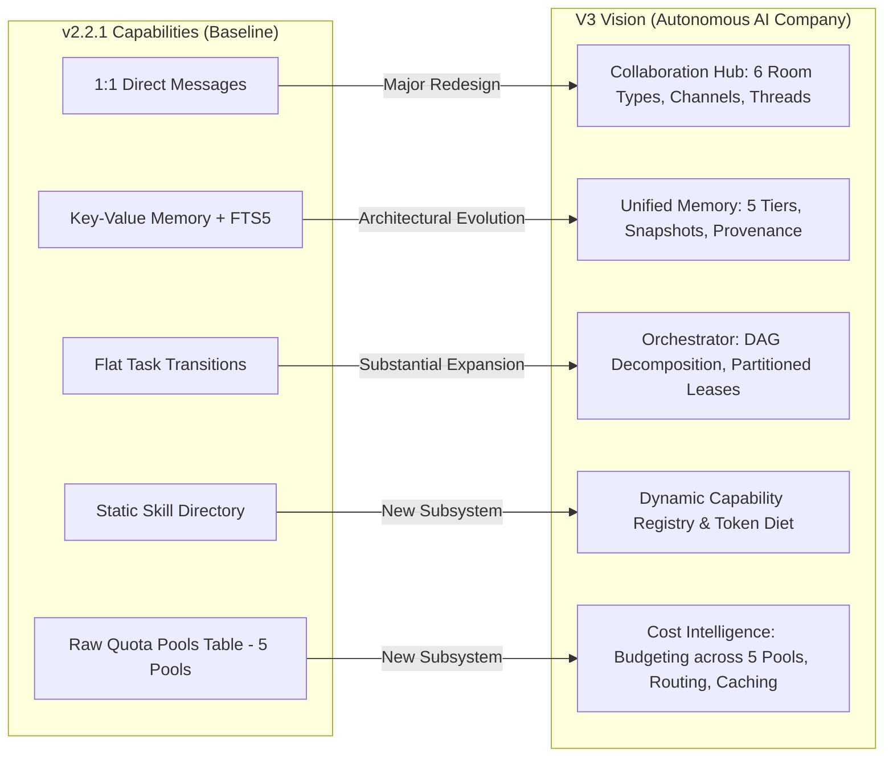

# AICO V3 — CURRENT STATE, BASELINE AUDIT & GAP ANALYSIS

**Document ID:** `BP-V3-01`  
**Version:** `3.2.0-reconciled`  
**Date:** 2026-11-07  
**Author:** `flash-02` — Engineering & QA Lead  
**Design Phase:** Architecture & Contracts Design Only  
**Baseline Git Reference:** Branch `feat/v2.2.1-implementation`, Actual HEAD: `6f33ba5ea5515187db0445dad443f3d06d4aa3a4`  
**Target Workspace:** `D:\AI-COMPANY`

---

## 1. EXECUTIVE SUMMARY

To establish a solid, honest baseline for AICO V3, this document provides an exhaustive, source-verified audit of the repository as of commit `6f33ba5ea5515187db0445dad443f3d06d4aa3a4`. Rather than accepting self-reported claims at face value, every subsystem has been categorized using strict factual classifications:
- `VERIFIED_IN_SOURCE`: Directly inspected in TypeScript/SQL source code.
- `TESTED_IN_SOURCE_TEST`: Formally asserted in an existing automated test file.
- `RUNTIME_EVIDENCE_REPORTED`: Documented in test run logs executed in this environment.
- `NOT_INDEPENDENTLY_REPRODUCED`: Code exists and passes locally, but has not been confirmed on an independent third-party clean machine.
- `NOT_VERIFIED`: Documented or conceptual requirement lacking implementation or test evidence.

The audit confirms that while the repository has achieved a functional modular baseline (10 services, 38 MCP tools, 15 passing test suites), **significant technical debt and carry-over risks remain OPEN** in state machine ABAC, approval expiration, audit anchor truncation defense, and Git history inspection. These items form the **v2.2.1 Baseline Carry-Over Risk Register** and must be resolved before V3 is deployed.

Furthermore, this reconciliation directly addresses the architectural boundary: Gate `V3-G0` establishes the baseline freeze and risk register acceptance, while Phase 7 and Gate `V3-G7` authorize sandbox implementation completion ONLY. Production database Gate G4 remains strictly FROZEN at v0.3.0 and CLOSED until a separate human Founder directive.

---

## 2. SUBSYSTEM IMPLEMENTATION & VERIFICATION INVENTORY

| Subsystem Component | Actual File Location | Verification Status | Source & Test Reality | Target Requirement |
| :--- | :--- | :---: | :--- | :---: |
| **S01: Registry & Manifest** | `src/services/company-registry-service.ts` | `VERIFIED_IN_SOURCE` `TESTED_IN_SOURCE_TEST` | Manifest parsed from disk; 6 agent identities (`chatgpt-01`, `flash-01`, `flash-02`, `codex-01`, `argon-01`, `argon-02`) and 5 quota pools (`google-pro-01`, `google-pro-02`, `gemini-web-01`, `gemini-web-02`, `openai-go-shared`) loaded; validated in `baseline.test.ts`. | `REQ-V3-006` |
| **S02: Identity & Access** | `src/services/identity-access-service.ts` | `VERIFIED_IN_SOURCE` `TESTED_IN_SOURCE_TEST` | Token issue/revoke working; timing-safe verification implemented; live DB checks on every request. Canonical Founder identity is `founder-01` (Human Principal). | `REQ-V3-029` |
| **S03: Approval Lifecycle** | `src/services/approval-service.ts` | `VERIFIED_IN_SOURCE` `TESTED_IN_SOURCE_TEST` | Creation, decision, and consumption working. Payload hash binding for Argon. Carry-over risks OPEN: `expires_at` not enforced; Founder modeled as agent instead of human principal. | `REQ-V3-030` |
| **S04: Workspace Artifacts** | `src/services/workspace-artifact-service.ts` | `VERIFIED_IN_SOURCE` `TESTED_IN_SOURCE_TEST` | Path traversal blocked; symlink escape checks implemented; dotfiles filtered in `listFiles`. Carry-over: Windows `Hidden` file attribute. | `REQ-V3-001` |
| **S05: Git Mediation** | `src/services/git-mediation-service.ts` | `VERIFIED_IN_SOURCE` `TESTED_IN_SOURCE_TEST` | Tree scanning (`git ls-tree`) implemented; recent 50 commits diff scanned. Carry-over: deep history (>50 commits) not scanned. | `REQ-V3-001` |
| **S06: Tasks & States** | `src/services/project-task-service.ts` | `VERIFIED_IN_SOURCE` `TESTED_IN_SOURCE_TEST` | 26 state transitions implemented; Argon retries blocked; leases tracked. Carry-over risks OPEN: TR-04/TR-18 non-Argon critical approvals, TR-25 designee check, blanket lease recovery. | `REQ-V3-021` |
| **S07: Messaging** | `src/services/messaging-service.ts` | `VERIFIED_IN_SOURCE` `TESTED_IN_SOURCE_TEST` | 1:1 message delivery, inbox listing, and message acknowledgements working. Gap: No group chat rooms, no threads, no mentions. | `REQ-V3-011` |
| **S08: Orchestration** | `src/services/orchestration-service.ts` | `VERIFIED_IN_SOURCE` `TESTED_IN_SOURCE_TEST` | Milestone recording for external dispatches. ABAC restricted to Founder, CEO, CTO, or task assignee. | `REQ-V3-022` |
| **S09: Knowledge & Memory** | `src/services/knowledge-memory-service.ts` | `VERIFIED_IN_SOURCE` `TESTED_IN_SOURCE_TEST` | SQLite FTS5 search implemented; memory key-value read/write working. Gap: No scoped memory partitions, no context snapshots, no provenance. | `REQ-V3-016` |
| **S10: Observability & Audit** | `src/services/observability-quota-service.ts` | `VERIFIED_IN_SOURCE` `TESTED_IN_SOURCE_TEST` | HMAC-SHA256 audit chaining and JSONL anchoring implemented. Carry-over risk OPEN: table truncation recovery, `AICO_ALLOW_TEST_HMAC`. | `REQ-V3-032` |
| **38 MCP Tool Contracts** | `src/registry-core.ts` | `VERIFIED_IN_SOURCE` `TESTED_IN_SOURCE_TEST` | All 38 tools registered; 1-to-1 match with `TOOL_REQUIRED_SCOPES`; fail-closed check prevents unmapped tools from executing. | `REQ-V3-003` |
| **HTTP Security Pipeline** | `src/security/http-security-pipeline.ts` | `VERIFIED_IN_SOURCE` `TESTED_IN_SOURCE_TEST` | 10-step middleware on `:3334` & `:3335`; Content-Length & chunked 413 limit verified; Bearer auth timing-safe; secret scanning verified. | `REQ-V3-004` |
| **STDIO Stream Guard** | `src/security/stdio-security-pipeline.ts` | `VERIFIED_IN_SOURCE` `TESTED_IN_SOURCE_TEST` | Raw reader guard enforces 2 MiB line frame cap; stream destroyed on violation; live credential re-validation verified. | `REQ-V3-005` |
| **Windows DPAPI Manager** | `src/security/dpapi-manager.ts` | `VERIFIED_IN_SOURCE` `TESTED_IN_SOURCE_TEST` | `CryptProtectData` produces true binary ciphertext; zero plaintext fallback on Windows; verified in `t10`. | `REQ-V3-030` |
| **NTFS ACL Toolkit** | `deploy/apply-windows-acl.ps1` | `VERIFIED_IN_SOURCE` `NOT_INDEPENDENTLY_REPRODUCED` | Script updated with recursive `/t`, `aico_svc` access, and `/remove:g`. Tested only in Dry-Run mode (`-Apply` not authorized). | `REQ-V3-001` |

---

## 3. V2.2.1 BASELINE CARRY-OVER RISK REGISTER & TRACEABILITY

The following risks were originally confirmed in the v2.2.1 baseline (`6f33ba5ea5515187db0445dad443f3d06d4aa3a4`). **All six risks have now been remediated and verified in the source code on branch `fix/v221-v3-readiness`**, with automated regression test coverage in `company-mcp/test/t16-security-stabilization.test.ts`.

### P0 — Task Authorization & Approval Gaps

#### `RISK-V221-001` (Severity: Critical / P0) → `REQ-V3-030`
- **Status:** **REMEDIATED / VERIFIED IN SOURCE** (Worktree `fix/v221-v3-readiness`).
- **Title:** Critical Task Approval Verification Gap on Non-Argon Tasks (TR-04 & TR-18).
- **Component:** `company-mcp/src/services/project-task-service.ts` (`verifyAndConsumeTaskApproval`, TR-04, TR-11, TR-16, TR-18).
- **Remediation Details:** Removed Argon-only gating; unified under `verifyAndConsumeTaskApproval()` which asserts that ANY task with `risk_class === "critical"` or `priority === "P0"` requires a valid, unconsumed human Founder approval (`founder-01`). If `approvalService` is missing, unapproved, or belongs to non-Founder, the transition fails closed.
- **Verification Evidence:** `company-mcp/test/t16-security-stabilization.test.ts` (Test 5: asserts transition without approval throws `CRITICAL_TASK_APPROVAL_REQUIRED`, and transition with valid approval succeeds).

#### `RISK-V221-002` (Severity: High / P0) → `REQ-V3-025`
- **Status:** **REMEDIATED / VERIFIED IN SOURCE** (Worktree `fix/v221-v3-readiness`).
- **Title:** Designated Reviewer Verification Gap in TR-25 (`review_required -> completed`).
- **Component:** `company-mcp/src/services/project-task-service.ts` (TR-25, TR-23).
- **Remediation Details:** In addition to anti-self-approval (`task.assigned_agent_id !== actorId`), TR-25 and TR-23 now strictly enforce designated reviewer authorization: `actorId` must equal `task.reviewer_agent_id` or belong to executive leadership (`founder-01`, `chatgpt-01`, `flash-01`). Unauthorized agents receive `REVIEWER_NOT_AUTHORIZED`.
- **Verification Evidence:** `company-mcp/test/t16-security-stabilization.test.ts` (Test 6: asserts that an arbitrary third agent with review role but not assigned as reviewer cannot approve review).

---

### P1 — Approval Lifecycle & Expiration

#### `RISK-V221-003` (Severity: High / P1) → `REQ-V3-030`
- **Status:** **REMEDIATED / VERIFIED IN SOURCE** (Worktree `fix/v221-v3-readiness`).
- **Title:** Missing Expiration (`expires_at`) Validation in `decideApproval` and `consumeApproval`.
- **Component:** `company-mcp/src/services/approval-service.ts` (`decideApproval`, `consumeApproval`).
- **Remediation Details:** Both `decideApproval()` and `consumeApproval()` now evaluate `expires_at` against current time (`Date.now()`). Any request past its expiration timestamp is rejected with `APPROVAL_EXPIRED` (HTTP 410). Also implemented RFC 8785 JSON Canonicalization Scheme (`src/security/rfc8785-canonicalize.ts`) and mandatory canonical payload verification to prevent replay/tampering.
- **Verification Evidence:** `company-mcp/test/t16-security-stabilization.test.ts` (Tests 1, 2, 3: covers RFC 8785 canonicalization test vectors, mandatory payload assertion, and expiration rejection for decide and consume).

---

### P1 — State Machine & Partitioned Lease Recovery

#### `RISK-V221-004` (Severity: Medium / P1) → `REQ-V3-023`, `REQ-V3-024`, `REQ-V3-031`
- **Status:** **REMEDIATED / VERIFIED IN SOURCE** (Worktree `fix/v221-v3-readiness`).
- **Title:** Lease Expiry Recovery Not Verified with Controlled Wall-Clock Time & Blanket Recovery Threat.
- **Component:** `company-mcp/src/services/project-task-service.ts` (`recoverStaleLeases`).
- **Remediation Details:** Redesigned lease sweeper with partitioned recovery and CAS concurrency control:
  1. Compares `lease_expires_at` against explicit wall-clock timestamp parameter `nowMs`.
  2. For Argon tasks (`isArgonTask(task)`), unconditionally isolates the task to `blocked` status with error code `BLOCKED_MANUAL_INTERVENTION`, requiring manual Founder action (zero auto-retry, zero auto-dispatch).
  3. For non-Argon tasks, validates `retry_count < max_retries`. If exhausted, transitions to `blocked` (`MAX_RETRIES_EXCEEDED`); otherwise increments `retry_count` and resets to `ready_for_dev`.
  4. All updates require matching `lock_version`, `status`, and `lease_owner_agent_id`.
- **Verification Evidence:** `company-mcp/test/t16-security-stabilization.test.ts` (Test 7: verifies partitioned recovery, Argon isolation to `BLOCKED_MANUAL_INTERVENTION`, and non-Argon retry increment).

---

### P1 — Audit Integrity & Anchor Truncation Defense

#### `RISK-V221-005` (Severity: High / P1) → `REQ-V3-032`
- **Status:** **REMEDIATED / VERIFIED IN SOURCE** (Worktree `fix/v221-v3-readiness`).
- **Title:** Audit Chain Validation Vulnerability if Table Truncated While External Anchors Exist.
- **Component:** `company-mcp/src/services/observability-quota-service.ts` (`verifyAuditChainIntegrity`, `signAuditEvent`).
- **Remediation Details:**
  1. In `verifyAuditChainIntegrity()`, if `rows.length === 0` while the external JSONL anchor file exists on disk and contains anchor records, verification fails closed with `valid: false` and error `AUDIT_LOG_MISSING_OR_TRUNCATED`.
  2. Expanded HMAC signature calculation to cover all 13 canonical audit event fields (`prevHash`, `eventId`, `requestId`, `sourceGateway`, `principalType`, `principalId`, `credentialId`, `eventCategory`, `actionName`, `targetResource`, `outcome`, `errorCode`, `detailsJson`, `nowIso`), preventing metadata tampering.
- **Verification Evidence:** `company-mcp/test/t16-security-stabilization.test.ts` (Tests 8 and 9: verifies all-fields HMAC signing coverage and anchor truncation fail-closed defense).

---

### P1 — Git Mediation Full History Scanning

#### `RISK-V221-006` (Severity: Medium / P1) → `REQ-V3-001`
- **Status:** **REMEDIATED / VERIFIED IN SOURCE** (Worktree `fix/v221-v3-readiness`).
- **Title:** Git History Scanning Bounded to Recent 50 Commits (`git log -p -n 50`).
- **Component:** `company-mcp/src/services/git-mediation-service.ts` (`scanCommitFiles`).
- **Remediation Details:**
  1. Replaced bounded `-n 50` commit cap with full divergence scan: `git log -p -m --full-history mergeBase..commitSha`, inspecting every commit in branch divergence regardless of depth.
  2. Added working-tree inspection via `git status --porcelain -uall` to detect untracked and staged forbidden patterns prior to commit.
- **Verification Evidence:** `company-mcp/test/t16-security-stabilization.test.ts` (Test 10: creates a branch with 55 commits where a forbidden secret pattern was introduced and deleted in an early commit; verifies detection).

---

## 4. GAP ANALYSIS: V2.2.1 BASELINE VS V3 VISION

### 4.1 Collaboration & Communication Gaps
- **Current State:** The v2.2.1 messaging tool (M35) only delivers point-to-point text messages between two agents. There is no concept of a room, project channel, or public discussion.
- **V3 Requirement (`REQ-V3-011` to `015`):** Multi-agent collaboration requires dedicated chat rooms (Executive Boardroom, Announcements, Department Office, Project Rooms, Task Channels, Direct Messages) with membership roles, message threads, mentions, and delivery tracking.

### 4.2 Context & Memory Gaps
- **Current State:** Key-value pairs in `agent_memory` and unstructured markdown files in `knowledge_documents`. No scoping, no provenance, and no automatic context compilation.
- **V3 Requirement (`REQ-V3-016` to `020`):** Multi-tier context snapshots compiled just-in-time from verified sources, with strict ABAC boundaries preventing cross-tenant or unauthorized data leaks.

### 4.3 Task Workflow & Orchestration Gaps
- **Current State:** Tasks are single, flat records assigned to one agent. No native subtask support, no DAG dependency tracking, no dynamic reviewer assignment.
- **V3 Requirement (`REQ-V3-021` to `025`):** Hierarchical task decomposition where the CEO (`chatgpt-01`) decomposes strategic directives into subtasks, assigns them based on agent capabilities, coordinates parallel execution, and synthesizes deliverables.

### 4.4 Capability & Tooling Gaps
- **Current State:** All 12 skills reside in `.agents/skills/`. Agents receive large, static instruction prompts regardless of the specific task, wasting context tokens.
- **V3 Requirement (`REQ-V3-026`):** Dynamic Capability Registry that matches tasks to capability tags and dynamically injects only the required skills and tools for the current execution turn.

### 4.5 Cost & Token Intelligence Gaps
- **Current State:** Static `quota_pools` table displaying provider limits for 5 quota pools (`google-pro-01`, `google-pro-02`, `gemini-web-01`, `gemini-web-02`, `openai-go-shared`). No telemetry on tokens spent per task, cost per project, or model routing logic.
- **V3 Requirement (`REQ-V3-027` to `028`):** Real-time token accounting, prompt caching prefix alignment, context compression, and complexity-based model routing.

---

## 5. REUSABILITY VS REDESIGN MATRIX

| Component | V3 Strategy | Rationale & Migration Approach | Target Requirements |
| :--- | :---: | :--- | :---: |
| **`ConnectionManager`** | **REUSE** | Solid transaction management and connection lifecycle; directly reusable for SQLite V3. | `REQ-V3-008` |
| **`IdentityAccessService`** | **REUSE & EXTEND** | Timing-safe verification and credential management are robust; extend with human principal distinction (`founder-01`). | `REQ-V3-029` |
| **`ApprovalService`** | **REDESIGN (V3)** | Redesign approval lifecycle for verifiable human Founder authorization with RFC 8785 (JCS) payload hash and Ed25519 signature verification. | `REQ-V3-030` |
| **`WorkspaceArtifactService`** | **REUSE & EXTEND** | Path traversal, symlink guards, and atomic writes are proven; extend with Windows Hidden attribute checks. | `REQ-V3-001` |
| **`GitMediationService`** | **REUSE & EXTEND** | Branch naming and tree scanning are solid; upgrade diff scanning from `-n 50` to `mergeBase..HEAD`. | `REQ-V3-001` |
| **`ProjectTaskService`** | **REDESIGN (V3)** | Flat state machine cannot support DAG subtasks or dynamic reviewer assignment; redesign as Hexagonal Workflow Engine. | `REQ-V3-021` to `025` |
| **`MessagingService`** | **REDESIGN (V3)** | 1:1 message model is obsolete; replace with Collaboration Hub (6 room types, threads, mentions). | `REQ-V3-011` to `015` |
| **`KnowledgeMemoryService`** | **REDESIGN (V3)** | Replace unstructured memory with Scoped Memory Engine (5 tiers, context snapshots, FTS5 sync triggers). | `REQ-V3-016` to `020` |
| **`ObservabilityQuotaService`**| **REUSE & EXTEND** | HMAC-SHA256 audit chaining is solid; add table-truncation defense and real-time token cost tracking across 5 quota pools. | `REQ-V3-027`, `032` |
| **`HttpSecurityPipeline`** | **REUSE** | 10-step middleware (:3334/:3335) passed all E2E black-box tests; keep intact. | `REQ-V3-003`, `004` |
| **`StdioSecurityPipeline`** | **REUSE** | 2 MiB stream guard and live credential checks passed all tests; keep intact. | `REQ-V3-005` |
| **`DpapiManager`** | **REUSE** | Genuine Windows DPAPI with binary ciphertext verification is complete; keep intact. | `REQ-V3-030` |
