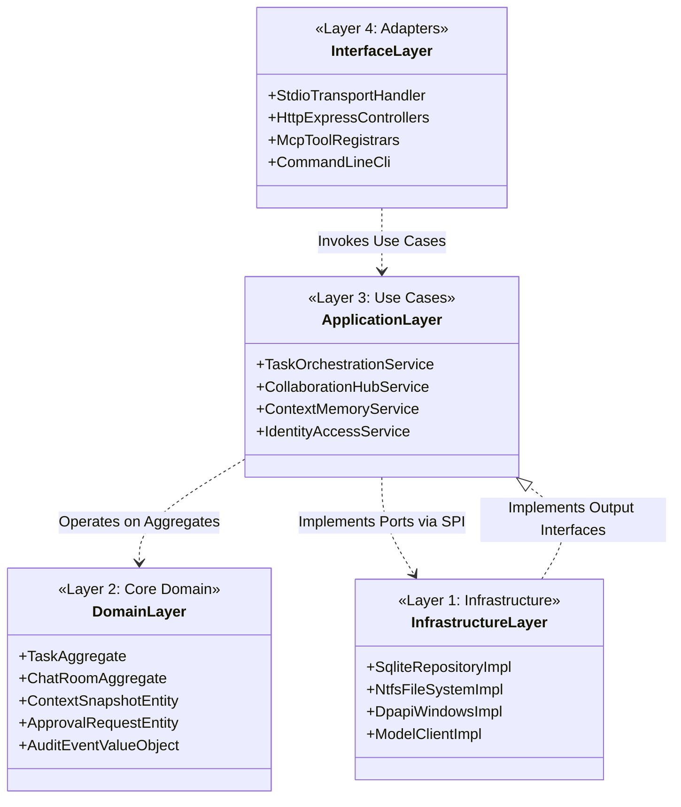
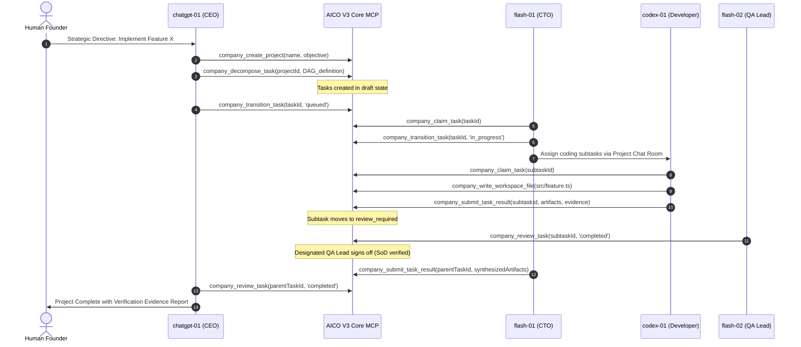
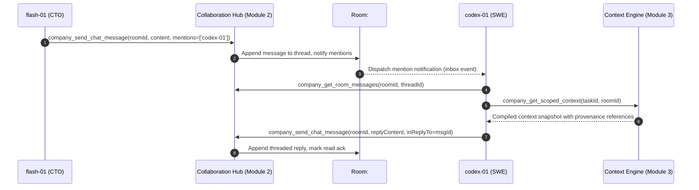
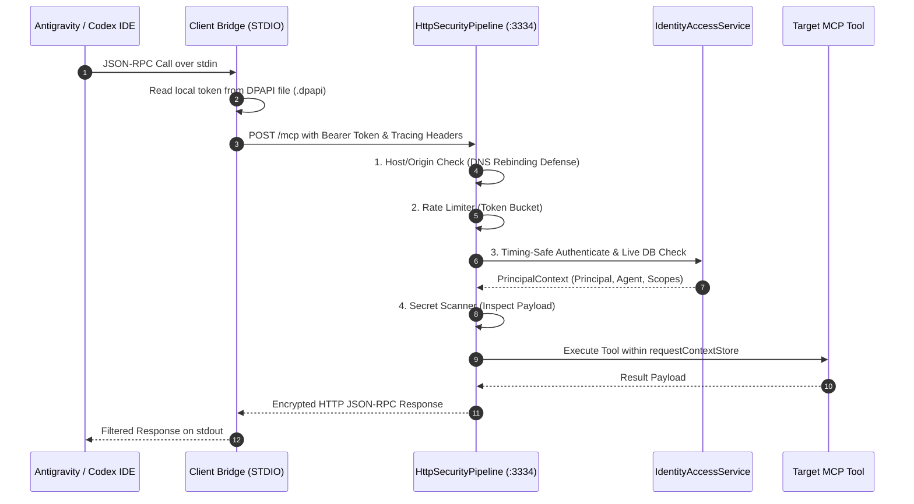

# AICO V3 TARGET ARCHITECTURE — MODULAR MONOLITH & PORTS-AND-ADAPTERS

**Document ID:** `BP-V3-02`  
**Version:** `3.0.0-draft`  
**Date:** 2026-11-07  
**Author:** `flash-02` — Engineering & QA Lead  
**Design Phase:** Architecture & Contracts Design Only  
**Baseline Git Reference:** Branch `feat/v2.2.1-implementation`, Commit `cd749107c4b34e26f61e14a238336e414f78779d`  
**Target Workspace:** `D:\AI-COMPANY`

---

## 1. ARCHITECTURAL VISION & CORE PARADIGM

AICO V3 adopts a **Modular Monolith with Hexagonal Architecture (Ports and Adapters)** as its core architectural paradigm. This design strikes the optimal balance between high engineering velocity, zero network latency between domain modules, strict boundary enforcement, and clear future extraction paths.

```mermaid
graph TD
    subgraph DrivingAdapters["Driving Adapters (Primary / Inbound)"]
        StdioEntry["STDIO Protocol Adapter\n(Local Agent CLI)"]
        HttpEntry["HTTP Local Gateway :3334\n(REST / SSE Adapter)"]
        PublicHttp["HTTP Public Gateway :3335\n(Allowlisted Proxy Adapter)"]
        CronTrigger["Internal Timer / Scheduler"]
    end

    subgraph PortsIn["Inbound Ports (Application API)"]
        ICollabPort["ICollaborationPort"]
        ITaskPort["ITaskOrchestrationPort"]
        IContextPort["IContextMemoryPort"]
        ICapabilityPort["ICapabilityPort"]
        IGovernancePort["IGovernancePort"]
    end

    subgraph CoreDomain["Application Core (Pure Domain & Use Cases)"]
        CollabCore["Collaboration Hub Domain"]
        WorkflowCore["DAG Workflow Engine"]
        ContextCore["Unified Context Engine"]
        SecurityCore["Zero-Trust ABAC & Governance"]
        CostCore["Token & Cost Intelligence"]
    end

    subgraph PortsOut["Outbound Ports (Secondary / SPI)"]
        IRepoPort["IRepositoryPort"]
        IFsPort["IWorkspaceFsPort"]
        IEventPort["IEventPublisherPort"]
        IModelPort["IModelProviderPort"]
        IAuditPort["IAuditAnchorPort"]
    end

    subgraph DrivenAdapters["Driven Adapters (Secondary / Outbound)"]
        SqliteAdapter["SQLite Connection Adapter\n(WAL Mode + Transactions)"]
        NtfsAdapter["Windows NTFS Workspace Adapter\n(Option A SIDs & Paths)"]
        EventOutbox["In-Memory / Outbox Event Bus"]
        ModelRouter["AI Model Gateway Adapter\n(OpenAI / Gemini / Anthropic)"]
        AnchorFs["JSONL External Anchor File Writer"]
    end

    DrivingAdapters --> PortsIn
    PortsIn --> CoreDomain
    CoreDomain --> PortsOut
    PortsOut --> DrivenAdapters
```



### Architectural Tenets:
1. **Dependency Inversion:** Dependencies flow strictly inward. The Core Domain (`src/core/`) imports no external libraries, no database drivers, and no protocol handlers.
2. **Modular Cohesion:** Each business domain (Collaboration, Workflow, Context, Governance) is encapsulated with a private repository interface, public DTO contracts, and explicit domain events.
3. **Local-First Single Process:** The entire control plane runs inside a single, highly optimized Node.js process. Modules communicate via synchronous in-memory TypeScript function calls or asynchronous domain event handlers.
4. **Zero-Trust ABAC at Service Boundary:** Authentication happens at the adapter level; fine-grained ABAC and Separation of Duties are enforced strictly inside the Core Domain interactors.

---

## 2. LOGICAL & PHYSICAL BOUNDARIES

### 2.1 Logical Layers



### 2.2 Physical Runtime Boundaries
- **Runtime Host:** Windows 11 Enterprise (Developer Workstation), Localhost.
- **Process Model:**
  - `aico-mcp-core`: Single long-running background service managed via WinSW (`aicosvc.exe`), listening on `127.0.0.1:3334` (HTTP) and stdio (when spawned by local CLI tools).
  - `aico-worker-pool`: Ephemeral worker child processes spawned with dedicated Windows accounts (`aico_flash1`, `aico_flash2`, `aico_codex`) under NTFS Option A isolation.
- **Persistence Boundary:**
  - Shared SQLite database located at `D:\AI-COMPANY\data\aico.db` (frozen at v0.3.0 until G4/V3-G7; sandbox DBs used for all intermediate development).
  - External JSONL audit anchor file at `D:\AI-COMPANY\backup\audit_anchors.jsonl`.
  - Workspace directory tree at `D:\AI-COMPANY\workspaces\<agent_id>\` or `D:\AICO-WORKSPACES\<agent_id>\`.

---

## 3. CORE INTERACTION FLOWS & MERMAID DIAGRAMS

### 3.1 Overall Task Lifecycle Flow (intake to synthesis)



### 3.2 Agent-to-Agent Collaboration & Chat Room Flow



### 3.3 Runtime Adapter Flow (Antigravity & Codex)



### 3.4 Failure & Self-Healing Boundary Flow

```mermaid
sequenceDiagram
    autonumber
    participant Worker as codex-01 (Worker Process)
    participant MCP as AICO Core Manager
    participant DB as SQLite Storage
    participant CTO as flash-01 (CTO)

    Worker->>MCP: company_heartbeat_task(taskId)
    Note over Worker,MCP: Worker crashes / disconnects unexpectedly
    loop Every 60 seconds (Lease Monitor)
        MCP->>DB: Scan tasks WHERE lease_expires_at < NOW() AND status IN ('claimed', 'in_progress')
        DB-->>MCP: Found expired lease on taskId (Worker offline)
        alt Non-Argon Task
            MCP->>DB: TR-12: Transition task to 'assigned' (Clear lease owner)
            MCP->>MCP: Record Audit Event: LEASE_EXPIRED_RECOVERED
            CTO->>MCP: company_list_tasks(status='assigned')
            CTO->>MCP: Reassign to healthy agent (TR-08 / TR-06)
        else Argon Task
            MCP->>DB: TR-15: Transition task to 'blocked' (Clear lease owner)
            MCP->>MCP: Record Audit Event: ARGON_LEASE_EXPIRED_BLOCKED
            Note over MCP: Zero auto-retry; requires Founder intervention
        end
    end
```

---

## 4. ARCHITECTURAL DECISIONS & COMPARATIVE EVALUATIONS

The following 10 architectural choices were rigorously evaluated to establish the V3 design baseline:

### 1. Modular Monolith vs. Microservices
- **Comparison:** Microservices introduce network boundaries, serialization latency, distributed transaction complexity (2PC/Sagas), and high operational overhead. A Modular Monolith provides strict TypeScript compile-time boundaries, zero-overhead in-memory calls, and ACID database transactions across aggregates.
- **Verdict:** **Modular Monolith**. Bounded contexts are separated by TypeScript module boundaries and interfaces; network distribution is deferred until physical resource limits require it.

### 2. SQLite vs. PostgreSQL
- **Comparison:** PostgreSQL provides advanced concurrency and connection pooling, but introduces external daemon dependencies, network round-trips, and infrastructure burdens. SQLite (WAL mode, `busy_timeout = 5000ms`, `ConnectionManager`) supports single-writer/multi-reader at up to 50,000 queries/second locally with zero configuration.
- **Verdict:** **SQLite (Retained for V3)**. Use PostgreSQL only if AICO transitions from a local workstation tool to a multi-node distributed cloud service.

### 3. Synchronous Requests vs. Event-Driven Workflow
- **Comparison:** Pure synchronous processing blocks clients during long-running agent tasks. Pure event-driven systems (Kafka/RabbitMQ) add heavy infrastructure.
- **Verdict:** **Hybrid Outbox Event Architecture**. Client interactions (MCP tool calls) are synchronous with immediate response; long-running workflows emit persistent Domain Events into an internal SQLite `domain_events` outbox table processed by background worker loops.

### 4. Single Shared Room vs. Project/Task-Scoped Rooms
- **Comparison:** A single shared chat channel results in catastrophic token noise, context bleeding, and security cross-talk between engineering tasks.
- **Verdict:** **Multi-Tier Chat Rooms**. Default rooms include Executive Boardroom, Department Rooms, and dynamic Project/Task Rooms that archive upon task completion.

### 5. Single Global Context vs. Scoped Context Partitions
- **Comparison:** Feeding all agent conversations and memories into every prompt blows past context limits and leaks confidential information.
- **Verdict:** **Scoped Context Partitions**. Agents receive an assembled context snapshot composed strictly of authorized slices (Company Mission + Project Goals + Task Acceptance Criteria + Thread History).

### 6. Push-Based vs. Pull-Based Runtime Dispatch
- **Comparison:** Push-based dispatch requires maintaining live WebSocket/SSH connections to potentially sleepy or offline worker agents. Pull-based dispatch lets agents query their assigned inbox when active.
- **Verdict:** **Pull-Based Dispatch with Push Notifications**. Agents poll `/mcp` or inbox, augmented by local OS notifications (Named Pipes / STDIO signals) when immediate wakeup is feasible.

### 7. Central CEO Orchestrator vs. Decentralized P2P Choreography
- **Comparison:** Decentralized choreography leads to agent deadlocks, duplicate execution, and uncoordinated drift. Pure centralization overburdens the CEO.
- **Verdict:** **Hierarchical Delegation**. CEO (`chatgpt-01`) decomposes strategic directives to department leads (CTO `flash-01`); leads manage technical execution and delegate implementation subtasks to `codex-01`.

### 8. Static Skills Directory vs. Dynamic Capability Registry
- **Comparison:** Loading all 12 skills statically bloats prompt overhead by 3,000–8,000 tokens per turn.
- **Verdict:** **Dynamic Capability Registry**. The Capability Engine inspects task metadata and selectively mounts only the 1–3 skills required for the specific turn.

### 9. Direct Runtime Execution vs. Adapter-Mediated Execution
- **Comparison:** Calling OS tools or code execution engines directly tightly couples business logic to the host machine.
- **Verdict:** **Adapter-Mediated Execution (`IRuntimeAdapter`)**. Antigravity, Codex CLI, and local daemons interface via standardized ports, allowing easy testing with in-memory mocks.

### 10. Full Conversation History vs. Versioned Context Snapshots
- **Comparison:** Appending full chat history indefinitely leads to context degradation and high inference costs.
- **Verdict:** **Versioned Context Snapshots with Rolling Summaries**. Long threads are periodically summarized into immutable context snapshots with source references, maintaining a bounded recent history window (last 10 turns).
