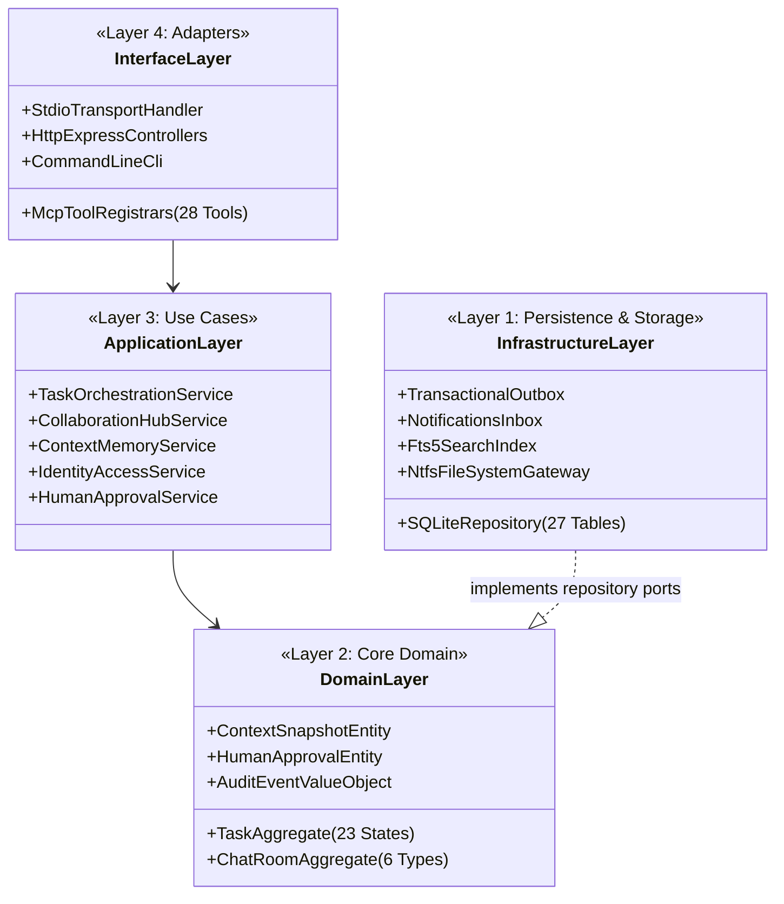
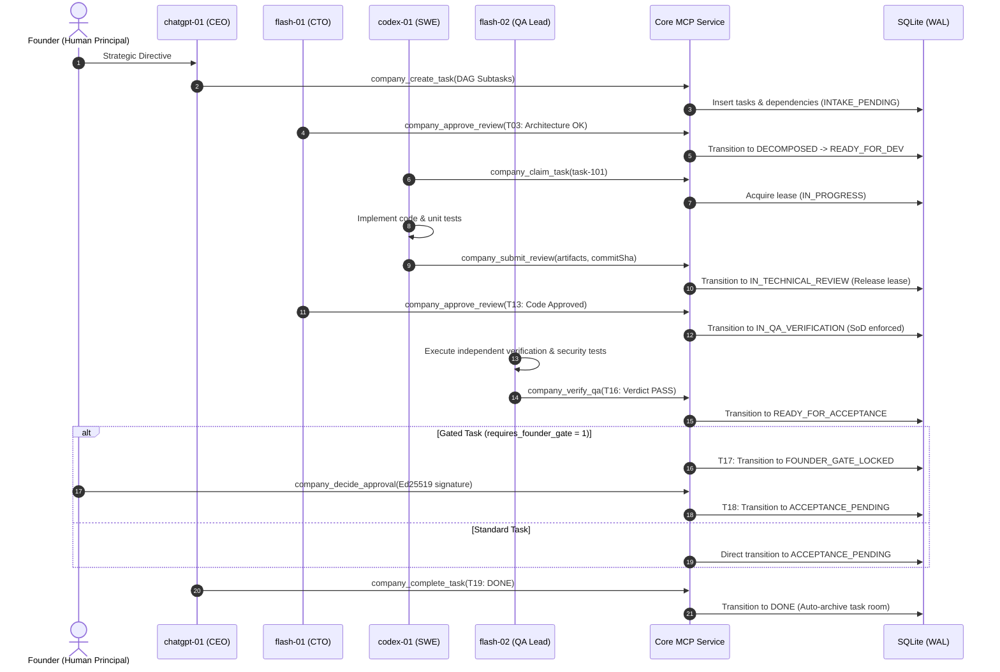

# AICO V3 TARGET ARCHITECTURE — MODULAR MONOLITH & PORTS-AND-ADAPTERS

**Document ID:** `BP-V3-02`  
**Version:** `3.1.0-reconciled`  
**Date:** 2026-11-07  
**Author:** `flash-02` — Engineering & QA Lead  
**Design Phase:** Architecture & Contracts Design Only  
**Baseline Git Reference:** Branch `feat/v2.2.1-implementation`, Commit `cd749107c4b34e26f61e14a238336e414f78779d`  
**Actual HEAD:** `21f3aad16911eb076e2245a791bde51178a0d222`  
**Target Workspace:** `D:\AI-COMPANY`

---

## 1. ARCHITECTURAL VISION & CORE PARADIGM

AICO V3 adopts a **Modular Monolith with Hexagonal Architecture (Ports and Adapters)** as its core architectural paradigm. This design strikes the optimal balance between high engineering velocity, zero network latency between domain modules, strict boundary enforcement, and clear future extraction paths (`REQ-V3-001`).

```mermaid
graph TD
    subgraph DrivingAdapters["Driving Adapters (Primary / Inbound)"]
        StdioEntry["STDIO Protocol Adapter\n(Local Agent CLI - 2 MiB Guard)"]
        HttpEntry["HTTP Local Gateway :3334\n(Loopback REST / MCP Adapter)"]
        CronTrigger["Internal Timer / Scheduler\n(Lease & Compaction Sweeper)"]
    end

    subgraph PortsIn["Inbound Ports (Application API)"]
        ICollabPort["ICollaborationPort"]
        ITaskPort["ITaskOrchestrationPort"]
        IContextPort["IContextMemoryPort"]
        ICapabilityPort["ICapabilityPort"]
        IGovernancePort["IGovernancePort (Human Verifiable)"]
    end

    subgraph CoreDomain["Application Core (Pure Domain & Use Cases)"]
        CollabCore["Collaboration Hub Domain (6 Room Types)"]
        WorkflowCore["DAG Workflow Engine (23 States)"]
        ContextCore["Unified Context Engine (5 Tiers)"]
        SecurityCore["Zero-Trust ABAC & Human Governance"]
        CostCore["Token & Cost Intelligence"]
    end

    subgraph PortsOut["Outbound Ports (Secondary / SPI)"]
        IRepoPort["IRepositoryPort"]
        IFsPort["IWorkspaceFsPort"]
        IEventPort["IEventPublisherPort"]
        IModelPort["IModelProviderPort"]
        IAuditPort["IAuditAnchorPort"]
    end

    subgraph DrivenAdapters["Driven Adapters (Secondary / Outbound)"]
        SqliteAdapter["SQLite Connection Adapter\n(WAL Mode, 27 Tables, Triggers)"]
        NtfsAdapter["Windows NTFS Workspace Adapter\n(Option A SIDs & Path Guard)"]
        EventOutbox["Transactional Event Outbox\n(event_outbox Table)"]
        NotificationInbox["Notifications Inbox Adapter\n(notifications_inbox Table)"]
        ModelRouter["AI Model Gateway Adapter\n(OpenAI / Gemini / Anthropic)"]
        AnchorFs["JSONL External Anchor File Writer"]
    end

    DrivingAdapters --> PortsIn
    PortsIn --> CoreDomain
    CoreDomain --> PortsOut
    PortsOut --> DrivenAdapters
```



### Architectural Tenets:
1. **Dependency Inversion (`REQ-V3-001`):** Dependencies flow strictly inward. The Core Domain imports no external libraries, no database drivers, and no protocol handlers.
2. **Modular Cohesion:** Each business domain (Collaboration, Workflow, Context, Governance) is encapsulated with a private repository interface, public DTO contracts, and explicit domain events (`aico.event.v3`, `REQ-V3-002`).
3. **Local-First Single Process:** The entire control plane runs inside a single, highly optimized Node.js process. Modules communicate via synchronous in-memory TypeScript function calls or asynchronous domain event handlers.
4. **Zero-Trust ABAC with Human Final Authority (`REQ-V3-029`, `REQ-V3-030`):** Authentication happens at the adapter level; fine-grained ABAC, Separation of Duties (SoD), and verifiable human Founder cryptographic authorization are enforced strictly inside the Core Domain interactors.
5. **Sandbox Isolation & Gate G4 Decoupling (`REQ-V3-007`):** All V3 development, migrations, and quality gates (`V3-G0` through `V3-G7`) operate exclusively on isolated test sandboxes. Gate G4 for the production database remains frozen and closed.

---

## 2. LOGICAL & PHYSICAL BOUNDARIES

### 2.1 Logical Layers



---

## 3. CORE RUNTIME FLOWS & SEQUENCES

### 3.1 Task Lifecycle & Verification Flow (`REQ-V3-021`, `REQ-V3-025`)



### 3.2 Partitioned Failure & Lease Recovery Boundary Flow (`REQ-V3-024`, `REQ-V3-031`)

```mermaid
sequenceDiagram
    autonumber
    participant Worker as Worker Process (SWE or Argon)
    participant MCP as AICO Core Lease Sweeper
    participant DB as SQLite Storage
    participant Boardroom as #executive-boardroom

    Worker->>MCP: company_renew_lease(taskId, nonce)
    Note over Worker,MCP: Worker crashes / disconnects unexpectedly
    loop Every 30 seconds (Lease Monitor)
        MCP->>DB: Query task_leases WHERE expires_at < NOW()
        DB-->>MCP: Found expired lease on taskId
        alt Non-Argon Task (codex-01 / flash-01 / flash-02)
            alt Retry Count < Max
                MCP->>DB: T10A: Transition task to READY_FOR_DEV (Forfeit lease to queue)
                MCP->>DB: Insert audit event: LEASE_EXPIRED_RECOVERED
            else Retry Count >= Max
                MCP->>DB: Transition task to BLOCKED
                MCP->>Boardroom: Alert: Task exceeded retry attempts
            end
        else Argon Task (argon-01 / argon-02)
            MCP->>DB: T10B: Transition task to BLOCKED_MANUAL_INTERVENTION
            MCP->>DB: Delete lease record
            MCP->>DB: Insert audit event: ARGON_LEASE_EXPIRED_BLOCKED
            MCP->>Boardroom: Alert: Argon task expired; REQUIRES HUMAN FOUNDER INTERVENTION
            Note over MCP,Boardroom: ZERO AUTO-RETRY. Never return to READY_FOR_DEV.
        end
    end
```

---

## 4. ARCHITECTURAL DECISIONS & COMPARATIVE EVALUATIONS

The following 10 architectural choices were evaluated to establish the V3 design baseline:

### 1. Modular Monolith vs. Microservices
- **Comparison:** Microservices introduce network boundaries, serialization latency, distributed transaction complexity (2PC/Sagas), and high operational overhead. A Modular Monolith provides strict TypeScript compile-time boundaries, zero-overhead in-memory calls, and ACID database transactions across aggregates.
- **Verdict:** **Modular Monolith (`REQ-V3-001`)**. Bounded contexts are separated by TypeScript module boundaries and interfaces; network distribution is deferred until physical resource limits require it.

### 2. SQLite vs. PostgreSQL
- **Comparison:** PostgreSQL provides advanced concurrency and connection pooling, but introduces external daemon dependencies, network round-trips, and infrastructure burdens. SQLite (WAL mode, `busy_timeout = 5000ms`, `ConnectionManager`) supports single-writer/multi-reader at up to 50,000 queries/second locally with zero configuration.
- **Verdict:** **SQLite WAL Mode (`REQ-V3-008`)**. Retained for local single-node architecture. Production database Gate G4 remains strictly decoupled and frozen.

### 3. Synchronous Requests vs. Event-Driven Workflow
- **Comparison:** Pure synchronous processing blocks clients during long-running agent tasks. Pure event-driven systems (Kafka/RabbitMQ) add heavy infrastructure.
- **Verdict:** **Hybrid Outbox Event Architecture (`REQ-V3-009`)**. Client interactions (MCP tool calls) are synchronous with immediate response; domain events are persisted transactionally into `event_outbox` and dispatched to registered in-process handlers.

### 4. Single Shared Room vs. 6-Tier Chat Rooms
- **Comparison:** A single shared chat channel results in catastrophic token noise, context bleeding, and security cross-talk between engineering tasks.
- **Verdict:** **6 Structured Chat Room Types (`REQ-V3-011`)**. Executive Boardroom, Company Announcements, Department Offices, Project Rooms, Task Channels, and 1:1 Direct Messages.

### 5. Single Global Context vs. Scoped Context Partitions
- **Comparison:** Feeding all agent conversations and memories into every prompt blows past context limits and leaks confidential information.
- **Verdict:** **Scoped Context Partitions (`REQ-V3-016`, `REQ-V3-017`)**. Agents receive an assembled context snapshot composed strictly of authorized slices across Company, Project, Task, Room, and Agent-Private tiers.

### 6. Push-Based vs. Pull-Based Runtime Dispatch
- **Comparison:** Push-based dispatch requires maintaining live WebSocket/SSH connections to potentially sleepy or offline worker agents. Pull-based dispatch lets agents query their assigned inbox when active.
- **Verdict:** **Pull-Based Dispatch with Inbox Notifications (`REQ-V3-014`)**. Mentions and assignments are recorded in `notifications_inbox`, allowing agents to query unread notifications upon wakeup.

### 7. Central CEO Orchestrator vs. Decentralized P2P Choreography
- **Comparison:** Decentralized choreography leads to agent deadlocks, duplicate execution, and uncoordinated drift. Pure centralization overburdens the CEO.
- **Verdict:** **Hierarchical Delegation with Separation of Duties (`REQ-V3-021`, `REQ-V3-025`)**. CEO (`chatgpt-01`) decomposes strategic directives; CTO (`flash-01`) reviews architecture and technical code; QA Lead (`flash-02`) independently tests; Founder retains final sign-off.

### 8. Static Skills Directory vs. Dynamic Capability Registry
- **Comparison:** Loading all 12 skills statically bloats prompt overhead by 3,000–8,000 tokens per turn.
- **Verdict:** **Dynamic Capability Registry & Token Diet (`REQ-V3-026`)**. The Capability Engine inspects task metadata and selectively mounts only the 1–2 skills required for the specific turn.

### 9. Direct Runtime Execution vs. Adapter-Mediated Execution
- **Comparison:** Calling OS tools or code execution engines directly tightly couples business logic to the host machine.
- **Verdict:** **Adapter-Mediated Execution (`IRuntimeAdapter`)**. Antigravity, Codex CLI, and local daemons interface via standardized ports, allowing easy testing with in-memory mocks.

### 10. Full Conversation History vs. Versioned Context Snapshots
- **Comparison:** Appending full chat history indefinitely leads to context degradation and high inference costs.
- **Verdict:** **Versioned Context Snapshots with Rolling Summaries (`REQ-V3-018`)**. Long threads are periodically summarized into immutable context snapshots with source references (<1,500 tokens).
