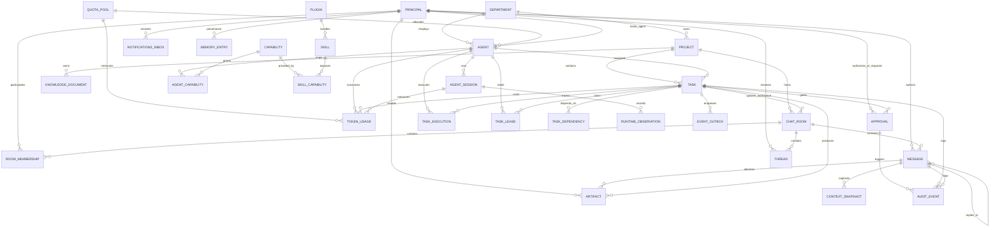
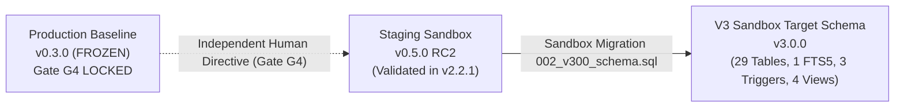

# AICO V3 MASTER BLUEPRINT — DOMAIN MODEL & DATABASE ARCHITECTURE

**Document ID:** `BP-V3-03`  
**Version:** `3.2.0-reconciled`  
**Date:** 2026-11-07  
**Author:** `flash-02` — Engineering & QA Lead  
**Design Phase:** Architecture & Contracts Design Only (No Implementation Authorized)  
**Baseline Git Reference:** Branch `feat/v2.2.1-implementation`, Actual HEAD: `6f33ba5ea5515187db0445dad443f3d06d4aa3a4`  
**Target Workspace:** `D:\AI-COMPANY`

---

> [!IMPORTANT]
> **ARCHITECTURAL BOUNDARY: V2.2.1 RUNTIME VS V3 TARGET SPECIFICATION**
> - **Current V2.2.1 Runtime:** The physical runtime database (`data/aico.db`) operates on the **V2.2.1 Baseline Schema (v0.3.0/v0.4.0)** and is **STRICTLY FROZEN** (SHA-256: `17BD93214291E33260DF4A3D0B7DAD417BCA05C137770443D4D3FA965595E416`).
> - **Target V3 Architecture:** The 24 conceptual domain entities, 29 physical base tables, explicit foreign keys, referential action rules, and 23-state task CHECK constraints detailed in this document are the **TARGET ARCHITECTURE SPECIFICATION FOR V3**.
> - **Execution Boundary:** These target constraints and tables are **NOT** present in the active V2.2.1 runtime environment. They are specification artifacts designed for Phase 1 / Migration v0.5.0, which will be executed only after explicit human Founder approval and the formal opening of Production Gate G4.

## 1. DOMAIN MODEL OVERVIEW & CANONICAL INVENTORY

The AICO V3 Domain Model encapsulates the complete lifecycle of an autonomous AI software company (`REQ-V3-006`). It models corporate organization, agent identities, collaborative group rooms, multi-tier persistent memory, hierarchical task orchestration, capability discovery, token budget telemetry, cryptographic governance, and immutable audit logging.

### 1.1 Canonical Schema Counts & Inventory
To ensure exact agreement between documentation, ER diagrams, test assertions, and target DDL scripts, the canonical schema metrics are established as:

- **Core Domain Entities:** Exactly **24** Conceptual Entities.
- **Physical SQLite Base Tables:** Exactly **29** Base Tables.
- **Virtual Tables:** Exactly **1** Virtual Table (`memory_fts` via SQLite FTS5).
- **Database Synchronization Triggers:** Exactly **3** Triggers (`trg_memory_entries_ai`, `trg_memory_entries_ad`, `trg_memory_entries_au`).
- **Backward-Compatible Legacy Views:** Exactly **4** Views (`v_tasks_legacy`, `v_agents_legacy`, `v_quota_legacy`, `v_approvals_legacy`).
- **Performance & Integrity Indexes:** Exactly **17** Indexes (including partial unique index `idx_memory_unique_active`).

### 1.2 Entity vs Physical Table Mapping
The 24 conceptual domain entities map directly to 29 physical SQLite base tables in the normalized schema:
- 19 entities map 1-to-1 to physical tables (`departments`, `agents`, `principals`, `projects`, `tasks`, `task_executions`, `task_leases`, `chat_rooms`, `messages`, `threads`, `notifications_inbox`, `context_snapshots`, `memory_entries`, `knowledge_documents`, `artifacts`, `skills`, `plugins`, `agent_sessions`, `runtime_observations`, `approvals`, `audit_events`, `event_outbox`).
- Entity `CAPABILITY` maps to 3 physical tables: `capabilities`, `agent_capabilities` (M:N join table), and `skill_capabilities` (M:N join table).
- Entity `TOKEN_USAGE` is supported by the dedicated `quota_pools` physical base table (which tracks configuration and hard limits for the 5 canonical quota pools).
- Entity `TASK_DEPENDENCY` maps to `task_dependencies` (DAG structure).
- Entity `ROOM_MEMBERSHIP` maps to `room_memberships` (M:N room participation).

Total physical base tables = 29.

### 1.3 Entity-Relationship Diagram



---

## 2. DETAILED SPECIFICATION OF THE 24 CORE DOMAIN ENTITIES

### 2.1 Entity Groupings by Bounded Context
1. **Organization & Identity Context:** `DEPARTMENT`, `AGENT`, `PRINCIPAL`, `CAPABILITY`
2. **Project & Collaboration Context:** `PROJECT`, `CHAT_ROOM`, `ROOM_MEMBERSHIP`, `MESSAGE`, `THREAD`, `NOTIFICATIONS_INBOX`
3. **Task & Workflow Context:** `TASK`, `TASK_DEPENDENCY`, `TASK_EXECUTION`, `TASK_LEASE`
4. **Context, Memory & Knowledge Context:** `CONTEXT_SNAPSHOT`, `MEMORY_ENTRY`, `KNOWLEDGE_DOCUMENT`, `ARTIFACT`
5. **Skills & Ecosystem Context:** `SKILL`, `PLUGIN`
6. **Telemetry & Runtime Context:** `AGENT_SESSION`, `RUNTIME_OBSERVATION`, `TOKEN_USAGE`, `QUOTA_POOL`
7. **Governance, Events & Audit Context:** `APPROVAL`, `AUDIT_EVENT`, `EVENT_OUTBOX`

---

### 2.2 Domain Entities Specification

#### 1. Entity: `DEPARTMENT`
- **Purpose:** Represents functional corporate units (Executive, Engineering, Quality Assurance, Architecture, Research).
- **Attributes:**
  - `department_id` (TEXT, PK, UUIDv4)
  - `department_code` (TEXT, UNIQUE, NOT NULL): e.g., `EXEC`, `ENG`, `QA`, `ARCH`
  - `name` (TEXT, NOT NULL): e.g., "Engineering & Implementation"
  - `lead_agent_id` (TEXT, NULL, FK -> `agents.agent_id`)
  - `description` (TEXT, NULL)
  - `created_at` (INTEGER, NOT NULL, Unix Epoch ms)
  - `updated_at` (INTEGER, NOT NULL, Unix Epoch ms)

#### 2. Entity: `AGENT`
- **Purpose:** Represents an artificial intelligence persona within AICO. Strictly AI agents; the Founder is modeled separately as a human security principal (`REQ-V3-029`). Exactly 6 registered AI agents: `chatgpt-01`, `flash-01`, `flash-02`, `codex-01`, `argon-01`, `argon-02`.
- **Attributes:**
  - `agent_id` (TEXT, PK): Canonical slug.
  - `display_name` (TEXT, NOT NULL)
  - `role_title` (TEXT, NOT NULL): e.g., "Chief Technology Officer"
  - `department_id` (TEXT, NOT NULL, FK -> `departments.department_id`)
  - `system_prompt_ref` (TEXT, NOT NULL): Path to markdown system prompt.
  - `default_model` (TEXT, NOT NULL): Primary LLM engine.
  - `quota_pool_id` (TEXT, NOT NULL, FK -> `quota_pools.quota_pool_id`): Quota allocation pool identifier.
  - `is_autonomous` (INTEGER, NOT NULL, 0 or 1): 0 for Argon (manual only); 1 for primary workers.
  - `requires_approval` (INTEGER, NOT NULL, 0 or 1): 1 for specialist actions.
  - `status` (TEXT, NOT NULL): `ACTIVE`, `BUSY`, `DRAINING`, `DISABLED`
  - `created_at` (INTEGER, NOT NULL, Unix Epoch ms)
  - `updated_at` (INTEGER, NOT NULL, Unix Epoch ms)

#### 3. Entity: `PRINCIPAL` (Unified Security Principal)
- **Purpose:** Authentication credential and authorization identity binding. Discriminates between human principals (`founder-01`) and AI agent principals (`REQ-V3-029`). Option A Unified Principal Model.
- **Attributes:**
  - `principal_id` (TEXT, PK, UUIDv4)
  - `principal_type` (TEXT, NOT NULL CHECK(`principal_type` IN ('HUMAN', 'AGENT')))
  - `agent_id` (TEXT, UNIQUE, NULL, FK -> `agents.agent_id`): Set for agent principals; NULL for human principals.
  - `human_identifier` (TEXT, UNIQUE, NULL): e.g. `founder-01`. Set for human principals; NULL for agent principals.
  - `auth_credential_hash` (TEXT, NOT NULL): HMAC-SHA256, Argon2id, or Ed25519 public key.
  - `role` (TEXT, NOT NULL): `FOUNDER`, `EXECUTIVE`, `LEAD`, `ENGINEER`, `AUDITOR`, `SYSTEM`
  - `allowed_scopes` (TEXT, NOT NULL): JSON Array of MCP scopes.
  - `is_revoked` (INTEGER, NOT NULL, DEFAULT 0)
  - `created_at` (INTEGER, NOT NULL, Unix Epoch ms)
- **Integrity Rule:** `CHECK((principal_type = 'AGENT' AND agent_id IS NOT NULL AND human_identifier IS NULL) OR (principal_type = 'HUMAN' AND agent_id IS NULL AND human_identifier IS NOT NULL))`

#### 4. Entity: `QUOTA_POOL` (Physical Table `quota_pools`)
- **Purpose:** Preserves and tracks telemetry for the 5 actual company quota pools: `google-pro-01`, `google-pro-02`, `gemini-web-01`, `gemini-web-02`, and `openai-go-shared`.
- **Attributes:**
  - `quota_pool_id` (TEXT, PK): Canonical pool identifier.
  - `provider` (TEXT, NOT NULL): `GOOGLE_ANTIGRAVITY`, `OPENAI_CHATGPT`, `GOOGLE_GEMINI_WEB`
  - `pool_type` (TEXT, NOT NULL CHECK(`pool_type` IN ('SUBSCRIPTION', 'USAGE_BASED')))
  - `hard_limit_tokens` (INTEGER, NOT NULL DEFAULT 1000000)
  - `reset_interval` (TEXT, NOT NULL DEFAULT 'MONTHLY')
  - `is_active` (INTEGER, NOT NULL DEFAULT 1)
  - `created_at` (INTEGER, NOT NULL, Unix Epoch ms)
  - `updated_at` (INTEGER, NOT NULL, Unix Epoch ms)

#### 5. Entity: `PROJECT`
- **Purpose:** High-level project workspace container grouping tasks, chat rooms, artifacts, and knowledge.
- **Attributes:**
  - `project_id` (TEXT, PK, UUIDv4)
  - `slug` (TEXT, UNIQUE, NOT NULL): e.g., `aico-v3-core`, `company-mcp`
  - `name` (TEXT, NOT NULL)
  - `department_id` (TEXT, NOT NULL, FK -> `departments.department_id`)
  - `lead_agent_id` (TEXT, NOT NULL, FK -> `agents.agent_id`)
  - `status` (TEXT, NOT NULL): `PLANNING`, `ACTIVE`, `MAINTENANCE`, `ARCHIVED`, `SUSPENDED`
  - `root_path` (TEXT, NOT NULL): Canonical absolute Windows path.
  - `created_at` (INTEGER, NOT NULL, Unix Epoch ms)
  - `updated_at` (INTEGER, NOT NULL, Unix Epoch ms)

#### 6. Entity: `TASK`
- **Purpose:** Fundamental unit of work with DAG parent-child relationships, states, and verification gates.
- **Attributes:**
  - `task_id` (TEXT, PK, UUIDv4)
  - `parent_task_id` (TEXT, NULL, FK -> `tasks.task_id`)
  - `project_id` (TEXT, NOT NULL, FK -> `projects.project_id`)
  - `title` (TEXT, NOT NULL)
  - `description` (TEXT, NOT NULL)
  - `task_type` (TEXT, NOT NULL): `ARCHITECTURE`, `CODE_MODIFICATION`, `TEST_RUN`, `AUDIT`, `MAINTENANCE`
  - `priority` (TEXT, NOT NULL): `CRITICAL`, `HIGH`, `MEDIUM`, `LOW`
  - `status` (TEXT, NOT NULL): State machine status (23 states; see BP-V3-07)
  - `assigned_agent_id` (TEXT, NULL, FK -> `agents.agent_id`)
  - `creator_principal_id` (TEXT, NOT NULL, FK -> `principals.principal_id`)
  - `reviewer_agent_id` (TEXT, NULL, FK -> `agents.agent_id`)
  - `qa_agent_id` (TEXT, NULL, FK -> `agents.agent_id`)
  - `room_id` (TEXT, NULL, FK -> `chat_rooms.room_id`)
  - `token_budget` (INTEGER, NOT NULL, DEFAULT 100000)
  - `requires_founder_gate` (INTEGER, NOT NULL, DEFAULT 0)
  - `version` (INTEGER, NOT NULL, DEFAULT 1): Optimistic concurrency lock.
  - `created_at` (INTEGER, NOT NULL, Unix Epoch ms)
  - `updated_at` (INTEGER, NOT NULL, Unix Epoch ms)
  - `completed_at` (INTEGER, NULL, Unix Epoch ms)

#### 7. Entity: `TASK_DEPENDENCY`
- **Purpose:** Models Directed Acyclic Graph (DAG) dependencies between tasks (`REQ-V3-022`).
- **Attributes:**
  - `dependency_id` (TEXT, PK, UUIDv4)
  - `task_id` (TEXT, NOT NULL, FK -> `tasks.task_id` ON DELETE CASCADE)
  - `depends_on_task_id` (TEXT, NOT NULL, FK -> `tasks.task_id` ON DELETE CASCADE)
  - `dependency_type` (TEXT, NOT NULL DEFAULT 'FINISH_TO_START')
  - `is_blocking` (INTEGER, NOT NULL DEFAULT 1)
  - `created_at` (INTEGER, NOT NULL, Unix Epoch ms)

#### 8. Entity: `TASK_EXECUTION`
- **Purpose:** Run history of an agent working on a specific task lease.
- **Attributes:**
  - `execution_id` (TEXT, PK, UUIDv4)
  - `task_id` (TEXT, NOT NULL, FK -> `tasks.task_id`)
  - `agent_id` (TEXT, NOT NULL, FK -> `agents.agent_id`)
  - `session_id` (TEXT, NOT NULL, FK -> `agent_sessions.session_id`)
  - `status` (TEXT, NOT NULL): `RUNNING`, `SUCCEEDED`, `FAILED`, `ABORTED`
  - `git_base_commit` (TEXT, NULL)
  - `git_head_commit` (TEXT, NULL)
  - `exit_code` (INTEGER, NULL)
  - `error_message` (TEXT, NULL)
  - `started_at` (INTEGER, NOT NULL, Unix Epoch ms)
  - `ended_at` (INTEGER, NULL, Unix Epoch ms)

#### 9. Entity: `TASK_LEASE`
- **Purpose:** Exclusive distributed mutex preventing duplicate concurrent execution (`REQ-V3-023`).
- **Attributes:**
  - `lease_id` (TEXT, PK, UUIDv4)
  - `task_id` (TEXT, UNIQUE, NOT NULL, FK -> `tasks.task_id` ON DELETE CASCADE)
  - `agent_id` (TEXT, NOT NULL, FK -> `agents.agent_id`)
  - `lease_nonce` (TEXT, NOT NULL)
  - `heartbeat_at` (INTEGER, NOT NULL, Unix Epoch ms)
  - `expires_at` (INTEGER, NOT NULL, Unix Epoch ms)
  - `acquired_at` (INTEGER, NOT NULL, Unix Epoch ms)

#### 10. Entity: `CHAT_ROOM`
- **Purpose:** Persistent collaboration workspace across 6 canonical room types (`REQ-V3-011`).
- **Attributes:**
  - `room_id` (TEXT, PK, UUIDv4)
  - `slug` (TEXT, UNIQUE, NOT NULL)
  - `title` (TEXT, NOT NULL)
  - `room_type` (TEXT, NOT NULL CHECK(`room_type` IN ('EXECUTIVE_BOARDROOM', 'ANNOUNCEMENTS', 'DEPARTMENT_OFFICE', 'PROJECT_ROOM', 'TASK_ROOM', 'DIRECT_MESSAGE')))
  - `project_id` (TEXT, NULL, FK -> `projects.project_id`)
  - `task_id` (TEXT, NULL, FK -> `tasks.task_id`)
  - `is_archived` (INTEGER, NOT NULL DEFAULT 0)
  - `created_by_principal_id` (TEXT, NOT NULL, FK -> `principals.principal_id`)
  - `created_at` (INTEGER, NOT NULL, Unix Epoch ms)
  - `updated_at` (INTEGER, NOT NULL, Unix Epoch ms)

#### 11. Entity: `ROOM_MEMBERSHIP`
- **Purpose:** Tracks principal (Founder or agent) participation and unread cursors in chat rooms.
- **Attributes:**
  - `membership_id` (TEXT, PK, UUIDv4)
  - `room_id` (TEXT, NOT NULL, FK -> `chat_rooms.room_id` ON DELETE CASCADE)
  - `principal_id` (TEXT, NOT NULL, FK -> `principals.principal_id`)
  - `member_role` (TEXT, NOT NULL DEFAULT 'MEMBER')
  - `last_read_message_id` (TEXT, NULL)
  - `last_read_at` (INTEGER, NOT NULL, Unix Epoch ms)
  - `joined_at` (INTEGER, NOT NULL, Unix Epoch ms)
- **Constraints:** `UNIQUE(room_id, principal_id)`

#### 12. Entity: `MESSAGE`
- **Purpose:** Structured communication artifact within a chat room (`REQ-V3-012`).
- **Attributes:**
  - `message_id` (TEXT, PK, UUIDv4)
  - `room_id` (TEXT, NOT NULL, FK -> `chat_rooms.room_id` ON DELETE CASCADE)
  - `thread_id` (TEXT, NULL, FK -> `threads.thread_id`)
  - `sender_principal_id` (TEXT, NOT NULL, FK -> `principals.principal_id`)
  - `reply_to_message_id` (TEXT, NULL, FK -> `messages.message_id`)
  - `message_type` (TEXT, NOT NULL DEFAULT 'TEXT' CHECK(`message_type` IN ('TEXT', 'DIRECTIVE', 'PROPOSAL', 'REVIEW_FEEDBACK', 'GATE_STATUS', 'SYSTEM_NOTICE')))
  - `content` (TEXT, NOT NULL)
  - `mentions` (TEXT, NULL): JSON Array of agent_ids or `founder-01`.
  - `metadata` (TEXT, NULL): JSON Object.
  - `is_edited` (INTEGER, NOT NULL DEFAULT 0)
  - `created_at` (INTEGER, NOT NULL, Unix Epoch ms)
  - `updated_at` (INTEGER, NOT NULL, Unix Epoch ms)

#### 13. Entity: `THREAD`
- **Purpose:** Focuses discussion around a specific problem with lifecycle tracking (`REQ-V3-013`).
- **Attributes:**
  - `thread_id` (TEXT, PK, UUIDv4)
  - `room_id` (TEXT, NOT NULL, FK -> `chat_rooms.room_id` ON DELETE CASCADE)
  - `root_message_id` (TEXT, UNIQUE, NOT NULL, FK -> `messages.message_id`)
  - `title` (TEXT, NOT NULL)
  - `status` (TEXT, NOT NULL DEFAULT 'OPEN' CHECK(`status` IN ('OPEN', 'RESOLVED', 'CLOSED')))
  - `resolved_by_principal_id` (TEXT, NULL, FK -> `principals.principal_id`)
  - `resolved_at` (INTEGER, NULL, Unix Epoch ms)
  - `created_at` (INTEGER, NOT NULL, Unix Epoch ms)

#### 14. Entity: `NOTIFICATIONS_INBOX`
- **Purpose:** Stores pending mentions, task assignments, and review requests for principals (`REQ-V3-014`).
- **Attributes:**
  - `notification_id` (TEXT, PK, UUIDv4)
  - `target_principal_id` (TEXT, NOT NULL, FK -> `principals.principal_id`)
  - `source_type` (TEXT, NOT NULL CHECK(`source_type` IN ('MENTION', 'ASSIGNMENT', 'REVIEW_REQUEST', 'QA_REQUEST', 'APPROVAL_ALERT', 'SYSTEM')))
  - `source_id` (TEXT, NOT NULL)
  - `title` (TEXT, NOT NULL)
  - `content` (TEXT, NOT NULL)
  - `is_read` (INTEGER, NOT NULL DEFAULT 0)
  - `created_at` (INTEGER, NOT NULL, Unix Epoch ms)
  - `read_at` (INTEGER, NULL, Unix Epoch ms)

#### 15. Entity: `CONTEXT_SNAPSHOT`
- **Purpose:** Compact, structured point-in-time state of agent working memory (<1,500 tokens, `REQ-V3-018`).
- **Attributes:**
  - `snapshot_id` (TEXT, PK, UUIDv4)
  - `task_id` (TEXT, NOT NULL, FK -> `tasks.task_id` ON DELETE CASCADE)
  - `agent_id` (TEXT, NOT NULL, FK -> `agents.agent_id`)
  - `summary` (TEXT, NOT NULL)
  - `active_hypotheses` (TEXT, NULL): JSON Array.
  - `verified_facts` (TEXT, NOT NULL): JSON Array.
  - `pending_steps` (TEXT, NOT NULL): JSON Array.
  - `total_tokens` (INTEGER, NOT NULL)
  - `created_at` (INTEGER, NOT NULL, Unix Epoch ms)

#### 16. Entity: `MEMORY_ENTRY`
- **Purpose:** Long-term episodic and declarative memory entries with 5-tier scoping (`REQ-V3-016`).
- **Attributes:**
  - `memory_id` (TEXT, PK, UUIDv4)
  - `scope` (TEXT, NOT NULL CHECK(`scope` IN ('COMPANY', 'PROJECT', 'TASK', 'ROOM', 'AGENT_PRIVATE')))
  - `scope_id` (TEXT, NOT NULL)
  - `category` (TEXT, NOT NULL CHECK(`category` IN ('ARCHITECTURAL_DECISION', 'INCIDENT_LEARNING', 'PERFORMANCE_PATTERN', 'FACT')))
  - `key` (TEXT, NOT NULL)
  - `content` (TEXT, NOT NULL)
  - `provenance_principal_id` (TEXT, NOT NULL, FK -> `principals.principal_id`)
  - `provenance_ref` (TEXT, NULL)
  - `confidence_score` (REAL, NOT NULL DEFAULT 1.0)
  - `is_tombstoned` (INTEGER, NOT NULL DEFAULT 0)
  - `tombstone_reason` (TEXT, NULL)
  - `created_at` (INTEGER, NOT NULL, Unix Epoch ms)
  - `updated_at` (INTEGER, NOT NULL, Unix Epoch ms)

#### 17. Entity: `KNOWLEDGE_DOCUMENT`
- **Purpose:** Curated company documentation, standards, and Architecture Decision Records (ADRs).
- **Attributes:**
  - `doc_id` (TEXT, PK, UUIDv4)
  - `project_id` (TEXT, NULL, FK -> `projects.project_id`)
  - `file_path` (TEXT, UNIQUE, NOT NULL)
  - `title` (TEXT, NOT NULL)
  - `content_sha256` (TEXT, NOT NULL)
  - `classification` (TEXT, NOT NULL)
  - `author_agent_id` (TEXT, NOT NULL, FK -> `agents.agent_id`)
  - `last_indexed_at` (INTEGER, NOT NULL, Unix Epoch ms)
  - `created_at` (INTEGER, NOT NULL, Unix Epoch ms)

#### 18. Entity: `ARTIFACT`
- **Purpose:** Structured deliverable produced during task execution.
- **Attributes:**
  - `artifact_id` (TEXT, PK, UUIDv4)
  - `task_id` (TEXT, NOT NULL, FK -> `tasks.task_id` ON DELETE CASCADE)
  - `creator_principal_id` (TEXT, NOT NULL, FK -> `principals.principal_id`)
  - `name` (TEXT, NOT NULL)
  - `file_path` (TEXT, NOT NULL)
  - `file_sha256` (TEXT, NOT NULL)
  - `mime_type` (TEXT, NOT NULL)
  - `size_bytes` (INTEGER, NOT NULL)
  - `is_verified` (INTEGER, NOT NULL DEFAULT 0)
  - `created_at` (INTEGER, NOT NULL, Unix Epoch ms)

#### 19. Entity: `SKILL`
- **Purpose:** Specialized domain knowledge folder in `.agents/skills/` (`REQ-V3-026`).
- **Attributes:**
  - `skill_id` (TEXT, PK)
  - `name` (TEXT, NOT NULL)
  - `description` (TEXT, NOT NULL)
  - `skill_path` (TEXT, NOT NULL)
  - `instructions_md_hash` (TEXT, NOT NULL)
  - `is_active` (INTEGER, NOT NULL DEFAULT 1)
  - `plugin_id` (TEXT, NULL, FK -> `plugins.plugin_id`)
  - `created_at` (INTEGER, NOT NULL, Unix Epoch ms)
  - `updated_at` (INTEGER, NOT NULL, Unix Epoch ms)

#### 20. Entity: `CAPABILITY` & Mapping Tables
- **Purpose:** Capability taxonomy mapped to agents and skills.
- **Attributes (`capabilities`):**
  - `capability_id` (TEXT, PK)
  - `category` (TEXT, NOT NULL)
  - `description` (TEXT, NOT NULL)
- **Attributes (`agent_capabilities`):**
  - `agent_id` (TEXT, NOT NULL, FK -> `agents.agent_id`)
  - `capability_id` (TEXT, NOT NULL, FK -> `capabilities.capability_id`)
  - `proficiency_level` (TEXT, NOT NULL DEFAULT 'COMPETENT')
  - `PRIMARY KEY (agent_id, capability_id)`
- **Attributes (`skill_capabilities`):**
  - `skill_id` (TEXT, NOT NULL, FK -> `skills.skill_id`)
  - `capability_id` (TEXT, NOT NULL, FK -> `capabilities.capability_id`)
  - `PRIMARY KEY (skill_id, capability_id)`

#### 21. Entity: `PLUGIN`
- **Purpose:** Packaged extensions providing tools, skills, and agents.
- **Attributes:**
  - `plugin_id` (TEXT, PK)
  - `version` (TEXT, NOT NULL)
  - `install_path` (TEXT, NOT NULL)
  - `status` (TEXT, NOT NULL DEFAULT 'ENABLED')
  - `created_at` (INTEGER, NOT NULL, Unix Epoch ms)

#### 22. Entity: `AGENT_SESSION`
- **Purpose:** Continuous operational execution window of an agent connection.
- **Attributes:**
  - `session_id` (TEXT, PK, UUIDv4)
  - `agent_id` (TEXT, NOT NULL, FK -> `agents.agent_id`)
  - `runtime_adapter` (TEXT, NOT NULL)
  - `ip_address` (TEXT, NOT NULL)
  - `started_at` (INTEGER, NOT NULL, Unix Epoch ms)
  - `ended_at` (INTEGER, NULL, Unix Epoch ms)
  - `is_active` (INTEGER, NOT NULL DEFAULT 1)

#### 23. Entity: `RUNTIME_OBSERVATION`
- **Purpose:** Diagnostic events, errors, or telemetry emitted during runtime.
- **Attributes:**
  - `observation_id` (TEXT, PK, UUIDv4)
  - `session_id` (TEXT, NOT NULL, FK -> `agent_sessions.session_id`)
  - `task_id` (TEXT, NULL, FK -> `tasks.task_id`)
  - `severity` (TEXT, NOT NULL CHECK(`severity` IN ('DEBUG', 'INFO', 'WARN', 'ERROR', 'FATAL')))
  - `subsystem` (TEXT, NOT NULL)
  - `message` (TEXT, NOT NULL)
  - `details_json` (TEXT, NULL)
  - `created_at` (INTEGER, NOT NULL, Unix Epoch ms)

#### 24. Entity: `TOKEN_USAGE`
- **Purpose:** Granular token expenditure tracking per task, session, agent, model, and quota pool (`REQ-V3-028`).
- **Attributes:**
  - `usage_id` (TEXT, PK, UUIDv4)
  - `session_id` (TEXT, NOT NULL, FK -> `agent_sessions.session_id`)
  - `task_id` (TEXT, NULL, FK -> `tasks.task_id`)
  - `agent_id` (TEXT, NOT NULL, FK -> `agents.agent_id`)
  - `quota_pool_id` (TEXT, NOT NULL, FK -> `quota_pools.quota_pool_id`)
  - `model_name` (TEXT, NOT NULL)
  - `prompt_tokens` (INTEGER, NOT NULL)
  - `completion_tokens` (INTEGER, NOT NULL)
  - `total_tokens` (INTEGER, NOT NULL)
  - `estimated_cost_usd` (REAL, NOT NULL DEFAULT 0.0)
  - `created_at` (INTEGER, NOT NULL, Unix Epoch ms)

---

## 3. DATABASE CONFIGURATION & RUNTIME SETTINGS

### 3.1 SQLite PRAGMA Standards (`REQ-V3-008`)

```sql
PRAGMA journal_mode = WAL;
PRAGMA synchronous = NORMAL;
PRAGMA foreign_keys = ON;
PRAGMA busy_timeout = 5000;
PRAGMA cache_size = -64000; -- 64MB memory cache
PRAGMA temp_store = MEMORY;
PRAGMA mmap_size = 268435456; -- 256MB memory-mapped I/O
```

### 3.2 FTS5 Rebuild Procedure
In the event of an unexpected power loss or after large batch data migrations, the SQLite FTS5 search index can be completely resynchronized and rebuilt using the documented SQLite FTS5 maintenance command:

```sql
INSERT INTO memory_fts(memory_fts) VALUES('rebuild');
```

---

## 4. SCHEMA MIGRATION & BACKWARD COMPATIBILITY

### 4.1 Migration Path: v0.3.0 -> v0.5.0 RC2 -> V3 Target Schema



---

## 5. COMPLETE DDL TARGET SCHEMA SCRIPT (VERIFIED IN-MEMORY SPECIFICATION)

```sql
-- ============================================================================
-- AICO V3 TARGET SCHEMA (CANONICAL DDL SPECIFICATION)
-- File: docs/blueprint/v3/03_DOMAIN_AND_DATABASE_DESIGN.md
-- Target: SQLite 3.40+ (WAL Mode)
-- Inventory: 29 Base Tables, 1 Virtual Table, 3 Triggers, 4 Views, 17 Indexes
-- Tested & Verified in node:sqlite In-Memory Environment
-- ============================================================================

-- 1. Departments
CREATE TABLE IF NOT EXISTS departments (
    department_id TEXT PRIMARY KEY,
    department_code TEXT UNIQUE NOT NULL,
    name TEXT NOT NULL,
    lead_agent_id TEXT REFERENCES agents(agent_id),
    description TEXT,
    created_at INTEGER NOT NULL,
    updated_at INTEGER NOT NULL
);

-- 2. Agents (Strictly 6 AI Agents)
CREATE TABLE IF NOT EXISTS agents (
    agent_id TEXT PRIMARY KEY,
    display_name TEXT NOT NULL,
    role_title TEXT NOT NULL,
    department_id TEXT NOT NULL REFERENCES departments(department_id),
    system_prompt_ref TEXT NOT NULL,
    default_model TEXT NOT NULL,
    quota_pool_id TEXT NOT NULL REFERENCES quota_pools(quota_pool_id),
    is_autonomous INTEGER NOT NULL DEFAULT 1,
    requires_approval INTEGER NOT NULL DEFAULT 0,
    status TEXT NOT NULL DEFAULT 'ACTIVE',
    created_at INTEGER NOT NULL,
    updated_at INTEGER NOT NULL
);

-- 3. Security Principals (Option A Unified Model: Discriminator HUMAN vs AGENT)
CREATE TABLE IF NOT EXISTS principals (
    principal_id TEXT PRIMARY KEY,
    principal_type TEXT NOT NULL CHECK(principal_type IN ('HUMAN', 'AGENT')),
    agent_id TEXT UNIQUE REFERENCES agents(agent_id),
    human_identifier TEXT UNIQUE,
    display_name TEXT NOT NULL,
    role TEXT NOT NULL,
    auth_credential_hash TEXT NOT NULL,
    allowed_scopes TEXT NOT NULL,
    is_revoked INTEGER NOT NULL DEFAULT 0,
    created_at INTEGER NOT NULL,
    CHECK(
        (principal_type = 'AGENT' AND agent_id IS NOT NULL AND human_identifier IS NULL) OR
        (principal_type = 'HUMAN' AND agent_id IS NULL AND human_identifier IS NOT NULL)
    )
);

-- 4. Quota Pools (Tracks the 5 Canonical Pools)
CREATE TABLE IF NOT EXISTS quota_pools (
    quota_pool_id TEXT PRIMARY KEY,
    provider TEXT NOT NULL,
    pool_type TEXT NOT NULL CHECK(pool_type IN ('SUBSCRIPTION', 'USAGE_BASED')),
    hard_limit_tokens INTEGER NOT NULL DEFAULT 1000000,
    reset_interval TEXT NOT NULL DEFAULT 'MONTHLY',
    is_active INTEGER NOT NULL DEFAULT 1,
    created_at INTEGER NOT NULL,
    updated_at INTEGER NOT NULL
);

-- 5. Projects
CREATE TABLE IF NOT EXISTS projects (
    project_id TEXT PRIMARY KEY,
    slug TEXT UNIQUE NOT NULL,
    name TEXT NOT NULL,
    department_id TEXT NOT NULL REFERENCES departments(department_id),
    lead_agent_id TEXT NOT NULL REFERENCES agents(agent_id),
    status TEXT NOT NULL DEFAULT 'ACTIVE',
    root_path TEXT NOT NULL,
    created_at INTEGER NOT NULL,
    updated_at INTEGER NOT NULL
);

-- 6. Tasks
CREATE TABLE IF NOT EXISTS tasks (
    task_id TEXT PRIMARY KEY,
    parent_task_id TEXT REFERENCES tasks(task_id),
    project_id TEXT NOT NULL REFERENCES projects(project_id),
    title TEXT NOT NULL,
    description TEXT NOT NULL,
    task_type TEXT NOT NULL,
    priority TEXT NOT NULL DEFAULT 'MEDIUM' CHECK(priority IN ('LOW', 'MEDIUM', 'HIGH', 'CRITICAL')),
    status TEXT NOT NULL DEFAULT 'INTAKE_PENDING' CHECK(status IN (
      'INTAKE_PENDING', 'ARCH_REVIEW_PENDING', 'READY_FOR_DECOMPOSITION',
      'DECOMPOSING', 'DECOMPOSED', 'BLOCKED', 'READY_FOR_DEV',
      'LEASE_ACQUISITION_PENDING', 'IN_PROGRESS', 'STALE_LEASE_RECOVERY',
      'BLOCKED_MANUAL_INTERVENTION', 'BLOCKED_RUNTIME', 'IN_TECHNICAL_REVIEW',
      'REWORK_REQUIRED', 'IN_QA_VERIFICATION', 'QA_REJECTED',
      'READY_FOR_ACCEPTANCE', 'FOUNDER_GATE_LOCKED', 'ACCEPTANCE_PENDING',
      'DONE', 'REOPENED', 'ABORTED', 'REJECTED'
    )),
    assigned_agent_id TEXT REFERENCES agents(agent_id),
    creator_principal_id TEXT NOT NULL REFERENCES principals(principal_id),
    reviewer_agent_id TEXT REFERENCES agents(agent_id),
    qa_agent_id TEXT REFERENCES agents(agent_id),
    room_id TEXT REFERENCES chat_rooms(room_id),
    token_budget INTEGER NOT NULL DEFAULT 100000,
    requires_founder_gate INTEGER NOT NULL DEFAULT 0,
    version INTEGER NOT NULL DEFAULT 1,
    created_at INTEGER NOT NULL,
    updated_at INTEGER NOT NULL,
    completed_at INTEGER
);

-- 7. Task Dependencies
CREATE TABLE IF NOT EXISTS task_dependencies (
    dependency_id TEXT PRIMARY KEY,
    task_id TEXT NOT NULL REFERENCES tasks(task_id) ON DELETE CASCADE,
    depends_on_task_id TEXT NOT NULL REFERENCES tasks(task_id) ON DELETE CASCADE,
    dependency_type TEXT NOT NULL DEFAULT 'FINISH_TO_START',
    is_blocking INTEGER NOT NULL DEFAULT 1,
    created_at INTEGER NOT NULL,
    UNIQUE(task_id, depends_on_task_id),
    CHECK(task_id != depends_on_task_id)
);

-- 8. Task Executions
CREATE TABLE IF NOT EXISTS task_executions (
    execution_id TEXT PRIMARY KEY,
    task_id TEXT NOT NULL REFERENCES tasks(task_id),
    agent_id TEXT NOT NULL REFERENCES agents(agent_id),
    session_id TEXT NOT NULL REFERENCES agent_sessions(session_id),
    status TEXT NOT NULL,
    git_base_commit TEXT,
    git_head_commit TEXT,
    exit_code INTEGER,
    error_message TEXT,
    started_at INTEGER NOT NULL,
    ended_at INTEGER
);

-- 9. Task Leases
CREATE TABLE IF NOT EXISTS task_leases (
    lease_id TEXT PRIMARY KEY,
    task_id TEXT UNIQUE NOT NULL REFERENCES tasks(task_id) ON DELETE CASCADE,
    agent_id TEXT NOT NULL REFERENCES agents(agent_id),
    lease_nonce TEXT NOT NULL,
    heartbeat_at INTEGER NOT NULL,
    expires_at INTEGER NOT NULL,
    acquired_at INTEGER NOT NULL
);

-- 10. Chat Rooms (6 Canonical Types)
CREATE TABLE IF NOT EXISTS chat_rooms (
    room_id TEXT PRIMARY KEY,
    slug TEXT UNIQUE NOT NULL,
    title TEXT NOT NULL,
    room_type TEXT NOT NULL CHECK(room_type IN ('EXECUTIVE_BOARDROOM', 'ANNOUNCEMENTS', 'DEPARTMENT_OFFICE', 'PROJECT_ROOM', 'TASK_ROOM', 'DIRECT_MESSAGE')),
    project_id TEXT REFERENCES projects(project_id),
    task_id TEXT REFERENCES tasks(task_id),
    is_archived INTEGER NOT NULL DEFAULT 0,
    created_by_principal_id TEXT NOT NULL REFERENCES principals(principal_id),
    created_at INTEGER NOT NULL,
    updated_at INTEGER NOT NULL
);

-- 11. Room Memberships
CREATE TABLE IF NOT EXISTS room_memberships (
    membership_id TEXT PRIMARY KEY,
    room_id TEXT NOT NULL REFERENCES chat_rooms(room_id) ON DELETE CASCADE,
    principal_id TEXT NOT NULL REFERENCES principals(principal_id),
    member_role TEXT NOT NULL DEFAULT 'MEMBER',
    last_read_message_id TEXT,
    last_read_at INTEGER NOT NULL,
    joined_at INTEGER NOT NULL,
    UNIQUE(room_id, principal_id)
);

-- 12. Messages
CREATE TABLE IF NOT EXISTS messages (
    message_id TEXT PRIMARY KEY,
    room_id TEXT NOT NULL REFERENCES chat_rooms(room_id) ON DELETE CASCADE,
    thread_id TEXT REFERENCES threads(thread_id),
    sender_principal_id TEXT NOT NULL REFERENCES principals(principal_id),
    reply_to_message_id TEXT REFERENCES messages(message_id),
    message_type TEXT NOT NULL DEFAULT 'TEXT' CHECK(message_type IN ('TEXT', 'DIRECTIVE', 'PROPOSAL', 'REVIEW_FEEDBACK', 'GATE_STATUS', 'SYSTEM_NOTICE')),
    content TEXT NOT NULL,
    mentions TEXT,
    metadata TEXT,
    is_edited INTEGER NOT NULL DEFAULT 0,
    created_at INTEGER NOT NULL,
    updated_at INTEGER NOT NULL
);

-- 13. Threads
CREATE TABLE IF NOT EXISTS threads (
    thread_id TEXT PRIMARY KEY,
    room_id TEXT NOT NULL REFERENCES chat_rooms(room_id) ON DELETE CASCADE,
    root_message_id TEXT UNIQUE NOT NULL REFERENCES messages(message_id),
    title TEXT NOT NULL,
    status TEXT NOT NULL DEFAULT 'OPEN' CHECK(status IN ('OPEN', 'RESOLVED', 'CLOSED')),
    resolved_by_principal_id TEXT REFERENCES principals(principal_id),
    resolved_at INTEGER,
    created_at INTEGER NOT NULL
);

-- 14. Notifications Inbox
CREATE TABLE IF NOT EXISTS notifications_inbox (
    notification_id TEXT PRIMARY KEY,
    target_principal_id TEXT NOT NULL REFERENCES principals(principal_id),
    source_type TEXT NOT NULL CHECK(source_type IN ('MENTION', 'ASSIGNMENT', 'REVIEW_REQUEST', 'QA_REQUEST', 'APPROVAL_ALERT', 'SYSTEM')),
    source_id TEXT NOT NULL,
    title TEXT NOT NULL,
    content TEXT NOT NULL,
    is_read INTEGER NOT NULL DEFAULT 0,
    created_at INTEGER NOT NULL,
    read_at INTEGER
);

-- 15. Context Snapshots
CREATE TABLE IF NOT EXISTS context_snapshots (
    snapshot_id TEXT PRIMARY KEY,
    task_id TEXT NOT NULL REFERENCES tasks(task_id) ON DELETE CASCADE,
    agent_id TEXT NOT NULL REFERENCES agents(agent_id),
    summary TEXT NOT NULL,
    active_hypotheses TEXT,
    verified_facts TEXT NOT NULL,
    pending_steps TEXT NOT NULL,
    total_tokens INTEGER NOT NULL,
    created_at INTEGER NOT NULL
);

-- 16. Memory Entries (5-Tier Scoping & Tombstoning)
CREATE TABLE IF NOT EXISTS memory_entries (
    memory_id TEXT PRIMARY KEY,
    scope TEXT NOT NULL CHECK(scope IN ('COMPANY', 'PROJECT', 'TASK', 'ROOM', 'AGENT_PRIVATE')),
    scope_id TEXT NOT NULL,
    category TEXT NOT NULL CHECK(category IN ('ARCHITECTURAL_DECISION', 'INCIDENT_LEARNING', 'PERFORMANCE_PATTERN', 'FACT')),
    key TEXT NOT NULL,
    content TEXT NOT NULL,
    provenance_principal_id TEXT NOT NULL REFERENCES principals(principal_id),
    provenance_ref TEXT,
    confidence_score REAL NOT NULL DEFAULT 1.0,
    is_tombstoned INTEGER NOT NULL DEFAULT 0,
    tombstone_reason TEXT,
    created_at INTEGER NOT NULL,
    updated_at INTEGER NOT NULL
);

-- 17. Knowledge Documents
CREATE TABLE IF NOT EXISTS knowledge_documents (
    doc_id TEXT PRIMARY KEY,
    project_id TEXT REFERENCES projects(project_id),
    file_path TEXT UNIQUE NOT NULL,
    title TEXT NOT NULL,
    content_sha256 TEXT NOT NULL,
    classification TEXT NOT NULL,
    author_agent_id TEXT NOT NULL REFERENCES agents(agent_id),
    last_indexed_at INTEGER NOT NULL,
    created_at INTEGER NOT NULL
);

-- 18. Artifacts
CREATE TABLE IF NOT EXISTS artifacts (
    artifact_id TEXT PRIMARY KEY,
    task_id TEXT NOT NULL REFERENCES tasks(task_id) ON DELETE CASCADE,
    creator_principal_id TEXT NOT NULL REFERENCES principals(principal_id),
    name TEXT NOT NULL,
    file_path TEXT NOT NULL,
    file_sha256 TEXT NOT NULL,
    mime_type TEXT NOT NULL,
    size_bytes INTEGER NOT NULL,
    is_verified INTEGER NOT NULL DEFAULT 0,
    created_at INTEGER NOT NULL
);

-- 19. Skills
CREATE TABLE IF NOT EXISTS skills (
    skill_id TEXT PRIMARY KEY,
    name TEXT NOT NULL,
    description TEXT NOT NULL,
    skill_path TEXT NOT NULL,
    instructions_md_hash TEXT NOT NULL,
    is_active INTEGER NOT NULL DEFAULT 1,
    plugin_id TEXT REFERENCES plugins(plugin_id),
    created_at INTEGER NOT NULL,
    updated_at INTEGER NOT NULL
);

-- 20. Capabilities Taxonomy
CREATE TABLE IF NOT EXISTS capabilities (
    capability_id TEXT PRIMARY KEY,
    category TEXT NOT NULL,
    description TEXT NOT NULL
);

-- 21. Agent Capabilities Mapping
CREATE TABLE IF NOT EXISTS agent_capabilities (
    agent_id TEXT NOT NULL REFERENCES agents(agent_id),
    capability_id TEXT NOT NULL REFERENCES capabilities(capability_id),
    proficiency_level TEXT NOT NULL DEFAULT 'COMPETENT',
    PRIMARY KEY(agent_id, capability_id)
);

-- 22. Skill Capabilities Mapping
CREATE TABLE IF NOT EXISTS skill_capabilities (
    skill_id TEXT NOT NULL REFERENCES skills(skill_id),
    capability_id TEXT NOT NULL REFERENCES capabilities(capability_id),
    PRIMARY KEY(skill_id, capability_id)
);

-- 23. Plugins
CREATE TABLE IF NOT EXISTS plugins (
    plugin_id TEXT PRIMARY KEY,
    version TEXT NOT NULL,
    install_path TEXT NOT NULL,
    status TEXT NOT NULL DEFAULT 'ENABLED',
    created_at INTEGER NOT NULL
);

-- 24. Agent Sessions
CREATE TABLE IF NOT EXISTS agent_sessions (
    session_id TEXT PRIMARY KEY,
    agent_id TEXT NOT NULL REFERENCES agents(agent_id),
    runtime_adapter TEXT NOT NULL,
    ip_address TEXT NOT NULL,
    started_at INTEGER NOT NULL,
    ended_at INTEGER,
    is_active INTEGER NOT NULL DEFAULT 1
);

-- 25. Runtime Observations
CREATE TABLE IF NOT EXISTS runtime_observations (
    observation_id TEXT PRIMARY KEY,
    session_id TEXT NOT NULL REFERENCES agent_sessions(session_id),
    task_id TEXT REFERENCES tasks(task_id),
    severity TEXT NOT NULL CHECK(severity IN ('DEBUG', 'INFO', 'WARN', 'ERROR', 'FATAL')),
    subsystem TEXT NOT NULL,
    message TEXT NOT NULL,
    details_json TEXT,
    created_at INTEGER NOT NULL
);

-- 26. Token Usage
CREATE TABLE IF NOT EXISTS token_usage (
    usage_id TEXT PRIMARY KEY,
    session_id TEXT NOT NULL REFERENCES agent_sessions(session_id),
    task_id TEXT REFERENCES tasks(task_id),
    agent_id TEXT NOT NULL REFERENCES agents(agent_id),
    quota_pool_id TEXT NOT NULL REFERENCES quota_pools(quota_pool_id),
    model_name TEXT NOT NULL,
    prompt_tokens INTEGER NOT NULL,
    completion_tokens INTEGER NOT NULL,
    total_tokens INTEGER NOT NULL,
    estimated_cost_usd REAL NOT NULL DEFAULT 0.0,
    created_at INTEGER NOT NULL
);

-- 27. Approvals (Human Verifiable Authorization)
CREATE TABLE IF NOT EXISTS approvals (
    approval_id TEXT PRIMARY KEY,
    approval_type TEXT NOT NULL CHECK(approval_type IN ('ARGON_INVOCATION', 'PRODUCTION_DEPLOY', 'SCHEMA_MIGRATION', 'ACL_APPLY')),
    target_resource TEXT NOT NULL,
    requestor_principal_id TEXT NOT NULL REFERENCES principals(principal_id),
    payload_sha256 TEXT NOT NULL,
    status TEXT NOT NULL DEFAULT 'PENDING' CHECK(status IN ('PENDING', 'APPROVED', 'REJECTED', 'EXPIRED', 'CONSUMED')),
    founder_principal_id TEXT REFERENCES principals(principal_id),
    human_signature TEXT,
    decision_reason TEXT,
    expires_at INTEGER NOT NULL,
    consumed_at INTEGER,
    consumed_by_principal_id TEXT REFERENCES principals(principal_id),
    created_at INTEGER NOT NULL,
    updated_at INTEGER NOT NULL
);

-- 28. Audit Events (Forward Hash Chain)
CREATE TABLE IF NOT EXISTS audit_events (
    event_id TEXT PRIMARY KEY,
    sequence_number INTEGER UNIQUE NOT NULL,
    actor_principal_id TEXT NOT NULL REFERENCES principals(principal_id),
    action TEXT NOT NULL,
    target_type TEXT NOT NULL,
    target_id TEXT NOT NULL,
    payload_hash TEXT NOT NULL,
    previous_event_hash TEXT NOT NULL,
    current_event_hash TEXT NOT NULL,
    created_at INTEGER NOT NULL
);

-- 29. Event Outbox (Transactional Event Publishing)
CREATE TABLE IF NOT EXISTS event_outbox (
    outbox_id TEXT PRIMARY KEY,
    event_id TEXT UNIQUE NOT NULL,
    event_type TEXT NOT NULL,
    correlation_id TEXT NOT NULL,
    payload_json TEXT NOT NULL,
    status TEXT NOT NULL DEFAULT 'PENDING' CHECK(status IN ('PENDING', 'PUBLISHED', 'FAILED')),
    retry_count INTEGER NOT NULL DEFAULT 0,
    error_message TEXT,
    created_at INTEGER NOT NULL,
    published_at INTEGER
);

-- ============================================================================
-- VIRTUAL TABLES (FTS5) & TRIGGERS
-- ============================================================================

-- Virtual Table: Memory Full-Text Search
CREATE VIRTUAL TABLE IF NOT EXISTS memory_fts USING fts5(
    key,
    content,
    scope,
    category,
    content='memory_entries',
    content_rowid='rowid'
);

-- Trigger: FTS5 Insert Sync
CREATE TRIGGER IF NOT EXISTS trg_memory_entries_ai AFTER INSERT ON memory_entries BEGIN
    INSERT INTO memory_fts(rowid, key, content, scope, category)
    VALUES (new.rowid, new.key, new.content, new.scope, new.category);
END;

-- Trigger: FTS5 Delete Sync
CREATE TRIGGER IF NOT EXISTS trg_memory_entries_ad AFTER DELETE ON memory_entries BEGIN
    INSERT INTO memory_fts(memory_fts, rowid, key, content, scope, category)
    VALUES ('delete', old.rowid, old.key, old.content, old.scope, old.category);
END;

-- Trigger: FTS5 Update Sync
CREATE TRIGGER IF NOT EXISTS trg_memory_entries_au AFTER UPDATE ON memory_entries BEGIN
    INSERT INTO memory_fts(memory_fts, rowid, key, content, scope, category)
    VALUES ('delete', old.rowid, old.key, old.content, old.scope, old.category);
    INSERT INTO memory_fts(rowid, key, content, scope, category)
    VALUES (new.rowid, new.key, new.content, new.scope, new.category);
END;

-- ============================================================================
-- BACKWARD-COMPATIBLE LEGACY VIEWS
-- ============================================================================

-- View 1: Tasks Legacy Compatibility View
CREATE VIEW IF NOT EXISTS v_tasks_legacy AS
SELECT 
    task_id AS id,
    title,
    description,
    status,
    priority,
    assigned_agent_id AS assigned_to,
    creator_principal_id AS created_by,
    created_at,
    updated_at
FROM tasks;

-- View 2: Agents Legacy Compatibility View
CREATE VIEW IF NOT EXISTS v_agents_legacy AS
SELECT 
    agent_id AS id,
    display_name AS name,
    role_title AS role,
    status,
    default_model AS model,
    quota_pool_id AS quota_pool
FROM agents;

-- View 3: Quota Legacy Compatibility View
CREATE VIEW IF NOT EXISTS v_quota_legacy AS
SELECT 
    quota_pool_id,
    SUM(prompt_tokens) AS total_prompt_tokens,
    SUM(completion_tokens) AS total_completion_tokens,
    SUM(total_tokens) AS total_tokens_consumed,
    SUM(estimated_cost_usd) AS total_cost_usd
FROM token_usage
GROUP BY quota_pool_id;

-- View 4: Approvals Legacy Compatibility View
CREATE VIEW IF NOT EXISTS v_approvals_legacy AS
SELECT 
    approval_id AS id,
    approval_type AS action_type,
    target_resource AS resource,
    requestor_principal_id AS requested_by,
    status,
    decision_reason AS reason,
    expires_at,
    created_at
FROM approvals;

-- ============================================================================
-- PERFORMANCE & INTEGRITY INDEXES (17 INDEXES)
-- ============================================================================
CREATE INDEX IF NOT EXISTS idx_tasks_status ON tasks(status);
CREATE INDEX IF NOT EXISTS idx_tasks_assigned_agent ON tasks(assigned_agent_id);
CREATE INDEX IF NOT EXISTS idx_tasks_project ON tasks(project_id);
CREATE INDEX IF NOT EXISTS idx_messages_room_created ON messages(room_id, created_at);
CREATE INDEX IF NOT EXISTS idx_messages_thread ON messages(thread_id);
CREATE INDEX IF NOT EXISTS idx_notifications_inbox_principal ON notifications_inbox(target_principal_id, is_read);
CREATE INDEX IF NOT EXISTS idx_memory_lookup ON memory_entries(scope, scope_id, key);
CREATE UNIQUE INDEX IF NOT EXISTS idx_memory_unique_active ON memory_entries(scope, scope_id, key) WHERE is_tombstoned = 0;
CREATE INDEX IF NOT EXISTS idx_token_usage_task ON token_usage(task_id);
CREATE INDEX IF NOT EXISTS idx_token_usage_agent ON token_usage(agent_id);
CREATE INDEX IF NOT EXISTS idx_audit_sequence ON audit_events(sequence_number);
CREATE INDEX IF NOT EXISTS idx_approvals_lookup ON approvals(approval_type, target_resource, payload_sha256, status);
CREATE INDEX IF NOT EXISTS idx_task_leases_expires ON task_leases(expires_at);
CREATE INDEX IF NOT EXISTS idx_event_outbox_status ON event_outbox(status);
CREATE INDEX IF NOT EXISTS idx_task_dependencies_parent ON task_dependencies(task_id);
CREATE INDEX IF NOT EXISTS idx_task_dependencies_child ON task_dependencies(depends_on_task_id);
CREATE INDEX IF NOT EXISTS idx_room_memberships_lookup ON room_memberships(room_id, principal_id);
```
