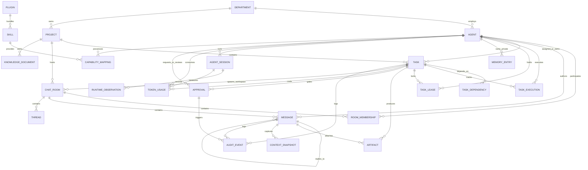
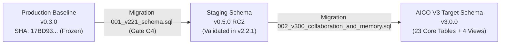

# AICO V3 MASTER BLUEPRINT — DOMAIN MODEL & DATABASE ARCHITECTURE

**Document ID:** `BP-V3-03`  
**Version:** `3.0.0-draft`  
**Date:** 2026-11-07  
**Author:** `flash-02` — Engineering & QA Lead  
**Design Phase:** Architecture & Contracts Design Only (No Implementation Authorized)  
**Baseline Git Reference:** Branch `feat/v2.2.1-implementation`, Commit `cd749107c4b34e26f61e14a238336e414f78779d`  
**Target Workspace:** `D:\AI-COMPANY`

---

## 1. DOMAIN MODEL OVERVIEW

The AICO V3 Domain Model encapsulates the complete lifecycle of an autonomous AI software company. It models corporate organization, agent identities, collaborative group rooms, multi-tier persistent memory, hierarchical task orchestration, capability discovery, token budget telemetry, cryptographic governance, and immutable audit logging.

### 1.1 Complete Entity-Relationship Diagram



---

## 2. DETAILED SPECIFICATION OF THE 23 CORE DOMAIN ENTITIES

### 2.1 Entity Catalog & Metadata

The 23 domain entities are grouped into 7 bounded contexts:
1. **Organization & Identity Context:** `DEPARTMENT`, `AGENT`, `PRINCIPAL`, `CAPABILITY`, `AGENT_CAPABILITY`
2. **Project & Collaboration Context:** `PROJECT`, `CHAT_ROOM`, `ROOM_MEMBERSHIP`, `MESSAGE`, `THREAD`
3. **Task & Workflow Context:** `TASK`, `TASK_DEPENDENCY`, `TASK_EXECUTION`, `TASK_LEASE`
4. **Context, Memory & Knowledge Context:** `CONTEXT_SNAPSHOT`, `MEMORY_ENTRY`, `KNOWLEDGE_DOCUMENT`, `ARTIFACT`
5. **Skills & Ecosystem Context:** `SKILL`, `PLUGIN`
6. **Telemetry & Runtime Context:** `AGENT_SESSION`, `RUNTIME_OBSERVATION`, `TOKEN_USAGE`
7. **Governance & Audit Context:** `APPROVAL`, `AUDIT_EVENT`

---

### 2.2 Domain Entities Specification

#### 1. Entity: `DEPARTMENT`
- **Purpose:** Represents functional corporate units (Executive, Engineering, Quality Assurance, Architecture, Research).
- **Attributes:**
  - `department_id` (TEXT, PK, UUIDv4)
  - `department_code` (TEXT, UNIQUE, NOT NULL): e.g., `EXEC`, `ENG`, `QA`, `ARCH`
  - `name` (TEXT, NOT NULL): e.g., "Engineering & Implementation"
  - `lead_agent_id` (TEXT, NULL, FK -> `agents.agent_id`)
  - `description` (TEXT, NULL)
  - `created_at` (INTEGER, NOT NULL, Unix Epoch ms)
  - `updated_at` (INTEGER, NOT NULL, Unix Epoch ms)
- **Lifecycle:** Persistent static data configured via `company-manifest.json`.

#### 2. Entity: `AGENT`
- **Purpose:** Represents an AI agent persona or human operator within AICO.
- **Attributes:**
  - `agent_id` (TEXT, PK): Canonical slug, e.g., `chatgpt-01`, `flash-01`, `flash-02`, `codex-01`, `argon-01`, `argon-02`, `founder`.
  - `display_name` (TEXT, NOT NULL)
  - `role_title` (TEXT, NOT NULL): e.g., "Chief Technology Officer"
  - `department_id` (TEXT, NOT NULL, FK -> `departments.department_id`)
  - `system_prompt_ref` (TEXT, NOT NULL): Path to markdown system prompt.
  - `default_model` (TEXT, NOT NULL): Primary LLM engine.
  - `quota_pool_id` (TEXT, NOT NULL): Quota allocation pool identifier.
  - `is_autonomous` (INTEGER, NOT NULL, 0 or 1): 0 for Argon (manual only) and Founder; 1 for primary workers.
  - `requires_approval` (INTEGER, NOT NULL, 0 or 1): 1 for destructive or specialist actions.
  - `status` (TEXT, NOT NULL): `ACTIVE`, `BUSY`, `DRAINING`, `DISABLED`
  - `created_at` (INTEGER, NOT NULL, Unix Epoch ms)
  - `updated_at` (INTEGER, NOT NULL, Unix Epoch ms)
- **Constraints:** Exactly 6 registered AI agents + 1 human `founder` identity.

#### 3. Entity: `PRINCIPAL` (Security Principal)
- **Purpose:** Authentication credential and authorization identity binding.
- **Attributes:**
  - `principal_id` (TEXT, PK, UUIDv4)
  - `agent_id` (TEXT, UNIQUE, NOT NULL, FK -> `agents.agent_id`)
  - `auth_token_hash` (TEXT, NOT NULL): Argon2id or HMAC-SHA256 hash of API bearer token.
  - `role` (TEXT, NOT NULL): `FOUNDER`, `EXECUTIVE`, `LEAD`, `ENGINEER`, `AUDITOR`, `SYSTEM`
  - `allowed_scopes` (TEXT, NOT NULL): JSON Array of MCP scopes, e.g., `["task:read", "task:write", "room:join"]`
  - `is_revoked` (INTEGER, NOT NULL, DEFAULT 0)
  - `created_at` (INTEGER, NOT NULL, Unix Epoch ms)

#### 4. Entity: `PROJECT`
- **Purpose:** High-level project workspace container grouping tasks, chat rooms, artifacts, and knowledge.
- **Attributes:**
  - `project_id` (TEXT, PK, UUIDv4)
  - `slug` (TEXT, UNIQUE, NOT NULL): e.g., `aico-v3-core`, `company-mcp`
  - `name` (TEXT, NOT NULL)
  - `department_id` (TEXT, NOT NULL, FK -> `departments.department_id`)
  - `lead_agent_id` (TEXT, NOT NULL, FK -> `agents.agent_id`)
  - `status` (TEXT, NOT NULL): `PLANNING`, `ACTIVE`, `MAINTENANCE`, `ARCHIVED`, `SUSPENDED`
  - `root_path` (TEXT, NOT NULL): Canonical absolute Windows path.
  - `created_at` (INTEGER, NOT NULL, Unix Epoch ms)
  - `updated_at` (INTEGER, NOT NULL, Unix Epoch ms)

#### 5. Entity: `TASK`
- **Purpose:** Fundamental unit of work with DAG parent-child relationships, states, and verification gates.
- **Attributes:**
  - `task_id` (TEXT, PK, UUIDv4)
  - `parent_task_id` (TEXT, NULL, FK -> `tasks.task_id`)
  - `project_id` (TEXT, NOT NULL, FK -> `projects.project_id`)
  - `title` (TEXT, NOT NULL)
  - `description` (TEXT, NOT NULL)
  - `task_type` (TEXT, NOT NULL): `ARCHITECTURE`, `CODE_MODIFICATION`, `TEST_RUN`, `AUDIT`, `MAINTENANCE`
  - `priority` (TEXT, NOT NULL): `CRITICAL`, `HIGH`, `MEDIUM`, `LOW`
  - `status` (TEXT, NOT NULL): State machine status (30+ states; see BP-V3-07)
  - `assigned_agent_id` (TEXT, NULL, FK -> `agents.agent_id`)
  - `creator_agent_id` (TEXT, NOT NULL, FK -> `agents.agent_id`)
  - `reviewer_agent_id` (TEXT, NULL, FK -> `agents.agent_id`)
  - `qa_agent_id` (TEXT, NULL, FK -> `agents.agent_id`)
  - `room_id` (TEXT, NULL, FK -> `chat_rooms.room_id`): Dedicated task room.
  - `token_budget` (INTEGER, NOT NULL, DEFAULT 0): Max tokens allocated before hard cut-off.
  - `requires_founder_gate` (INTEGER, NOT NULL, DEFAULT 0): Flag if task touches production or destructive assets.
  - `version` (INTEGER, NOT NULL, DEFAULT 1): Optimistic concurrency version lock.
  - `created_at` (INTEGER, NOT NULL, Unix Epoch ms)
  - `updated_at` (INTEGER, NOT NULL, Unix Epoch ms)
  - `completed_at` (INTEGER, NULL, Unix Epoch ms)

#### 6. Entity: `TASK_DEPENDENCY`
- **Purpose:** Models Directed Acyclic Graph (DAG) dependencies between tasks.
- **Attributes:**
  - `dependency_id` (TEXT, PK, UUIDv4)
  - `task_id` (TEXT, NOT NULL, FK -> `tasks.task_id`): Dependent task.
  - `depends_on_task_id` (TEXT, NOT NULL, FK -> `tasks.task_id`): Upstream blocking task.
  - `dependency_type` (TEXT, NOT NULL): `FINISH_TO_START`, `FINISH_TO_FINISH`
  - `is_blocking` (INTEGER, NOT NULL, DEFAULT 1)
  - `created_at` (INTEGER, NOT NULL, Unix Epoch ms)
- **Constraints:** `UNIQUE(task_id, depends_on_task_id)`, check constraint against self-dependency.

#### 7. Entity: `TASK_EXECUTION`
- **Purpose:** Detailed run history of an agent working on a specific task lease.
- **Attributes:**
  - `execution_id` (TEXT, PK, UUIDv4)
  - `task_id` (TEXT, NOT NULL, FK -> `tasks.task_id`)
  - `agent_id` (TEXT, NOT NULL, FK -> `agents.agent_id`)
  - `session_id` (TEXT, NOT NULL, FK -> `agent_sessions.session_id`)
  - `status` (TEXT, NOT NULL): `RUNNING`, `SUCCEEDED`, `FAILED`, `ABORTED`
  - `git_base_commit` (TEXT, NULL): Commit SHA before execution.
  - `git_head_commit` (TEXT, NULL): Commit SHA after execution.
  - `exit_code` (INTEGER, NULL)
  - `error_message` (TEXT, NULL)
  - `started_at` (INTEGER, NOT NULL, Unix Epoch ms)
  - `ended_at` (INTEGER, NULL, Unix Epoch ms)

#### 8. Entity: `TASK_LEASE`
- **Purpose:** Distributed mutex preventing duplicate concurrent execution of tasks across workers.
- **Attributes:**
  - `lease_id` (TEXT, PK, UUIDv4)
  - `task_id` (TEXT, UNIQUE, NOT NULL, FK -> `tasks.task_id`)
  - `agent_id` (TEXT, NOT NULL, FK -> `agents.agent_id`)
  - `lease_nonce` (TEXT, NOT NULL): Unique random string regenerated on each renew.
  - `heartbeat_at` (INTEGER, NOT NULL, Unix Epoch ms)
  - `expires_at` (INTEGER, NOT NULL, Unix Epoch ms)
  - `acquired_at` (INTEGER, NOT NULL, Unix Epoch ms)
- **Invariants:** Worker must send heartbeat every 60s; lease expires after 180s without heartbeat.

#### 9. Entity: `CHAT_ROOM`
- **Purpose:** Persistent collaboration workspace for agent teams and Founder.
- **Attributes:**
  - `room_id` (TEXT, PK, UUIDv4)
  - `slug` (TEXT, UNIQUE, NOT NULL): e.g., `boardroom`, `project-v3-core`, `task-uuid-workspace`
  - `title` (TEXT, NOT NULL)
  - `room_type` (TEXT, NOT NULL): `EXECUTIVE_BOARDROOM`, `DEPARTMENT_OFFICE`, `PROJECT_ROOM`, `TASK_ROOM`, `DIRECT_MESSAGE`
  - `project_id` (TEXT, NULL, FK -> `projects.project_id`)
  - `task_id` (TEXT, NULL, FK -> `tasks.task_id`)
  - `is_archived` (INTEGER, NOT NULL, DEFAULT 0)
  - `created_by_agent_id` (TEXT, NOT NULL, FK -> `agents.agent_id`)
  - `created_at` (INTEGER, NOT NULL, Unix Epoch ms)
  - `updated_at` (INTEGER, NOT NULL, Unix Epoch ms)

#### 10. Entity: `ROOM_MEMBERSHIP`
- **Purpose:** Tracks agent participation, notification preferences, and permissions in chat rooms.
- **Attributes:**
  - `membership_id` (TEXT, PK, UUIDv4)
  - `room_id` (TEXT, NOT NULL, FK -> `chat_rooms.room_id`)
  - `agent_id` (TEXT, NOT NULL, FK -> `agents.agent_id`)
  - `member_role` (TEXT, NOT NULL): `LEAD`, `MEMBER`, `OBSERVER`, `MUTED`
  - `last_read_message_id` (TEXT, NULL, FK -> `messages.message_id`)
  - `last_read_at` (INTEGER, NOT NULL, Unix Epoch ms)
  - `joined_at` (INTEGER, NOT NULL, Unix Epoch ms)
- **Constraints:** `UNIQUE(room_id, agent_id)`

#### 11. Entity: `MESSAGE`
- **Purpose:** Individual structured communication artifact within a chat room.
- **Attributes:**
  - `message_id` (TEXT, PK, UUIDv4)
  - `room_id` (TEXT, NOT NULL, FK -> `chat_rooms.room_id`)
  - `thread_id` (TEXT, NULL, FK -> `threads.thread_id`)
  - `sender_agent_id` (TEXT, NOT NULL, FK -> `agents.agent_id`)
  - `reply_to_message_id` (TEXT, NULL, FK -> `messages.message_id`)
  - `message_type` (TEXT, NOT NULL): `TEXT`, `DIRECTIVE`, `PROPOSAL`, `REVIEW_FEEDBACK`, `GATE_STATUS`, `SYSTEM_NOTICE`
  - `content` (TEXT, NOT NULL): Markdown message payload.
  - `mentions` (TEXT, NULL): JSON Array of agent_ids mentioned via `@agent-id`.
  - `metadata` (TEXT, NULL): JSON Object for extensible payload parameters.
  - `is_edited` (INTEGER, NOT NULL, DEFAULT 0)
  - `created_at` (INTEGER, NOT NULL, Unix Epoch ms)
  - `updated_at` (INTEGER, NOT NULL, Unix Epoch ms)

#### 12. Entity: `THREAD`
- **Purpose:** Focuses discussion around a specific problem, bug, review, or proposal within a room.
- **Attributes:**
  - `thread_id` (TEXT, PK, UUIDv4)
  - `room_id` (TEXT, NOT NULL, FK -> `chat_rooms.room_id`)
  - `root_message_id` (TEXT, UNIQUE, NOT NULL, FK -> `messages.message_id`)
  - `title` (TEXT, NOT NULL)
  - `status` (TEXT, NOT NULL): `OPEN`, `RESOLVED`, `CLOSED`
  - `resolved_by_agent_id` (TEXT, NULL, FK -> `agents.agent_id`)
  - `resolved_at` (INTEGER, NULL, Unix Epoch ms)
  - `created_at` (INTEGER, NOT NULL, Unix Epoch ms)

#### 13. Entity: `CONTEXT_SNAPSHOT`
- **Purpose:** Compact, structured point-in-time state of agent working memory for instant rehydration.
- **Attributes:**
  - `snapshot_id` (TEXT, PK, UUIDv4)
  - `task_id` (TEXT, NOT NULL, FK -> `tasks.task_id`)
  - `agent_id` (TEXT, NOT NULL, FK -> `agents.agent_id`)
  - `summary` (TEXT, NOT NULL): High-level plain text executive digest.
  - `active_hypotheses` (TEXT, NULL): JSON Array of open questions.
  - `verified_facts` (TEXT, NOT NULL): JSON Array of hard confirmed statements with evidence references.
  - `pending_steps` (TEXT, NOT NULL): JSON Array of next actions.
  - `total_tokens` (INTEGER, NOT NULL)
  - `created_at` (INTEGER, NOT NULL, Unix Epoch ms)

#### 14. Entity: `MEMORY_ENTRY`
- **Purpose:** Long-term episodic and declarative memory entries with multi-tier scoping.
- **Attributes:**
  - `memory_id` (TEXT, PK, UUIDv4)
  - `scope` (TEXT, NOT NULL): `COMPANY`, `PROJECT`, `TASK`, `ROOM`, `AGENT_PRIVATE`
  - `scope_id` (TEXT, NOT NULL): Canonical ID matching scope type (e.g., project_id or agent_id).
  - `category` (TEXT, NOT NULL): `ARCHITECTURAL_DECISION`, `INCIDENT_LEARNING`, `PERFORMANCE_PATTERN`, `PREFERENCE`, `FACT`
  - `key` (TEXT, NOT NULL): Structured index key, e.g., `sqlite.wal.busy_timeout`.
  - `content` (TEXT, NOT NULL): Verified insight or rule.
  - `provenance_agent_id` (TEXT, NOT NULL, FK -> `agents.agent_id`)
  - `provenance_ref` (TEXT, NULL): File link, commit SHA, or task ID where learned.
  - `confidence_score` (REAL, NOT NULL, DEFAULT 1.0): 0.0 to 1.0.
  - `is_tombstoned` (INTEGER, NOT NULL, DEFAULT 0): Soft deletion flag for superseded knowledge.
  - `tombstone_reason` (TEXT, NULL)
  - `created_at` (INTEGER, NOT NULL, Unix Epoch ms)
  - `updated_at` (INTEGER, NOT NULL, Unix Epoch ms)
- **Constraints:** `UNIQUE(scope, scope_id, key)` where `is_tombstoned = 0`.

#### 15. Entity: `KNOWLEDGE_DOCUMENT`
- **Purpose:** Curated company documentation, standards, and Architecture Decision Records (ADRs).
- **Attributes:**
  - `doc_id` (TEXT, PK, UUIDv4)
  - `project_id` (TEXT, NULL, FK -> `projects.project_id`)
  - `file_path` (TEXT, UNIQUE, NOT NULL): Repo-relative path, e.g., `docs/adr/0001-hexagonal.md`.
  - `title` (TEXT, NOT NULL)
  - `content_sha256` (TEXT, NOT NULL): SHA-256 hash of file content.
  - `classification` (TEXT, NOT NULL): `CANONICAL_POLICY`, `ARCHITECTURE`, `SPECIFICATION`, `RUNBOOK`
  - `author_agent_id` (TEXT, NOT NULL, FK -> `agents.agent_id`)
  - `last_indexed_at` (INTEGER, NOT NULL, Unix Epoch ms)
  - `created_at` (INTEGER, NOT NULL, Unix Epoch ms)

#### 16. Entity: `ARTIFACT`
- **Purpose:** Structured deliverable produced by an agent during task execution.
- **Attributes:**
  - `artifact_id` (TEXT, PK, UUIDv4)
  - `task_id` (TEXT, NOT NULL, FK -> `tasks.task_id`)
  - `creator_agent_id` (TEXT, NOT NULL, FK -> `agents.agent_id`)
  - `name` (TEXT, NOT NULL): e.g., `audit_report.md`, `schema_v3.sql`
  - `file_path` (TEXT, NOT NULL): Absolute Windows file path.
  - `file_sha256` (TEXT, NOT NULL): SHA-256 hash.
  - `mime_type` (TEXT, NOT NULL)
  - `size_bytes` (INTEGER, NOT NULL)
  - `is_verified` (INTEGER, NOT NULL, DEFAULT 0)
  - `created_at` (INTEGER, NOT NULL, Unix Epoch ms)

#### 17. Entity: `SKILL`
- **Purpose:** Specialized domain knowledge and executable workflow folder in `.agents/skills/`.
- **Attributes:**
  - `skill_id` (TEXT, PK): Canonical directory name, e.g., `aico-architecture-patterns`.
  - `name` (TEXT, NOT NULL)
  - `description` (TEXT, NOT NULL)
  - `skill_path` (TEXT, NOT NULL): Relative path from repo root.
  - `instructions_md_hash` (TEXT, NOT NULL): SHA-256 of `SKILL.md`.
  - `is_active` (INTEGER, NOT NULL, DEFAULT 1)
  - `plugin_id` (TEXT, NULL, FK -> `plugins.plugin_id`)
  - `created_at` (INTEGER, NOT NULL, Unix Epoch ms)
  - `updated_at` (INTEGER, NOT NULL, Unix Epoch ms)

#### 18. Entity: `CAPABILITY` & `AGENT_CAPABILITY`
- **Purpose:** Normalized capability taxonomy mapped to agents and skills.
- **Attributes (`capabilities`):**
  - `capability_id` (TEXT, PK): e.g., `code.typescript.review`, `db.sqlite.migrate`, `security.audit`
  - `category` (TEXT, NOT NULL): `ENGINEERING`, `ARCHITECTURE`, `QA`, `DEVOPS`, `GOVERNANCE`
  - `description` (TEXT, NOT NULL)
- **Attributes (`agent_capabilities`):**
  - `agent_id` (TEXT, NOT NULL, FK -> `agents.agent_id`)
  - `capability_id` (TEXT, NOT NULL, FK -> `capabilities.capability_id`)
  - `proficiency_level` (TEXT, NOT NULL): `AUTHORITATIVE`, `COMPETENT`, `RESTRICTED`
  - `PRIMARY KEY (agent_id, capability_id)`

#### 19. Entity: `PLUGIN`
- **Purpose:** Packaged extensions providing tools, skills, and agents.
- **Attributes:**
  - `plugin_id` (TEXT, PK): e.g., `aico-core-tools`, `chrome-devtools-plugin`
  - `version` (TEXT, NOT NULL)
  - `install_path` (TEXT, NOT NULL)
  - `status` (TEXT, NOT NULL): `ENABLED`, `DISABLED`, `QUARANTINED`
  - `created_at` (INTEGER, NOT NULL, Unix Epoch ms)

#### 20. Entity: `AGENT_SESSION`
- **Purpose:** Continuous operational execution window of an agent connection.
- **Attributes:**
  - `session_id` (TEXT, PK, UUIDv4)
  - `agent_id` (TEXT, NOT NULL, FK -> `agents.agent_id`)
  - `runtime_adapter` (TEXT, NOT NULL): `ANTIGRAVITY`, `CODEX_CLI`, `LOCAL_CLI`
  - `ip_address` (TEXT, NOT NULL)
  - `started_at` (INTEGER, NOT NULL, Unix Epoch ms)
  - `ended_at` (INTEGER, NULL, Unix Epoch ms)
  - `is_active` (INTEGER, NOT NULL, DEFAULT 1)

#### 21. Entity: `RUNTIME_OBSERVATION`
- **Purpose:** Diagnostic events, errors, or telemetry emitted during runtime.
- **Attributes:**
  - `observation_id` (TEXT, PK, UUIDv4)
  - `session_id` (TEXT, NOT NULL, FK -> `agent_sessions.session_id`)
  - `task_id` (TEXT, NULL, FK -> `tasks.task_id`)
  - `severity` (TEXT, NOT NULL): `DEBUG`, `INFO`, `WARN`, `ERROR`, `FATAL`
  - `subsystem` (TEXT, NOT NULL): e.g., `MCP_TRANSPORT`, `DATABASE`, `GIT`
  - `message` (TEXT, NOT NULL)
  - `details_json` (TEXT, NULL)
  - `created_at` (INTEGER, NOT NULL, Unix Epoch ms)

#### 22. Entity: `TOKEN_USAGE`
- **Purpose:** Granular token expenditure tracking per task, session, agent, and model.
- **Attributes:**
  - `usage_id` (TEXT, PK, UUIDv4)
  - `session_id` (TEXT, NOT NULL, FK -> `agent_sessions.session_id`)
  - `task_id` (TEXT, NULL, FK -> `tasks.task_id`)
  - `agent_id` (TEXT, NOT NULL, FK -> `agents.agent_id`)
  - `quota_pool_id` (TEXT, NOT NULL)
  - `model_name` (TEXT, NOT NULL): e.g., `gemini-3.8-flash`, `gpt-4o`
  - `prompt_tokens` (INTEGER, NOT NULL)
  - `completion_tokens` (INTEGER, NOT NULL)
  - `total_tokens` (INTEGER, NOT NULL)
  - `estimated_cost_usd` (REAL, NOT NULL, DEFAULT 0.0)
  - `created_at` (INTEGER, NOT NULL, Unix Epoch ms)

#### 23. Entity: `APPROVAL`
- **Purpose:** Cryptographic, immutable authorization token gating restricted actions.
- **Attributes:**
  - `approval_id` (TEXT, PK, UUIDv4)
  - `approval_type` (TEXT, NOT NULL): `ARGON_INVOCATION`, `PRODUCTION_DEPLOY`, `SCHEMA_MIGRATION`, `ACL_APPLY`
  - `target_resource` (TEXT, NOT NULL): Resource identifier (e.g., `agent:argon-01` or `db:production`)
  - `requestor_agent_id` (TEXT, NOT NULL, FK -> `agents.agent_id`)
  - `payload_sha256` (TEXT, NOT NULL): SHA-256 hash of the exact parameters being approved.
  - `status` (TEXT, NOT NULL): `PENDING`, `APPROVED`, `REJECTED`, `EXPIRED`, `CONSUMED`
  - `reviewer_agent_id` (TEXT, NULL): Must be `founder` for Founder gates.
  - `decision_reason` (TEXT, NULL)
  - `expires_at` (INTEGER, NOT NULL, Unix Epoch ms): Strict deadline.
  - `consumed_at` (INTEGER, NULL, Unix Epoch ms): Recorded on single-use consumption.
  - `created_at` (INTEGER, NOT NULL, Unix Epoch ms)
  - `updated_at` (INTEGER, NOT NULL, Unix Epoch ms)
- **Constraints:**
  - Self-approval strictly forbidden (`requestor_agent_id != reviewer_agent_id`).
  - Single-use consumption only.

#### 24. Entity: `AUDIT_EVENT`
- **Purpose:** Tamper-evident, forward-hash-chained log of every security-sensitive action.
- **Attributes:**
  - `event_id` (TEXT, PK, UUIDv4)
  - `sequence_number` (INTEGER, UNIQUE, NOT NULL): Strictly monotonic counter.
  - `actor_agent_id` (TEXT, NOT NULL, FK -> `agents.agent_id`)
  - `action` (TEXT, NOT NULL): e.g., `task.create`, `approval.grant`, `argon.invoke`
  - `target_type` (TEXT, NOT NULL)
  - `target_id` (TEXT, NOT NULL)
  - `payload_hash` (TEXT, NOT NULL): SHA-256 of the event details.
  - `previous_event_hash` (TEXT, NOT NULL): Hash of previous audit row.
  - `current_event_hash` (TEXT, NOT NULL): SHA-256(`sequence_number` + `actor` + `action` + `payload_hash` + `prev_hash`).
  - `created_at` (INTEGER, NOT NULL, Unix Epoch ms)

---

## 3. DATABASE CONFIGURATION & RUNTIME SETTINGS

### 3.1 SQLite PRAGMA Standards

AICO V3 uses embedded SQLite via `better-sqlite3`. To ensure enterprise reliability, high-concurrency read operations, and strict crash consistency, every database connection must apply the following PRAGMAs immediately upon opening:

```sql
PRAGMA journal_mode = WAL;
PRAGMA synchronous = NORMAL;
PRAGMA foreign_keys = ON;
PRAGMA busy_timeout = 5000;
PRAGMA cache_size = -64000; -- 64MB memory cache
PRAGMA temp_store = MEMORY;
PRAGMA mmap_size = 268435456; -- 256MB memory-mapped I/O
```

### 3.2 Concurrency Architecture
- **Single-Writer, Multiple-Reader:** SQLite WAL mode permits arbitrary concurrent read queries without blocking writers, while write transactions obtain an exclusive write lock.
- **Connection Isolation:** Background tasks and MCP request handlers share connection pools managed by `ConnectionManager`.
- **Busy Timeout:** 5,000 ms busy timeout prevents `SQLITE_BUSY` errors during burst write operations by retrying with exponential backoff.
- **Automated Checkpointing:** Passive checkpointing runs continuously. An explicit passive checkpoint is executed every 1,000 transactions or 1 hour:
  ```sql
  PRAGMA wal_checkpoint(PASSIVE);
  ```

---

## 4. SCHEMA MIGRATION & BACKWARD COMPATIBILITY

### 4.1 Migration Path: v0.3.0 -> v0.5.0 RC2 -> V3 Target Schema



### 4.2 Migration Safety Rules
1. **Zero Data Loss Guarantee:** No existing columns or tables in `data/aico.db` will be dropped. Legacy columns are preserved or mapped to new schemas.
2. **Pre-Migration Cryptographic Snapshot:** Before running any migration script:
   - Calculate SHA-256 of `data/aico.db`.
   - Create timestamped backup `data/backup/aico_pre_v3_<timestamp>.db`.
   - Verify backup SHA-256 matches production before proceeding.
3. **Transactional Migration Execution:** All DDL statements must execute inside an explicit `BEGIN IMMEDIATE TRANSACTION; ... COMMIT;` block. If any error occurs, the transaction automatically rolls back.
4. **Backward-Compatible Views:** To allow legacy MCP tools and external scripts to continue operating seamlessly, V3 establishes compatibility views:
   - `v_tasks_legacy`: Presents V3 `tasks` table in v0.3.0 column layout.
   - `v_agents_legacy`: Presents V3 `agents` table in v0.3.0 column layout.
   - `v_quota_legacy`: Aggregates V3 `token_usage` table into v0.3.0 quota summary format.

---

## 5. COMPLETE DDL TARGET SCHEMA SCRIPT (DRAFT SPECIFICATION)

```sql
-- ============================================================================
-- AICO V3 TARGET SCHEMA (DRAFT SPECIFICATION)
-- File: docs/blueprint/v3/03_DOMAIN_AND_DATABASE_DESIGN.md
-- Target: SQLite 3.40+ (WAL Mode)
-- ============================================================================

-- 1. Departments
CREATE TABLE IF NOT EXISTS departments (
    department_id TEXT PRIMARY KEY,
    department_code TEXT UNIQUE NOT NULL,
    name TEXT NOT NULL,
    lead_agent_id TEXT,
    description TEXT,
    created_at INTEGER NOT NULL,
    updated_at INTEGER NOT NULL
);

-- 2. Agents
CREATE TABLE IF NOT EXISTS agents (
    agent_id TEXT PRIMARY KEY,
    display_name TEXT NOT NULL,
    role_title TEXT NOT NULL,
    department_id TEXT NOT NULL REFERENCES departments(department_id),
    system_prompt_ref TEXT NOT NULL,
    default_model TEXT NOT NULL,
    quota_pool_id TEXT NOT NULL,
    is_autonomous INTEGER NOT NULL DEFAULT 1,
    requires_approval INTEGER NOT NULL DEFAULT 0,
    status TEXT NOT NULL DEFAULT 'ACTIVE',
    created_at INTEGER NOT NULL,
    updated_at INTEGER NOT NULL
);

-- 3. Security Principals
CREATE TABLE IF NOT EXISTS principals (
    principal_id TEXT PRIMARY KEY,
    agent_id TEXT UNIQUE NOT NULL REFERENCES agents(agent_id),
    auth_token_hash TEXT NOT NULL,
    role TEXT NOT NULL,
    allowed_scopes TEXT NOT NULL,
    is_revoked INTEGER NOT NULL DEFAULT 0,
    created_at INTEGER NOT NULL
);

-- 4. Projects
CREATE TABLE IF NOT EXISTS projects (
    project_id TEXT PRIMARY KEY,
    slug TEXT UNIQUE NOT NULL,
    name TEXT NOT NULL,
    department_id TEXT NOT NULL REFERENCES departments(department_id),
    lead_agent_id TEXT NOT NULL REFERENCES agents(agent_id),
    status TEXT NOT NULL DEFAULT 'ACTIVE',
    root_path TEXT NOT NULL,
    created_at INTEGER NOT NULL,
    updated_at INTEGER NOT NULL
);

-- 5. Tasks
CREATE TABLE IF NOT EXISTS tasks (
    task_id TEXT PRIMARY KEY,
    parent_task_id TEXT REFERENCES tasks(task_id),
    project_id TEXT NOT NULL REFERENCES projects(project_id),
    title TEXT NOT NULL,
    description TEXT NOT NULL,
    task_type TEXT NOT NULL,
    priority TEXT NOT NULL DEFAULT 'MEDIUM',
    status TEXT NOT NULL DEFAULT 'INTAKE_PENDING',
    assigned_agent_id TEXT REFERENCES agents(agent_id),
    creator_agent_id TEXT NOT NULL REFERENCES agents(agent_id),
    reviewer_agent_id TEXT REFERENCES agents(agent_id),
    qa_agent_id TEXT REFERENCES agents(agent_id),
    room_id TEXT,
    token_budget INTEGER NOT NULL DEFAULT 100000,
    requires_founder_gate INTEGER NOT NULL DEFAULT 0,
    version INTEGER NOT NULL DEFAULT 1,
    created_at INTEGER NOT NULL,
    updated_at INTEGER NOT NULL,
    completed_at INTEGER
);

-- 6. Task Dependencies
CREATE TABLE IF NOT EXISTS task_dependencies (
    dependency_id TEXT PRIMARY KEY,
    task_id TEXT NOT NULL REFERENCES tasks(task_id) ON DELETE CASCADE,
    depends_on_task_id TEXT NOT NULL REFERENCES tasks(task_id) ON DELETE CASCADE,
    dependency_type TEXT NOT NULL DEFAULT 'FINISH_TO_START',
    is_blocking INTEGER NOT NULL DEFAULT 1,
    created_at INTEGER NOT NULL,
    UNIQUE(task_id, depends_on_task_id),
    CHECK(task_id != depends_on_task_id)
);

-- 7. Task Executions
CREATE TABLE IF NOT EXISTS task_executions (
    execution_id TEXT PRIMARY KEY,
    task_id TEXT NOT NULL REFERENCES tasks(task_id),
    agent_id TEXT NOT NULL REFERENCES agents(agent_id),
    session_id TEXT NOT NULL,
    status TEXT NOT NULL,
    git_base_commit TEXT,
    git_head_commit TEXT,
    exit_code INTEGER,
    error_message TEXT,
    started_at INTEGER NOT NULL,
    ended_at INTEGER
);

-- 8. Task Leases
CREATE TABLE IF NOT EXISTS task_leases (
    lease_id TEXT PRIMARY KEY,
    task_id TEXT UNIQUE NOT NULL REFERENCES tasks(task_id) ON DELETE CASCADE,
    agent_id TEXT NOT NULL REFERENCES agents(agent_id),
    lease_nonce TEXT NOT NULL,
    heartbeat_at INTEGER NOT NULL,
    expires_at INTEGER NOT NULL,
    acquired_at INTEGER NOT NULL
);

-- 9. Chat Rooms
CREATE TABLE IF NOT EXISTS chat_rooms (
    room_id TEXT PRIMARY KEY,
    slug TEXT UNIQUE NOT NULL,
    title TEXT NOT NULL,
    room_type TEXT NOT NULL,
    project_id TEXT REFERENCES projects(project_id),
    task_id TEXT REFERENCES tasks(task_id),
    is_archived INTEGER NOT NULL DEFAULT 0,
    created_by_agent_id TEXT NOT NULL REFERENCES agents(agent_id),
    created_at INTEGER NOT NULL,
    updated_at INTEGER NOT NULL
);

-- 10. Room Memberships
CREATE TABLE IF NOT EXISTS room_memberships (
    membership_id TEXT PRIMARY KEY,
    room_id TEXT NOT NULL REFERENCES chat_rooms(room_id) ON DELETE CASCADE,
    agent_id TEXT NOT NULL REFERENCES agents(agent_id),
    member_role TEXT NOT NULL DEFAULT 'MEMBER',
    last_read_message_id TEXT,
    last_read_at INTEGER NOT NULL,
    joined_at INTEGER NOT NULL,
    UNIQUE(room_id, agent_id)
);

-- 11. Messages
CREATE TABLE IF NOT EXISTS messages (
    message_id TEXT PRIMARY KEY,
    room_id TEXT NOT NULL REFERENCES chat_rooms(room_id) ON DELETE CASCADE,
    thread_id TEXT,
    sender_agent_id TEXT NOT NULL REFERENCES agents(agent_id),
    reply_to_message_id TEXT REFERENCES messages(message_id),
    message_type TEXT NOT NULL DEFAULT 'TEXT',
    content TEXT NOT NULL,
    mentions TEXT,
    metadata TEXT,
    is_edited INTEGER NOT NULL DEFAULT 0,
    created_at INTEGER NOT NULL,
    updated_at INTEGER NOT NULL
);

-- 12. Threads
CREATE TABLE IF NOT EXISTS threads (
    thread_id TEXT PRIMARY KEY,
    room_id TEXT NOT NULL REFERENCES chat_rooms(room_id) ON DELETE CASCADE,
    root_message_id TEXT UNIQUE NOT NULL REFERENCES messages(message_id),
    title TEXT NOT NULL,
    status TEXT NOT NULL DEFAULT 'OPEN',
    resolved_by_agent_id TEXT REFERENCES agents(agent_id),
    resolved_at INTEGER,
    created_at INTEGER NOT NULL
);

-- 13. Context Snapshots
CREATE TABLE IF NOT EXISTS context_snapshots (
    snapshot_id TEXT PRIMARY KEY,
    task_id TEXT NOT NULL REFERENCES tasks(task_id) ON DELETE CASCADE,
    agent_id TEXT NOT NULL REFERENCES agents(agent_id),
    summary TEXT NOT NULL,
    active_hypotheses TEXT,
    verified_facts TEXT NOT NULL,
    pending_steps TEXT NOT NULL,
    total_tokens INTEGER NOT NULL,
    created_at INTEGER NOT NULL
);

-- 14. Memory Entries
CREATE TABLE IF NOT EXISTS memory_entries (
    memory_id TEXT PRIMARY KEY,
    scope TEXT NOT NULL,
    scope_id TEXT NOT NULL,
    category TEXT NOT NULL,
    key TEXT NOT NULL,
    content TEXT NOT NULL,
    provenance_agent_id TEXT NOT NULL REFERENCES agents(agent_id),
    provenance_ref TEXT,
    confidence_score REAL NOT NULL DEFAULT 1.0,
    is_tombstoned INTEGER NOT NULL DEFAULT 0,
    tombstone_reason TEXT,
    created_at INTEGER NOT NULL,
    updated_at INTEGER NOT NULL
);

-- 15. Knowledge Documents
CREATE TABLE IF NOT EXISTS knowledge_documents (
    doc_id TEXT PRIMARY KEY,
    project_id TEXT REFERENCES projects(project_id),
    file_path TEXT UNIQUE NOT NULL,
    title TEXT NOT NULL,
    content_sha256 TEXT NOT NULL,
    classification TEXT NOT NULL,
    author_agent_id TEXT NOT NULL REFERENCES agents(agent_id),
    last_indexed_at INTEGER NOT NULL,
    created_at INTEGER NOT NULL
);

-- 16. Artifacts
CREATE TABLE IF NOT EXISTS artifacts (
    artifact_id TEXT PRIMARY KEY,
    task_id TEXT NOT NULL REFERENCES tasks(task_id) ON DELETE CASCADE,
    creator_agent_id TEXT NOT NULL REFERENCES agents(agent_id),
    name TEXT NOT NULL,
    file_path TEXT NOT NULL,
    file_sha256 TEXT NOT NULL,
    mime_type TEXT NOT NULL,
    size_bytes INTEGER NOT NULL,
    is_verified INTEGER NOT NULL DEFAULT 0,
    created_at INTEGER NOT NULL
);

-- 17. Skills
CREATE TABLE IF NOT EXISTS skills (
    skill_id TEXT PRIMARY KEY,
    name TEXT NOT NULL,
    description TEXT NOT NULL,
    skill_path TEXT NOT NULL,
    instructions_md_hash TEXT NOT NULL,
    is_active INTEGER NOT NULL DEFAULT 1,
    plugin_id TEXT,
    created_at INTEGER NOT NULL,
    updated_at INTEGER NOT NULL
);

-- 18. Capabilities Taxonomy
CREATE TABLE IF NOT EXISTS capabilities (
    capability_id TEXT PRIMARY KEY,
    category TEXT NOT NULL,
    description TEXT NOT NULL
);

CREATE TABLE IF NOT EXISTS agent_capabilities (
    agent_id TEXT NOT NULL REFERENCES agents(agent_id),
    capability_id TEXT NOT NULL REFERENCES capabilities(capability_id),
    proficiency_level TEXT NOT NULL DEFAULT 'COMPETENT',
    PRIMARY KEY(agent_id, capability_id)
);

-- 19. Plugins
CREATE TABLE IF NOT EXISTS plugins (
    plugin_id TEXT PRIMARY KEY,
    version TEXT NOT NULL,
    install_path TEXT NOT NULL,
    status TEXT NOT NULL DEFAULT 'ENABLED',
    created_at INTEGER NOT NULL
);

-- 20. Agent Sessions
CREATE TABLE IF NOT EXISTS agent_sessions (
    session_id TEXT PRIMARY KEY,
    agent_id TEXT NOT NULL REFERENCES agents(agent_id),
    runtime_adapter TEXT NOT NULL,
    ip_address TEXT NOT NULL,
    started_at INTEGER NOT NULL,
    ended_at INTEGER,
    is_active INTEGER NOT NULL DEFAULT 1
);

-- 21. Runtime Observations
CREATE TABLE IF NOT EXISTS runtime_observations (
    observation_id TEXT PRIMARY KEY,
    session_id TEXT NOT NULL REFERENCES agent_sessions(session_id),
    task_id TEXT REFERENCES tasks(task_id),
    severity TEXT NOT NULL,
    subsystem TEXT NOT NULL,
    message TEXT NOT NULL,
    details_json TEXT,
    created_at INTEGER NOT NULL
);

-- 22. Token Usage
CREATE TABLE IF NOT EXISTS token_usage (
    usage_id TEXT PRIMARY KEY,
    session_id TEXT NOT NULL REFERENCES agent_sessions(session_id),
    task_id TEXT REFERENCES tasks(task_id),
    agent_id TEXT NOT NULL REFERENCES agents(agent_id),
    quota_pool_id TEXT NOT NULL,
    model_name TEXT NOT NULL,
    prompt_tokens INTEGER NOT NULL,
    completion_tokens INTEGER NOT NULL,
    total_tokens INTEGER NOT NULL,
    estimated_cost_usd REAL NOT NULL DEFAULT 0.0,
    created_at INTEGER NOT NULL
);

-- 23. Approvals
CREATE TABLE IF NOT EXISTS approvals (
    approval_id TEXT PRIMARY KEY,
    approval_type TEXT NOT NULL,
    target_resource TEXT NOT NULL,
    requestor_agent_id TEXT NOT NULL REFERENCES agents(agent_id),
    payload_sha256 TEXT NOT NULL,
    status TEXT NOT NULL DEFAULT 'PENDING',
    reviewer_agent_id TEXT REFERENCES agents(agent_id),
    decision_reason TEXT,
    expires_at INTEGER NOT NULL,
    consumed_at INTEGER,
    created_at INTEGER NOT NULL,
    updated_at INTEGER NOT NULL,
    CHECK(requestor_agent_id != reviewer_agent_id)
);

-- 24. Audit Events
CREATE TABLE IF NOT EXISTS audit_events (
    event_id TEXT PRIMARY KEY,
    sequence_number INTEGER UNIQUE NOT NULL,
    actor_agent_id TEXT NOT NULL REFERENCES agents(agent_id),
    action TEXT NOT NULL,
    target_type TEXT NOT NULL,
    target_id TEXT NOT NULL,
    payload_hash TEXT NOT NULL,
    previous_event_hash TEXT NOT NULL,
    current_event_hash TEXT NOT NULL,
    created_at INTEGER NOT NULL
);

-- ============================================================================
-- PERFORMANCE & INTEGRITY INDEXES
-- ============================================================================
CREATE INDEX IF NOT EXISTS idx_tasks_status ON tasks(status);
CREATE INDEX IF NOT EXISTS idx_tasks_assigned_agent ON tasks(assigned_agent_id);
CREATE INDEX IF NOT EXISTS idx_tasks_project ON tasks(project_id);
CREATE INDEX IF NOT EXISTS idx_messages_room_created ON messages(room_id, created_at);
CREATE INDEX IF NOT EXISTS idx_messages_thread ON messages(thread_id);
CREATE INDEX IF NOT EXISTS idx_memory_lookup ON memory_entries(scope, scope_id, key) WHERE is_tombstoned = 0;
CREATE INDEX IF NOT EXISTS idx_token_usage_task ON token_usage(task_id);
CREATE INDEX IF NOT EXISTS idx_token_usage_agent ON token_usage(agent_id);
CREATE INDEX IF NOT EXISTS idx_audit_sequence ON audit_events(sequence_number);
CREATE INDEX IF NOT EXISTS idx_approvals_lookup ON approvals(approval_type, target_resource, payload_sha256, status);
CREATE INDEX IF NOT EXISTS idx_task_leases_expires ON task_leases(expires_at);
