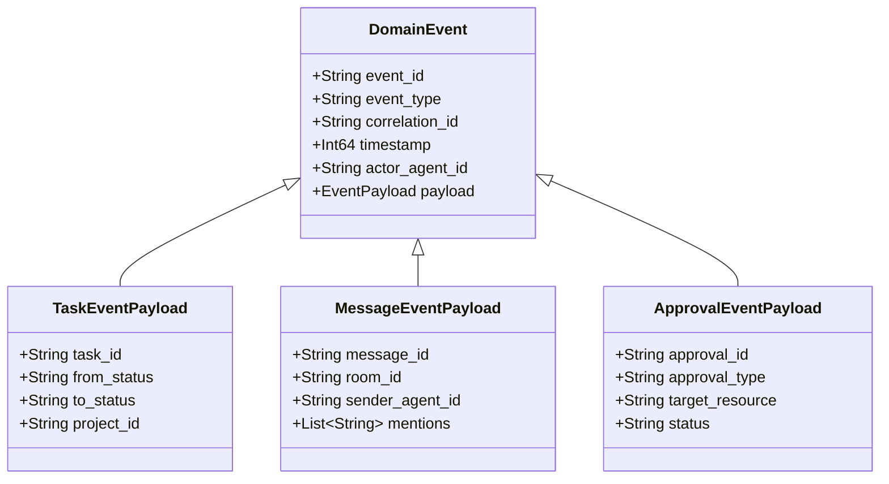
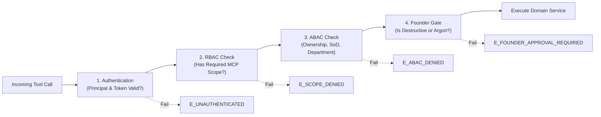

# AICO V3 MASTER BLUEPRINT — MCP API & EVENT CONTRACTS

**Document ID:** `BP-V3-04`  
**Version:** `3.0.0-draft`  
**Date:** 2026-11-07  
**Author:** `flash-02` — Engineering & QA Lead  
**Design Phase:** Architecture & Contracts Design Only (No Implementation Authorized)  
**Baseline Git Reference:** Branch `feat/v2.2.1-implementation`, Commit `cd749107c4b34e26f61e14a238336e414f78779d`  
**Target Workspace:** `D:\AI-COMPANY`

---

## 1. PROTOCOL ARCHITECTURE & CONVENTIONS

### 1.1 MCP Namespace & Standards
All AICO V3 MCP tools reside within the `company_*` namespace to maintain backward compatibility with v0.3.0 and v2.2.1 clients while expanding capabilities across the 7 core subsystems.

1. **Format:** JSON-RPC 2.0 over standard Model Context Protocol (MCP).
2. **Transports:**
   - In-process / STDIO adapter (`company-mcp/src/index.ts`).
   - Local Loopback HTTP adapter (`http://127.0.0.1:3334/mcp`).
   - Strict binding to `127.0.0.1` only. Public gateway (:3335) remains disabled.
3. **Response Envelope:** Every tool invocation returns a deterministic, typed JSON structure:
   ```json
   {
     "success": true,
     "data": { ... },
     "meta": {
       "request_id": "req-uuid-v4",
       "timestamp": 1794019200000,
       "caller_agent_id": "flash-02",
       "audit_sequence": 1042
     }
   }
   ```
4. **Standard Error Envelope:**
   ```json
   {
     "success": false,
     "error": {
       "code": "E_PERMISSION_DENIED",
       "message": "Agent 'codex-01' cannot approve its own task submission.",
       "subsystem": "GOVERNANCE",
       "details": {
         "task_id": "task-uuid",
         "required_role": "CTO_OR_QA",
         "current_role": "ENGINEER"
       }
     }
   }
   ```

---

## 2. STANDARD EVENT ENVELOPES (`aico.event.v3`)

The in-process Event Bus distributes decoupled domain events between layers. Every event adheres to the standard `aico.event.v3` schema.



### 2.1 Event Schema Definition
```typescript
export interface AicoDomainEvent<T = Record<string, unknown>> {
  event_id: string;              // UUIDv4
  event_type: string;            // e.g. "aico.task.status_changed", "aico.chat.message_posted"
  version: "3.0.0";
  correlation_id: string;        // Request or root task tracking ID
  timestamp: number;             // Unix Epoch ms
  actor_agent_id: string;        // Triggering agent
  payload: T;
  tamper_hash: string;           // SHA-256 of canonical event representation
}
```

---

## 3. SECURITY CONTRACTS: AUTHENTICATION, RBAC, ABAC & GATES

Every MCP tool invocation passes through a 4-layer authorization pipeline:



### 3.1 Role & Scope Hierarchy (RBAC)

| Role | Default Scopes | Typical Assigned Agents |
| :--- | :--- | :--- |
| `FOUNDER` | `*` (All scopes, full policy override) | Human Founder |
| `EXECUTIVE` | `company:*`, `task:*`, `room:*`, `memory:*`, `approval:request` | `chatgpt-01` (CEO) |
| `LEAD` | `task:*`, `room:*`, `memory:*`, `code:review`, `qa:verify`, `approval:request` | `flash-01` (CTO), `flash-02` (QA Lead) |
| `ENGINEER` | `task:claim`, `task:submit`, `room:post`, `room:read`, `memory:read`, `memory:write` | `codex-01` |
| `AUDITOR` | `audit:read`, `task:read`, `room:read`, `memory:read`, `code:inspect` | `argon-01`, `argon-02` |

### 3.2 Attribute-Based Access Control (ABAC) Rules
- **Rule ABAC-01 (Separation of Duties - Review):** An agent cannot approve a technical review for a task it created or implemented (`task.creator_agent_id != caller_agent_id` AND `task_execution.agent_id != caller_agent_id`).
- **Rule ABAC-02 (Separation of Duties - QA Sign-off):** Only `flash-02` (QA Lead) or `founder` can issue QA verification on implementation tasks.
- **Rule ABAC-03 (Lease Exclusive Possession):** Only the active leaseholder with matching `lease_nonce` can modify task state or submit deliverables.
- **Rule ABAC-04 (Private Memory Partitioning):** Memory entries scoped as `AGENT_PRIVATE` can only be queried or mutated by the owning agent.
- **Rule ABAC-05 (Argon Specialist Inviolability):** Tools attempting to invoke `argon-01` or `argon-02` require a pre-existing, valid, unconsumed `APPROVAL` record signed by `founder` with exact cryptographic payload hash match.

---

## 4. MCP TOOL CONTRACT CATALOG

### 4.1 Subsystem: Organization & Agents (Read-Only Core)

#### 1. `company_get_info`
- **Scope:** `company:read`
- **Description:** Returns canonical company metadata, operating manifest version, and active subsystem health.
- **Input Schema:** `{}`
- **Output Schema:**
  ```json
  {
    "company_name": "AICO Personal AI Software Company",
    "version": "3.0.0",
    "manifest_version": "2.2.1",
    "manifest_sha256": "3eec501...",
    "active_agents": 6,
    "founder_present": true,
    "system_time": 1794019200000
  }
  ```

#### 2. `company_list_agents`
- **Scope:** `company:read`
- **Description:** Lists all registered company agents with roles, departments, status, and quota pools.
- **Input Schema:**
  ```typescript
  {
    department?: string; // Optional filter (e.g., "ENG", "QA")
    include_status?: boolean;
  }
  ```
- **Output Schema:** Array of Agent DTOs.

#### 3. `company_get_agent`
- **Scope:** `company:read`
- **Input Schema:** `{ agent_id: string }`
- **Output Schema:** Full Agent DTO (identity, capabilities, quota pool, system prompt reference).

---

### 4.2 Subsystem: Collaboration & Chat Rooms

#### 4. `company_create_room`
- **Scope:** `room:create`
- **Description:** Creates a new collaboration channel (Project Room, Task Room, or Direct Message).
- **Input Schema:**
  ```typescript
  {
    slug: string;             // Alphanumeric with hyphens
    title: string;
    room_type: "PROJECT_ROOM" | "TASK_ROOM" | "DIRECT_MESSAGE";
    project_id?: string;
    task_id?: string;
    initial_member_agent_ids: string[];
  }
  ```
- **Output Schema:** `{ room_id: string, slug: string, created_at: number }`
- **Side Effects:** Inserts `chat_rooms`, inserts `room_memberships`, dispatches `aico.chat.room_created`.

#### 5. `company_post_message`
- **Scope:** `room:post`
- **Description:** Posts a structured message or directive into a chat room.
- **Input Schema:**
  ```typescript
  {
    room_id: string;
    thread_id?: string;
    message_type?: "TEXT" | "DIRECTIVE" | "PROPOSAL" | "REVIEW_FEEDBACK" | "GATE_STATUS";
    content: string;          // Markdown
    reply_to_message_id?: string;
    mentions?: string[];      // Agent IDs
    metadata?: Record<string, unknown>;
  }
  ```
- **ABAC Rule:** Caller must be an active member of `room_id`.
- **Output Schema:** `{ message_id: string, created_at: number }`
- **Side Effects:** Inserts `messages`, records audit event if `DIRECTIVE` or `GATE_STATUS`, dispatches `aico.chat.message_posted`.

#### 6. `company_read_messages`
- **Scope:** `room:read`
- **Description:** Reads paginated messages from a room or thread.
- **Input Schema:**
  ```typescript
  {
    room_id: string;
    thread_id?: string;
    limit?: number;           // Default 50, max 200
    before_message_id?: string;
    after_message_id?: string;
  }
  ```
- **Output Schema:**
  ```typescript
  {
    messages: Array<{
      message_id: string;
      sender_agent_id: string;
      message_type: string;
      content: string;
      created_at: number;
    }>;
    has_more: boolean;
  }
  ```
- **Side Effects:** Updates `room_memberships.last_read_message_id` for caller.

---

### 4.3 Subsystem: Task Orchestration & Workflow

#### 7. `company_create_task`
- **Scope:** `task:create`
- **Description:** Creates a new task in `INTAKE_PENDING` status with budget and dependency links.
- **Input Schema:**
  ```typescript
  {
    project_id: string;
    parent_task_id?: string;
    title: string;
    description: string;
    task_type: "ARCHITECTURE" | "CODE_MODIFICATION" | "TEST_RUN" | "AUDIT" | "MAINTENANCE";
    priority: "CRITICAL" | "HIGH" | "MEDIUM" | "LOW";
    token_budget?: number;
    assigned_agent_id?: string;
    reviewer_agent_id?: string;
    qa_agent_id?: string;
    depends_on_task_ids?: string[];
  }
  ```
- **Output Schema:** `{ task_id: string, status: "INTAKE_PENDING", created_at: number }`
- **Side Effects:** Inserts `tasks`, inserts `task_dependencies`, automatically spawns a dedicated `TASK_ROOM` if complexity is HIGH/CRITICAL.

#### 8. `company_claim_task`
- **Scope:** `task:claim`
- **Description:** Acquires an exclusive lease on an available, unblocked task and transitions it to `IN_PROGRESS`.
- **Input Schema:**
  ```typescript
  {
    task_id: string;
    lease_duration_seconds?: number; // Default 180s, max 600s
  }
  ```
- **Preconditions:**
  - Task status must be `READY_FOR_DEV` or `REOPENED`.
  - All upstream dependencies in `task_dependencies` must be in `DONE` status.
  - No active, unexpired lease exists on `task_id`.
- **Output Schema:**
  ```typescript
  {
    task_id: string;
    lease_id: string;
    lease_nonce: string;
    expires_at: number;
    status: "IN_PROGRESS"
  }
  ```
- **Side Effects:** Inserts `task_leases`, inserts `task_executions`, updates `tasks.status = 'IN_PROGRESS'`.

#### 9. `company_renew_lease`
- **Scope:** `task:claim`
- **Description:** Heartbeat mechanism to extend lease expiration while worker is actively processing.
- **Input Schema:**
  ```typescript
  {
    task_id: string;
    lease_id: string;
    lease_nonce: string;
    extend_seconds?: number; // Default 180s
  }
  ```
- **Preconditions:** `lease_id` and `lease_nonce` match active lease; caller is lease owner.
- **Output Schema:** `{ success: true, expires_at: number }`

#### 10. `company_submit_review`
- **Scope:** `task:submit`
- **Description:** Submits task deliverables (artifacts, commit SHAs) and transitions status to `IN_TECHNICAL_REVIEW`.
- **Input Schema:**
  ```typescript
  {
    task_id: string;
    lease_nonce: string;
    artifacts: Array<{ name: string; file_path: string; mime_type: string }>;
    git_head_commit?: string;
    summary_of_work: string;
  }
  ```
- **Preconditions:** Caller holds active lease on `task_id`.
- **Output Schema:** `{ task_id: string, status: "IN_TECHNICAL_REVIEW" }`
- **Side Effects:** Releases lease, creates `artifacts`, posts notification in project room, updates task status.

#### 11. `company_approve_review`
- **Scope:** `code:review`
- **Description:** Conducts technical review and advances task to `IN_QA_VERIFICATION` or rejects back to `REWORK_REQUIRED`.
- **Input Schema:**
  ```typescript
  {
    task_id: string;
    decision: "APPROVE" | "REQUEST_CHANGES";
    review_comments: string;
  }
  ```
- **ABAC Rules:**
  - Caller must have role `LEAD` or `EXECUTIVE` (CTO `flash-01`).
  - Separation of Duties: Caller CANNOT be the task creator or implementer.
- **Output Schema:** `{ task_id: string, new_status: string }`

#### 12. `company_verify_qa`
- **Scope:** `qa:verify`
- **Description:** Submits independent QA verification evidence and advances task to `READY_FOR_ACCEPTANCE`.
- **Input Schema:**
  ```typescript
  {
    task_id: string;
    test_suite_run: string;
    evidence_report_path: string;
    verdict: "PASS" | "FAIL";
    notes: string;
  }
  ```
- **ABAC Rules:** Caller must be QA Lead (`flash-02`) or `founder`.
- **Output Schema:** `{ task_id: string, new_status: string }`

---

### 4.4 Subsystem: Unified Memory & Context

#### 13. `company_store_memory`
- **Scope:** `memory:write`
- **Description:** Persists a long-term declarative fact, rule, or learning into the multi-tier memory store.
- **Input Schema:**
  ```typescript
  {
    scope: "COMPANY" | "PROJECT" | "TASK" | "ROOM" | "AGENT_PRIVATE";
    scope_id: string;
    category: "ARCHITECTURAL_DECISION" | "INCIDENT_LEARNING" | "PERFORMANCE_PATTERN" | "FACT";
    key: string;
    content: string;
    confidence_score?: number;
    provenance_ref?: string;
  }
  ```
- **ABAC Rules:** If `scope === 'AGENT_PRIVATE'`, `scope_id` must equal caller agent_id. If `scope === 'COMPANY'`, caller must be `chatgpt-01`, `flash-01`, or `founder`.
- **Output Schema:** `{ memory_id: string, created_at: number }`

#### 14. `company_query_memory`
- **Scope:** `memory:read`
- **Description:** Retrieves relevant memory entries across permitted scopes.
- **Input Schema:**
  ```typescript
  {
    scopes: Array<"COMPANY" | "PROJECT" | "TASK" | "ROOM" | "AGENT_PRIVATE">;
    scope_ids: string[];
    category?: string;
    search_query?: string;
  }
  ```
- **Output Schema:** Array of memory entries filtered by ABAC partitions.

#### 15. `company_create_context_snapshot`
- **Scope:** `memory:write`
- **Description:** Emits a compact context snapshot to checkpoint progress and facilitate instant agent resumption without token waste.
- **Input Schema:**
  ```typescript
  {
    task_id: string;
    summary: string;
    active_hypotheses?: string[];
    verified_facts: string[];
    pending_steps: string[];
  }
  ```
- **Output Schema:** `{ snapshot_id: string, created_at: number }`

---

### 4.5 Subsystem: Governance & Audit Logging

#### 16. `company_request_approval`
- **Scope:** `approval:request`
- **Description:** Submits a cryptographic approval request for a gated action (e.g. Argon invocation or DB migration).
- **Input Schema:**
  ```typescript
  {
    approval_type: "ARGON_INVOCATION" | "PRODUCTION_DEPLOY" | "SCHEMA_MIGRATION" | "ACL_APPLY";
    target_resource: string;
    payload_to_hash: Record<string, unknown>; // Exact parameters to be executed
    justification: string;
    duration_minutes?: number;                // Expiration window (max 60m)
  }
  ```
- **Output Schema:**
  ```typescript
  {
    approval_id: string;
    payload_sha256: string;
    status: "PENDING";
    expires_at: number;
  }
  ```
- **Side Effects:** Inserts `approvals`, posts notification in `#boardroom`, sends alert to Founder.

#### 17. `company_decide_approval`
- **Scope:** `approval:grant`
- **Description:** Evaluates and decides a pending approval request.
- **Input Schema:**
  ```typescript
  {
    approval_id: string;
    decision: "APPROVED" | "REJECTED";
    reason: string;
  }
  ```
- **ABAC Rules:**
  - Caller must be `founder` for Founder gates.
  - Self-approval strictly forbidden (`requestor_agent_id != caller_agent_id`).
- **Output Schema:** `{ approval_id: string, status: "APPROVED" | "REJECTED", decided_at: number }`

#### 18. `company_query_audit_log`
- **Scope:** `audit:read`
- **Description:** Inspects the forward-hash-chained audit trail with verification of cryptographic hash integrity.
- **Input Schema:**
  ```typescript
  {
    start_sequence?: number;
    limit?: number;
    actor_agent_id?: string;
    action?: string;
    verify_chain?: boolean;
  }
  ```
- **Output Schema:**
  ```typescript
  {
    events: Array<{
      sequence_number: number;
      actor_agent_id: string;
      action: string;
      target_type: string;
      target_id: string;
      created_at: number;
      chain_valid: boolean;
    }>;
    chain_integrity_verified: boolean;
  }
  ```

---

## 5. COMPLETE ERROR CODES & CLASSIFICATION

All V3 tools return structured error objects categorized by subsystem:

| Error Code | HTTP / RPC Status | Description | Action Required |
| :--- | :--- | :--- | :--- |
| `E_UNAUTHENTICATED` | 401 Unauthorized | Bearer token missing, invalid, or expired. | Provide valid credential. |
| `E_SCOPE_DENIED` | 403 Forbidden | Principal lacks required RBAC scope. | Request higher scope from Founder. |
| `E_ABAC_DENIED` | 403 Forbidden | Access denied due to ownership, department, or SoD rule. | Delegate to authorized role. |
| `E_FOUNDER_APPROVAL_REQUIRED` | 403 Forbidden | Action requires manual single-use Founder approval. | Call `company_request_approval`. |
| `E_APPROVAL_EXPIRED` | 410 Gone | The approval token exceeded its `expires_at` timestamp. | Request fresh approval. |
| `E_APPROVAL_CONSUMED` | 409 Conflict | Single-use approval has already been redeemed. | Request fresh approval. |
| `E_PAYLOAD_MISMATCH` | 400 Bad Request | Execution payload hash does not match approved hash. | Execute exact approved payload. |
| `E_LEASE_CONFLICT` | 409 Conflict | Task is currently locked by another active worker lease. | Wait for lease expiration or completion. |
| `E_LEASE_EXPIRED` | 410 Gone | Worker's lease expired before heartbeat/renewal. | Re-acquire lease. |
| `E_DEPENDENCY_BLOCKED` | 412 Precondition Failed | Upstream task dependencies are not yet complete. | Complete upstream tasks first. |
| `E_INVALID_STATE_TRANSITION` | 422 Unprocessable Entity | Requested status change violates task state machine. | Follow proper transition sequence. |
| `E_TOKEN_BUDGET_EXCEEDED` | 429 Too Many Requests | Task or project exceeded allocated token expenditure. | Request budget increase. |
| `E_DATABASE_LOCKED` | 503 Service Unavailable | SQLite write lock contention exceeded busy timeout. | Retry with exponential backoff. |
