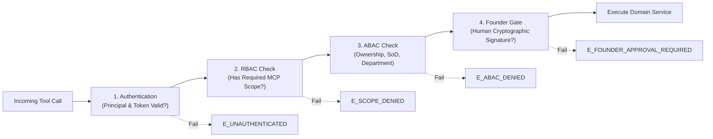

# AICO V3 MASTER BLUEPRINT — MCP API & EVENT CONTRACTS

**Document ID:** `BP-V3-04`  
**Version:** `3.2.0-reconciled`  
**Date:** 2026-11-07  
**Author:** `flash-02` — Engineering & QA Lead  
**Design Phase:** Architecture & Contracts Design Only (No Implementation Authorized)  
**Baseline Git Reference:** Branch `feat/v2.2.1-implementation`, Actual HEAD: `6f33ba5ea5515187db0445dad443f3d06d4aa3a4`  
**Target Workspace:** `D:\AI-COMPANY`

---

## 1. PROTOCOL ARCHITECTURE & CONVENTIONS

### 1.1 MCP Namespace & Standards
All AICO V3 MCP tools reside within the `company_*` namespace to maintain backward compatibility with v0.3.0 and v2.2.1 clients while expanding capabilities across the 7 core subsystems (`REQ-V3-003`).

1. **Format:** JSON-RPC 2.0 over standard Model Context Protocol (MCP).
2. **Transports:**
   - In-process / STDIO adapter (`company-mcp/src/index.ts`).
   - Local Loopback HTTP adapter (`http://127.0.0.1:3334/mcp`).
   - Strict binding to `127.0.0.1` only. Public gateway (:3335) remains disabled (`REQ-V3-004`).
3. **Canonical Tool Inventory:** Exactly **28** MCP tools are defined. There are zero phantom operations. Runtime state changes triggered by process crash or environment error are modeled as internal domain events (`aico.task.runtime_blocked`, `aico.task.runtime_unblocked`) and are not exposed as MCP tools.
4. **Response Envelope:** Every tool invocation returns a deterministic, typed JSON structure:
   ```json
   {
     "success": true,
     "data": { ... },
     "meta": {
       "request_id": "req-uuid-v4",
       "timestamp": 1794019200000,
       "caller_principal_id": "prn-flash02-uuid",
       "audit_sequence": 1042
     }
   }
   ```
5. **Standard Error Envelope:**
   ```json
   {
     "success": false,
     "error": {
       "code": "E_PERMISSION_DENIED",
       "message": "Agent 'codex-01' cannot approve its own task submission.",
       "subsystem": "GOVERNANCE",
       "details": {
         "task_id": "task-uuid",
         "required_role": "CTO_OR_QA",
         "current_role": "ENGINEER"
       }
     }
   }
   ```

---

## 2. STANDARD EVENT ENVELOPES (`aico.event.v3`)

The in-process Event Bus distributes decoupled domain events between layers (`REQ-V3-002`). Every event adheres to the standard `aico.event.v3` schema:

```typescript
export interface AicoDomainEvent<T = Record<string, unknown>> {
  event_id: string;              // UUIDv4
  event_type: string;            // e.g. "aico.task.status_changed", "aico.chat.message_posted"
  version: "3.0.0";
  correlation_id: string;        // Request or root task tracking ID
  timestamp: number;             // Unix Epoch ms
  actor_principal_id: string;    // Triggering human ('founder-01') or agent principal_id
  payload: T;
  tamper_hash: string;           // SHA-256 of canonical event representation (RFC 8785 JCS)
}
```

---

## 3. RFC 8785 (JCS) CANONICAL PAYLOAD SERIALIZATION SPECIFICATION

To prevent payload tampering, hash collision, and key-filtering bypasses in nested payloads (`RISK-V221-001`, `REQ-V3-030`), AICO V3 strictly mandates the **JSON Canonicalization Scheme (RFC 8785 / JCS)** for all payload hashing and signature verification.

### 3.1 JCS Normalization Rules
1. **Object Key Sorting:** Keys are sorted strictly by UTF-16 code units in ascending lexicographical order at all nesting depths.
2. **Whitespace:** Zero insignificant whitespace outside string literals (no space after `:` or `,`).
3. **Numbers:** Formatted per IEEE 754. Non-finite numbers (`NaN`, `Infinity`) throw `E_INVALID_PAYLOAD`.
4. **Strings:** Standard JSON escaping; UTF-16 surrogate pairs preserved.
5. **Arrays:** Array element order is strictly preserved (never sorted).
6. **Null and Booleans:** Serialized as literal `null`, `true`, `false`.

### 3.2 Canonical Test Vectors

#### Vector A (Key Ordering & Nested Objects):
- **Input Object:**
  ```json
  {"b": 2, "a": {"z": 10, "m": "test"}, "active": true}
  ```
- **JCS Canonical Form:**
  ```text
  {"a":{"m":"test","z":10},"active":true,"b":2}
  ```
- **SHA-256 Hash:**
  `8d8f07096c14dcbf6db8dc2c9a936aef42557ff63d6f0cf72d8e4125b0ff72e3`

#### Vector B (Array Preservation & Numeric Precision):
- **Input Object:**
  ```json
  {"tags": ["qa", "critical"], "timeout_ms": 5000, "meta": null}
  ```
- **JCS Canonical Form:**
  ```text
  {"meta":null,"tags":["qa","critical"],"timeout_ms":5000}
  ```
- **SHA-256 Hash:**
  `44e6bdf8e04040dafa68c858ba5381a1795c47f7d1b33fa1f0fa2a912bb03649`

---

## 4. SECURITY CONTRACTS: 4-LAYER AUTHORIZATION PIPELINE

Every MCP tool invocation passes through a 4-layer authorization pipeline:



### 4.1 Role & Scope Hierarchy (RBAC)

| Role | Default Scopes | Assigned Principals |
| :--- | :--- | :--- |
| `FOUNDER` | `*` (All scopes, full policy override) | Human Founder (Principal: `founder-01`) |
| `EXECUTIVE` | `company:*`, `task:*`, `room:*`, `memory:*`, `approval:request` | `chatgpt-01` (CEO) |
| `LEAD` | `task:*`, `room:*`, `memory:*`, `code:review`, `qa:verify`, `approval:request` | `flash-01` (CTO), `flash-02` (QA Lead) |
| `ENGINEER` | `task:claim`, `task:submit`, `room:post`, `room:read`, `memory:read`, `memory:write` | `codex-01` |
| `AUDITOR` | `audit:read`, `task:read`, `room:read`, `memory:read`, `code:inspect` | `argon-01`, `argon-02` |

### 4.2 Attribute-Based Access Control (ABAC) Rules
- **Rule ABAC-01 (Separation of Duties - Review, `REQ-V3-025`):** An agent cannot approve a technical review for a task it created or implemented (`task.creator_principal_id != caller_principal_id` AND `task_execution.agent_id != caller_agent_id`).
- **Rule ABAC-02 (Separation of Duties - QA Sign-off, `REQ-V3-025`):** Only `flash-02` (QA Lead) or `founder-01` (Human Founder) can issue QA verification on implementation tasks.
- **Rule ABAC-03 (Lease Exclusive Possession, `REQ-V3-023`):** Only the active leaseholder with matching `lease_nonce` can modify task state or submit deliverables.
- **Rule ABAC-04 (Private Memory Partitioning, `REQ-V3-017`):** Memory entries scoped as `AGENT_PRIVATE` can only be queried or mutated by the owning principal.
- **Rule ABAC-05 (Argon Specialist Inviolability, `REQ-V3-031`):** Tools attempting to invoke `argon-01` or `argon-02` require a pre-existing, valid, unconsumed human `APPROVAL` record signed by `founder-01` with exact JCS cryptographic payload hash match.

---

## 5. CANONICAL MCP TOOL CONTRACT CATALOG (28 TOOLS)

### 5.1 Subsystem 1: Organization & Identity (4 Tools)

#### 1. `company_get_info`
- **Purpose:** Retrieve company status, manifest version, active agents, and timestamp.
- **Scope:** `company:read`
- **Input Schema:** `{}`
- **Output Schema:** `{ company_name: string, version: string, active_agents: number, system_time: number }`
- **Principal Types Allowed:** `HUMAN`, `AGENT`
- **Preconditions:** Authenticated caller.
- **Idempotency:** Idempotent read.
- **Audit Event:** None (read-only telemetry).

#### 2. `company_list_agents`
- **Purpose:** List registered AI company agents and their active operational statuses.
- **Scope:** `company:read`
- **Input Schema:** `{ department?: string; include_status?: boolean; }`
- **Output Schema:** `Array<{ agent_id: string, display_name: string, role_title: string, department_id: string, status: string, default_model: string }>`
- **Principal Types Allowed:** `HUMAN`, `AGENT`
- **Idempotency:** Idempotent read.

#### 3. `company_get_agent`
- **Purpose:** Retrieve complete profile, capability tags, and quota assignment of a specific agent.
- **Scope:** `company:read`
- **Input Schema:** `{ agent_id: string }`
- **Output Schema:** `{ agent_id: string, display_name: string, role_title: string, department_id: string, capabilities: string[], quota_pool_id: string }`
- **Principal Types Allowed:** `HUMAN`, `AGENT`
- **Idempotency:** Idempotent read.

#### 4. `company_list_quota_pools`
- **Purpose:** List telemetry and consumption metrics across the 5 canonical quota pools.
- **Scope:** `company:read`
- **Input Schema:** `{}`
- **Output Schema:** `Array<{ quota_pool_id: string, provider: string, pool_type: string, hard_limit_tokens: number, total_tokens_consumed: number, estimated_cost_usd: number }>`
- **Principal Types Allowed:** `HUMAN`, `AGENT`
- **Idempotency:** Idempotent read.

---

### 5.2 Subsystem 2: Collaboration & Chat Rooms (7 Tools)

#### 5. `company_create_room` (`REQ-V3-011`)
- **Purpose:** Provision a collaboration room across the 6 canonical room types.
- **Scope:** `room:create`
- **Input Schema:**
  ```typescript
  {
    slug: string;
    title: string;
    room_type: "EXECUTIVE_BOARDROOM" | "ANNOUNCEMENTS" | "DEPARTMENT_OFFICE" | "PROJECT_ROOM" | "TASK_ROOM" | "DIRECT_MESSAGE";
    project_id?: string;
    task_id?: string;
    initial_member_principal_ids: string[];
  }
  ```
- **Output Schema:** `{ room_id: string, slug: string, created_at: number }`
- **Principal Types Allowed:** `HUMAN`, `AGENT`
- **Side Effects:** Inserts `chat_rooms`, inserts `room_memberships`, enqueues `aico.chat.room_created`.
- **Audit Event:** `chat.room_created`

#### 6. `company_list_rooms`
- **Purpose:** List chat rooms accessible to the calling principal.
- **Scope:** `room:read`
- **Input Schema:** `{ room_type?: string; project_id?: string; include_archived?: boolean; }`
- **Output Schema:** `Array<{ room_id: string, slug: string, title: string, room_type: string, is_archived: boolean }>`
- **Principal Types Allowed:** `HUMAN`, `AGENT`
- **Idempotency:** Idempotent read.

#### 7. `company_join_room`
- **Purpose:** Join a chat room or update membership role.
- **Scope:** `room:join`
- **Input Schema:** `{ room_id: string; principal_id: string; role?: "MEMBER" | "OBSERVER"; }`
- **Output Schema:** `{ membership_id: string, joined_at: number }`
- **Principal Types Allowed:** `HUMAN`, `AGENT`
- **Preconditions:** Caller is `founder-01` or joins self.
- **Side Effects:** Inserts or updates `room_memberships`.
- **Audit Event:** `chat.room_joined`

#### 8. `company_post_message` (`REQ-V3-012`, `REQ-V3-014`)
- **Purpose:** Post a structured message to a chat room or reply in a thread. (Canonical V3 operation; supersedes legacy v2.2.1 point-to-point messaging).
- **Scope:** `room:post`
- **Input Schema:**
  ```typescript
  {
    room_id: string;
    thread_id?: string;
    message_type?: "TEXT" | "DIRECTIVE" | "PROPOSAL" | "REVIEW_FEEDBACK" | "GATE_STATUS" | "SYSTEM_NOTICE";
    content: string;
    reply_to_message_id?: string;
    mentions?: string[]; // Array of principal_ids or agent slugs e.g. ['flash-01', 'founder-01']
    metadata?: Record<string, unknown>;
  }
  ```
- **Output Schema:** `{ message_id: string, created_at: number }`
- **Principal Types Allowed:** `HUMAN`, `AGENT`
- **ABAC Rule:** Caller must be active member of `room_id`.
- **Side Effects:** Inserts `messages`, routes mentions to `notifications_inbox`, enqueues `aico.chat.message_posted`.
- **Audit Event:** `chat.message_posted`

#### 9. `company_read_messages`
- **Purpose:** Read message history from a chat room or thread with pagination.
- **Scope:** `room:read`
- **Input Schema:** `{ room_id: string; thread_id?: string; limit?: number; before_message_id?: string; after_message_id?: string; }`
- **Output Schema:** `{ messages: Array<Record<string, unknown>>, has_more: boolean }`
- **Principal Types Allowed:** `HUMAN`, `AGENT`
- **Side Effects:** Updates `room_memberships.last_read_message_id`.

#### 10. `company_create_thread` (`REQ-V3-013`)
- **Purpose:** Open a focused discussion thread rooted on an existing message.
- **Scope:** `room:post`
- **Input Schema:** `{ room_id: string; root_message_id: string; title: string; }`
- **Output Schema:** `{ thread_id: string, status: "OPEN", created_at: number }`
- **Principal Types Allowed:** `HUMAN`, `AGENT`
- **Side Effects:** Inserts `threads`, enqueues `aico.chat.thread_created`.
- **Audit Event:** `chat.thread_created`

#### 11. `company_resolve_thread` (`REQ-V3-013`)
- **Purpose:** Mark a discussion thread resolved with summary and optional memory persistence.
- **Scope:** `room:post`
- **Input Schema:** `{ thread_id: string; resolution_summary: string; store_as_memory?: boolean; memory_scope?: string; memory_key?: string; }`
- **Output Schema:** `{ thread_id: string, status: "RESOLVED", resolved_at: number }`
- **Principal Types Allowed:** `HUMAN`, `AGENT`
- **Side Effects:** Updates `threads.status = 'RESOLVED'`, optionally creates `memory_entries` record.
- **Audit Event:** `chat.thread_resolved`

---

### 5.3 Subsystem 3: Task Orchestration & Workflow (10 Tools)

#### 12. `company_create_task` (`REQ-V3-021`, `REQ-V3-022`)
- **Purpose:** Create a root task or subtask linked into a DAG.
- **Scope:** `task:create`
- **Input Schema:**
  ```typescript
  {
    project_id: string;
    parent_task_id?: string;
    title: string;
    description: string;
    task_type: "ARCHITECTURE" | "CODE_MODIFICATION" | "TEST_RUN" | "AUDIT" | "MAINTENANCE";
    priority: "CRITICAL" | "HIGH" | "MEDIUM" | "LOW";
    token_budget?: number;
    assigned_agent_id?: string;
    reviewer_agent_id?: string;
    qa_agent_id?: string;
    depends_on_task_ids?: string[];
    requires_founder_gate?: boolean;
  }
  ```
- **Output Schema:** `{ task_id: string, status: "INTAKE_PENDING", created_at: number }`
- **Preconditions:** Kahn's cycle validation pass on dependencies.
- **Side Effects:** Inserts `tasks`, inserts `task_dependencies`, enqueues `aico.task.created`.
- **Audit Event:** `task.created`

#### 13. `company_list_tasks`
- **Purpose:** Query task lists with status, project, and assignee filters.
- **Scope:** `task:read`
- **Input Schema:** `{ project_id?: string; status?: string; assigned_agent_id?: string; limit?: number; }`
- **Output Schema:** `Array<Record<string, unknown>>`
- **Principal Types Allowed:** `HUMAN`, `AGENT`
- **Idempotency:** Idempotent read.

#### 14. `company_claim_task` (`REQ-V3-023`)
- **Purpose:** Claim an exclusive execution lease on an unleased task.
- **Scope:** `task:claim`
- **Input Schema:** `{ task_id: string; lease_duration_seconds?: number; }`
- **Preconditions:** Status in `READY_FOR_DEV` or `REOPENED`; 100% upstream dependencies in `DONE`; unleased.
- **Output Schema:** `{ task_id: string, lease_id: string, lease_nonce: string, expires_at: number, status: "IN_PROGRESS" }`
- **Principal Types Allowed:** `AGENT`
- **Side Effects:** Transitions `READY_FOR_DEV -> LEASE_ACQUISITION_PENDING -> IN_PROGRESS`, inserts `task_leases`.
- **Audit Event:** `task.claimed`

#### 15. `company_renew_lease` (`REQ-V3-023`)
- **Purpose:** Extend an active task lease heartbeat.
- **Scope:** `task:claim`
- **Input Schema:** `{ task_id: string; lease_id: string; lease_nonce: string; extend_seconds?: number; }`
- **Preconditions:** Caller is active leaseholder with matching nonce; `now < expires_at`.
- **Output Schema:** `{ success: true, expires_at: number }`
- **Principal Types Allowed:** `AGENT`
- **Side Effects:** Updates `task_leases.expires_at`, `heartbeat_at`.
- **Audit Event:** `task.lease_renewed`

#### 16. `company_submit_review` (`REQ-V3-025`)
- **Purpose:** Complete implementation, register deliverables, and submit task for technical review.
- **Scope:** `task:submit`
- **Input Schema:**
  ```typescript
  {
    task_id: string;
    lease_nonce: string;
    artifacts: Array<{ name: string; file_path: string; mime_type: string }>;
    git_head_commit?: string;
    summary_of_work: string;
  }
  ```
- **Output Schema:** `{ task_id: string, status: "IN_TECHNICAL_REVIEW" }`
- **Principal Types Allowed:** `AGENT`
- **Side Effects:** Forfeits lease, inserts `artifacts`, transitions `IN_PROGRESS -> IN_TECHNICAL_REVIEW`.
- **Audit Event:** `task.submitted_review`

#### 17. `company_approve_review` (`REQ-V3-025`)
- **Purpose:** Lead review of task deliverables with Separation of Duties enforcement.
- **Scope:** `code:review`
- **Input Schema:** `{ task_id: string; decision: "APPROVE" | "REQUEST_CHANGES"; review_comments: string; }`
- **ABAC Rules:** Caller cannot be task creator or implementer (`REQ-V3-025`). Caller must be `flash-01` (CTO) or `founder-01`.
- **Output Schema:** `{ task_id: string, new_status: "IN_QA_VERIFICATION" | "REWORK_REQUIRED" }`
- **Audit Event:** `task.review_decided`

#### 18. `company_verify_qa` (`REQ-V3-025`)
- **Purpose:** Submit independent QA verification evidence and sign-off.
- **Scope:** `qa:verify`
- **Input Schema:** `{ task_id: string; test_suite_run: string; evidence_report_path: string; verdict: "PASS" | "FAIL"; notes: string; }`
- **ABAC Rules:** Caller must be `flash-02` (QA Lead) or `founder-01` (Human Founder).
- **Output Schema:** `{ task_id: string, new_status: "READY_FOR_ACCEPTANCE" | "QA_REJECTED" }`
- **Audit Event:** `task.qa_verified`

#### 19. `company_complete_task`
- **Purpose:** Accept completed task deliverables and transition to `DONE`.
- **Scope:** `task:complete`
- **Input Schema:** `{ task_id: string; completion_notes?: string; }`
- **Preconditions:** Task is in `ACCEPTANCE_PENDING`. Caller is `chatgpt-01` (CEO) or `founder-01`.
- **Output Schema:** `{ task_id: string, status: "DONE", completed_at: number }`
- **Side Effects:** Auto-archives associated task room.
- **Audit Event:** `task.completed`

#### 20. `company_abort_task`
- **Purpose:** Abort a task in progress and forfeit leases.
- **Scope:** `task:manage`
- **Input Schema:** `{ task_id: string; reason: string; }`
- **Preconditions:** Caller is executive (`chatgpt-01`, `flash-01`) or `founder-01`.
- **Output Schema:** `{ task_id: string, status: "ABORTED" }`
- **Audit Event:** `task.aborted`

#### 21. `company_reopen_task`
- **Purpose:** Reopen a completed task upon discovery of a regression.
- **Scope:** `task:manage`
- **Input Schema:** `{ task_id: string; regression_report: string; }`
- **Preconditions:** Task is in `DONE`. Caller is `flash-02` (QA Lead) or `founder-01`.
- **Output Schema:** `{ task_id: string, status: "REOPENED" }`
- **Audit Event:** `task.reopened`

---

### 5.4 Subsystem 4: Memory & Context (4 Tools)

#### 22. `company_store_memory` (`REQ-V3-016`)
- **Purpose:** Persist episodic or declarative knowledge into one of 5 scoped tiers.
- **Scope:** `memory:write`
- **Input Schema:**
  ```typescript
  {
    scope: "COMPANY" | "PROJECT" | "TASK" | "ROOM" | "AGENT_PRIVATE";
    scope_id: string;
    category: "ARCHITECTURAL_DECISION" | "INCIDENT_LEARNING" | "PERFORMANCE_PATTERN" | "FACT";
    key: string;
    content: string;
    confidence_score?: number;
    provenance_ref?: string;
  }
  ```
- **Output Schema:** `{ memory_id: string, created_at: number }`
- **Side Effects:** Inserts `memory_entries`, synchronizes `memory_fts` via trigger.
- **Audit Event:** `memory.stored`

#### 23. `company_query_memory` (`REQ-V3-017`, `REQ-V3-020`)
- **Purpose:** Query scoped knowledge with keyword FTS5 or partition filtering.
- **Scope:** `memory:read`
- **Input Schema:** `{ scopes: string[]; scope_ids: string[]; category?: string; search_query?: string; }`
- **Output Schema:** `Array<Record<string, unknown>>`
- **ABAC Rule:** `AGENT_PRIVATE` entries visible only to the owning principal.

#### 24. `company_create_context_snapshot` (`REQ-V3-018`)
- **Purpose:** Capture a compact (<1,500 token) verified working memory state for task continuity. (Canonical V3 operation; supersedes legacy create_snapshot).
- **Scope:** `memory:write`
- **Input Schema:** `{ task_id: string; summary: string; active_hypotheses?: string[]; verified_facts: string[]; pending_steps: string[]; }`
- **Output Schema:** `{ snapshot_id: string, total_tokens: number, created_at: number }`
- **Audit Event:** `context.snapshot_created`

#### 25. `company_get_context_snapshot` (`REQ-V3-018`)
- **Purpose:** Retrieve the latest verified context snapshot for a task.
- **Scope:** `memory:read`
- **Input Schema:** `{ task_id: string; }`
- **Output Schema:** `{ snapshot_id: string, summary: string, verified_facts: string[], pending_steps: string[], total_tokens: number }`

---

### 5.5 Subsystem 5: Governance & Audit (3 Tools)

#### 26. `company_request_approval` (`REQ-V3-030`)
- **Purpose:** Initiate a formal authorization request gating a sensitive or specialist action.
- **Scope:** `approval:request`
- **Input Schema:**
  ```typescript
  {
    approval_type: "ARGON_INVOCATION" | "PRODUCTION_DEPLOY" | "SCHEMA_MIGRATION" | "ACL_APPLY";
    target_resource: string;
    canonical_payload: Record<string, unknown>; // Mandatory canonical payload
    justification: string;
    duration_minutes?: number;
  }
  ```
- **Preconditions:** `canonical_payload` is strictly mandatory. Computed `payload_sha256 = SHA256(JCS(canonical_payload))`.
- **Output Schema:** `{ approval_id: string, payload_sha256: string, status: "PENDING", expires_at: number }`
- **Audit Event:** `approval.requested`

#### 27. `company_decide_approval` (Verifiable Human Authorization, `REQ-V3-030`)
- **Purpose:** Execute formal human Founder decision with cryptographic signature over canonical payload hash.
- **Scope:** `approval:grant`
- **Input Schema:**
  ```typescript
  {
    approval_id: string;
    decision: "APPROVED" | "REJECTED";
    reason: string;
    human_signature: string; // Ed25519 signature by founder-01 over approval_id:payload_sha256:expires_at
  }
  ```
- **ABAC Rules:**
  - Caller principal MUST be `founder-01` (`principal_type = 'HUMAN'`).
  - AI agents CANNOT decide approvals (`E_HUMAN_AUTHORIZATION_REQUIRED`).
- **10-Step Atomic Consumption Transaction:**
  1. Load approved record `SELECT ... FOR UPDATE` (or exclusive SQLite write lock).
  2. Verify payload hash matches exact RFC 8785 JCS canonicalization.
  3. Verify Founder Ed25519 public key signature.
  4. Verify target resource and approval type match.
  5. Check `expires_at > Date.now()` and status is not `REVOKED`.
  6. Check status is `PENDING` (never consumed).
  7. Atomically update `status = 'APPROVED'` (or 'CONSUMED' upon execution dispatch).
  8. Create dispatch record.
  9. Enqueue outbox notification.
  10. Commit atomically.
- **Output Schema:** `{ approval_id: string, status: "APPROVED" | "REJECTED", decided_at: number }`
- **Audit Event:** `approval.decided`

#### 28. `company_query_audit_log` (`REQ-V3-032`)
- **Purpose:** Query the immutable, forward-hash-chained audit log with truncation detection. (Canonical V3 operation; supersedes legacy query_audit).
- **Scope:** `audit:read`
- **Input Schema:** `{ start_sequence?: number; limit?: number; verify_chain?: boolean; }`
- **Output Schema:** `{ events: Array<Record<string, unknown>>, chain_valid: boolean, last_anchor_verified: boolean }`

---

## 6. COMPLETE ERROR CODES & SUBSYSTEM CLASSIFICATION

| Error Code | HTTP / RPC Status | Description | Action Required |
| :--- | :--- | :--- | :--- |
| `E_UNAUTHENTICATED` | 401 Unauthorized | Bearer token missing, invalid, or revoked. | Provide valid credential. |
| `E_SCOPE_DENIED` | 403 Forbidden | Principal lacks required RBAC scope. | Request higher scope from Founder. |
| `E_ABAC_DENIED` | 403 Forbidden | Access denied due to ownership, department, or SoD rule. | Delegate to authorized role. |
| `E_HUMAN_AUTHORIZATION_REQUIRED`| 403 Forbidden | Attempt by AI agent to grant human Founder approval. | Must be executed by human Founder principal (`founder-01`). |
| `E_FOUNDER_APPROVAL_REQUIRED` | 403 Forbidden | Action requires manual single-use Founder approval. | Call `company_request_approval`. |
| `E_APPROVAL_EXPIRED` | 410 Gone | The approval token exceeded its `expires_at` timestamp. | Request fresh approval. |
| `E_APPROVAL_CONSUMED` | 409 Conflict | Single-use approval has already been redeemed. | Request fresh approval. |
| `E_PAYLOAD_MISMATCH` | 400 Bad Request | Execution payload hash does not match approved hash. | Execute exact approved payload. |
| `E_INVALID_PAYLOAD` | 400 Bad Request | Payload cannot be canonicalized (e.g. NaN, non-finite). | Correct payload format. |
| `E_LEASE_CONFLICT` | 409 Conflict | Task is currently locked by another active worker lease. | Wait for lease expiration or completion. |
| `E_LEASE_EXPIRED` | 410 Gone | Worker's lease expired before heartbeat/renewal. | Re-acquire lease. |
| `E_DEPENDENCY_BLOCKED` | 412 Precondition Failed | Upstream task dependencies are not yet complete. | Complete upstream tasks first. |
| `E_DEPENDENCY_CYCLE` | 422 Unprocessable Entity | Requested task dependency would create a cycle in DAG. | Remove circular dependency. |
| `E_INVALID_STATE_TRANSITION` | 422 Unprocessable Entity | Requested status change violates task state machine. | Follow proper transition sequence. |
| `E_TOKEN_BUDGET_EXCEEDED` | 429 Too Many Requests | Task or project exceeded allocated token expenditure. | Request budget increase. |
| `E_DATABASE_LOCKED` | 503 Service Unavailable | SQLite write lock contention exceeded busy timeout. | Retry with exponential backoff. |
