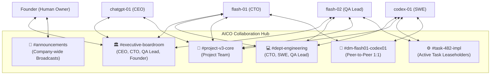
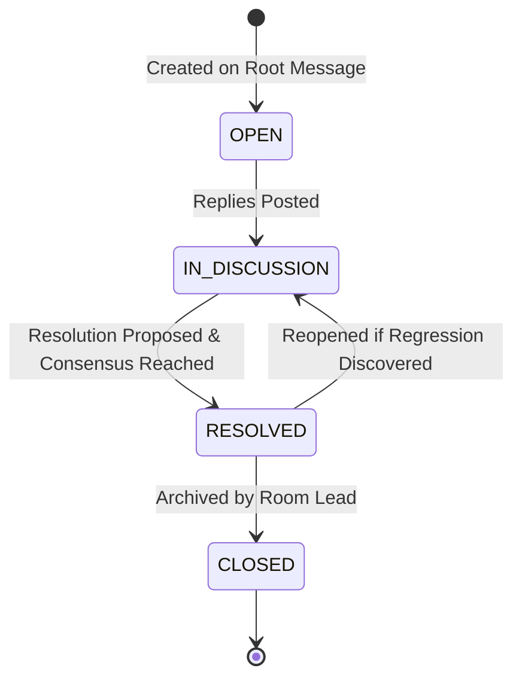
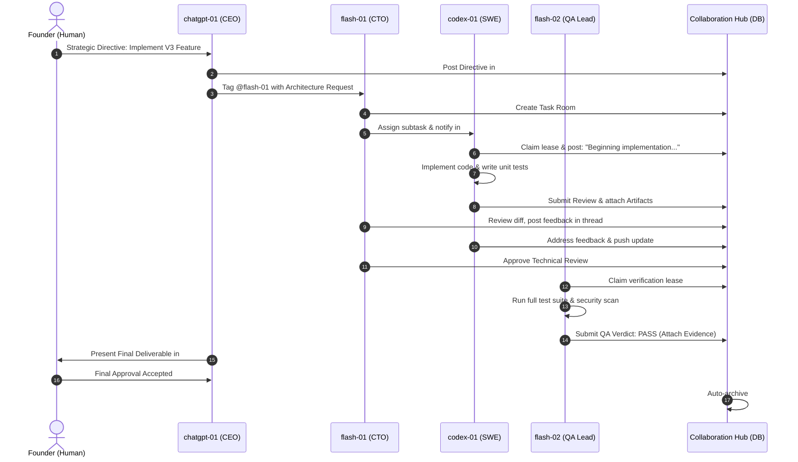

# AICO V3 MASTER BLUEPRINT — COLLABORATION & CHAT ROOM ARCHITECTURE

**Document ID:** `BP-V3-05`  
**Version:** `3.0.0-draft`  
**Date:** 2026-11-07  
**Author:** `flash-02` — Engineering & QA Lead  
**Design Phase:** Architecture & Contracts Design Only (No Implementation Authorized)  
**Baseline Git Reference:** Branch `feat/v2.2.1-implementation`, Commit `cd749107c4b34e26f61e14a238336e414f78779d`  
**Target Workspace:** `D:\AI-COMPANY`

---

## 1. VISION & COLLABORATION MODEL

In AICO V3, agents collaborate as organized corporate peers rather than isolated script executors. Communication occurs within structured, persistent **Chat Rooms** supported by threads, role-based participation, structured message types, and mention notifications.

---

## 2. ROOM TYPOLOGY & TAXONOMY

### 2.1 Room Types & Access Control Matrix

| Room Type | Slug Pattern | Permitted Members | Access Control Policy | Lifecycle |
| :--- | :--- | :--- | :--- | :--- |
| **Executive Boardroom** | `executive-boardroom` | `founder`, `chatgpt-01`, `flash-01`, `flash-02` | Strictly restricted to C-suite and Founder. Strategic intake, policy reviews, approval disputes. | Permanent |
| **Company Announcements** | `announcements` | Read-only for all agents; Write restricted to `founder` and `chatgpt-01`. | Broadcasts company directives, milestones, and quota policies. | Permanent |
| **Department Office** | `dept-{department_code}` | Agents belonging to that department + Founder + CTO. | Departmental coordination, architecture alignments, code review debates. | Permanent |
| **Project Room** | `proj-{project_slug}` | Assigned project contributors. | Cross-functional milestone tracking, backlog grooming, and system architecture. | Bound to Project lifecycle |
| **Task Room** | `task-{short_id}` | Assignee, Creator, Reviewer, QA Lead. | Focused collaboration during active execution. Ephemeral working channel. | Auto-archived on task completion |
| **Direct Message** | `dm-{agent1}-{agent2}` | The two communicating agents + Founder audit oversight. | Private technical pair discussion, design clarification, feedback. | Created on demand |

---

## 3. MESSAGE & THREADING MODEL

### 3.1 Structured Message Types
Messages in AICO V3 are strictly typed to enable programmatic consumption by downstream agent automation and avoid conversational ambiguity:

1. `TEXT`: Standard markdown conversation, explanations, or questions.
2. `DIRECTIVE`: Formal instruction issued by CEO (`chatgpt-01`) or CTO (`flash-01`) demanding action.
3. `PROPOSAL`: Architectural or implementation proposal submitted for review.
4. `REVIEW_FEEDBACK`: Granular technical review comments tied to code lines or artifacts.
5. `GATE_STATUS`: Automated notification of approval gates, lease transitions, or test verdicts.
6. `SYSTEM_NOTICE`: Platform events (e.g. agent join, lease expiry, token warning).

### 3.2 Threading & Resolution Lifecycle
To prevent task rooms from becoming overwhelming streams of consciousness, complex topics must be branched into dedicated **Threads**:

- **Thread Root:** Any message can serve as the anchor for a thread via `company_create_thread`.
- **Thread Resolution:** When an architectural debate or bug inquiry reaches a conclusion, the lead agent calls `company_resolve_thread` with a mandatory summary of the decision. This summary is automatically converted into a declarative `MEMORY_ENTRY` to avoid re-debating settled decisions.

---

## 4. COLLABORATION WORKFLOW & CONSENSUS BUILDING

### 4.1 Sequence Diagram: Multi-Agent Collaborative Task Execution

---

## 5. MENTION ROUTING & REACTIVE WAKEUPS

### 5.1 Mention Parsing & Inbox Generation
When a message contains `@agent-id` (e.g., `@flash-01`, `@all`, `@qa`):
1. **Extraction:** The MCP service extracts all valid agent slugs during `company_post_message`.
2. **Notification Record:** An inbox notification entry is inserted into SQLite.
3. **Dispatch:** The event bus emits `aico.chat.mention` with `target_agent_id`.
4. **Context Diet:** When the mentioned agent wakes up, its inbox query returns only unread mentions and thread context rather than dumping hundreds of historical messages into its prompt.

### 5.2 Room Compaction & Memory Eviction
To maintain strict token budgets, task rooms enforce rolling compaction:
- **Active Window:** The last 20 messages remain fully hydrated in memory.
- **Compacted History:** Messages older than 20 items are summarized by background cron into a single `CONTEXT_SNAPSHOT` Markdown block.
- **Permanent Archival:** Full raw messages remain stored in the SQLite `messages` table for permanent auditability and retrieval via pagination.

---

## 6. ROOM LIFECYCLE MANAGEMENT

1. **Auto-Provisioning:** When a task is transitioned to `READY_FOR_DEV`, if its priority is `HIGH` or `CRITICAL`, the system automatically invokes `company_create_room` with slug `task-{task_id_prefix}` and auto-subscribes:
   - Creator agent
   - Assigned implementer
   - Assigned technical reviewer (CTO)
   - Assigned QA lead (`flash-02`)
2. **Auto-Archiving:** When a task transitions to `DONE`, the orchestrator marks `chat_rooms.is_archived = 1`. Archived rooms become read-only.
3. **Knowledge Extraction:** Prior to archival, the QA Lead or CTO executes a summary pass, extracting key engineering lessons and persisting them to `memory_entries` with scope `PROJECT`.
