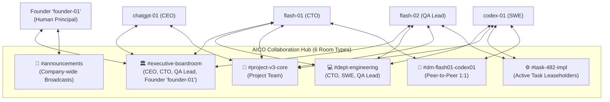
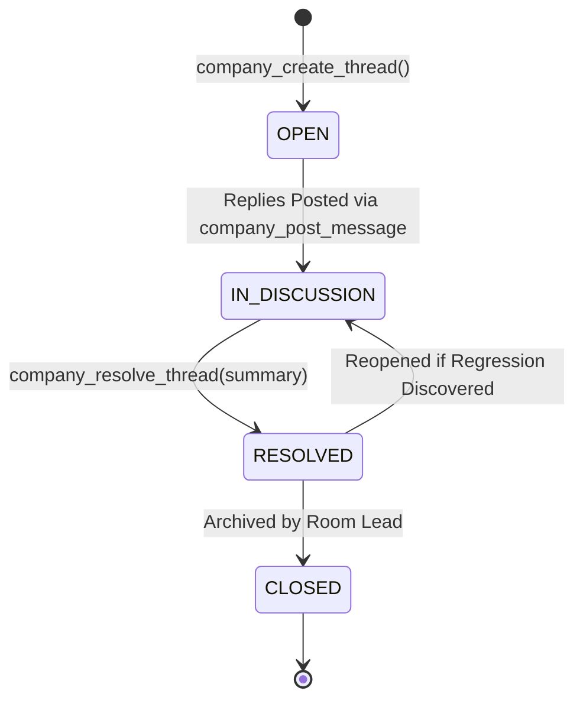

# AICO V3 MASTER BLUEPRINT — COLLABORATION & CHAT ROOM ARCHITECTURE

**Document ID:** `BP-V3-05`  
**Version:** `3.2.0-reconciled`  
**Date:** 2026-11-07  
**Author:** `flash-02` — Engineering & QA Lead  
**Design Phase:** Architecture & Contracts Design Only (No Implementation Authorized)  
**Baseline Git Reference:** Branch `feat/v2.2.1-implementation`, Actual HEAD: `6f33ba5ea5515187db0445dad443f3d06d4aa3a4`  
**Target Workspace:** `D:\AI-COMPANY`

---

## 1. VISION & COLLABORATION MODEL

In AICO V3, agents and the human Founder collaborate as organized corporate peers rather than isolated script executors (`REQ-V3-011`). Communication occurs within structured, persistent **Chat Rooms** supported by threads, role-based participation, structured message types, and mention notifications routed via `notifications_inbox` across unified principals (`principals(principal_id)`).



---

## 2. ROOM TYPOLOGY & TAXONOMY (6 CANONICAL TYPES)

### 2.1 Room Types & Access Control Matrix (`REQ-V3-011`)

| Room Type | Slug Pattern | Permitted Members | Access Control Policy | Lifecycle |
| :--- | :--- | :--- | :--- | :--- |
| **`EXECUTIVE_BOARDROOM`** | `executive-boardroom` | `founder-01`, `chatgpt-01`, `flash-01`, `flash-02` | Strictly restricted to C-suite and Founder. Strategic intake, policy reviews, approval disputes. | Permanent |
| **`ANNOUNCEMENTS`** | `announcements` | Read-only for all agents; Write restricted to `founder-01` and `chatgpt-01`. | Broadcasts company directives, milestones, and quota policies. | Permanent |
| **`DEPARTMENT_OFFICE`** | `dept-{department_code}` | Agents belonging to department + Founder (`founder-01`) + CTO (`flash-01`). | Departmental coordination, architecture alignments, code review debates. | Permanent |
| **`PROJECT_ROOM`** | `proj-{project_slug}` | Assigned project contributors (agents and `founder-01`). | Cross-functional milestone tracking, backlog grooming, and system architecture. | Bound to Project lifecycle |
| **`TASK_ROOM`** | `task-{short_id}` | Assignee, Creator, Reviewer, QA Lead, Founder. | Focused collaboration during active execution. Ephemeral working channel. | Auto-archived on task completion (`REQ-V3-015`) |
| **`DIRECT_MESSAGE`** | `dm-{principal1}-{principal2}` | The two communicating principals + Founder audit oversight. | Private technical pair discussion, design clarification, feedback. | Created on demand |

---

## 3. MESSAGE & THREADING MODEL

### 3.1 Structured Message Types (`REQ-V3-012`)
Messages in AICO V3 are strictly typed to enable programmatic consumption by downstream agent automation and avoid conversational ambiguity:

1. `TEXT`: Standard markdown conversation, explanations, or questions.
2. `DIRECTIVE`: Formal instruction issued by CEO (`chatgpt-01`) or CTO (`flash-01`) demanding action.
3. `PROPOSAL`: Architectural or implementation proposal submitted for review.
4. `REVIEW_FEEDBACK`: Granular technical review comments tied to code lines or artifacts.
5. `GATE_STATUS`: Automated notification of approval gates, lease transitions, or test verdicts.
6. `SYSTEM_NOTICE`: Platform events (e.g. agent join, lease expiry, token warning).

### 3.2 Threading & Resolution Lifecycle (`REQ-V3-013`)
To prevent task rooms from becoming overwhelming streams of consciousness, complex topics must be branched into dedicated **Threads**:



- **Thread Root:** Any message can serve as the anchor for a thread via `company_create_thread`.
- **Thread Resolution:** When an architectural debate or bug inquiry reaches a conclusion, the lead agent calls `company_resolve_thread` with a mandatory summary of the decision. This summary is automatically converted into a declarative `MEMORY_ENTRY` to avoid re-debating settled decisions (`REQ-V3-016`).

### 3.3 10-Step Memory Promotion from Thread Resolution
When a discussion thread is resolved via `company_resolve_thread(thread_id, summary, store_as_memory = true)`:
1. Validate calling principal is thread creator, room lead, or `founder-01`.
2. Ensure thread status is currently `OPEN`.
3. Compute summary token count (<500 tokens).
4. Atomically update `threads.status = 'RESOLVED'`, `resolved_by_principal_id = caller_principal_id`, `resolved_at = Date.now()`.
5. Post resolution system message into room with type `SYSTEM_NOTICE`.
6. Determine memory category (`ARCHITECTURAL_DECISION`, `INCIDENT_LEARNING`, or `PERFORMANCE_PATTERN`).
7. Determine scope (`PROJECT` if room is project-bound; `TASK` if task-bound; `COMPANY` if boardroom).
8. Generate canonical memory key: `decision.{thread_slug}.{date}`.
9. Insert into `memory_entries` with `provenance_principal_id = caller_principal_id` and `confidence_score = 1.0`.
10. Trigger `trg_memory_entries_ai` to synchronize SQLite FTS5 index automatically.

---

## 4. MENTION ROUTING & NOTIFICATIONS INBOX (`REQ-V3-014`)

### 4.1 Mention Extraction & Inbox Record Creation
When a message contains `@agent-id` or `@founder-01` (e.g., `@flash-01`, `@codex-01`, `@founder-01`, `@all`):
1. **Extraction:** The MCP service extracts all valid principal slugs during `company_post_message`.
2. **Inbox Insertion:** A new record is inserted into `notifications_inbox`:
   ```sql
   INSERT INTO notifications_inbox (
       notification_id, target_principal_id, source_type, source_id, title, content, is_read, created_at
   ) VALUES (
       :notification_id, :target_principal_id, 'MENTION', :message_id, :title, :content_snippet, 0, :now
   );
   ```
3. **Event Dispatch:** The in-process event bus emits `aico.chat.mention` with `target_principal_id` via `event_outbox`.
4. **Context Diet (`REQ-V3-026`):** When the mentioned agent wakes up, its inbox query returns only unread notifications rather than dumping hundreds of historical room messages into its prompt context.

---

## 5. ROOM LIFECYCLE MANAGEMENT (`REQ-V3-015`)

1. **Auto-Provisioning:** When a task is transitioned to `READY_FOR_DEV`, if its priority is `HIGH` or `CRITICAL`, the system automatically invokes `company_create_room` with slug `task-{task_id_prefix}` and auto-subscribes:
   - Creator principal
   - Assigned implementer (`codex-01`)
   - Assigned technical reviewer (CTO `flash-01`)
   - Assigned QA lead (`flash-02`)
   - Founder (`founder-01`)
2. **Auto-Archiving:** When a task transitions to `DONE`, the orchestrator marks `chat_rooms.is_archived = 1`. Archived rooms become read-only.
3. **Knowledge Extraction:** Prior to archival, the QA Lead or CTO executes a summary pass, extracting key engineering lessons and persisting them to `memory_entries` with scope `PROJECT` (`REQ-V3-016`).
