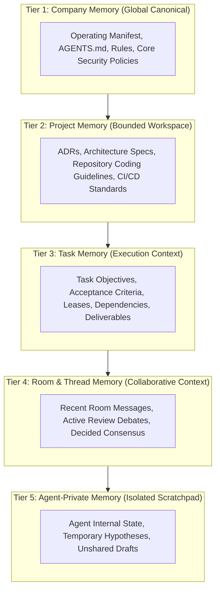
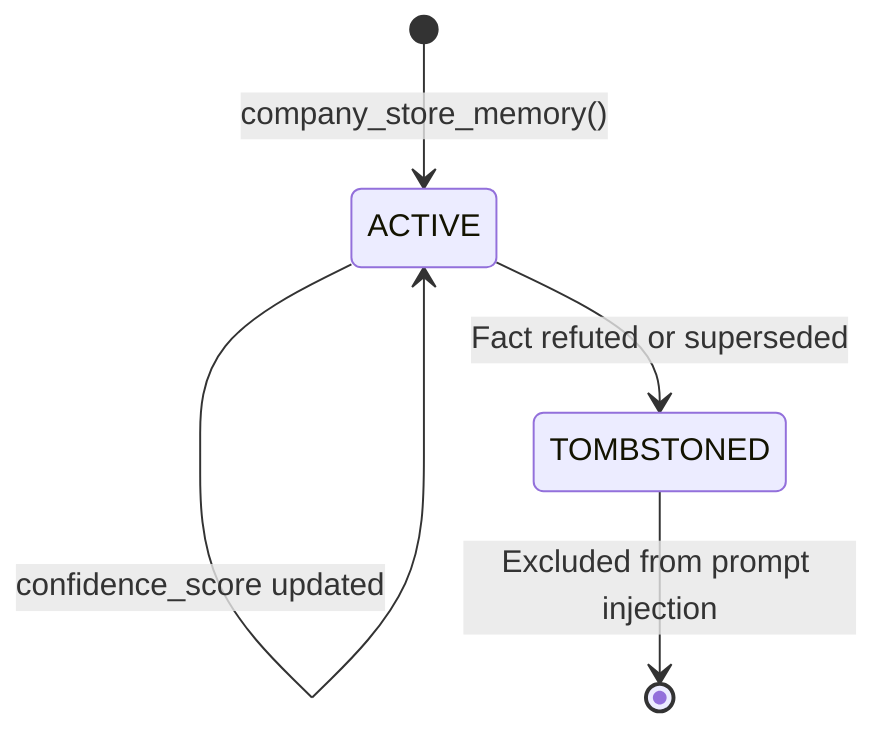

# AICO V3 MASTER BLUEPRINT — UNIFIED CONTEXT & MEMORY ARCHITECTURE

**Document ID:** `BP-V3-06`  
**Version:** `3.1.0-reconciled`  
**Date:** 2026-11-07  
**Author:** `flash-02` — Engineering & QA Lead  
**Design Phase:** Architecture & Contracts Design Only (No Implementation Authorized)  
**Baseline Git Reference:** Branch `feat/v2.2.1-implementation`, Commit `cd749107c4b34e26f61e14a238336e414f78779d`  
**Actual HEAD:** `21f3aad16911eb076e2245a791bde51178a0d222`  
**Target Workspace:** `D:\AI-COMPANY`

---

## 1. VISION & MEMORY HIERARCHY

LLM agent context windows are precious and expensive resources. Dumping entire transcripts, multiple markdown specifications, and unfiltered conversation history into an agent prompt leads to attention dilution, hallucinations, and catastrophic token costs.

AICO V3 replaces unorganized prompt stuffing with a **5-Tier Scoped Memory Hierarchy** (`REQ-V3-016`):



---

## 2. MEMORY TIERS & PARTITIONING SPECIFICATION (`REQ-V3-016`, `REQ-V3-017`)

| Tier | Scope Enum | Access Policy | Lifetime | Storage Location | Invalidation Trigger |
| :--- | :--- | :--- | :--- | :--- | :--- |
| **1. Company** | `COMPANY` | Read: All Agents. Write: `founder-human`, `chatgpt-01`, `flash-01`. | Permanent | `memory_entries` + canonical `.md` files | Founder manifest update |
| **2. Project** | `PROJECT` | Read: Project members. Write: CTO, Lead, Assigned Engineers. | Project duration | `memory_entries` + `docs/adr/` | Architectural revision |
| **3. Task** | `TASK` | Read: All project agents. Write: Active leaseholder, Reviewer, QA. | Task duration | `tasks` + `context_snapshots` | Task completion or lease re-claim |
| **4. Room** | `ROOM` | Read/Write: Active room members. | Rolling / Archived | `messages` + `threads` | Room archival or rolling compaction |
| **5. Private** | `AGENT_PRIVATE` | Read/Write: Strictly owning agent. **Zero cross-agent leakage (`REQ-V3-017`).** | Session or long-term | `memory_entries` (isolated by `scope_id = agent_id`) | Agent explicit overwrite or tombstone |

---

## 3. TYPES OF STORED KNOWLEDGE

AICO V3 categorizes memory into three fundamental cognitive types:

### 3.1 Declarative Knowledge (Facts & Rules)
- **Examples:** "Production database `data/aico.db` is strictly frozen at v0.3.0", "Argon invocation requires single-use Founder approval".
- **Storage:** Key-value records in `memory_entries` with category `FACT` or `ARCHITECTURAL_DECISION`.
- **Validation:** Must link to a canonical file path, commit hash, or task ID (`provenance_ref`, `REQ-V3-019`).

### 3.2 Episodic Knowledge (Incidents & Historical Experience)
- **Examples:** "Bug fix for SQLite WAL busy timeout required `PRAGMA busy_timeout = 5000`", "Argon audit on commit `cd74910` uncovered unenforced task lease check".
- **Storage:** `memory_entries` with category `INCIDENT_LEARNING` or `PERFORMANCE_PATTERN`.
- **Usage:** Injected into prompt during task planning to prevent repeating past engineering errors.

### 3.3 Procedural Knowledge (Workflows & Skills)
- **Examples:** How to run an independent code review, how to execute test suites under PowerShell on Windows.
- **Storage:** Markdown files in `.agents/skills/<skill-name>/SKILL.md`.
- **Usage:** Loaded just-in-time via Dynamic Capability Discovery (`REQ-V3-026`).

---

## 4. CONTEXT SNAPSHOTTING & TOKEN DIET (`REQ-V3-018`)

### 4.1 The Rehydration Problem
When an agent session restarts or a task is handed off from implementation (`codex-01`) to QA (`flash-02`), reading hundreds of lines of transcript consumes massive tokens and induces cognitive overload.

### 4.2 Structured Context Snapshot Schema (<1,500 Tokens)
AICO V3 uses formal **Context Snapshots** to compress state into a standardized, deterministic schema under 1,500 tokens:

```json
{
  "snapshot_id": "snap-9842a1-uuid",
  "task_id": "task-482-auth",
  "agent_id": "codex-01",
  "created_at": 1794019200000,
  "summary": "Completed initial implementation of company_renew_lease with SQLite optimistic locking.",
  "active_hypotheses": [
    "Does exponential backoff under SQLite lock contention cause high event loop jitter on Windows?"
  ],
  "verified_facts": [
    "SQLite PRAGMA busy_timeout is confirmed active at 5000ms (verified in test/integration/sqlite-busy.test.ts:42).",
    "Unit tests pass 100% on node test runner (exit code 0)."
  ],
  "pending_steps": [
    "Execute concurrency stress test with 10 parallel lease claim requests.",
    "Submit task for Technical Review by flash-01."
  ],
  "total_tokens": 420
}
```

---

## 5. PROVENANCE, FRESHNESS & TOMBSTONING (`REQ-V3-019`)

### 5.1 Provenance Tracking
Every memory item stored in `memory_entries` must record:
- `provenance_agent_id`: The author agent.
- `provenance_ref`: Verifiable proof (e.g. `commit:cd74910`, `file:company-manifest.json#L40`, `task:uuid`).
- `confidence_score`: Float between 0.0 (speculative) and 1.0 (verified by test/commit).

### 5.2 Tombstoning & Invalidation (Soft Deletion)
In autonomous multi-agent environments, deleting historical records causes synchronization inconsistencies and breaks audit chains. When a fact is refuted or superseded:
1. `is_tombstoned` is updated to `1`.
2. `tombstone_reason` is set (e.g., "Superseded by ADR 0004").
3. Active memory lookups filter `WHERE is_tombstoned = 0`.
4. Historical audit queries can reconstruct the exact state of knowledge at any historical timestamp.



---

## 6. SEARCH & RETRIEVAL STRATEGY (`REQ-V3-020`)

### 6.1 SQLite FTS5 Full-Text Search with Trigger Sync
For local single-node operation without external cloud dependencies, AICO V3 implements SQLite Full-Text Search (FTS5):
```sql
CREATE VIRTUAL TABLE IF NOT EXISTS memory_fts USING fts5(
    key,
    content,
    scope,
    category,
    content='memory_entries',
    content_rowid='rowid'
);
```
- **Automated Synchronization:** Synchronized automatically via database triggers (`trg_memory_entries_ai`, `trg_memory_entries_ad`, `trg_memory_entries_au`).
- **BM25 Ranking:** Fast, sub-millisecond keyword relevance scoring across all permitted memory scopes.
- **Zero Token Cost:** Filtered locally inside SQLite before any tokens are sent to LLMs.

### 6.2 Semantic Vector Search Roadmap (`DEC-V3-001`)
- As evaluated in `DEC-V3-001`, Phase 4 introduces in-process vector embeddings with reciprocal rank fusion (RRF) merging BM25 and vector similarity scores.
