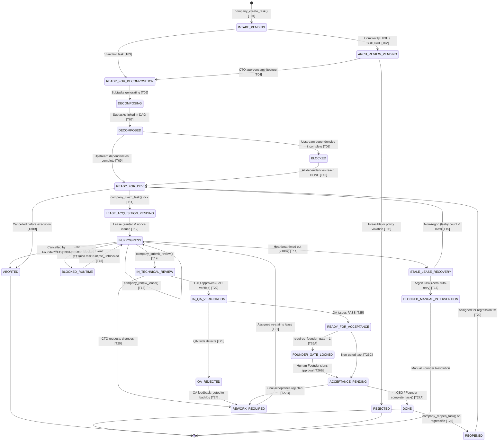

# AICO V3 MASTER BLUEPRINT — TASK & COLLABORATIVE ORCHESTRATION

**Document ID:** `BP-V3-07`  
**Version:** `3.2.0-reconciled`  
**Date:** 2026-11-07  
**Author:** `flash-02` — Engineering & QA Lead  
**Design Phase:** Architecture & Contracts Design Only (No Implementation Authorized)  
**Baseline Git Reference:** Branch `feat/v2.2.1-implementation`, Actual HEAD: `6f33ba5ea5515187db0445dad443f3d06d4aa3a4`  
**Target Workspace:** `D:\AI-COMPANY`

---

## 1. ORCHESTRATION OVERVIEW & DESIGN PRINCIPLES

In AICO V3, complex software engineering initiatives are executed through an autonomous, hierarchical workflow engine (`REQ-V3-021`). Work is structured as Directed Acyclic Graphs (DAGs) of tasks with strict Separation of Duties (SoD), non-conflicting leases, heartbeat monitoring, and multi-tier verification gates.

### 1.1 Core Principles
1. **DAG Decomposition (`REQ-V3-022`):** Complex goals are broken into granular tasks with explicit dependency constraints.
2. **Deterministic Ownership (`REQ-V3-023`):** Exactly one agent holds an exclusive lease on an active task.
3. **Four-Eyes Principle (SoD, `REQ-V3-025`):** The creator or implementer of code cannot review or verify their own work.
4. **Mandatory QA Sign-Off (`REQ-V3-025`):** No task can transition to `DONE` without explicit, independent verification evidence submitted by `flash-02` (QA Lead).
5. **Partitioned Lease Recovery (`REQ-V3-024`, `REQ-V3-031`):** Inactive standard workers forfeit leases to queue. **Expired Argon tasks transition to `BLOCKED_MANUAL_INTERVENTION` and require human Founder intervention; they are NEVER automatically retried or returned to `READY_FOR_DEV`.**

---

## 2. THE CANONICAL 23-STATE TASK STATE MACHINE

The state machine encapsulates exactly **23** mutually exclusive states (with zero aliases):



---

## 3. STATE TRANSITION AUTHORIZATION & VALIDATION MATRIX (34 CANONICAL TRANSITIONS)

Every transition row maps 1-to-1 to the state diagram and specifies its exact actor, RBAC scope, ABAC rule, preconditions, atomic side effects, and audit event (`REQ-V3-021`). There are zero phantom tools.

| ID | From State | To State | Trigger / Operation | Actor | Scope | ABAC Rule | Preconditions | Side Effects | Audit Event |
| :---: | :--- | :--- | :--- | :--- | :--- | :--- | :--- | :--- | :--- |
| **TR-01** | `[*] ` | `INTAKE_PENDING` | `company_create_task` | `chatgpt-01`, `flash-01`, `founder-01` | `task:create` | None | Valid project_id | Inserts task record | `task.created` |
| **TR-02** | `INTAKE_PENDING` | `ARCH_REVIEW_PENDING`| Auto-Router (Internal Event) | Orchestrator | `system` | None | Priority HIGH/CRITICAL | Alerts CTO | `task.routed_arch_review` |
| **TR-03** | `INTAKE_PENDING` | `READY_FOR_DECOMPOSITION`| Auto-Router (Internal Event) | Orchestrator | `system` | None | Priority STANDARD/LOW | Ready for decomposition | `task.routed_decomp` |
| **TR-04** | `ARCH_REVIEW_PENDING`| `READY_FOR_DECOMPOSITION` | `company_approve_review` | `flash-01` (CTO), `founder-01` | `code:review` | Anti-self-approval | Reviewer = CTO | Advances task | `task.arch_approved` |
| **TR-05** | `ARCH_REVIEW_PENDING`| `REJECTED` | `company_approve_review` | `flash-01` (CTO), `founder-01` | `code:review` | Anti-self-approval | Infeasible or policy violation | Terminal rejection | `task.rejected` |
| **TR-06** | `READY_FOR_DECOMPOSITION`| `DECOMPOSING` | Orchestrator (Internal Event) | `chatgpt-01` (CEO), `flash-01` | `task:create` | Department Lead | Parent decomposition started | Sets decomposing flag | `task.decomposing_started` |
| **TR-07** | `DECOMPOSING` | `DECOMPOSED` | `company_create_task` (Subtasks)| `chatgpt-01` (CEO), `flash-01` | `task:create` | Department Lead | DAG cycle check pass (Kahn's) | Links subtask edges | `task.decomposed` |
| **TR-08** | `DECOMPOSED` | `BLOCKED` | Dependency Engine | Orchestrator | `system` | None | >=1 upstream not DONE | Sets blocking flag | `task.blocked_dependency` |
| **TR-09** | `DECOMPOSED` | `READY_FOR_DEV` | Dependency Engine | Orchestrator | `system` | None | 0 upstream dependencies | Unblocks task for claims | `task.ready_for_dev` |
| **TR-10** | `BLOCKED` | `READY_FOR_DEV` | Dependency Engine | Orchestrator | `system` | None | 100% upstream tasks reach DONE | Unblocks task | `task.unblocked` |
| **TR-11** | `READY_FOR_DEV` | `LEASE_ACQUISITION_PENDING`| `company_claim_task` | Assigned Agent | `task:claim` | Matching capability | Task unleased | Optimistic lock set | `task.lease_claim_started` |
| **TR-12** | `LEASE_ACQUISITION_PENDING`| `IN_PROGRESS` | Atomic Commit (Internal Event)| Orchestrator | `system` | Lease lock valid | No lease collision | Inserts `task_leases` | `task.claimed` |
| **TR-13** | `IN_PROGRESS` | `IN_PROGRESS` | `company_renew_lease` | Leaseholder | `task:claim` | Leaseholder match | `now < expires_at` | Extends `expires_at` | `task.lease_renewed` |
| **TR-14** | `IN_PROGRESS` | `STALE_LEASE_RECOVERY` | Lease Monitor Cron | Orchestrator | `system` | None | `now > expires_at` (>180s timeout) | Enters recovery queue | `task.lease_stale_detected` |
| **TR-15** | `STALE_LEASE_RECOVERY` | `READY_FOR_DEV` | Lease Sweeper | Orchestrator | `system` | Non-Argon Worker | Retry count < max | Deletes lease; re-queues | `task.lease_recovered` |
| **TR-16** | `STALE_LEASE_RECOVERY` | `BLOCKED_MANUAL_INTERVENTION`| Lease Sweeper | Orchestrator | `system` | Argon Specialist (`REQ-V3-031`)| Assigned = Argon or retries max | Deletes lease; alerts Founder | `task.argon_lease_blocked` |
| **TR-17** | `IN_PROGRESS` | `BLOCKED_RUNTIME` | Event: `aico.task.runtime_blocked`| Runtime Observer | `system` | Leaseholder match | Environment or container error | Holds lease; emits alert | `task.runtime_blocked` |
| **TR-18** | `BLOCKED_RUNTIME` | `IN_PROGRESS` | Event: `aico.task.runtime_unblocked`| Runtime Observer | `system` | Leaseholder match | Environment error healed | Resumes execution | `task.runtime_unblocked` |
| **TR-19** | `IN_PROGRESS` | `IN_TECHNICAL_REVIEW`| `company_submit_review` | Leaseholder | `task:submit` | Leaseholder match | Deliverable artifacts provided | Forfeits lease; notifies lead | `task.submitted_review` |
| **TR-20** | `IN_TECHNICAL_REVIEW`| `REWORK_REQUIRED` | `company_approve_review` | `flash-01` (CTO), `founder-01` | `code:review` | SoD check (`REQ-V3-025`)| Decision = REQUEST_CHANGES | Notifies assignee | `task.review_rejected` |
| **TR-21** | `REWORK_REQUIRED` | `IN_PROGRESS` | `company_claim_task` | Assignee | `task:claim` | Assignee match | Unleased | Re-acquires lease | `task.rework_started` |
| **TR-22** | `IN_TECHNICAL_REVIEW`| `IN_QA_VERIFICATION` | `company_approve_review` | `flash-01` (CTO), `founder-01` | `code:review` | SoD check (`REQ-V3-025`)| Decision = APPROVE | Enqueues QA verification | `task.review_approved` |
| **TR-23** | `IN_QA_VERIFICATION` | `QA_REJECTED` | `company_verify_qa` | `flash-02` (QA Lead), `founder-01` | `qa:verify` | Designated QA Role | Verdict = FAIL | Records defect report | `task.qa_rejected` |
| **TR-24** | `QA_REJECTED` | `REWORK_REQUIRED` | Auto-Router (Internal Event) | Orchestrator | `system` | None | Defect logged | Routes to rework backlog | `task.routed_rework` |
| **TR-25** | `IN_QA_VERIFICATION` | `READY_FOR_ACCEPTANCE`| `company_verify_qa` | `flash-02` (QA Lead), `founder-01` | `qa:verify` | Designated QA Role | Verdict = PASS | Sets QA pass flag | `task.qa_passed` |
| **TR-26A**| `READY_FOR_ACCEPTANCE`| `FOUNDER_GATE_LOCKED`| Safety Engine | Orchestrator | `system` | None | `requires_founder_gate = 1` | Locks task for Founder | `task.founder_gate_locked` |
| **TR-26B**| `FOUNDER_GATE_LOCKED`| `ACCEPTANCE_PENDING` | `company_decide_approval`| `founder-01` (Human) | `approval:grant` | Human Principal (`REQ-V3-030`)| JCS SHA-256 match, Ed25519 valid | Consumes approval | `task.founder_gate_approved` |
| **TR-26C**| `READY_FOR_ACCEPTANCE`| `ACCEPTANCE_PENDING` | Safety Engine | Orchestrator | `system` | None | `requires_founder_gate = 0` | Advances to final sign-off | `task.acceptance_pending` |
| **TR-27A**| `ACCEPTANCE_PENDING` | `DONE` | `company_complete_task` | `chatgpt-01` (CEO), `founder-01` | `task:complete` | Executive Role | Acceptance criteria satisfied | Auto-archives task room | `task.completed` |
| **TR-27B**| `ACCEPTANCE_PENDING` | `REWORK_REQUIRED` | `company_complete_task` (Reject)| `chatgpt-01` (CEO), `founder-01` | `task:complete` | Executive Role | Final acceptance rejected | Routes to rework | `task.acceptance_rejected` |
| **TR-28** | `DONE` | `REOPENED` | `company_reopen_task` | `flash-02` (QA Lead), `founder-01` | `task:manage` | QA Lead / Founder | Regression report provided | Clears completed_at | `task.reopened` |
| **TR-29** | `REOPENED` | `READY_FOR_DEV` | Orchestrator (Internal Event) | Orchestrator | `system` | None | Re-queued for fix | Ready for re-claim | `task.reopened_queued` |
| **TR-30A**| `IN_PROGRESS` | `ABORTED` | `company_abort_task` | `chatgpt-01` (CEO), `founder-01` | `task:manage` | Executive Role | Cancellation reason provided | Releases active lease, aborts execution | `task.aborted` |
| **TR-30B**| `READY_FOR_DEV` | `ABORTED` | `company_abort_task` | `chatgpt-01` (CEO), `founder-01` | `task:manage` | Executive Role | Cancellation reason provided | Removes from queue before lease grant | `task.aborted` |

---

## 4. PARTITIONED LEASE RECOVERY SPECIFICATION (`REQ-V3-024`, `REQ-V3-031`)

### 4.1 Blanket Recovery Removal & Safety Logic
To completely eliminate the safety violation of blanket lease recovery (`RISK-V221-004`), the lease sweeper executes strict conditional partitioning:

```typescript
export async function recoverExpiredLeases(db: Database): Promise<void> {
  const now = Date.now();
  const expiredLeases = db.prepare(`
    SELECT l.lease_id, l.task_id, l.agent_id, t.task_type, t.requires_founder_gate
    FROM task_leases l
    JOIN tasks t ON l.task_id = t.task_id
    WHERE l.expires_at < ?
  `).all(now);

  for (const lease of expiredLeases) {
    const isArgon = lease.agent_id === 'argon-01' || lease.agent_id === 'argon-02' || lease.task_type === 'SPECIALIST';

    if (isArgon) {
      // TR-16: NEVER auto-retry Argon. Lock in BLOCKED_MANUAL_INTERVENTION
      db.transaction(() => {
        db.prepare(`UPDATE tasks SET status = 'BLOCKED_MANUAL_INTERVENTION', updated_at = ? WHERE task_id = ?`)
          .run(now, lease.task_id);
        db.prepare(`DELETE FROM task_leases WHERE lease_id = ?`).run(lease.lease_id);
        insertAuditEvent(db, {
          actor: 'orchestrator',
          action: 'task.argon_lease_blocked',
          target_type: 'task',
          target_id: lease.task_id,
          payload: { reason: 'Argon lease expired; manual Founder intervention required' }
        });
      })();
      postBoardroomAlert(`CRITICAL: Task ${lease.task_id} assigned to Argon expired. Moved to BLOCKED_MANUAL_INTERVENTION. Zero auto-retry.`);
    } else {
      // TR-15: Standard worker recovery
      db.transaction(() => {
        db.prepare(`UPDATE tasks SET status = 'READY_FOR_DEV', updated_at = ? WHERE task_id = ?`)
          .run(now, lease.task_id);
        db.prepare(`DELETE FROM task_leases WHERE lease_id = ?`).run(lease.lease_id);
        insertAuditEvent(db, {
          actor: 'orchestrator',
          action: 'task.lease_recovered',
          target_type: 'task',
          target_id: lease.task_id,
          payload: { previous_agent: lease.agent_id }
        });
      })();
    }
  }
}
```

---

## 5. DIRECTED ACYCLIC GRAPH (DAG) RESOLUTION (`REQ-V3-022`)

1. **Cycle Prevention:** Prior to persisting dependencies in `task_dependencies`, Kahn's algorithm validates that the graph remains cycle-free. Any attempt to introduce circular edges fails immediately with `E_DEPENDENCY_CYCLE`.
2. **Parallel Fan-Out:** When a parent task decomposes into independent subtasks, all subtasks with in-degree 0 immediately enter `READY_FOR_DEV` for parallel claims by distinct workers.
3. **Barrier Synchronization (Fan-In):** Integrating tasks remain in `BLOCKED` until all parent prerequisites enter `DONE`.
