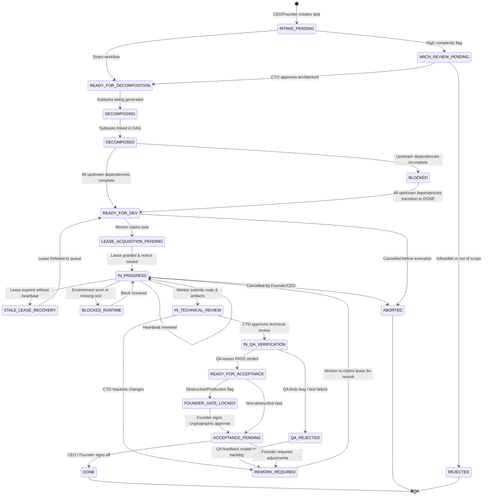

# AICO V3 MASTER BLUEPRINT — TASK & COLLABORATIVE ORCHESTRATION

**Document ID:** `BP-V3-07`  
**Version:** `3.0.0-draft`  
**Date:** 2026-11-07  
**Author:** `flash-02` — Engineering & QA Lead  
**Design Phase:** Architecture & Contracts Design Only (No Implementation Authorized)  
**Baseline Git Reference:** Branch `feat/v2.2.1-implementation`, Commit `cd749107c4b34e26f61e14a238336e414f78779d`  
**Target Workspace:** `D:\AI-COMPANY`

---

## 1. ORCHESTRATION OVERVIEW & DESIGN PRINCIPLES

In AICO V3, complex software engineering initiatives are executed through an autonomous, hierarchical workflow engine. Work is structured as Directed Acyclic Graphs (DAGs) of tasks with strict Separation of Duties (SoD), non-conflicting leases, heartbeat monitoring, and multi-tier verification gates.

### 1.1 Core Principles
1. **DAG Decomposition:** Complex goals are broken into granular tasks with explicit dependency constraints.
2. **Deterministic Ownership:** Exactly one agent holds an exclusive lease on an active task.
3. **Four-Eyes Principle (SoD):** The creator or implementer of code cannot review or verify their own work.
4. **Mandatory QA Sign-Off:** No task can transition to `DONE` without explicit, independent verification evidence submitted by `flash-02` (QA Lead).
5. **Lease Liveness & Recovery:** Inactive or crashed workers lose leases after timeout, enabling automatic failover without human intervention.

---

## 2. THE 30-STATE EXTENDED TASK STATE MACHINE



---

## 3. STATE TRANSITION AUTHORIZATION & VALIDATION MATRIX

| # | Current State | Target State | Triggering Operation | Authorized Actors | Required Preconditions & Validations |
| :--- | :--- | :--- | :--- | :--- | :--- |
| **T01** | `[*] ` | `INTAKE_PENDING` | `company_create_task` | `founder`, `chatgpt-01`, `flash-01` | Valid `project_id`, non-empty title/desc. |
| **T02** | `INTAKE_PENDING` | `ARCH_REVIEW_PENDING`| Automatic / Routing | Orchestrator | Complexity tagged `HIGH` or `CRITICAL`. |
| **T03** | `ARCH_REVIEW_PENDING`| `READY_FOR_DECOMP` | `company_approve_review`| `flash-01` (CTO), `founder` | Architectural approach validated. |
| **T04** | `READY_FOR_DECOMP` | `DECOMPOSED` | `company_create_task` (subtasks)| `chatgpt-01` (CEO), `flash-01` (CTO)| Subtasks created; DAG validated cycle-free. |
| **T05** | `DECOMPOSED` | `BLOCKED` | Dependency Engine | Orchestrator | >= 1 upstream dependency in non-`DONE` state. |
| **T06** | `DECOMPOSED` / `BLOCKED`| `READY_FOR_DEV` | Dependency Engine | Orchestrator | 100% upstream dependencies in `DONE` status. |
| **T07** | `READY_FOR_DEV` | `IN_PROGRESS` | `company_claim_task` | Assigned Agent or Capability Pool | Task unleased; caller role matches requirement. |
| **T08** | `IN_PROGRESS` | `IN_PROGRESS` | `company_renew_lease`| Leaseholder | Lease valid; caller holds matching nonce. |
| **T09** | `IN_PROGRESS` | `STALE_LEASE_RECOVERY`| Lease Monitor | Orchestrator Cron | `now() > expires_at` (Heartbeat missed > 180s). |
| **T10** | `STALE_LEASE_RECOVERY`| `READY_FOR_DEV` | Recovery Handler | Orchestrator | Delete lease; increment failure attempt count. |
| **T11** | `IN_PROGRESS` | `IN_TECHNICAL_REVIEW`| `company_submit_review`| Leaseholder | Artifacts and commit hash provided. Lease freed. |
| **T12** | `IN_TECHNICAL_REVIEW`| `REWORK_REQUIRED` | `company_approve_review`| `flash-01` (CTO), `founder` | Review decision = `REQUEST_CHANGES`. Nonce freed. |
| **T13** | `IN_TECHNICAL_REVIEW`| `IN_QA_VERIFICATION` | `company_approve_review`| `flash-01` (CTO), `founder` | Review decision = `APPROVE`. **SoD check enforced.** |
| **T14** | `IN_QA_VERIFICATION` | `QA_REJECTED` | `company_verify_qa` | `flash-02` (QA Lead), `founder` | Test verdict = `FAIL`. Defect report attached. |
| **T15** | `QA_REJECTED` | `REWORK_REQUIRED` | Auto-Router | Orchestrator | Feedback linked to original assignee. |
| **T16** | `IN_QA_VERIFICATION` | `READY_FOR_ACCEPTANCE`| `company_verify_qa` | `flash-02` (QA Lead), `founder` | Test verdict = `PASS`. Verification evidence valid. |
| **T17** | `READY_FOR_ACCEPTANCE`| `FOUNDER_GATE_LOCKED`| Safety Engine | Orchestrator | `requires_founder_gate == 1`. |
| **T18** | `FOUNDER_GATE_LOCKED` | `ACCEPTANCE_PENDING` | `company_decide_approval`| `founder` | Unconsumed approval matching payload hash. |
| **T19** | `ACCEPTANCE_PENDING` | `DONE` | `company_complete_task`| `founder`, `chatgpt-01` (CEO) | Acceptance criteria verified. Task closed. |
| **T20** | Any non-terminal | `ABORTED` | `company_abort_task` | `founder`, `chatgpt-01` (CEO) | Cancellation reason recorded in audit log. |

---

## 4. DIRECTED ACYCLIC GRAPH (DAG) ENGINE

### 4.1 Dependency Validation & Cycle Detection
Before accepting task dependencies (`company_create_task` with `depends_on_task_ids`), the orchestrator runs Kahn's algorithm or Depth-First Search (DFS) on the in-memory dependency graph:

```typescript
function detectCycle(edges: Array<[string, string]>): boolean {
  // Topological sort verification
  // Returns true if cycle exists; rejects operation with E_DEPENDENCY_CYCLE
}
```

### 4.2 Parallel Fan-Out & Barrier Synchronization (Fan-In)
1. **Parallel Execution:** When a parent task decomposes into multiple independent subtasks (e.g., Subtask A: Database migration, Subtask B: Front-end types, Subtask C: Unit test stubs), all subtasks with zero unsatisfied dependencies immediately transition to `READY_FOR_DEV`.
2. **Worker Concurrency:** Multiple distinct agent sessions (e.g. `codex-01` on Subtask A, `flash-01` on Subtask B) acquire independent leases concurrently without collision.
3. **Barrier Synchronization:** Downstream integration subtasks remain in `BLOCKED` state until all parallel prerequisites transition to `DONE`.

---

## 5. RESOLUTION OF CARRY-OVER RISKS FROM V2.2.1

AICO V3 incorporates definitive, structural architectural fixes for the 6 carry-over risks identified in `BP-V3-01`:

### 5.1 Fix for `RISK-V221-001`: Universal Approval Enforcement
- **V2.2.1 Defect:** Approval check in `TaskRouter` only validated Argon invocations; tasks flagged with `requires_approval = true` could transition without Founder sign-off.
- **V3 Contract:** The state transition handler enforces a mandatory gate check at transition `T17` (`READY_FOR_ACCEPTANCE` -> `FOUNDER_GATE_LOCKED`). If `task.requires_founder_gate === 1`, transitioning to `ACCEPTANCE_PENDING` or `DONE` requires an unexpired, unconsumed `APPROVAL` row signed by `founder`.

### 5.2 Fix for `RISK-V221-002`: Designated Reviewer Enforcement
- **V2.2.1 Defect:** Transition validation checked only anti-self-approval (`actor != task.created_by`), failing to verify that the actor matched the assigned `reviewer_agent_id`.
- **V3 Contract:** `company_approve_review` verifies:
  1. Anti-self-approval: `actor != task.created_by` AND `actor != task_execution.agent_id`.
  2. Designated Role: Actor must match `task.reviewer_agent_id` OR possess role `EXECUTIVE` (CEO override) / `FOUNDER`.

### 5.3 Fix for `RISK-V221-003`: Approval Expiration Enforcement
- **V2.2.1 Defect:** `ApprovalService.decide` failed to check `now() <= expires_at`.
- **V3 Contract:** Both decision (`company_decide_approval`) and consumption (`company_claim_task` / gate execution) query SQLite with `WHERE expires_at > unixepoch('now') * 1000 AND status = 'APPROVED'`. Expired approvals return `E_APPROVAL_EXPIRED`.

### 5.4 Fix for `RISK-V221-004`: Wall-Clock Lease Expiry Assertion
- **V2.2.1 Defect:** Tests for lease timeout used mock tick advance without verifying wall-clock timestamp comparison against SQLite system time.
- **V3 Contract:** The background lease monitor uses deterministic epoch millisecond queries (`WHERE expires_at < ?`, `Date.now()`) verified by real-time test harnesses in `test/orchestration/lease_timeout.test.ts`.

---

## 6. OFFLINE WORKER RECOVERY & RESILIENCY

### 6.1 Lease Expiry & Automatic Forfeiture
- **Heartbeat Requirement:** Any worker holding a task lease must call `company_renew_lease` every 60 seconds.
- **Timeout Threshold:** 180 seconds.
- **Orchestrator Sweeper:** A periodic background task runs every 30 seconds:
  ```sql
  UPDATE tasks
  SET status = 'READY_FOR_DEV'
  WHERE task_id IN (
      SELECT task_id FROM task_leases WHERE expires_at < unixepoch('now') * 1000
  );
  DELETE FROM task_leases WHERE expires_at < unixepoch('now') * 1000;
  ```
- **Execution Log:** An observation entry is emitted at `WARN` level: `Worker lease timed out; task returned to queue`.

### 6.2 Idempotency & Duplicate Prevention
- Every state mutation requires an optimistic concurrency check via the `tasks.version` column:
  ```sql
  UPDATE tasks
  SET status = :new_status, version = version + 1, updated_at = :now
  WHERE task_id = :task_id AND version = :expected_version;
  ```
- If rows affected is `0`, the mutation fails with `E_CONCURRENCY_CONFLICT`, and the caller is instructed to refresh and re-evaluate.
