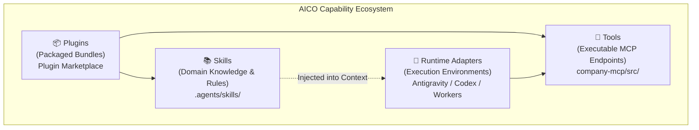
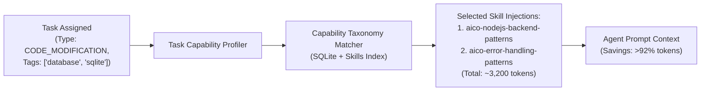
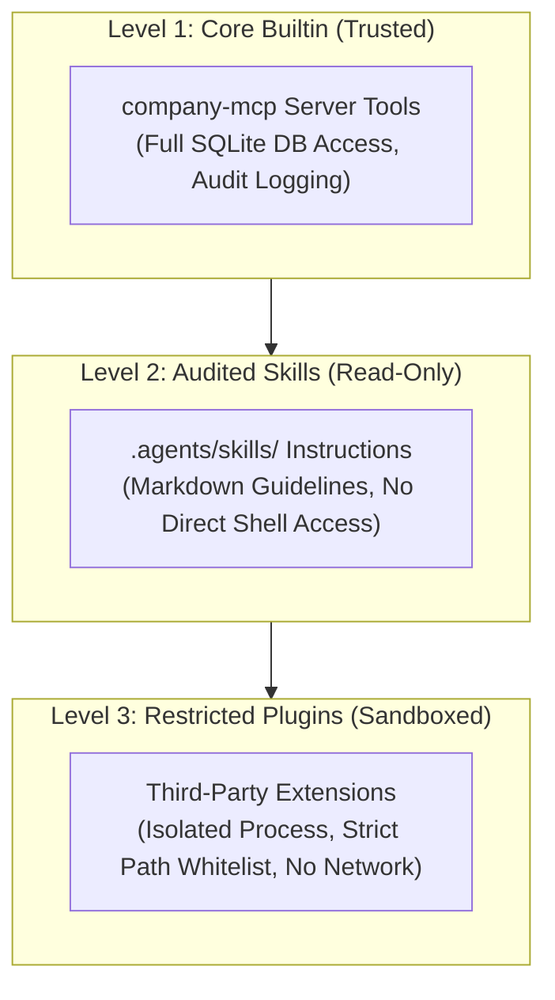

# AICO V3 MASTER BLUEPRINT — SKILLS, TOOLS & PLUGIN ECOSYSTEM

**Document ID:** `BP-V3-08`  
**Version:** `3.0.0-draft`  
**Date:** 2026-11-07  
**Author:** `flash-02` — Engineering & QA Lead  
**Design Phase:** Architecture & Contracts Design Only (No Implementation Authorized)  
**Baseline Git Reference:** Branch `feat/v2.2.1-implementation`, Commit `cd749107c4b34e26f61e14a238336e414f78779d`  
**Target Workspace:** `D:\AI-COMPANY`

---

## 1. CAPABILITY ECOSYSTEM TAXONOMY

AICO V3 establishes clear structural boundaries between four distinct extension concepts that were previously conflated:

### 1.1 Structural Definitions
1. **Skill:** A structured directory containing a declarative `SKILL.md` with YAML frontmatter and comprehensive engineering guidelines, examples, and scripts. Skills are knowledge injectors that govern agent behavior.
2. **Tool:** An executable JSON-RPC function exposed over the Model Context Protocol (MCP) implementing a strictly typed schema, ABAC authorization, and stateful side-effects.
3. **Plugin:** A deployable package bundling skills, tools, rules, and configuration hooks that can be enabled or disabled as an atomic unit.
4. **Runtime Adapter:** A software bridge allowing different agent execution harnesses (Google Antigravity, OpenAI Codex CLI, local background workers) to communicate with the AICO MCP gateway.

---

## 2. THE 12 CANONICAL AICO SKILLS

The repository `D:\AI-COMPANY\.agents\skills\` hosts 12 production-grade skills authored specifically for AICO company operations. In V3, each skill is indexed in the `skills` database table with its cryptographic SHA-256 integrity hash:

| # | Skill Directory | Domain / Core Purpose | Primary Assigned Roles | Target Tasks |
| :--- | :--- | :--- | :--- | :--- |
| **1** | `aico-architecture-patterns` | Hexagonal, Clean, DDD, boundary separation, seam design. | `argon-01`, `flash-01` | System architecture, modular refactoring. |
| **2** | `aico-api-design-principles` | REST & JSON-RPC schema contracts, idempotency, versioning. | `flash-01`, `codex-01` | MCP tool design, API endpoint authoring. |
| **3** | `aico-nodejs-backend-patterns` | Express, TypeScript, async patterns, process management. | `codex-01`, `flash-02` | MCP server development, daemon services. |
| **4** | `aico-error-handling-patterns` | Result types, error classification, graceful degradation. | `codex-01`, `flash-02` | Database retry logic, boundary validation. |
| **5** | `aico-security-audit` | Vulnerability assessment, threat modeling, injection defense. | `argon-02`, `flash-01` | Security reviews, dependency audits. |
| **6** | `aico-tdd` | Test-driven development, red-green-refactor loop. | `codex-01`, `flash-02` | Bug fixing, new feature implementation. |
| **7** | `aico-e2e-testing-patterns` | Integration test harnesses, multi-agent end-to-end tests. | `flash-02` (QA Lead) | QA gate verification, release testing. |
| **8** | `aico-code-review-excellence` | Constructive technical review, anti-self-approval standards. | `flash-01` (CTO) | Technical review of pull requests. |
| **9** | `aico-git-workflow` | Branching strategy, atomic commits, worktree isolation. | All Agents | Git commit authoring, merge preparation. |
| **10**| `aico-secrets-management` | Zero-hardcoded credentials, safe environment injection. | `flash-01`, `argon-02` | Credential handling, CI/CD configuration. |
| **11**| `aico-token-optimization` | Context compression, prompt diet, observation masking. | All Agents | System prompt construction, batch tasks. |
| **12**| `aico-diagnosing-bugs` | Root-cause analysis, reproduction scripts, evidence-first. | `flash-02`, `codex-01` | Regression diagnosis, test failures. |

---

## 3. DYNAMIC CAPABILITY DISCOVERY & TOKEN DIET

### 3.1 The Context Window Problem
In naive multi-agent systems, all available skill instructions and tool definitions are loaded into the system prompt simultaneously. In AICO, loading all 12 skills exceeds 45,000 prompt tokens per turn, inflating API costs by 90% and diluting the model's instruction-following attention.

### 3.2 Dynamic Capability Profiling
AICO V3 introduces **Just-In-Time (JIT) Skill Activation**:

### 3.3 Skill Selection Algorithm
1. **Metadata Inspection:** When a task is claimed via `company_claim_task`, the orchestrator inspects `task.task_type`, `task.title`, and `task.description`.
2. **Relevance Scoring:** The capability matcher computes an overlap score against the `skills` catalog and required capabilities (`agent_capabilities`).
3. **Hard Cap:** Exactly **1 to 2** skills are selected per subtask turn. Skills not required for the active subtask are strictly excluded from the prompt.
4. **Context Diet KPI:** Average prompt size is reduced from ~52,000 tokens to under 4,500 tokens.

---

## 4. SANDBOXING, TRUST LEVELS & SECURITY

To protect the local host environment and corporate repositories from untrusted execution, AICO V3 divides all capabilities into 3 distinct trust levels:

### 4.1 Execution Boundaries
- **Path Whitelisting:** File operations are strictly restricted to `D:\AI-COMPANY`. Any attempt to access `C:\Windows`, user profile roots, or parent directories triggers an immediate security abort (`E_SECURITY_PATH_TRAVERSAL`).
- **Network Isolation:** MCP server binds exclusively to `127.0.0.1`. Outbound network connections from tools or plugins are blocked unless an explicit whitelist entry exists in `company-manifest.json`.
- **Command Sanitization:** Shell execution commands must avoid command-chaining injection (`&`, `;`, `|`, `` ` ``) and execute with minimal PowerShell privileges.

---

## 5. SKILL LIFECYCLE & INTEGRITY ASSURANCE

1. **Authoring:** Any new skill must follow the standard directory format (`SKILL.md`, `examples/`, `references/`).
2. **Quality Verification:** The QA Lead (`flash-02`) must audit the skill for clarity, safety, and lack of harmful prompt injection.
3. **Cryptographic Sealing:**
   - On registration, the SHA-256 hash of `SKILL.md` is recorded in `skills.instructions_md_hash`.
   - Before runtime injection, the orchestrator re-hashes the file. If the file has been tampered with or modified without QA sign-off, the skill is quarantined with status `SUSPENDED`.
4. **Deprecation & Tombstoning:** Obsolete skills are flagged with `is_active = 0` in SQLite, preventing prompt pollution while preserving historical reproducibility.
