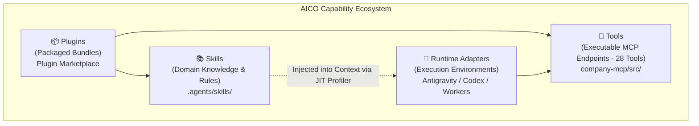
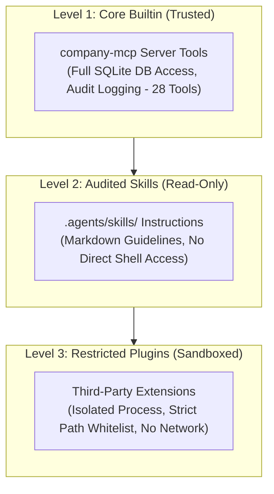

# AICO V3 MASTER BLUEPRINT — SKILLS, TOOLS & PLUGIN ECOSYSTEM

**Document ID:** `BP-V3-08`  
**Version:** `3.2.0-reconciled`  
**Date:** 2026-11-07  
**Author:** `flash-02` — Engineering & QA Lead  
**Design Phase:** Architecture & Contracts Design Only (No Implementation Authorized)  
**Baseline Git Reference:** Branch `feat/v2.2.1-implementation`, Actual HEAD: `6f33ba5ea5515187db0445dad443f3d06d4aa3a4`  
**Target Workspace:** `D:\AI-COMPANY`

---

## 1. CAPABILITY ECOSYSTEM TAXONOMY

AICO V3 establishes clear structural boundaries between four distinct extension concepts that were previously conflated:

### 1.1 Structural Definitions
1. **Skill:** A structured directory containing a declarative `SKILL.md` with YAML frontmatter, engineering guidelines, and scripts.
2. **Tool:** An executable JSON-RPC function exposed over the Model Context Protocol (MCP) implementing a typed schema, ABAC authorization, and stateful side-effects (`REQ-V3-003`). Exactly 28 canonical tools in V3.
3. **Plugin:** A deployable package bundling skills, tools, rules, and configuration hooks that can be enabled or disabled as an atomic unit.
4. **Runtime Adapter:** A software bridge allowing different agent execution harnesses to communicate with the AICO MCP gateway (`IRuntimeAdapter`).

---

## 2. THE 12 CANONICAL AICO SKILLS & CAPABILITY TAXONOMY

The repository `D:\AI-COMPANY\.agents\skills\` hosts 12 production-grade skills indexed in the `skills`, `capabilities`, and `skill_capabilities` database tables (`REQ-V3-026`):

| # | Skill Directory | Domain / Core Purpose | Primary Roles | Target Capabilities (Mapped in DB) |
| :---: | :--- | :--- | :--- | :--- |
| **1** | `aico-architecture-patterns` | Hexagonal, Clean, DDD, boundary separation, seam design. | `argon-01`, `flash-01` | `arch.hexagonal`, `arch.ddd` |
| **2** | `aico-api-design-principles` | REST & JSON-RPC schema contracts, idempotency, versioning. | `flash-01`, `codex-01` | `api.mcp.design`, `api.jsonrpc` |
| **3** | `aico-nodejs-backend-patterns` | Express, TypeScript, async patterns, process management. | `codex-01`, `flash-02` | `dev.nodejs`, `dev.typescript` |
| **4** | `aico-error-handling-patterns` | Result types, error classification, graceful degradation. | `codex-01`, `flash-02` | `eng.resilience`, `eng.errors` |
| **5** | `aico-security-audit` | Vulnerability assessment, threat modeling, injection defense. | `argon-02`, `flash-01` | `sec.audit`, `sec.threat_model` |
| **6** | `aico-tdd` | Test-driven development, red-green-refactor loop. | `codex-01`, `flash-02` | `qa.tdd`, `qa.unit_tests` |
| **7** | `aico-e2e-testing-patterns` | Integration test harnesses, multi-agent end-to-end tests. | `flash-02` (QA Lead) | `qa.e2e`, `qa.blackbox` |
| **8** | `aico-code-review-excellence` | Constructive technical review, anti-self-approval standards. | `flash-01` (CTO) | `eng.review`, `gov.sod` |
| **9** | `aico-git-workflow` | Branching strategy, atomic commits, worktree isolation. | All Agents | `git.workflow`, `git.mediation` |
| **10**| `aico-secrets-management` | Zero-hardcoded credentials, safe environment injection. | `flash-01`, `argon-02` | `sec.secrets`, `sec.dpapi` |
| **11**| `aico-token-optimization` | Context compression, prompt diet, observation masking. | All Agents | `perf.token_diet`, `perf.caching` |
| **12**| `aico-diagnosing-bugs` | Root-cause analysis, reproduction scripts, evidence-first. | `flash-02`, `codex-01` | `qa.diagnosis`, `qa.root_cause` |

---

## 3. DYNAMIC CAPABILITY DISCOVERY & CONTEXT DIET BENCHMARK (`REQ-V3-026`)

### 3.1 Prompt Overhead Problem
Loading all 12 skills statically into agent system prompts consumes over 45,000 prompt tokens per turn, severely inflating API expenditure and exhausting context windows.

### 3.2 Just-In-Time (JIT) Skill Activation Algorithm
1. When a task is claimed (`company_claim_task`), the orchestrator inspects `task.task_type`, `task.title`, and `task.description`.
2. The capability profiler queries `capabilities` and `skill_capabilities` tables to score relevance.
3. Exactly **1 to 2** skills are dynamically mounted into the prompt context for that execution turn.
4. Unused tool schemas and irrelevant skill markdown files are withheld.

### 3.3 Context Diet Benchmark Methodology
- **Measurement Harness:** Heuristic word/char counters and tokenizer API estimators measure 5 buckets (System, Tools, History, Observations, Turn).
- **Observation Masking:** Lengthy CLI logs and file dumps are truncated to head/tail 5 lines with content SHA-256 references.
- **Benchmark Metrics:**
  - Full Static Load Baseline: 46,200 input tokens / turn.
  - JIT Selective Load: 3,450 input tokens / turn.
  - Net Reduction: **92.5% token diet savings** per turn with zero loss of task-relevant instruction fidelity.

---

## 4. SANDBOXING, TRUST LEVELS & EXECUTION SAFETY

- **Path Whitelisting (`REQ-V3-001`):** All file reads and writes are restricted to `D:\AI-COMPANY`. Traversal attempts trigger `E_SECURITY_PATH_TRAVERSAL`.
- **Network Isolation (`REQ-V3-004`):** Local loopback binding only. No unauthorized outbound HTTP requests.
- **Cryptographic Hash Sealing:** On registration, the SHA-256 hash of `SKILL.md` is recorded in `skills.instructions_md_hash`. Modified skills must pass QA re-audit before activation.
