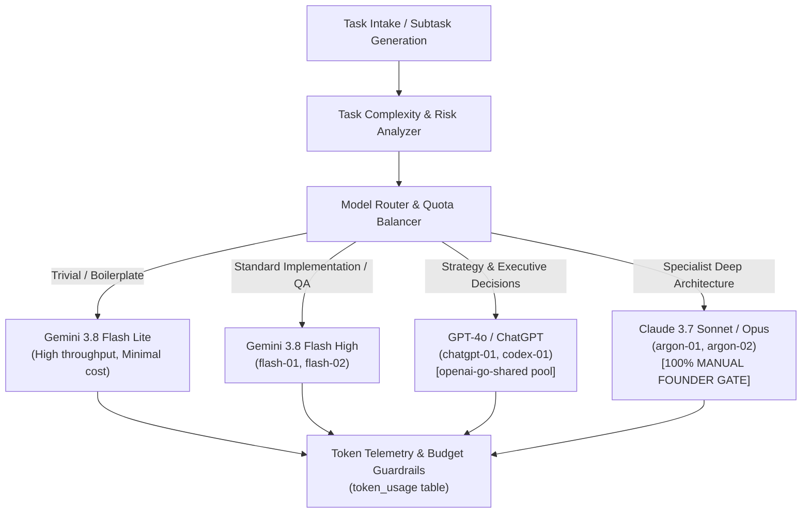
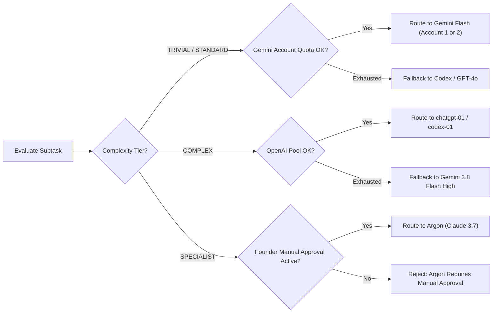

# AICO V3 MASTER BLUEPRINT — MODEL ROUTING, TOKEN & COST INTELLIGENCE

**Document ID:** `BP-V3-09`  
**Version:** `3.0.0-draft`  
**Date:** 2026-11-07  
**Author:** `flash-02` — Engineering & QA Lead  
**Design Phase:** Architecture & Contracts Design Only (No Implementation Authorized)  
**Baseline Git Reference:** Branch `feat/v2.2.1-implementation`, Commit `cd749107c4b34e26f61e14a238336e414f78779d`  
**Target Workspace:** `D:\AI-COMPANY`

---

## 1. VISION & COST MANAGEMENT PHILOSOPHY

Running an autonomous multi-agent AI company requires rigorous financial governance and computational efficiency. Uncontrolled LLM tool loops, bloated system prompts, and inappropriate model selection can rapidly exhaust API quotas and produce astronomical operating expenses without proportional business value.

AICO V3 integrates an intelligent **Model Routing & Cost Intelligence Engine** directly into the core orchestration loop:



---

## 2. MODEL CATALOG & CAPABILITY PROFILES

| Tier / Agent Role | Primary Model Engine | Context Window | Relative Cost / 1M Tokens | Optimal Workloads |
| :--- | :--- | :--- | :--- | :--- |
| **Tier 1: High-Speed Primary** (`flash-01`, `flash-02`) | Gemini 3.8 Flash High | 1,000,000 tokens | Low ($0.35 / $1.05) | Architecture review, QA test runs, TypeScript implementation, bug diagnosis. |
| **Tier 2: Code Construction** (`codex-01`) | GPT-4o / Codex CLI | 128,000 tokens | Medium ($2.50 / $10.00) | Surgical code editing, refactoring, script generation (`openai-go-shared`). |
| **Tier 3: Executive Orchestration** (`chatgpt-01`) | GPT-4o / ChatGPT Plus | 128,000 tokens | Subscription Pool | Strategic task decomposition, company milestone reviews, team alignment. |
| **Tier 4: Specialist Deep Reasoning** (`argon-01`, `argon-02`) | Claude 3.7 Sonnet (Thinking) | 200,000 tokens | High ($3.00 / $15.00) | **MANUAL ONLY.** High-stakes cryptographic audits, deep formal architecture reviews. |
| **Tier 5: Local Open-Source** (Future Harness) | DeepSeek-R1 / V3 (Local) | 64,000 tokens | Zero Marginal Cost | Offline linting, repetitive schema validation, local unit test loops. |

---

## 3. COMPLEXITY-BASED MODEL ROUTING ALGORITHM

### 3.1 Task Complexity Tiers
Every task created via `company_create_task` is evaluated and assigned a complexity rating:

1. **`TRIVIAL`:** File formatting, documentation typos, simple unit test assertions, linting.
2. **`STANDARD`:** Feature implementation, database queries, bug diagnosis, integration tests.
3. **`COMPLEX`:** Cross-subsystem refactoring, security policy changes, distributed lease engine modifications.
4. **`SPECIALIST`:** Fundamental database schema redesign, cryptographic protocol updates, formal audit verification.

### 3.2 Routing & Fallback Decision Matrix



---

## 4. QUOTA POOL TRACKING & HARD BUDGET CAPS

### 4.1 Quota Pools in AICO
As defined in `company-manifest.json`:
- `gemini-antigravity-01`: Primary CTO and QA pool.
- `gemini-antigravity-02`: Secondary parallel execution pool.
- `openai-go-shared`: Shared allocation pool between `chatgpt-01` and `codex-01`.
- `anthropic-argon-manual`: Strictly metered specialist pool.

### 4.2 Budget Guardrail Enforcement
Every task is assigned a `token_budget` (default 100,000 tokens):
- **Telemetry Recording:** After every MCP tool execution or model invocation turn, the session records consumed prompt and completion tokens into `token_usage`.
- **Soft Warning (80%):** When cumulative task tokens reach 80% of `token_budget`, the orchestrator posts a warning message to the task room.
- **Hard Cut-Off (100%):** When task tokens reach 100%, further tool executions on that lease are blocked with error `E_TOKEN_BUDGET_EXCEEDED` until an executive (`chatgpt-01`) or `founder` approves a budget extension.

---

## 5. TOKEN OPTIMIZATION STRATEGIES

Applying guidelines from the `aico-token-optimization` skill:

### 5.1 Prefix Prompt Caching
Modern LLMs (Gemini, Claude, GPT-4) provide substantial cost discounts (up to 75%) and sub-second latency for prompt prefixes that remain static across calls.
- **Strategy:** Place invariant company rules, manifest declarations, and tool definitions at the very beginning of the prompt.
- **Dynamic Content Placement:** Place changing variables (active task, lease nonce, recent messages) strictly at the tail of the prompt to maximize cache hit rates.

### 5.2 Observation Masking & Truncation
Shell tool outputs, file reads, and git diffs can be thousands of lines long:
- If a command output exceeds 80 lines or 4,000 bytes, the MCP adapter masks the middle portion:
  ```
  [Lines 1-30 shown]
  ... [1,420 lines masked for token efficiency; query with specific line range if required] ...
  [Lines 1,421-1,450 shown]
  ```
- Full execution outputs remain stored in temporary disk files in `data/logs/raw/` for auditing without burdening context windows.

---

## 6. MEASURABLE KPI TARGETS & FORMULAS

To track the effectiveness of V3 cost intelligence, the telemetry engine computes weekly performance metrics:

### 6.1 Cache Hit Ratio (CHR)
$$\text{CHR} = \frac{\sum \text{Prompt Tokens Cached}}{\sum \text{Total Prompt Tokens}} \times 100\%$$
- **Target KPI:** $\ge 65\%$ on recurring task workflows.

### 6.2 Token Waste Ratio (TWR)
$$\text{TWR} = \frac{\sum \text{Tokens in Aborted / Reworked Tasks}}{\sum \text{Total Tokens Consumed}} \times 100\%$$
- **Target KPI:** $\le 12\%$.

### 6.3 Cost Per Completed Feature (CPCF)
$$\text{CPCF} = \frac{\text{Total USD Spent on Model APIs}}{\text{Total Verified Tasks Transitioned to DONE}}$$
- **Target KPI:** $\le \$0.45$ per subtask in standard engineering workflows.
