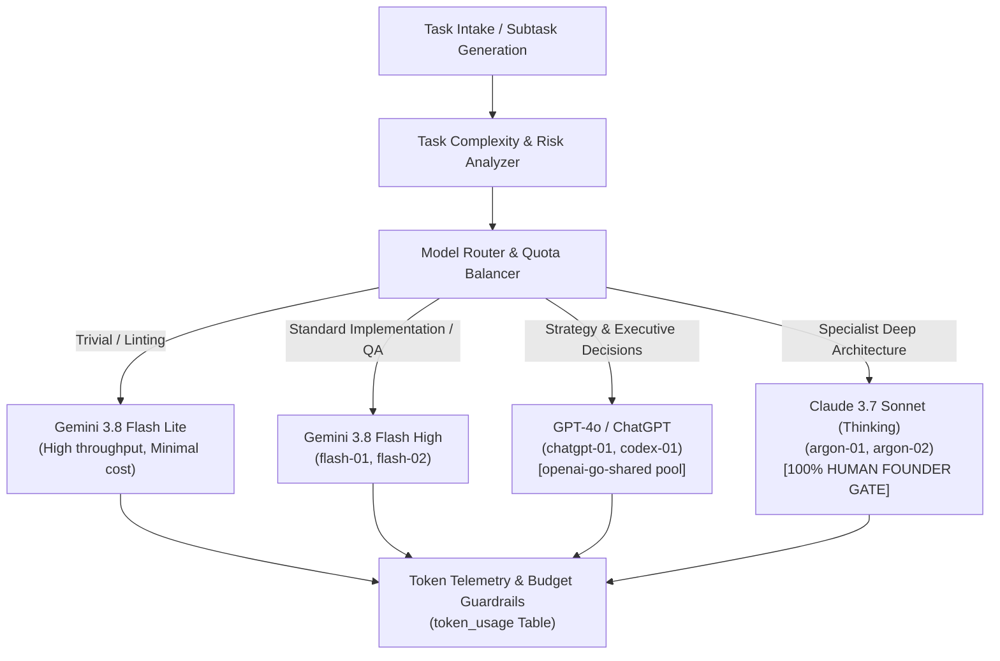

# AICO V3 MASTER BLUEPRINT — MODEL ROUTING, TOKEN & COST INTELLIGENCE

**Document ID:** `BP-V3-09`  
**Version:** `3.1.0-reconciled`  
**Date:** 2026-11-07  
**Author:** `flash-02` — Engineering & QA Lead  
**Design Phase:** Architecture & Contracts Design Only (No Implementation Authorized)  
**Baseline Git Reference:** Branch `feat/v2.2.1-implementation`, Commit `cd749107c4b34e26f61e14a238336e414f78779d`  
**Actual HEAD:** `21f3aad16911eb076e2245a791bde51178a0d222`  
**Target Workspace:** `D:\AI-COMPANY`

---

## 1. VISION & COST MANAGEMENT PHILOSOPHY

Running an autonomous multi-agent AI company requires rigorous financial governance and computational efficiency. AICO V3 integrates an intelligent **Model Routing & Cost Intelligence Engine** directly into the core orchestration loop (`REQ-V3-027`, `REQ-V3-028`):

---

## 2. MODEL CATALOG & CAPABILITY PROFILES

| Tier / Agent Role | Primary Model Engine | Context Window | Relative Cost / 1M Tokens | Optimal Workloads |
| :--- | :--- | :--- | :--- | :--- |
| **Tier 1: High-Speed Primary** (`flash-01`, `flash-02`) | Gemini 3.8 Flash High | 1,000,000 tokens | Low ($0.35 / $1.05) | Architecture review, QA test runs, TypeScript implementation, bug diagnosis. |
| **Tier 2: Code Construction** (`codex-01`) | GPT-4o / Codex CLI | 128,000 tokens | Medium ($2.50 / $10.00) | Surgical code editing, refactoring, script generation (`openai-go-shared`). |
| **Tier 3: Executive Orchestration** (`chatgpt-01`) | GPT-4o / ChatGPT Plus | 128,000 tokens | Subscription Pool | Strategic task decomposition, company milestone reviews, team alignment. |
| **Tier 4: Specialist Deep Reasoning** (`argon-01`, `argon-02`) | Claude 3.7 Sonnet (Thinking) | 200,000 tokens | High ($3.00 / $15.00) | **MANUAL ONLY (`REQ-V3-031`).** High-stakes cryptographic audits, formal architecture reviews. |
| **Tier 5: Local Open-Source** (Future Harness) | DeepSeek-R1 / V3 (Local) | 64,000 tokens | Zero Marginal Cost | Offline linting, repetitive schema validation, local unit test loops. |

---

## 3. COMPLEXITY-BASED MODEL ROUTING ALGORITHM (`REQ-V3-027`)

Every task is evaluated and classified into one of 4 complexity tiers:
1. **`TRIVIAL`:** File formatting, documentation typos, simple unit test assertions, linting.
2. **`STANDARD`:** Feature implementation, database queries, bug diagnosis, integration tests.
3. **`COMPLEX`:** Cross-subsystem refactoring, security policy changes, distributed lease engine modifications.
4. **`SPECIALIST`:** Fundamental database schema redesign, cryptographic protocol updates, formal audit verification.

---

## 4. QUOTA POOL TRACKING & HARD BUDGET CAPS (`REQ-V3-028`)

- **Telemetry Recording:** After every MCP tool execution or model invocation turn, consumed prompt and completion tokens are recorded in `token_usage`.
- **Soft Warning (80%):** When cumulative task tokens reach 80% of `token_budget`, the orchestrator posts an alert to the task room.
- **Hard Cut-Off (100%):** When task tokens reach 100%, further tool executions on that lease are blocked with error `E_TOKEN_BUDGET_EXCEEDED` until an executive (`chatgpt-01`) or `founder-human` approves a budget extension.

---

## 5. TOKEN OPTIMIZATION STRATEGIES

1. **Prefix Prompt Caching:** Place static company rules, manifest declarations, and tool definitions at the very beginning of prompts to maximize cache hit rates (>65%).
2. **Observation Masking:** Command outputs exceeding 80 lines or 4,000 bytes are masked in prompt context, with raw logs preserved in `data/logs/raw/`.

---

## 6. MEASURABLE KPI TARGETS & FORMULAS

### 6.1 Cache Hit Ratio (CHR)
$$\text{CHR} = \frac{\sum \text{Prompt Tokens Cached}}{\sum \text{Total Prompt Tokens}} \times 100\% \ge 65\%$$

### 6.2 Token Waste Ratio (TWR)
$$\text{TWR} = \frac{\sum \text{Tokens in Aborted / Reworked Tasks}}{\sum \text{Total Tokens Consumed}} \times 100\% \le 12\%$$

### 6.3 Cost Per Completed Feature (CPCF)
$$\text{CPCF} = \frac{\text{Total USD Spent on Model APIs}}{\text{Total Verified Tasks Transitioned to DONE}} \le \$0.45$$
