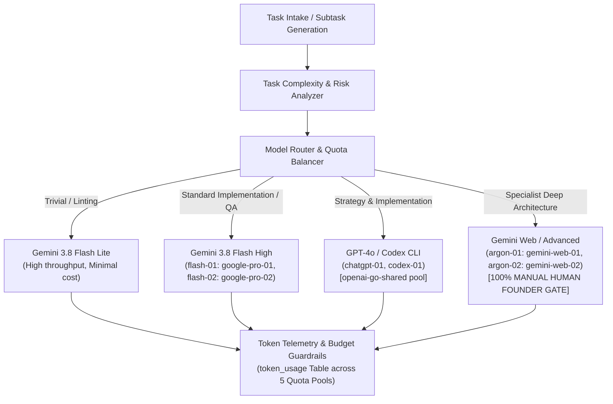

# AICO V3 MASTER BLUEPRINT — MODEL ROUTING, TOKEN & COST INTELLIGENCE

**Document ID:** `BP-V3-09`  
**Version:** `3.2.0-reconciled`  
**Date:** 2026-11-07  
**Author:** `flash-02` — Engineering & QA Lead  
**Design Phase:** Architecture & Contracts Design Only (No Implementation Authorized)  
**Baseline Git Reference:** Branch `feat/v2.2.1-implementation`, Actual HEAD: `6f33ba5ea5515187db0445dad443f3d06d4aa3a4`  
**Target Workspace:** `D:\AI-COMPANY`

---

## 1. VISION & COST MANAGEMENT PHILOSOPHY

Running an autonomous multi-agent AI company requires rigorous financial governance and computational efficiency. AICO V3 integrates an intelligent **Model Routing & Cost Intelligence Engine** directly into the core orchestration loop (`REQ-V3-027`, `REQ-V3-028`):

---

## 2. THE 5 CANONICAL QUOTA POOLS & SUBSCRIPTION DYNAMICS

AICO V3 tracks telemetry and enforces budgets across the 5 canonical quota pools defined in `data/aico.db` and `company-manifest.json`:

| Quota Pool ID | Provider / Runtime | Assigned Agents | Pool Type | Accounting Dynamics |
| :--- | :--- | :--- | :--- | :--- |
| **`google-pro-01`** | Google Antigravity Pro #1 | `flash-01` (CTO) | `SUBSCRIPTION` | 1M token window; monitored for burst rate limits and monthly allowance. |
| **`google-pro-02`** | Google Antigravity Pro #2 | `flash-02` (QA Lead) | `SUBSCRIPTION` | 1M token window; independent testing harness quota. |
| **`gemini-web-01`** | Google Gemini Web #1 | `argon-01` (Architect) | `SUBSCRIPTION` (Scarce) | **MANUAL ONLY.** High-tier reasoning; single-use Founder approval mandatory. |
| **`gemini-web-02`** | Google Gemini Web #2 | `argon-02` (Auditor) | `SUBSCRIPTION` (Scarce) | **MANUAL ONLY.** Independent audit pool; single-use Founder approval mandatory. |
| **`openai-go-shared`**| OpenAI ChatGPT Go Shared | `chatgpt-01` (CEO), `codex-01` (SWE) | `SUBSCRIPTION` (Shared) | Shared rolling window; concurrency balancer prevents pool exhaustion. |

> [!NOTE]
> **Subscription vs API Billing:**
> Unlike raw pay-per-token API keys, subscription quota pools (`openai-go-shared`, `gemini-web-01`, `gemini-web-02`) do not deplete dollar balances per call. Instead, they enforce sliding-window rate limits (requests/minute and tokens/window). Telemetry records both estimated token volume and sliding window request frequency to prevent rate-limit throttling.

---

## 3. MODEL CATALOG & CAPABILITY PROFILES

| Tier / Agent Role | Primary Model Engine | Context Window | Relative Cost / 1M Tokens | Optimal Workloads |
| :--- | :--- | :--- | :--- | :--- |
| **Tier 1: High-Speed Primary** (`flash-01`, `flash-02`) | Gemini 3.8 Flash High | 1,000,000 tokens | Low ($0.35 / $1.05) | Architecture review, QA test runs, TypeScript implementation, bug diagnosis. |
| **Tier 2: Code Construction** (`codex-01`) | GPT-4o / Codex CLI | 128,000 tokens | Shared Subscription | Surgical code editing, refactoring, script generation (`openai-go-shared`). |
| **Tier 3: Executive Orchestration** (`chatgpt-01`) | GPT-4o / ChatGPT Plus | 128,000 tokens | Shared Subscription | Strategic task decomposition, company milestone reviews, team alignment. |
| **Tier 4: Specialist Deep Reasoning** (`argon-01`, `argon-02`) | Gemini Web / Advanced Reasoning | 1,000,000 tokens | Scarce Subscription | **MANUAL ONLY (`REQ-V3-031`).** High-stakes cryptographic audits, formal architecture reviews. |
| **Tier 5: Lightweight Automation** | Gemini 3.8 Flash Lite | 1,000,000 tokens | Very Low ($0.075 / $0.30) | Offline linting, repetitive schema validation, local status pings. |

---

## 4. COMPLEXITY-BASED MODEL ROUTING ALGORITHM (`REQ-V3-027`)

Every task is evaluated and classified into one of 4 complexity tiers:
1. **`TRIVIAL`:** File formatting, documentation typos, simple unit test assertions, linting. Routed to Flash Lite.
2. **`STANDARD`:** Feature implementation, database queries, bug diagnosis, integration tests. Routed to Flash High (`flash-01`, `flash-02`) or Codex (`codex-01`).
3. **`COMPLEX`:** Cross-subsystem refactoring, security policy changes, distributed lease engine modifications. Routed to Flash High or GPT-4o (`chatgpt-01`).
4. **`SPECIALIST`:** Fundamental database schema redesign, cryptographic protocol updates, formal audit verification. Routed to Argon specialists ONLY with explicit human Founder approval (`founder-01`).

---

## 5. QUOTA POOL TRACKING & HARD BUDGET CAPS (`REQ-V3-028`)

- **Telemetry Recording:** After every MCP tool execution or model invocation turn, consumed prompt and completion tokens are recorded in `token_usage` referencing the assigned `quota_pool_id`.
- **Soft Warning (80%):** When cumulative task tokens reach 80% of `token_budget`, the orchestrator posts an alert to the task room.
- **Hard Cut-Off (100%):** When task tokens reach 100%, further tool executions on that lease are blocked with error `E_TOKEN_BUDGET_EXCEEDED` until an executive (`chatgpt-01`) or Founder (`founder-01`) approves a budget extension.

---

## 6. TOKEN OPTIMIZATION STRATEGIES (`aico-token-optimization`)

1. **Prefix Prompt Caching:** Place static company rules, manifest declarations, and tool definitions at the very beginning of prompts to maximize cache hit rates (>65%).
2. **Observation Masking:** Command outputs exceeding 80 lines or 4,000 bytes are masked in prompt context, with raw logs preserved in `data/logs/raw/`.
3. **Tiered Context Compaction:** Long-running sessions compress turns 6+ into structured summaries, keeping only the primary objective, active hypotheses, verified facts, and pending steps.

---

## 7. MEASURABLE KPI TARGETS & FORMULAS

### 7.1 Cache Hit Ratio (CHR)
$$\text{CHR} = \frac{\sum \text{Prompt Tokens Cached}}{\sum \text{Total Prompt Tokens}} \times 100\% \ge 65\%$$

### 7.2 Token Waste Ratio (TWR)
$$\text{TWR} = \frac{\sum \text{Tokens in Aborted / Reworked Tasks}}{\sum \text{Total Tokens Consumed}} \times 100\% \le 12\%$$

### 7.3 Cost Per Completed Feature (CPCF)
$$\text{CPCF} = \frac{\text{Total USD Spent on Model APIs}}{\text{Total Verified Tasks Transitioned to DONE}} \le \$0.45$$
