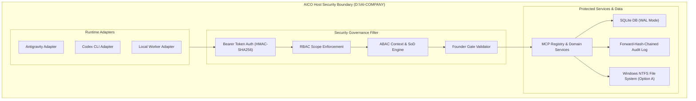
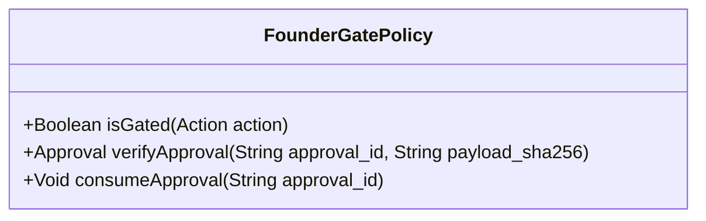
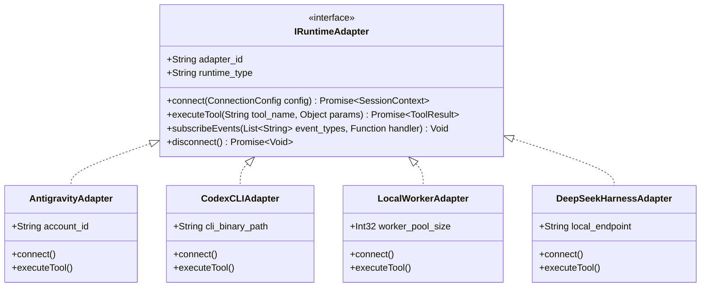

# AICO V3 MASTER BLUEPRINT — SECURITY GOVERNANCE & RUNTIME ADAPTERS

**Document ID:** `BP-V3-10`  
**Version:** `3.0.0-draft`  
**Date:** 2026-11-07  
**Author:** `flash-02` — Engineering & QA Lead  
**Design Phase:** Architecture & Contracts Design Only (No Implementation Authorized)  
**Baseline Git Reference:** Branch `feat/v2.2.1-implementation`, Commit `cd749107c4b34e26f61e14a238336e414f78779d`  
**Target Workspace:** `D:\AI-COMPANY`

---

## 1. ZERO-TRUST SECURITY ARCHITECTURE

AICO V3 operates under a strict Zero-Trust Security Model. No agent, harness, or tool call is trusted by default, regardless of whether it originates from local loopback or an in-process adapter.



---

## 2. THE 4 INVIOLABLE FOUNDER GATES

To ensure human oversight over high-risk or irreversible operations, AICO V3 establishes 4 cryptographically enforced **Founder Gates**:



### 2.1 Gate 1: Argon Specialist Invocation Gate
- **Policy:** `argon-01` (Principal Architect) and `argon-02` (Independent Auditor) MUST NEVER be invoked automatically.
- **Rules:**
  1. No automated fan-out, retry loop, or background cron may trigger Argon.
  2. Every invocation requires a pre-existing `APPROVAL` record where:
     - `approval_type = 'ARGON_INVOCATION'`
     - `target_resource = 'agent:argon-01'` (or `02`)
     - `status = 'APPROVED'`
     - `reviewer_agent_id = 'founder'`
     - `consumed_at IS NULL`
     - `expires_at > unixepoch('now') * 1000`
  3. **Exact Cryptographic Binding:** The execution payload SHA-256 must match `approvals.payload_sha256` exactly. Any variation in prompt, parameters, or target files causes an immediate `E_PAYLOAD_MISMATCH` rejection.
  4. **Single-Use Consumption:** Once verified, `consumed_at` is stamped immediately within an atomic transaction. A second invocation using the same `approval_id` is rejected (`E_APPROVAL_CONSUMED`).

### 2.2 Gate 2: Production Database Schema Migration Gate (Gate G4)
- **Policy:** Production database `D:\AI-COMPANY\data\aico.db` remains 100% frozen at v0.3.0 until explicit Founder authorization.
- **Rules:**
  1. No migration script may execute against `data/aico.db` without Founder approval.
  2. Pre-migration backup and SHA-256 verification are mandatory.
  3. DDL must execute inside a rollback-safe transaction block.

### 2.3 Gate 3: Network Exposure & Public Gateway Gate
- **Policy:** AICO services bind exclusively to `127.0.0.1` (Local Loopback).
- **Rules:**
  1. Public Gateway (:3335) remains disabled.
  2. ngrok, Cloudflare tunnels, or reverse proxies remain completely shut down.
  3. Any tool attempting to bind non-loopback addresses triggers an immediate process termination.

### 2.4 Gate 4: Windows NTFS DACL Modification Gate
- **Policy:** Running `icacls`, ACL modification scripts, or applying Windows NTFS security policies requires explicit Founder sign-off.
- **Rules:**
  1. Current workspace adheres to Option A (audit-only / review-only).
  2. No automated script may strip or alter file ownership.

---

## 3. THREAT MODELING & DEFENSIVE CONTROLS

### 3.1 Path Traversal Defense
- **Attack Vector:** An agent passes `../../Windows/System32` or absolute drive letters outside `D:\AI-COMPANY`.
- **Defensive Control:** All file paths received via MCP parameters are resolved using `path.resolve` and normalized. The resolved path must strictly start with the canonical workspace root `D:\AI-COMPANY`. Violations immediately throw `E_SECURITY_PATH_TRAVERSAL` and log an `ERROR` audit event.

### 3.2 Command Injection Defense
- **Attack Vector:** Command injection via shell meta-characters (`;`, `&`, `|`, `` ` ``, `$()`).
- **Defensive Control:** Command execution wrappers sanitize arguments, utilize structured argument arrays (`execFile` rather than `exec`), and disallow execution of arbitrary binaries outside the authorized toolchain (Node.js, Git, PowerShell).

### 3.3 Credential & Secret Protection
- **Attack Vector:** Committing API keys, bearer tokens, or private keys to git history.
- **Defensive Control:**
  1. All bearer tokens in `principals` are stored hashed with HMAC-SHA256 or Argon2id. Raw tokens are never logged or persisted.
  2. Pre-commit hooks and QA verification runs execute automated regex scanning for API key patterns (OpenAI `sk-...`, Anthropic `sk-ant-...`, Google `AIza...`).
  3. Any detected secret halts the pipeline with an immediate `FATAL` security alert.

### 3.4 Tamper-Evident Audit Logging
- Every sensitive action inserts an entry into `audit_events`.
- **Cryptographic Hash Chaining:**
  $$\text{Current Hash} = \text{SHA-256}(\text{Sequence} \parallel \text{Actor} \parallel \text{Action} \parallel \text{PayloadHash} \parallel \text{PrevHash})$$
- Even if a malicious actor modifies a row in SQLite, the unbroken forward hash chain is invalidated, triggering detection on the next query.

---

## 4. RUNTIME ADAPTER FRAMEWORK (`IRuntimeAdapter`)

To decouple the AICO core from specific vendor harnesses and client implementations, V3 introduces the standardized **Runtime Adapter Interface**:



### 4.1 Interface Specification
```typescript
export interface IRuntimeAdapter {
  readonly adapter_id: string;
  readonly runtime_type: "ANTIGRAVITY" | "CODEX_CLI" | "LOCAL_WORKER" | "DEEPSEEK_LOCAL";

  connect(config: Record<string, unknown>): Promise<AgentSessionDTO>;
  executeTool<TInput, TOutput>(toolName: string, input: TInput): Promise<ToolResponse<TOutput>>;
  onEvent(eventType: string, handler: (event: AicoDomainEvent) => void): void;
  disconnect(): Promise<void>;
}
```

### 4.2 Adapter Responsibilities
1. **Google Antigravity Adapter:** Connects to native AGY execution contexts, binds Account 1 (`flash-01`) or Account 2 (`flash-02`), and manages session heartbeats.
2. **OpenAI Codex CLI Adapter:** Bridges the non-interactive terminal environment of Codex CLI to the AICO MCP STDIO gateway.
3. **Local Worker Adapter:** Runs background cron tasks (e.g., stale lease sweeper, rolling room compaction, audit verification).
4. **DeepSeek Harness Adapter:** Standardized adapter for local open-source models, allowing zero-cost tasks to execute on local hardware without cloud vendor locks.
