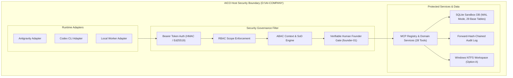
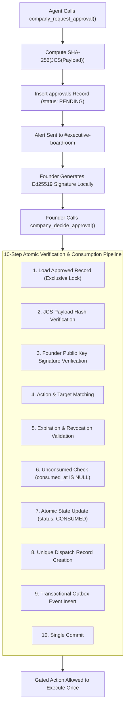

# AICO V3 MASTER BLUEPRINT — SECURITY GOVERNANCE & RUNTIME ADAPTERS

**Document ID:** `BP-V3-10`  
**Version:** `3.2.0-reconciled`  
**Date:** 2026-11-07  
**Author:** `flash-02` — Engineering & QA Lead  
**Design Phase:** Architecture & Contracts Design Only (No Implementation Authorized)  
**Baseline Git Reference:** Branch `feat/v2.2.1-implementation`, Actual HEAD: `6f33ba5ea5515187db0445dad443f3d06d4aa3a4`  
**Target Workspace:** `D:\AI-COMPANY`

---

## 1. ZERO-TRUST SECURITY ARCHITECTURE

AICO V3 operates under a strict Zero-Trust Security Model (`REQ-V3-001`). No agent, harness, or tool call is trusted by default:



---

## 2. THE 4 INVIOLABLE FOUNDER GATES

To ensure supreme human oversight over high-risk or irreversible operations, AICO V3 establishes 4 cryptographically enforced **Founder Gates** (formally specified at Gate `V3-G0` and verified prior to `V3-G7` sandbox sign-off):

### 2.1 Gate 1: Argon Specialist Invocation Gate (`REQ-V3-031`)
- **Policy:** `argon-01` (Principal Architect) and `argon-02` (Independent Auditor) MUST NEVER be invoked automatically.
- **Rules:**
  1. No automated fan-out, retry loop, or background cron may trigger Argon.
  2. Every invocation requires a pre-existing `APPROVAL` record where:
     - `approval_type = 'ARGON_INVOCATION'`
     - `target_resource = 'agent:argon-01'` (or `02`)
     - `status = 'APPROVED'`
     - `founder_principal_id` matches human Founder principal (`founder-01`)
     - `consumed_at IS NULL`
     - `expires_at > unixepoch('now') * 1000`
  3. **Exact Cryptographic Binding:** The execution payload SHA-256 must match `approvals.payload_sha256` exactly via RFC 8785 (JCS).
  4. **Single-Use Consumption:** `consumed_at` is stamped in an atomic 10-step transaction; replay attempts fail with `E_APPROVAL_CONSUMED`.

### 2.2 Gate 2: Production Database Schema Migration Gate (Gate G4, `REQ-V3-007`)
- **Policy:** Production database `D:\AI-COMPANY\data\aico.db` remains 100% frozen at v0.3.0 (`SHA-256: 17BD93214291E33260DF4A3D0B7DAD417BCA05C137770443D4D3FA965595E416`).
- **Rules:**
  1. Gate `V3-G7` authorizes sandbox implementation completion ONLY. It does **NOT** open Gate G4.
  2. Gate G4 requires an independent, manual human Founder directive.
  3. Pre-migration backup and SHA-256 validation are mandatory.

### 2.3 Gate 3: Network Exposure & Public Gateway Gate (`REQ-V3-004`)
- **Policy:** AICO services bind exclusively to `127.0.0.1` (Local Loopback, port 3334).
- **Rules:** Public Gateway (:3335) and ngrok remain strictly disabled.

### 2.4 Gate 4: Windows NTFS DACL Modification Gate (`REQ-V3-001`)
- **Policy:** Current workspace adheres to Option A (audit-only / review-only). No automated script may alter NTFS inheritance or permissions (`-Apply` is prohibited).

---

## 3. VERIFIABLE HUMAN FOUNDER APPROVAL PIPELINE (`REQ-V3-030`)

To prevent AI agents from fabricating or auto-approving gated actions, Founder approvals require verifiable human authorization:



### 3.1 10-Step Atomic Consumption Transaction
When an approved action is dispatched:
1. **Exclusive Row Lock:** Fetch `approvals` row with exclusive lock.
2. **Canonical Payload Match:** Serialize execution payload with RFC 8785 JCS; assert `SHA256(JCS(payload)) === approvals.payload_sha256`. Throw `E_PAYLOAD_MISMATCH` on failure.
3. **Cryptographic Signature Match:** Verify `human_signature` using Founder Ed25519 public key over `(approval_id:payload_sha256:expires_at)`.
4. **Scope & Resource Check:** Confirm requested operation matches `approval_type` and `target_resource`.
5. **Freshness & Revocation Check:** Assert `Date.now() < row.expires_at` and `status != 'REVOKED'`. Throw `E_APPROVAL_EXPIRED` on failure.
6. **Replay Defense Check:** Assert `row.consumed_at IS NULL` and `row.status != 'CONSUMED'`. Throw `E_APPROVAL_CONSUMED` on failure.
7. **Atomic State Transition:** Update `status = 'CONSUMED'`, `consumed_at = Date.now()`, `consumed_by_principal_id = caller_principal_id`.
8. **Dispatch Record Creation:** Insert unique execution record in `task_executions`.
9. **Event Outbox Enqueue:** Write `aico.approval.consumed` into `event_outbox`.
10. **Commit:** Commit all steps in a single atomic database transaction.

### 3.2 Cryptographic Key Management & Interfaces
- **Algorithm:** Ed25519 (`NODE:crypto` / RFC 8032) for fast, deterministic signature verification.
- **Key Storage:** Founder private key is held exclusively on Founder's host machine protected by Windows DPAPI (`CryptProtectData`) or SSH Agent. Never accessible to AI agents.
- **Public Key:** Registered in `principals` table (`auth_credential_hash = 'ed25519:<base64-pubkey>'`).
- **WebAuthn Extensibility:** The `IHumanAuthProvider` interface accommodates WebAuthn (FIDO2) client assertions via `DEC-V3-002`.

---

## 4. THREAT MODELING & DEFENSIVE CONTROLS

### 4.1 Path Traversal Defense (`REQ-V3-001`)
All file paths are resolved with `path.resolve` and asserted to reside strictly inside `D:\AI-COMPANY`. Violations throw `E_SECURITY_PATH_TRAVERSAL`. Windows `Hidden` file attributes are asserted on sensitive stores.

### 4.2 Full Git History Secret Scanning (`REQ-V3-001`)
To eliminate the 50-commit truncation vulnerability (`RISK-V221-006`), git mediation scans the full divergence between feature branches and merge base:
```powershell
git log -p $mergeBase..$commitSha
```
Any matches against known credential regex patterns (API keys, DPAPI blobs, tokens) immediately reject the branch submission.

### 4.3 Tamper-Evident Audit Logging & Truncation Defense (`REQ-V3-032`)
- **Forward-Hash Chain:** Every audit event includes `previous_event_hash` and generates:
  $$\text{current\_event\_hash} = \text{HMAC-SHA256}(\text{key}, \text{sequence} \parallel \text{timestamp} \parallel \text{actor} \parallel \text{action} \parallel \text{target} \parallel \text{payload\_hash} \parallel \text{prev\_hash})$$
- **Signed Fields:** `event_id`, `sequence_number`, `timestamp`, `actor_principal_id`, `action`, `target_type`, `target_id`, `payload_hash`, `previous_event_hash`.
- **Truncation Defense (`RISK-V221-005`):** If an external JSONL anchor file exists on disk, `verifyAuditChainIntegrity()` checks that SQLite row count $\ge$ last anchored sequence. If the table is empty or truncated, verification fails closed with `E_AUDIT_LOG_MISSING_OR_TRUNCATED`.

---

## 5. RUNTIME ADAPTER FRAMEWORK (`IRuntimeAdapter`)

Standardized interface bridging execution harnesses to the AICO MCP gateway:

```typescript
export interface IRuntimeAdapter {
  readonly adapter_id: string;
  readonly runtime_type: "ANTIGRAVITY" | "CODEX_CLI" | "LOCAL_WORKER" | "DEEPSEEK_LOCAL";

  connect(config: Record<string, unknown>): Promise<AgentSessionDTO>;
  executeTool<TInput, TOutput>(toolName: string, input: TInput): Promise<ToolResponse<TOutput>>;
  onEvent(eventType: string, handler: (event: AicoDomainEvent) => void): void;
  disconnect(): Promise<void>;
}
```
