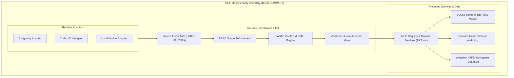
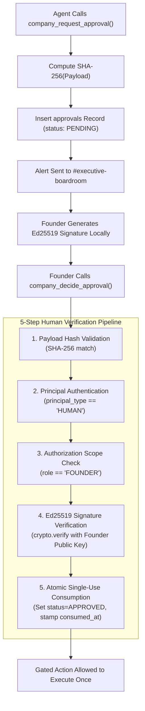

# AICO V3 MASTER BLUEPRINT — SECURITY GOVERNANCE & RUNTIME ADAPTERS

**Document ID:** `BP-V3-10`  
**Version:** `3.1.0-reconciled`  
**Date:** 2026-11-07  
**Author:** `flash-02` — Engineering & QA Lead  
**Design Phase:** Architecture & Contracts Design Only (No Implementation Authorized)  
**Baseline Git Reference:** Branch `feat/v2.2.1-implementation`, Commit `cd749107c4b34e26f61e14a238336e414f78779d`  
**Actual HEAD:** `21f3aad16911eb076e2245a791bde51178a0d222`  
**Target Workspace:** `D:\AI-COMPANY`

---

## 1. ZERO-TRUST SECURITY ARCHITECTURE

AICO V3 operates under a strict Zero-Trust Security Model (`REQ-V3-001`). No agent, harness, or tool call is trusted by default:



---

## 2. THE 4 INVIOLABLE FOUNDER GATES

To ensure supreme human oversight over high-risk or irreversible operations, AICO V3 establishes 4 cryptographically enforced **Founder Gates** (formally specified at Gate `V3-G0` and verified prior to `V3-G7` sandbox sign-off):

### 2.1 Gate 1: Argon Specialist Invocation Gate (`REQ-V3-031`)
- **Policy:** `argon-01` (Principal Architect) and `argon-02` (Independent Auditor) MUST NEVER be invoked automatically.
- **Rules:**
  1. No automated fan-out, retry loop, or background cron may trigger Argon.
  2. Every invocation requires a pre-existing `APPROVAL` record where:
     - `approval_type = 'ARGON_INVOCATION'`
     - `target_resource = 'agent:argon-01'` (or `02`)
     - `status = 'APPROVED'`
     - `founder_principal_id` matches human Founder principal
     - `consumed_at IS NULL`
     - `expires_at > unixepoch('now') * 1000`
  3. **Exact Cryptographic Binding:** The execution payload SHA-256 must match `approvals.payload_sha256` exactly.
  4. **Single-Use Consumption:** `consumed_at` is stamped in an atomic transaction; replay attempts fail with `E_APPROVAL_CONSUMED`.

### 2.2 Gate 2: Production Database Schema Migration Gate (Gate G4, `REQ-V3-007`)
- **Policy:** Production database `D:\AI-COMPANY\data\aico.db` remains 100% frozen at v0.3.0.
- **Rules:**
  1. Gate `V3-G7` authorizes sandbox implementation completion ONLY. It does **NOT** open Gate G4.
  2. Gate G4 requires an independent, manual human Founder directive.
  3. Pre-migration backup and SHA-256 validation are mandatory.

### 2.3 Gate 3: Network Exposure & Public Gateway Gate (`REQ-V3-004`)
- **Policy:** AICO services bind exclusively to `127.0.0.1` (Local Loopback, port 3334).
- **Rules:** Public Gateway (:3335) and ngrok remain disabled.

### 2.4 Gate 4: Windows NTFS DACL Modification Gate (`REQ-V3-001`)
- **Policy:** Current workspace adheres to Option A (audit-only / review-only). No automated script may alter NTFS inheritance or permissions.

---

## 3. REDESIGNED VERIFIABLE HUMAN FOUNDER APPROVAL PIPELINE (`REQ-V3-030`)

To prevent AI agents from fabricating or auto-approving gated actions, Founder approvals require verifiable human authorization:



---

## 4. THREAT MODELING & DEFENSIVE CONTROLS

1. **Path Traversal Defense (`REQ-V3-001`):** All file paths are resolved with `path.resolve` and asserted to reside strictly inside `D:\AI-COMPANY`. Violations throw `E_SECURITY_PATH_TRAVERSAL`.
2. **Command Injection Defense (`REQ-V3-001`):** Shell executions disallow meta-characters (`&`, `;`, `|`, `` ` ``) and execute with minimal privileges.
3. **Secret Scanning:** All artifacts and Git commits are scanned for API keys and secrets prior to persistence (`REQ-V3-001`).
4. **Tamper-Evident Audit Logging (`REQ-V3-032`):** Audit records form a monotonic SHA-256 forward-hash chain in SQLite with external JSONL anchoring and truncation defense.

---

## 5. RUNTIME ADAPTER FRAMEWORK (`IRuntimeAdapter`)

Standardized interface bridging execution harnesses to the AICO MCP gateway:

```typescript
export interface IRuntimeAdapter {
  readonly adapter_id: string;
  readonly runtime_type: "ANTIGRAVITY" | "CODEX_CLI" | "LOCAL_WORKER" | "DEEPSEEK_LOCAL";

  connect(config: Record<string, unknown>): Promise<AgentSessionDTO>;
  executeTool<TInput, TOutput>(toolName: string, input: TInput): Promise<ToolResponse<TOutput>>;
  onEvent(eventType: string, handler: (event: AicoDomainEvent) => void): void;
  disconnect(): Promise<void>;
}
```
