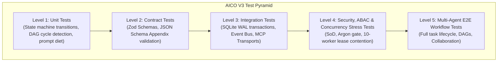
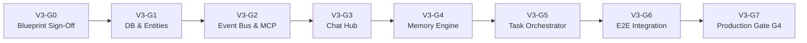

# AICO V3 MASTER BLUEPRINT — TEST STRATEGY, QUALITY GATES & RELEASE PLAN

**Document ID:** `BP-V3-11`  
**Version:** `3.0.0-draft`  
**Date:** 2026-11-07  
**Author:** `flash-02` — Engineering & QA Lead  
**Design Phase:** Architecture & Contracts Design Only (No Implementation Authorized)  
**Baseline Git Reference:** Branch `feat/v2.2.1-implementation`, Commit `cd749107c4b34e26f61e14a238336e414f78779d`  
**Target Workspace:** `D:\AI-COMPANY`

---

## 1. QUALITY ASSURANCE PHILOSOPHY & TEST TAXONOMY

In AICO V3, software quality is not an afterthought or a superficial assertion of "PASS". Quality is guaranteed through automated, multi-tiered test verification executed independently by QA (`flash-02`) before any code can advance to review or release.



---

## 2. THE 7-LEVEL TEST SUITE SPECIFICATION

### 2.1 Level 1: Unit Tests
- **Target:** Isolated functions, data structures, state machine transition tables, and algorithms.
- **Key Suites:**
  - `test/unit/state-machine.test.ts`: Tests all 30 states and valid/invalid transitions.
  - `test/unit/dag-validator.test.ts`: Verifies cycle detection using Kahn's algorithm.
  - `test/unit/token-optimizer.test.ts`: Verifies observation masking and prompt token counting.
- **Execution Target:** < 2 seconds, zero external I/O.

### 2.2 Level 2: Contract Tests
- **Target:** All MCP tool schemas and event payloads.
- **Key Suites:**
  - `test/contracts/mcp-schema.test.ts`: Validates input and output payloads of all 18 V3 tools against strict Zod schemas.
  - `test/contracts/event-envelope.test.ts`: Validates that emitted events conform to `aico.event.v3`.

### 2.3 Level 3: Database & Transport Integration Tests
- **Target:** Interaction between SQLite, transactions, and MCP communication adapters.
- **Key Suites:**
  - `test/integration/sqlite-wal.test.ts`: Validates concurrent read/write transactions, busy timeout behavior under simulated 500ms lock holding, and rollback safety.
  - `test/integration/stdio-adapter.test.ts`: Validates clean JSON-RPC over STDIO without stdout corruption.
  - `test/integration/http-adapter.test.ts`: Validates `/mcp` and `/health` endpoints on loopback (`127.0.0.1:3334`).

### 2.4 Level 4: Negative Security & ABAC Tests
- **Target:** Proving that the system fails closed when unauthorized or malicious operations occur.
- **Key Suites:**
  - `test/security/sod-enforcement.test.ts`: Proves an agent cannot approve technical review on its own task (`E_ABAC_DENIED`).
  - `test/security/argon-gate.test.ts`: Proves automated or unauthorized Argon invocation is strictly blocked (`E_FOUNDER_APPROVAL_REQUIRED`).
  - `test/security/path-traversal.test.ts`: Proves directory traversal payloads (`../../Windows/System32`) are rejected.
  - `test/security/audit-chain.test.ts`: Simulates tampering with an SQLite audit row and proves chain invalidation is detected.

### 2.5 Level 5: Concurrency & Stress Tests
- **Target:** High-contention lease acquisition and database transactions.
- **Key Suites:**
  - `test/stress/lease-contention.test.ts`: 10 simulated parallel worker processes attempt to claim the same task simultaneously; exactly 1 acquires the lease, and 9 receive `E_LEASE_CONFLICT`.
  - `test/stress/burst-messages.test.ts`: Posts 500 messages into a chat room in under 5 seconds to verify SQLite write queuing and zero data corruption.

### 2.6 Level 6: Disaster Recovery & Liveness Tests
- **Target:** Self-healing and resiliency when workers or background loops fail.
- **Key Suites:**
  - `test/recovery/lease-timeout.test.ts`: Tests wall-clock timeout recovery where an expired lease (>180s) is automatically forfeited to `READY_FOR_DEV`.
  - `test/recovery/crash-recovery.test.ts`: Simulates process crash during task execution and verifies recovery on restart.

### 2.7 Level 7: Multi-Agent End-to-End (E2E) Acceptance Tests
- **Target:** Full collaborative company workflow.
- **Key Suites:**
  - `test/e2e/multi-agent-workflow.test.ts`: Executes a complete flow: CEO (`chatgpt-01`) creates task -> DAG decomposes -> SWE (`codex-01`) claims lease and implements -> CTO (`flash-01`) reviews -> QA (`flash-02`) independently tests -> Founder accepts.

---

## 3. THE 8 FORMAL V3 QUALITY GATES (V3-G0 TO V3-G7)

Advancement between implementation phases is strictly governed by 8 sequential Quality Gates:



### 3.1 Gate Matrix & Criteria

| Gate | Phase Name | Entry Criteria | Required Deliverables | Mandatory Reviewers | Exit Criteria |
| :--- | :--- | :--- | :--- | :--- | :--- |
| **V3-G0** | Blueprint & Architecture | Baseline git clean on commit `cd74910`. | All 12 Blueprint docs in `docs/blueprint/v3/`. | Founder (Human), CTO (`flash-01`) | Explicit Founder approval on Master Blueprint. |
| **V3-G1** | Domain & Database | Gate V3-G0 APPROVED. | DDL migration scripts, SQLite WAL config, migration rollback test. | CTO (`flash-01`), QA (`flash-02`) | Unit + integration tests pass; 0 data loss. |
| **V3-G2** | Event Bus & MCP Core | Gate V3-G1 APPROVED. | In-process EventBus, Zod contracts, token auth filter. | CTO (`flash-01`), QA (`flash-02`) | Contract test suite passes 100%. |
| **V3-G3** | Collaboration Hub | Gate V3-G2 APPROVED. | Chat rooms, threads, message types, mention extraction. | CTO (`flash-01`), QA (`flash-02`) | Room collaboration integration tests pass. |
| **V3-G4** | Unified Memory Engine | Gate V3-G3 APPROVED. | 5-tier memory store, FTS5 search, context snapshotting. | CTO (`flash-01`), QA (`flash-02`) | Snapshot rehydration tests pass; ABAC holds. |
| **V3-G5** | Task Orchestration | Gate V3-G4 APPROVED. | 30-state engine, DAG validator, lease heartbeat, SoD review. | CTO (`flash-01`), QA (`flash-02`) | Concurrency stress & lease timeout pass. |
| **V3-G6** | Multi-Agent E2E | Gate V3-G5 APPROVED. | Full collaborative pipeline, dynamic skill discovery. | CEO (`chatgpt-01`), QA (`flash-02`) | Multi-agent E2E test suite passes 100%. |
| **V3-G7** | Production Release | Gate V3-G6 APPROVED. | Final release notes, security audit, pre-migration backup. | **FOUNDER (MANDATORY)** | Founder authorizes Gate G4 to migrate prod DB. |

---

## 4. DISASTER RECOVERY & ROLLBACK RUNBOOKS

### 4.1 Database Rollback Runbook (Zero Data Loss)
In the event of an unexpected schema corruption or migration failure during testing or release:

```powershell
# Step 1: Immediately terminate all local MCP server processes
Stop-Process -Name "node" -Force -ErrorAction SilentlyContinue

# Step 2: Verify backup snapshot integrity
$BackupPath = "D:\AI-COMPANY\data\backup\aico_pre_v3.db"
$CurrentPath = "D:\AI-COMPANY\data\aico.db"
$ExpectedHash = (Get-Content "$BackupPath.sha256").Trim()
$ActualHash = (Get-FileHash -Path $BackupPath -Algorithm SHA256).Hash

if ($ExpectedHash -ne $ActualHash) {
    Write-Error "CRITICAL: Backup file hash mismatch! Aborting rollback."
    exit 1
}

# Step 3: Atomic file replacement
Copy-Item -Path $BackupPath -Destination $CurrentPath -Force
Remove-Item -Path "$CurrentPath-wal", "$CurrentPath-shm" -Force -ErrorAction SilentlyContinue

# Step 4: Verify restored database
Write-Output "Database successfully restored to baseline snapshot."
```

### 4.2 Git Rollback Runbook
If an implementation phase must be aborted prior to merging:
```powershell
# Inspect branch state
git status --short
git log -n 5 --oneline

# Safe abort back to verified baseline commit
git checkout feat/v2.2.1-implementation
git reset --hard cd749107c4b34e26f61e14a238336e414f78779d
```

### 4.3 Windows NTFS ACL Rollback Runbook
If an unauthorized ACL change occurs:
```powershell
# Restore standard inheritance on workspace root
icacls "D:\AI-COMPANY" /reset /T /C
```

---

## 5. EVIDENCE-BASED RELEASE CRITERIA

Before requesting Founder authorization for Gate `V3-G7` (Production Release):
1. **Zero Failing Tests:** All unit, contract, integration, security, and E2E tests must report `exit code 0` with complete command logs.
2. **Zero Hardcoded Secrets:** Secret scanner reports 0 findings across all repository files.
3. **Argon Specialist Inviolability Verified:** Automated test proves Argon cannot be invoked without signed Founder approval.
4. **Independent QA Audit Signed:** `flash-02` submits a comprehensive verification report containing exact commit hashes, test outputs, and cryptographic signatures.
