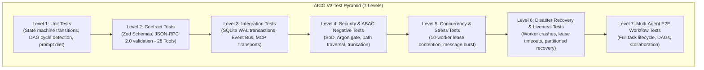

# AICO V3 MASTER BLUEPRINT — TEST STRATEGY, QUALITY GATES & RELEASE PLAN

**Document ID:** `BP-V3-11`  
**Version:** `3.1.0-reconciled`  
**Date:** 2026-11-07  
**Author:** `flash-02` — Engineering & QA Lead  
**Design Phase:** Architecture & Contracts Design Only (No Implementation Authorized)  
**Baseline Git Reference:** Branch `feat/v2.2.1-implementation`, Commit `cd749107c4b34e26f61e14a238336e414f78779d`  
**Actual HEAD:** `21f3aad16911eb076e2245a791bde51178a0d222`  
**Target Workspace:** `D:\AI-COMPANY`

---

## 1. QUALITY ASSURANCE PHILOSOPHY & TEST TAXONOMY

In AICO V3, software quality is guaranteed through automated, multi-tiered test verification executed independently by QA (`flash-02`) before any code can advance to review or release:

---

## 2. THE 7-LEVEL TEST SUITE SPECIFICATION

### 2.1 Level 1: Unit Tests
- **Target:** Isolated functions, data structures, state machine transition tables, and algorithms.
- **Key Suites:**
  - `test/unit/state-machine-23.test.ts`: Tests all 23 states and 26 valid transitions (`REQ-V3-021`).
  - `test/unit/dag-validator.test.ts`: Verifies cycle detection using Kahn's algorithm (`REQ-V3-022`).
  - `test/unit/token-diet.test.ts`: Verifies observation masking and prompt token counting (`REQ-V3-026`).

### 2.2 Level 2: Contract Tests
- **Target:** All 28 MCP tool schemas and event payloads (`REQ-V3-002`, `REQ-V3-003`).
- **Key Suites:**
  - `test/contracts/mcp-schema.test.ts`: Validates input and output payloads of all 28 tools against Zod schemas.
  - `test/contracts/event-envelope.test.ts`: Validates that emitted events conform to `aico.event.v3`.

### 2.3 Level 3: Database & Transport Integration Tests
- **Target:** SQLite WAL concurrency and protocol transports (`REQ-V3-003`, `REQ-V3-008`).
- **Key Suites:**
  - `test/integration/sqlite-wal.test.ts`: Validates concurrent read/write transactions and 5000ms busy timeout.
  - `test/integration/fts5-sync.test.ts`: Validates automatic FTS5 synchronization via triggers (`REQ-V3-020`).
  - `test/integration/stdio-adapter.test.ts`: Validates 2 MiB stream guard and clean JSON-RPC over STDIO.
  - `test/integration/http-adapter.test.ts`: Validates `/mcp` on loopback (`127.0.0.1:3334`).

### 2.4 Level 4: Security & ABAC Negative Tests
- **Target:** Proving that the system fails closed under unauthorized operations (`REQ-V3-025`, `REQ-V3-030`, `REQ-V3-031`).
- **Key Suites:**
  - `test/security/sod-enforcement.test.ts`: Proves self-approval rejection (`E_ABAC_DENIED`).
  - `test/security/argon-gate.test.ts`: Proves automated Argon invocation is blocked (`E_FOUNDER_APPROVAL_REQUIRED`).
  - `test/security/human-approval.test.ts`: Proves AI agents cannot grant Founder approvals (`E_HUMAN_AUTHORIZATION_REQUIRED`).
  - `test/security/path-traversal.test.ts`: Proves traversal outside `D:\AI-COMPANY` is blocked.
  - `test/security/audit-chain.test.ts`: Simulates table truncation with external anchor and verifies detection.

### 2.5 Level 5: Concurrency & Stress Tests
- **Target:** High-contention lease acquisition (`REQ-V3-023`).
- **Key Suites:**
  - `test/stress/lease-contention.test.ts`: 10 parallel workers claim the same task; exactly 1 succeeds, 9 get `E_LEASE_CONFLICT`.
  - `test/stress/burst-messages.test.ts`: 500 messages posted in 5 seconds to verify write queuing.

### 2.6 Level 6: Disaster Recovery & Liveness Tests
- **Target:** Self-healing and partitioned lease recovery (`REQ-V3-024`, `REQ-V3-031`).
- **Key Suites:**
  - `test/recovery/lease-timeout.test.ts`: Proves standard tasks return to `READY_FOR_DEV`, while expired Argon tasks transition to `BLOCKED_MANUAL_INTERVENTION`.
  - `test/recovery/crash-recovery.test.ts`: Simulates process crash and verifies uncorrupted state on restart.

### 2.7 Level 7: Multi-Agent E2E Workflow Tests
- **Target:** Full collaborative company workflow.
- **Key Suites:**
  - `test/e2e/multi-agent-workflow.test.ts`: CEO creates task -> DAG decomposes -> SWE implements -> CTO reviews -> QA tests -> Founder accepts.

---

## 3. UNIFIED V3 QUALITY GATES (`V3-G0` TO `V3-G7`)

Advancement between implementation phases is strictly governed by 8 sequential Quality Gates:

| Gate | Phase Name | Entry Criteria | Required Deliverables | Mandatory Reviewers | Exit Criteria |
| :---: | :--- | :--- | :--- | :--- | :--- |
| **V3-G0** | Blueprint & Architecture | Baseline git clean on commit `cd74910`. | All 12 reconciled Blueprint docs in `docs/blueprint/v3/`. | Founder (Human), CTO (`flash-01`) | Explicit human Founder approval on Master Blueprint. |
| **V3-G1** | Domain & Database Sandbox | Gate `V3-G0` APPROVED. | 27 sandbox tables, FTS5 table, 3 triggers, 4 legacy views. | CTO (`flash-01`), QA (`flash-02`) | Unit + integration tests pass on isolated test DB. |
| **V3-G2** | Event Bus & MCP Core | Gate `V3-G1` APPROVED. | In-process EventBus, Zod contracts, token auth filter. | CTO (`flash-01`), QA (`flash-02`) | Contract test suite passes 100%. |
| **V3-G3** | Collaboration Hub | Gate `V3-G2` APPROVED. | 6 chat room types, threads, message types, notifications inbox. | CTO (`flash-01`), QA (`flash-02`) | Room collaboration integration tests pass. |
| **V3-G4** | Unified Memory Engine | Gate `V3-G3` APPROVED. | 5-tier memory store, FTS5 sync, context snapshotting. | CTO (`flash-01`), QA (`flash-02`) | Snapshot rehydration tests pass; ABAC holds. |
| **V3-G5** | Task Orchestration | Gate `V3-G4` APPROVED. | 23-state engine, DAG validator, partitioned lease recovery. | CTO (`flash-01`), QA (`flash-02`) | Concurrency stress & lease timeout pass. |
| **V3-G6** | Multi-Agent Integration | Gate `V3-G5 APPROVED`. | Full collaborative pipeline, JIT skill discovery. | CEO (`chatgpt-01`), QA (`flash-02`) | Multi-agent E2E test suite passes 100%. |
| **V3-G7** | Sandbox Sign-Off | Gate `V3-G6` APPROVED. | Final QA audit report, 100% test pass logs, zero CVEs. | **FOUNDER (MANDATORY)** | **Authorizes sandbox implementation completion ONLY. Does NOT open production Gate G4.** |

---

## 4. SAFE CONCEPTUAL RECOVERY PROCEDURES (NON-DESTRUCTIVE)

> [!IMPORTANT]
> **CONCEPTUAL SPECIFICATION ONLY — DO NOT EXECUTE DIRECTLY DURING DESIGN PHASE.**  
> Destructive commands such as `Stop-Process -Force`, `git reset --hard`, and `icacls /reset /T` are strictly prohibited. The following non-destructive procedures define the design-time recovery architecture:

### 4.1 Non-Destructive Process Shutdown Procedure (Conceptual)
1. Signal the Node.js server process gracefully using standard IPC (`SIGTERM` or MCP administrative shutdown tool).
2. Allow active SQLite read/write transactions up to 5,000 ms to complete cleanly and checkpoint to disk (`PRAGMA wal_checkpoint(PASSIVE)`).
3. Close the HTTP loopback listener gracefully, ensuring zero truncated JSON-RPC frames.

### 4.2 Non-Destructive Git Inspection & Recovery Procedure (Conceptual)
If an implementation branch requires investigation or safe rollback:
1. Never run `git reset --hard` or discard uncommitted modifications.
2. Create an isolated inspection branch: `git checkout -b inspect/safety-checkpoint`.
3. Stash any uncommitted work non-destructively: `git stash save "checkpoint-before-investigation"`.
4. Inspect differences against baseline: `git diff feat/v2.2.1-implementation..HEAD`.

### 4.3 Non-Destructive Windows NTFS Security Audit (Conceptual)
1. Workspace security operates under Option A (audit-only / review-only).
2. Verify access control without modifying permissions: `icacls "D:\AI-COMPANY" /verify`.
3. Never strip inheritance or overwrite user permissions.

---

## 5. EVIDENCE-BASED RELEASE CRITERIA

Before requesting Founder authorization for Gate `V3-G7` (Sandbox Implementation Sign-Off):
1. **Zero Failing Tests:** All unit, contract, integration, security, and E2E tests report `exit code 0`.
2. **Zero Hardcoded Secrets:** Secret scanner reports 0 findings across all repository files.
3. **Argon Specialist Inviolability Verified:** Automated test proves Argon cannot be invoked without signed human Founder approval.
4. **Independent QA Audit Signed:** `flash-02` submits a comprehensive verification report containing exact commit hashes, test outputs, and cryptographic signatures.
