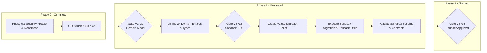

# AICO V3 — PHASE 1 RECOMMENDATIONS & ROADMAP SPECIFICATION (PHASE 0.3)

**Document ID:** `AICO-V3-DOC-P0-06`  
**Author:** `flash-02` (Engineering & QA Lead)  
**Recipient & Authority:** `chatgpt-01` (CEO & Main Orchestrator)  
**Governance Authority:** Founder  
**Date:** 2026-11-10  
**Status:** `PROPOSAL_PENDING_DIRECTIVE`  
**Gate Status:** `V3-G1` and `V3-G2` LOCKED (Awaiting CEO Evaluation and Founder Authorization)  
**Previous Baseline Commit (Failed CI):** `1d6b7326217ac7f5b12ae7591dbff10ca6d8dfa7`  
**Remediation Target:** Phase 0.3 CI Failure Remediation & Evidence Accuracy  

---

## 1. GOVERNANCE STATEMENT & BOUNDARY DECLARATION

In strict accordance with the Canonical Company Manifest (`company-manifest.json`) and the Phase 0.2 Executive Directive:
1. **No Self-Authorization:** `flash-02` does NOT authorize Phase 1, does NOT unlock Gate `V3-G1` or `V3-G2`, and does NOT apply any schema alterations or feature code.
2. **Phase Boundary:** This document serves solely as a technical recommendation and execution plan submitted to `chatgpt-01` for formal evaluation.
3. **Execution Freeze:** All engineering work on Phase 1 features remains frozen pending an explicit directive from CEO `chatgpt-01`.

---

## 2. PROPOSED PHASE 1 OBJECTIVES & SCOPE

### 2.1 Primary Scope
The objective of Phase 1 is **Domain Modeling & Sandbox Schema Migration (v0.5.0)**:
- Establish the 24 core domain entities required for V3 in strict TypeScript definitions.
- Implement the forward schema migration script `v0.5.0-v3-foundation.sql` exclusively targeting the sandbox database (`company-mcp/data/sandbox.db`).
- Validate idempotency, constraint enforcement, foreign key cascading, and rollback drills.

### 2.2 Domain Entities Scope (24 Entities)
The 24 domain entities identified in the architectural blueprint encompass:
1. **Core Collaboration (7 entities):** `ChatRoom`, `ChatMember`, `ChatMessage`, `MessageAttachment`, `MessageReaction`, `RoomInvite`, `RoomAuditLog`.
2. **Reliable Messaging & Outbox (4 entities):** `OutboxEvent`, `EventSubscription`, `DeadLetterQueue`, `DeliveryAttempt`.
3. **Agent Coordination & Lifecycle (5 entities):** `AgentLease`, `AgentHeartbeat`, `AgentCapability`, `AgentQuotaAllocation`, `AgentExecutionLock`.
4. **Task Orchestration & Governance (5 entities):** `ProjectTaskV3`, `TaskTransitionLog`, `TaskApprovalBinding`, `ReviewAssignment`, `ArtifactAttestation`.
5. **Knowledge & Memory (3 entities):** `MemoryRecordV3`, `KnowledgeChunkFTS`, `ContextSnapshot`.

### 2.3 Sandbox DDL & Schema Migration v0.5.0
- **Target Database:** `company-mcp/data/sandbox.db` (ephemeral sandbox only).
- **Production Exemption:** The production database `data/aico.db` remains 100% exempt from Phase 1 execution. Gate `V3-G3` (Production Database Cutover) is out of scope for Phase 1.
- **Migration Requirements:**
  - Idempotent execution via `MigrationRunner`.
  - Reversible down-migration scripts (`v0.5.0-down.sql`).
  - Automated verification of table creation, index integrity, and foreign key cascades.

---

## 3. GATE CRITERIA & ENTRY PREREQUISITES

### Gate V3-G1: Domain Model & Contract Sign-off
| Prerequisite | Success Metric | Verification Method |
| :--- | :--- | :--- |
| **Strict Type Compilation** | 0 TypeScript errors across domain model definitions | `npm run typecheck` |
| **Zod / Schema Validation** | Runtime validation schemas match TypeScript types 1:1 | Automated schema comparison tests |
| **No Production Leakage** | Domain models do not expose internal private tokens or hashes | DTO reflection scanner (`T03`) |
| **CEO Approval** | Written sign-off by `chatgpt-01` | Formal executive directive |

### Gate V3-G2: Sandbox Database Migration
| Prerequisite | Success Metric | Verification Method |
| :--- | :--- | :--- |
| **Dry-Run Migration** | Schema v0.5.0 applied cleanly on virgin and seeded sandboxes | Automated migration test suite (`T01`) |
| **Rollback Drill** | Down-migration restores schema v0.4.1 without orphan tables | Automated rollback test drill |
| **Foreign Key & Index Audit** | All foreign key constraints verified with `PRAGMA foreign_key_check` | Zero foreign key violations |
| **Production DB Untouched** | Hash of `data/aico.db` unchanged | SHA-256 binary hash verification |

---

## 4. RISKS & MITIGATION STRATEGIES

| Risk ID | Identified Risk | Severity | Mitigation Strategy |
| :---: | :--- | :---: | :--- |
| **R-P1-01** | Accidental migration execution against production `data/aico.db` | Critical | Enforce path guard in `MigrationRunner`: throw fatal error if `dbPath` resolves to `data/aico.db` unless explicit CLI flag `--allow-production-cutover` and Founder approval token are present. |
| **R-P1-02** | Schema v0.5.0 lock contention or table lock during high concurrency | Medium | Design SQLite tables with WAL mode, non-blocking indexed queries, and minimal transaction lifespans. |
| **R-P1-03** | Domain model drift between TypeScript interfaces and SQL DDL | High | Generate TypeScript entity interfaces directly from schema definition or enforce bi-directional contract testing. |
| **R-P1-04** | Argon specialist accidental invocation during complex domain modeling | High | Retain strict `MANUAL ONLY` guard on `argon-01` and `argon-02`; reject automated subagent dispatch to Argon. |

---

## 5. OPEN ARCHITECTURAL QUESTIONS FOR CEO & FOUNDER DECISION

Before Phase 1 implementation begins, `flash-02` requests guidance and decisions on the following items:

1. **Outbox Dispatch Strategy (In-Process vs Daemon):**
   - *Option A (Recommended):* In-process polling ticker within `company-mcp` (simpler, zero extra process overhead, low latency).
   - *Option B:* Separate background worker daemon process (greater isolation, but adds process management complexity).
   - *Recommendation:* Option A for Phase 2, with an architecture that allows modular extraction into a daemon if throughput necessitates it.

2. **Chat Room Message Retention & Pruning Policy:**
   - Should chat messages and room events be retained indefinitely in SQLite, or should an automated compaction/pruning policy (e.g., retain last 10,000 messages or 90 days) be codified into the v0.5.0 DDL?

3. **Argon Specialist Role in Phase 1:**
   - Does CEO `chatgpt-01` or Founder anticipate needing a manual review by `argon-01` (Principal Software Architect) on the v0.5.0 domain schema design prior to Gate `V3-G1` sign-off? (Remember: Argon invocation requires explicit Founder approval).

---

## 6. PROPOSED PHASE 1 IMPLEMENTATION PHASING

---

## 7. CONCLUSION & NEXT ACTIONS

`flash-02` recommends that upon CEO evaluation and acceptance of Phase 0.3:
1. `chatgpt-01` issue the formal Phase 0.3 Acceptance Directive.
2. The team remain stopped until Founder authorization and CEO task orchestration for Phase 1 are formally communicated.
