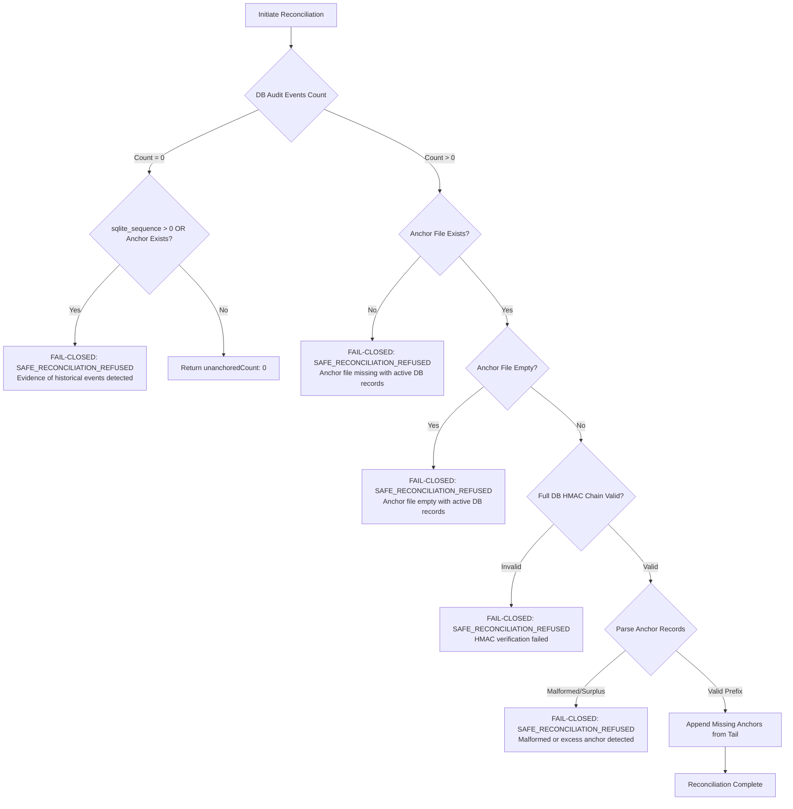

# AICO V3 — SECURITY AND DATABASE SAFETY SPECIFICATION

**Document ID:** `AICO-V3-DOC-P0-04`  
**Author:** `flash-02` (Engineering & QA Lead)  
**Reviewer:** `chatgpt-01` (CEO & Main Orchestrator)  
**Authority:** Founder  
**Date:** 2026-11-10  
**Status:** `READY_FOR_CEO_EVALUATION`  
**Security Baseline:** `SEC-P0-01` through `SEC-P1-05` remediated and verified  

---

## 1. EXECUTIVE SUMMARY

The security architecture of AICO V3 enforces strict defense-in-depth across cryptographic data integrity, identity authentication, dual-tier governance authorization, credential confidentiality, and production database immutability.

During Phase 0 and Phase 0.1, all legacy identity fallbacks, unverified anchor reconstructions, surrogate serialization loopholes, and truncated history scanners were eliminated. This document details the cryptographic principles, fail-closed reconciliation models, credential safeguards, and production safety guarantees established in the codebase.

---

## 2. CRYPTOGRAPHIC INTEGRITY & AUDIT CHAIN ARCHITECTURE

### 2.1 RFC 8785 JSON Canonicalization Scheme (JCS)
All cryptographically bound data structures (approvals, audit log entries, artifact manifests) utilize deterministic serialization adhering strictly to RFC 8785 JCS via `rfc8785Canonicalize()` in `company-mcp/src/utils/jcs.ts`.

Key technical constraints implemented:
1. **Deterministic Lexicographical Key Sorting:** Object member names are sorted by UTF-16 code units in ascending order.
2. **IEEE 754 Float Canonicalization:** Number formatting adheres to ECMAScript standard serialization without non-significant zeros, while preventing floating-point representation drift.
3. **Strict Rejection of Non-JSON Types:** Rejects `NaN`, `Infinity`, `BigInt`, and non-plain objects.
4. **UTF-16 Surrogate Pair Integrity:** Detects and strictly rejects unpaired (lone) surrogates (`0xD800` to `0xDFFF`) in both string values and object member names, preventing hash evasion via malformed Unicode.
5. **Deterministic Array Serialization:** Array holes/sparse indices are canonicalized as `null`, while explicit `undefined` items within arrays or object values are strictly rejected.

### 2.2 Tamper-Evident HMAC-SHA256 Chain
Audit records within SQLite table `audit_events` form an append-only, tamper-evident cryptographic hash chain:
- **Genesis Block:** Seeded with a 64-character zero-hash (`0000000000000000000000000000000000000000000000000000000000000000`).
- **Chain Formulation:** For each event $e_i$ ($i \ge 1$):
  $$H_i = \text{HMAC-SHA256}_{K_{\text{audit}}}\left( H_{i-1} \,\|\, \text{JCS}(\text{payload}_i) \right)$$
- **Zero-Trust Verification:** `verifyAuditChainIntegrity()` reads all events ordered by `event_id ASC` from genesis to the current tail. Any bitwise alteration, reordering, event insertion, or record deletion instantly breaks the HMAC relationship, identifying the exact `brokenAtEventId`.

### 2.3 External Audit Anchoring Model
To protect against database rollback attacks (where an adversary restores an earlier valid database state), an external append-only JSONL anchor file (`data/audit_anchor.jsonl`) mirrors every committed audit record:
- **Anchor Structure:** Each line contains `{"audit_id": number, "event_type": string, "hmac": string, "timestamp": string}`.
- **Bi-directional Parity:** Anchor verification asserts a 1:1 correspondence between SQLite records and external anchor entries.
- **Tamper Detection Vectors:**
  - Middle anchor deletion detection (`ANCHOR_FILE_DEFICIT`).
  - Anchor record insertion or duplicate records (`ANCHOR_FILE_EXCESS`).
  - Out-of-order or duplicate sequence records (`DUPLICATE_OR_REORDERED_ANCHORS`).
  - Database tail truncation (`DATABASE_TAIL_TRUNCATED_OR_MISSING`).
  - Corrupted or unparseable JSON lines (`MALFORMED_ANCHOR_RECORD`).

---

## 3. FAIL-CLOSED AUDIT RECONCILIATION MODEL

Reconciliation (`reconcileUnanchoredEvents()`) is invoked only during recovery drills or interrupted write recovery. The implementation in `ObservabilityQuotaService` follows strict fail-closed security semantics:

### Safety Rules Enforced:
1. **No Silent Reconstruction from Scratch:** If the anchor file is missing or 0 bytes while the database contains audit events, automated reconstruction is explicitly refused (`SAFE_RECONCILIATION_REFUSED`). Manual intervention and cryptographic forensics are required.
2. **Empty DB Tamper Detection:** If the database `audit_events` table contains 0 rows, the engine inspects `sqlite_sequence` and the external anchor file. If `sqlite_sequence.seq > 0` or anchor lines exist, the system detects a table wipe/truncation attack and refuses reconciliation.
3. **HMAC Pre-Condition:** No anchor reconciliation is permitted without prior verification of the database HMAC chain from genesis.
4. **Zero State Alteration on Error:** If any exception or discrepancy occurs during reconciliation, no records are written to disk, and the database state remains 100% unaltered.

---

## 4. WINDOWS DPAPI CREDENTIAL PROTECTION

AICO protects secrets at rest on Windows workstations using native Windows Data Protection API (DPAPI):

- **Storage Location:** `data/credentials.enc`
- **Encryption Primitive:** `CryptProtectData` (via Windows DPAPI binding).
- **Scope:** Current User (`CRYPTPROTECT_UI_FORBIDDEN`). Only processes running under the authenticated Windows user account can decrypt stored credentials.
- **Entropy Binding:** Decryption keys are derived from the local machine state and user logon credentials, preventing offline exfiltration of the database or credential files to other machines.
- **Process Isolation:** Decrypted plaintext secrets exist only transiently in heap memory and are never written to disk, logs, SQLite tables, or error stack traces.

---

## 5. AUTHENTICATION & AUTHORIZATION DEFENSE-IN-DEPTH

### 5.1 Elimination of Identity Fallbacks
Legacy implementations allowed `reviewTask` to accept an unverified string parameter (`reviewerId`) and synthesize a default context. This has been completely eliminated in `ProjectTaskService`:
- Direct caller must supply an explicit `PrincipalContext`.
- Context must satisfy: `ctx != null && ctx.authenticated === true`.
- Principal identifier (`principalId`) and type (`principalType`) must match registered company agents or human founder.
- Unauthenticated requests are rejected immediately with `UNAUTHENTICATED_REQUEST`.

### 5.2 Dual-Tier Approval Workflow & Separation of Duties (SoD)
Approval decisions in `ApprovalService` require authenticated context and enforce strict privilege tiers:
- **Founder Tier (Critical/Irreversible Operations):**
  - Requires `principalType === "human"` and `principalId === "founder-01"`.
  - Rejects agent self-approval or technical lead escalation for Founder-reserved operations.
- **Technical Tier (Architectural/Task Approvals):**
  - Permitted deciders: `founder-01` or designated CTO `flash-01`.
  - Enforces `ctx.authenticated === true`.
- **Anti-Self-Approval (TR-25):**
  - No agent or principal may review, approve, or sign off on tasks assigned to themselves (`assigned_agent_id === reviewer_agent_id` is strictly forbidden).

### 5.3 Cryptographic Target Binding
To prevent replay and cross-task authorization hijacking:
1. **Payload Hash Matching:** Approvals include the canonical JCS SHA-256 hash of the exact operation parameters.
2. **Resource Binding:** `consumeApproval()` enforces `expectedTargetResource === "task:" + taskId`.
3. **Agent Binding:** Tasks assigned to specialist agents (e.g., Argon) mandate `expectedTargetAgentId === task.assigned_agent_id`.
4. Mismatched resource or target agent approvals are rejected with `APPROVAL_RESOURCE_MISMATCH` or `APPROVAL_TARGET_AGENT_MISMATCH`.

---

## 6. GIT MEDIATION & SECRET SCANNING

`GitMediationService` provides programmatic isolation and multi-layer credential scanning:

- **Full Divergence Boundary Scanning:** Evaluates all commits between the feature branch and `merge-base(HEAD, main)`. The previous arbitrary 50-commit truncation limit was removed (`SEC-P0-02`), ensuring long-lived feature branches cannot smuggle credentials.
- **Working Tree & Staging Scanner:** Scans unstaged files, staged index entries, and commit patches using high-entropy regex patterns targeting:
  - Private Keys (RSA, EC, OpenSSH, PGP).
  - API Keys & Tokens (OpenAI, Anthropic, Google Gemini, GitHub PATs, AWS access keys).
  - DPAPI encrypted payloads and connection strings.
- **Pre-Merge Enforcement:** Blocks merges if any rule violation or credential leak is detected.

---

## 7. PRODUCTION DATABASE SAFETY GUARANTEES

The central production database is located at `D:\AI-COMPANY\data\aico.db`.

### 7.1 Immutability Evidence
- **Baseline SHA-256 Hash:**  
  `17BD93214291E33260DF4A3D0B7DAD417BCA05C137770443D4D3FA965595E416`
- **Post-Verification SHA-256 Hash:**  
  `17BD93214291E33260DF4A3D0B7DAD417BCA05C137770443D4D3FA965595E416`
- **State Change:** **0 bytes modified. Exact hash match confirmed.**

### 7.2 Sandbox Isolation Protocol
- All Phase 0, Phase 0.1, and security stabilization tests operate exclusively on ephemeral, in-memory databases or sandboxed SQLite instances (`data/sandbox.db`, `data/test_*.db`).
- No DDL statements, migrations, or schema mutations were executed against `data/aico.db`.
- Gate `V3-G3` (Production Database Cutover) remains **LOCKED**. Any future migration of `data/aico.db` requires:
  1. An explicit Founder directive.
  2. A verified SHA-256 binary backup stored in `data/backups/`.
  3. A successful dry-run on a replicated sandbox database with verified schema validation.

---

## 8. GOVERNANCE BOUNDARY & ACCESS CONTROLS

| Control Boundary | Baseline Constraint | Enforcement Status |
| :--- | :--- | :---: |
| **Gate G4** | External network and remote gateway access | **CLOSED** |
| **Public Gateway / ngrok** | Remote reverse proxy tunnel exposure | **DISABLED (Loopback only)** |
| **Argon Invocation** | Specialists `argon-01` and `argon-02` invocation | **MANUAL ONLY (Founder approval required)** |
| **Quota Allocation** | Agent quota ceilings and token diets | **ACTIVE (Strict enforcement)** |
| **V3 Runtime Features** | Chat Rooms, Outbox Dispatcher, Schema v0.5.0 | **FROZEN (Pending Phase 1+ authorization)** |

---

## 9. CONCLUSION

The security architecture of AICO V3 is formally hardened, fail-closed, and empirically verified. The production database is untouched, cryptographic integrity is complete, and all governance gates are strictly locked pending Founder and CEO directives.
