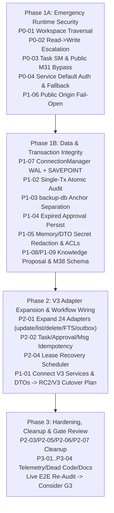

# AICO V3 Runtime Integration Audit — Remediation Roadmap (P0–P3)

**Document ID:** AICO-V3-AUDIT-ROADMAP  
**Repository:** `https://github.com/kietpro352010/AICO`  
**Audited Baseline Commit:** `09962781306dec8f25737c058437210d32e6da8f`  
**Author:** `flash-02` (Engineering & QA Lead)  
**Reporting To:** `chatgpt-01` (CEO & Main Orchestrator)  
**Audit Date:** 2026-11-11  

---

## 1. Findings Summary Matrix (24 Confirmed Findings)

| Severity | Count | Finding IDs |
| :--- | :---: | :--- |
| **P0 (Critical Security / Governance Bypass)** | **4** | `P0-01`, `P0-02`, `P0-03`, `P0-04` |
| **P1 (Major Broken Workflow / Data Integrity / Auth Flaw)** | **9** | `P1-01` .. `P1-09` |
| **P2 (Significant Functional Gap / Reliability Weakness)** | **7** | `P2-01` .. `P2-07` |
| **P3 (Minor Defect / Doc Drift / Dead Code)** | **4** | `P3-01` .. `P3-04` |
| **Total** | **24** | — |

---

## 2. Detailed Ranked Findings (P0–P3)

### Priority 0 — Critical Security & Governance Bypasses

#### `P0-01`: Cross-Agent Workspace Path Traversal Escape via `relative_path`
- **Severity:** `P0`
- **Affected component:** Workspace isolation boundary (`WorkspaceArtifactService`, MCP `M18`/`M19`/`M20`)
- **Exact file and function:** `company-mcp/src/services/workspace-artifact-service.ts` — [`validateAndResolveSafePath`](file:///D:/AI-COMPANY/company-mcp/src/services/workspace-artifact-service.ts#L33-L76), [`readArtifact`](file:///D:/AI-COMPANY/company-mcp/src/services/workspace-artifact-service.ts#L216-L230), [`writeArtifact`](file:///D:/AI-COMPANY/company-mcp/src/services/workspace-artifact-service.ts#L232-L253), [`listFiles`](file:///D:/AI-COMPANY/company-mcp/src/services/workspace-artifact-service.ts#L255-L351)
- **Reproduction steps or code-path evidence:** Authenticate as `codex-01` and call `readArtifact("codex-01", "../flash-02/reports/secret-plan.md", codexCtx)` (or via `M19` with `target_agent_id` unset and `relative_path: "../flash-02/reports/secret-plan.md"`). E2E Scenario 5 returned `relativePathEscapeToFlash02Succeeded: true` and read `"Flash-02 confidential note"`.
- **Expected behavior:** Containment check must anchor at `workspaces/<targetAgentId>` so any `../` segment escaping the agent's own workspace directory is rejected with `WORKSPACE_PATH_SECURITY_VIOLATION`.
- **Actual behavior:** `path.join(agentId, relativePath)` is validated against `folderRoot = path.resolve(this.baseDir, "workspaces")` (`L42-L53`), permitting traversal into any sibling agent directory inside `workspaces/`.
- **Root cause:** `validateAndResolveSafePath` validates containment relative to `workspaces/` root rather than per-agent workspace root `workspaces/<agentId>/`.
- **Recommended remediation:** Anchor path validation directly to `path.resolve(folderRoot, agentId)` using realpath + `path.sep` boundary enforcement before reading, writing, or listing, and reject `..` segments or paths escaping `workspaces/<agentId>`.
- **Acceptance criteria:** Automated E2E tests confirm `readArtifact`, `writeArtifact`, and `listFiles` throw `WORKSPACE_PATH_SECURITY_VIOLATION` on `../<peer>/...`, symlink targets pointing to `<peer>`, and null-byte/encoded traversal variants for both `relativePath` and `target_agent_id`.

#### `P0-02`: Read-Only Scopes Authorize Arbitrary Cross-Agent Workspace Writes & Missing `ctx` Checks
- **Severity:** `P0`
- **Affected component:** Workspace authorization & audit activity queries
- **Exact file and function:** `company-mcp/src/services/workspace-artifact-service.ts` — [`checkOwnershipOrScope`](file:///D:/AI-COMPANY/company-mcp/src/services/workspace-artifact-service.ts#L112-L123), [`safeWriteArtifact`](file:///D:/AI-COMPANY/company-mcp/src/services/workspace-artifact-service.ts#L125-L176), [`listActivities`](file:///D:/AI-COMPANY/company-mcp/src/services/workspace-artifact-service.ts#L435-L480)
- **Reproduction steps or code-path evidence:** Grant `codex-01` read-only audit scopes `["workspace:read:self", "workspace:read:any"]` and call `writeArtifact({ agentId: "flash-02", relativePath: "reports/overwritten-by-reader.md", ... })`. E2E Scenario 5 returned `readOnlyScopeAllowedCrossAgentWrite: true`. Calling `safeWriteArtifact` without `ctx` or as a `service` principal (`agentId: null`) also bypasses `L113`/`L120`.
- **Expected behavior:** Cross-agent writes require explicit write authorization (`founder-01`, `*`, or dedicated `workspace:write:any`); read/audit scopes must never authorize writes; unauthenticated/`!ctx` calls and `listActivities` for other agents must be rejected fail-closed.
- **Actual behavior:** `checkOwnershipOrScope` returns early on `workspace:read:any` or `workspace:audit:read` (`L117`), and `safeWriteArtifact` (`L133`) calls `checkOwnershipOrScope` with no `mode` (`read` vs `write`) distinction. `listActivities` lacks any `PrincipalContext` check.
- **Root cause:** Conflated read/write ownership guard with fail-open `!ctx` and optional `ctx.agentId` checks.
- **Recommended remediation:** Require mandatory authenticated `ctx`; split guard into `assertCanAccessWorkspace(ctx, targetAgentId, "read" | "write")` restricting cross-agent writes to `founder-01`/`*` (or `workspace:write:any`), block `service` principals unless explicitly scoped, and add `ctx` ABAC filtering to `listActivities`.
- **Acceptance criteria:** E2E test verifies `workspace:read:any` and `workspace:audit:read` can read/list cross-agent workspaces yet fail with `PERMISSION_DENIED` on cross-agent `writeArtifact`/`safeWriteArtifact`, and unauthenticated calls reject immediately.

#### `P0-03`: Task State-Machine Authorization & Approval Bypasses (`TR-04`, `TR-12`, `TR-18`) + Public `M31` Exposing Review Completion
- **Severity:** `P0`
- **Affected component:** Task governance & Public Gateway boundary (`ProjectTaskService`, `HttpSecurityPipeline`, `registry-core.ts`)
- **Exact file and function:** `company-mcp/src/services/project-task-service.ts` — [`transitionTask`](file:///D:/AI-COMPANY/company-mcp/src/services/project-task-service.ts#L589-L940) (`TR-01` `L639`, `TR-04` `L651`, `TR-06` `L662`, `TR-08` `L682`, `TR-12` `L740`, `TR-16` `L774`, `TR-18` `L786`, `TR-20` `L804`, `TR-22` `L816`, `TR-25` `L856`); `company-mcp/src/security/http-security-pipeline.ts` — [`PUBLIC_TOOL_ALLOWLIST`](file:///D:/AI-COMPANY/company-mcp/src/security/http-security-pipeline.ts#L70)
- **Reproduction steps or code-path evidence:**
  1. Move a `high` task assigned to `flash-02` to `waiting_approval`, then call `transitionTask` as `codex-01` (`toStatus: "queued"` or `"in_progress"`) with **no `approvalId`** -> E2E Scenario 3 returned `bypassedHighRiskWaitingApprovalWithoutApprovalId: "queued"`.
  2. Have `flash-02` claim a task, then call `transitionTask` as `codex-01` (`claimed -> assigned`) -> E2E Scenario 3 returned `unrelatedAgentDroppedActiveLeaseViaTR12: true`.
  3. On `createFullMcpServer({ isPublicGateway: true })` (where `company_review_task` is hidden), call `M31 company_transition_task` to transition `review_required -> completed` with zero evidence/artifacts -> Extra Probe returned `publicM31CompletedTaskWithoutM33: "completed"`.
- **Expected behavior:** Every task sent to `waiting_approval` must require a valid `approvalId` to exit toward execution (`TR-04`, `TR-18`); `P0` tasks must follow the same `TR-01` block as `critical`; `TR-01/04/06/08/12/16/18/20` must enforce role/ownership ABAC (`TR-12` restricted to lease recovery / leadership on expired leases); `TR-22/25` must enforce evidence/artifacts; Public Gateway must not allow `M31` to perform admin/review/archive transitions blocked via `M33`.
- **Actual behavior:** Ten transitions lack internal ABAC checks; non-critical/non-Argon tasks skip approval verification in `TR-04`/`TR-18`; `TR-12` drops any active lease regardless of expiry or caller; `M31` exposes `TR-23`/`TR-25`/`TR-26` on Public Gateway without artifact/evidence checks.
- **Root cause:** Incomplete per-transition ABAC matrix in `transitionTask`, conditional `if (isArgon || isCritical)` gating inside approval-exit states, and sharing unconstrained `transitionTask` behind both `M31` and `M33`.
- **Recommended remediation:** Enforce explicit role/ABAC & `principalType` policies on all 26 transitions; unconditionally require valid `verifyAndConsumeTaskApproval` on `TR-04`/`TR-18` (plus `TR-16` if paused awaiting approval); restrict `TR-12` to expired leases + leadership/recovery service; enforce `priority === "P0"` in `TR-01`; enforce artifacts+evidence before `TR-22`/`TR-25`; restrict `M31` on `isPublicGateway` (or move review/archive strictly to local `M33`/leadership check).
- **Acceptance criteria:** Negative regression tests confirm `codex-01` cannot exit `waiting_approval` without approval, cannot drop active `flash-02` leases, cannot force `P0` tasks `draft -> queued`, and Public Gateway cannot invoke `TR-23`/`TR-25`/`TR-26` via `M31`.

#### `P0-04`: Direct Service Default-Identity Spoofing & Founder-to-`flash-01` Attribution Fallback
- **Severity:** `P0`
- **Affected component:** Service authorization & audit principal attribution across MCP and internal services
- **Exact file and function:** `company-mcp/src/registry-core.ts` (`M17`–`M21`, `M23`, `M38` lines `832, 869, 905, 927, 949, 993, 1440`; legacy [`registerCompanyTools`](file:///D:/AI-COMPANY/company-mcp/src/registry-core.ts#L129-L257)); `company-mcp/src/services/messaging-service.ts` ([`sendMessage`](file:///D:/AI-COMPANY/company-mcp/src/services/messaging-service.ts#L60)); `company-mcp/src/services/approval-service.ts` ([`createApprovalRequest`](file:///D:/AI-COMPANY/company-mcp/src/services/approval-service.ts#L77), `consumeApproval` `L329`); `company-mcp/src/services/project-task-service.ts` ([`createProject`](file:///D:/AI-COMPANY/company-mcp/src/services/project-task-service.ts#L237-L275), [`createTask`](file:///D:/AI-COMPANY/company-mcp/src/services/project-task-service.ts#L331), [`listTasks`](file:///D:/AI-COMPANY/company-mcp/src/services/project-task-service.ts#L424), [`getTask`](file:///D:/AI-COMPANY/company-mcp/src/services/project-task-service.ts#L464)); `company-mcp/src/services/orchestration-service.ts` ([`recordExternalDispatchMilestone`](file:///D:/AI-COMPANY/company-mcp/src/services/orchestration-service.ts#L64-L65)); `company-mcp/src/services/identity-access-service.ts` ([`getPrincipalById`](file:///D:/AI-COMPANY/company-mcp/src/services/identity-access-service.ts#L80-L107)); `company-mcp/src/services/git-mediation-service.ts` ([`syncAgentBranch`](file:///D:/AI-COMPANY/company-mcp/src/services/git-mediation-service.ts#L193-L198))
- **Reproduction steps or code-path evidence:**
  1. Call `msgService.sendMessage({ toPrincipalId: "codex-01", subject: "...", bodyMarkdown: "..." })` without `ctx` -> Scenario 2 returned `from_principal_id: "founder-01"`.
  2. Call MCP `M38 write_memory` authenticated as `founder-01` (`ctx.agentId === null`) -> Scenario 5 DB inspection recorded `owner_agent_id: "flash-01", provenance_source: "agent:flash-01"`.
- **Expected behavior:** Every state-mutating or sensitive-read service method must fail closed if `ctx?.authenticated !== true`, never fabricate/default `"founder-01"` or `"chatgpt-01"` when `ctx` is absent, and never attribute human `founder-01` operations to `"flash-01"`.
- **Actual behavior:** Multiple services fail open when `ctx` is omitted (`"founder-01"`, `"chatgpt-01"`, spoofed `actorPrincipalId`), `getPrincipalById` returns `authenticated: true` with hardcoded `"cred_internal"`, and 7 MCP handlers substitute `"flash-01"` when `ctx.agentId` is null.
- **Root cause:** Legacy pre-auth default parameters and `ctx.agentId || "flash-01"` shortcuts left in place after V2 authentication was layered only onto MCP wrappers.
- **Recommended remediation:** Mandate authenticated `PrincipalContext` (`assertAuthenticatedContext(ctx)`) on all service public methods; remove fallback `"founder-01"`/`"chatgpt-01"`/`"flash-01"` defaults (attribute human `agent_id: null` or explicit `principalId` safely); quarantine `getPrincipalById` behind test-only helpers and remove unauthenticated `createBaseMcpServer`.
- **Acceptance criteria:** Calling any state-mutating service method with missing/unauthenticated `ctx` throws `AUTHENTICATION_REQUIRED`; human `founder-01` `M38` memory writes store `owner_agent_id = NULL` / `provenance_source = 'human:founder-01'` (or fail explicitly on `agent_private` without `target_agent_id`).

---

### Priority 1 — Major Broken Workflows, Auth Flaws & Transaction Integrity Defects

#### `P1-01`: Complete Runtime Disconnection of V3 Domain Models, Migrations & Persistence Adapters (`0 / 24` Entities Integrated)
- **Severity:** `P1`
- **Affected component:** V3 Domain & Persistence Layer across all production entrypoints and services
- **Exact file and function:** `company-mcp/src/index.ts`, `src/http-registry.ts`, `src/http-public.ts`, `src/registry-core.ts`, `src/services/*.ts`, [`src/db/v3-storage-mappers.ts`](file:///D:/AI-COMPANY/company-mcp/src/db/v3-storage-mappers.ts#L2289-L2316), [`src/db/migrations/v050-v3-foundation.ts`](file:///D:/AI-COMPANY/company-mcp/src/db/migrations/v050-v3-foundation.ts#L22-L41)
- **Reproduction steps or code-path evidence:** Execute Scenarios 1–4 against an isolated DB migrated with `migrationV050V3Foundation`, then inspect row counts of all 25 V3 SQLite objects; all remain `0` (`S1`–`S4` evidence). Recursive grep across `src/` confirms 0 non-test consumers of `V3_ENTITY_PERSISTENCE_ADAPTERS` and 0 imports of `src/domain/*`.
- **Expected behavior:** Approved V3 Phase 2 services/adapters should execute against V3 tables using G1 validated domain schemas, `toPublic*DTO()` projection, and transactional outbox persistence.
- **Actual behavior:** All 24 V3 entities are `ADAPTER_ONLY` with zero runtime callers; runtime runs exclusively on RC2 tables (`schema-v050-rc2.sql`) with none of G1's DTO sanitization guarantees (`internal_metadata` separation, `raw_token_trace` stripping, Zod secret guards) active.
- **Root cause:** Phase 1 intentionally stopped at G1/G2 boundaries with V3-G3 locked, and Phase 2 service integration & MCP V3 endpoints have not yet been implemented.
- **Recommended remediation:** Design and execute Phase 2 service-layer adapter migration under Gate V3-G3 plan: expand adapters beyond `insert`/`getById`, wire collaboration/outbox/task-v3/memory-v3 services through G1 DTOs, and plan RC2->V3 dual-write or cutover strategy.
- **Acceptance criteria:** Each V3 entity has verified end-to-end MCP -> Service -> Domain Schema -> V3 Adapter -> SQLite integration tests passing in sandbox, with `toPublic*DTO()` verified at every egress boundary.

#### `P1-02`: Non-Atomic 2-Transaction MCP Audit Split & Post-Commit Anchor Write Failure
- **Severity:** `P1`
- **Affected component:** MCP write auditing (`registry-core.ts` + `ObservabilityQuotaService`)
- **Exact file and function:** [`company-mcp/src/registry-core.ts`](file:///D:/AI-COMPANY/company-mcp/src/registry-core.ts#L1081-L1101) (`M10–M13, M16, M24, M26, M29, M31–M34`); [`company-mcp/src/services/observability-quota-service.ts`](file:///D:/AI-COMPANY/company-mcp/src/services/observability-quota-service.ts#L136-L226) (`appendAuditEvent`, `writeAnchorRecord`)
- **Reproduction steps or code-path evidence:** In E2E Scenario 6, configure `createFullMcpServer` with an unwritable `anchorFilePath` (directory -> `EISDIR`) and invoke `M26 company_create_task`. M26 returns `isError: true` (`AUDIT_ANCHOR_WRITE_FAILURE`), yet SQLite query confirms both `tasks` (`task_partial_orphan`) and `audit_events` (`audit_id = 1`) committed (`S6_EVIDENCE_PARTIAL_FAILURE`).
- **Expected behavior:** Domain mutations and their immutable audit log records must commit/abort in a single atomic transaction; anchor failures must either roll back uncommitted state or queue deterministic reconciliation without falsely failing committed writes into half-anchored limbo.
- **Actual behavior:** Domain write commits in Tx #1; `appendAuditEvent` commits `audit_events` in Tx #2 and writes `audit_anchors.jsonl` afterward outside SQLite ACID guarantees. Also `M17–M23` and `M35–M37` never invoke `appendAuditEvent` at all.
- **Root cause:** Services open isolated `ConnectionManager.withWriteTransaction` scopes without passing a shared transaction handle (`existingDb`) or transactional `event_outbox`, and anchor file I/O runs post-commit.
- **Recommended remediation:** Pass shared `db` handle (matching `ApprovalService.consumeApproval(..., existingDb)`) or `SAVEPOINT`-enabled `ConnectionManager` so domain mutation + `audit_events` (+ `event_outbox`) commit atomically in Tx #1; treat external file anchor appending as idempotent durable sync via `reconcileUnanchoredEvents` or rollback compensation.
- **Acceptance criteria:** Simulated audit/DB failure inside an MCP mutation leaves `0` orphan rows in `tasks` and `0` unanchored mismatches in `audit_events` / `audit_anchors.jsonl`.

#### `P1-03`: `backup-db.ts` Corrupts Default `audit_anchors.jsonl` File Required for Audit Reconciliation
- **Severity:** `P1`
- **Affected component:** Backup CLI vs Audit anchor verification & reconciliation
- **Exact file and function:** `company-mcp/src/scripts/backup-db.ts` — [`performBackup`](file:///D:/AI-COMPANY/company-mcp/src/scripts/backup-db.ts#L45-L55); `company-mcp/src/services/observability-quota-service.ts` — `constructor` (`L76`), [`verifyAuditChainIntegrity`](file:///D:/AI-COMPANY/company-mcp/src/services/observability-quota-service.ts#L228-L430), [`reconcileUnanchoredEvents`](file:///D:/AI-COMPANY/company-mcp/src/services/observability-quota-service.ts#L432-L578)
- **Reproduction steps or code-path evidence:** Emit an audit event (`appendAuditEvent` writing to `<backupDir>/audit_anchors.jsonl`), run `performBackup(dbPath, backupDir)`, then call `obs.reconcileUnanchoredEvents()`. E2E Scenario 4 threw `SAFE_RECONCILIATION_REFUSED: Malformed anchor record structure at line 2. Fail-closed.`.
- **Expected behavior:** Database backup manifests and HMAC audit hash-chain anchors must never share or corrupt the same JSONL file.
- **Actual behavior:** Both `performBackup()` and `ObservabilityQuotaService` default to `D:/AI-COMPANY/backup/audit_anchors.jsonl` with incompatible JSON schemas (`backup_file` vs `last_audit_id` + `event_hash_sha256`).
- **Root cause:** Filename collision between backup logging (`backup-db.ts:46`) and cryptographic audit anchor file (`observability-quota-service.ts:76`).
- **Recommended remediation:** Rename backup log output in `backup-db.ts` to `backup_manifests.jsonl` (and migrate existing mixed entries safely into separate files during maintenance) while locking `audit_anchors.jsonl` schema exclusively to HMAC anchor records.
- **Acceptance criteria:** Running `performBackup()` before or after `appendAuditEvent()` leaves `verifyAuditChainIntegrity().valid === true` and `reconcileUnanchoredEvents()` succeeding cleanly.

#### `P1-04`: `ApprovalService.decideApproval` & Task Consumption Roll Back `'expired'` Status Updates
- **Severity:** `P1`
- **Affected component:** Approval expiration persistence
- **Exact file and function:** `company-mcp/src/services/approval-service.ts` — [`decideApproval`](file:///D:/AI-COMPANY/company-mcp/src/services/approval-service.ts#L277-L280); `company-mcp/src/services/project-task-service.ts` — `verifyAndConsumeTaskApproval` (`L131-L148`)
- **Reproduction steps or code-path evidence:** Create an approval request, set `expires_at` in the past, then call `decideApproval(...)` as `founder-01`. It throws `APPROVAL_EXPIRED`, yet reading the DB afterward (`Extra Probe`: `expiredDecideApprovalDbStatusAfterRollback: "pending"`) proves `status` remained `'pending'`. Same rollback happens when `transitionTask` throws after `consumeApproval` sets `'expired'`.
- **Expected behavior:** Expired approvals encountered during decision or consumption must persist `status = 'expired'` even when the caller receives an error.
- **Actual behavior:** Writing `UPDATE approval_requests SET status = 'expired'` inside the same `withWriteTransaction` that subsequently `throw`s triggers `ROLLBACK;`, silently erasing the expiry transition.
- **Root cause:** Throwing an error inside a write transaction unconditionally rolls back all preceding SQL statements in `ConnectionManager.withWriteTransaction`.
- **Recommended remediation:** Either commit expiration in its own autonomous helper write transaction (or return `{ status: "expired" }` and throw outside the expiry commit transaction) before rejecting the transition/decision.
- **Acceptance criteria:** Test verifies that after `decideApproval` throws `APPROVAL_EXPIRED` or `transitionTask` rejects an expired approval, `approval_requests.status === 'expired'` is persisted in SQLite.

#### `P1-05`: Unredacted Secret Storage & Cross-Project Memory Leaks (`KnowledgeMemoryService` & `MessagingService`)
- **Severity:** `P1`
- **Affected component:** Memory ACLs, memory/message secret hygiene, error message redaction
- **Exact file and function:** `company-mcp/src/services/knowledge-memory-service.ts` — [`searchMemory`](file:///D:/AI-COMPANY/company-mcp/src/services/knowledge-memory-service.ts#L186-L221), [`writeMemory`](file:///D:/AI-COMPANY/company-mcp/src/services/knowledge-memory-service.ts#L223-L271); `company-mcp/src/services/messaging-service.ts` — [`sendMessage`](file:///D:/AI-COMPANY/company-mcp/src/services/messaging-service.ts#L77-L89), `listInbox` (`L137-L169`)
- **Reproduction steps or code-path evidence:** E2E Scenario 5: (1) `codex-01` called `searchMemory({ callerAgentId: "codex-01", scope: "project", projectId: "proj_other_secret" })` -> read another project's memory (`crossProjectMemoryReadableByUnassignedAgent: 1`); (2) `writeMemory` persisted synthetic test string `"sk-live-<redacted-test-token>"` as `status: 'verified'` (`secretStoredUnblockedInCompanyMemory: true`); (3) Scenario 2 proved `listInbox` returned raw `"sk-proj-..."` without redaction (`readPathReturnedUnredactedSecret: true`).
- **Expected behavior:** Secrets must be rejected before persistence in `writeMemory` (`SECRET_LEAK_PREVENTED`), read paths (`listInbox`, `searchMemory`, error throws) must redact patterns cleanly, `searchMemory` must check project/task membership and filter out expired/`superseded`/`archived` entries across all scopes, and `writeMemory` (`proposed` default in schema) must respect sensitivity/status governance.
- **Actual behavior:** `writeMemory` bypasses `SecretScanner`, hardcodes `'verified'`, `searchMemory` checks zero project/task ACLs and ignores `status`/`expires_at` outside `'company'`, `listInbox` returns raw DB text, and `sendMessage` errors leak raw regex pattern strings.
- **Root cause:** Simplified v2.2.1 implementation omitted service-layer `SecretScanner` checks, ACL joins against `projects`/`tasks`, and DTO redaction.
- **Recommended remediation:** Enforce `SecretScanner.scan()` pre-write in `KnowledgeMemoryService` & `WorkspaceArtifactService` (in addition to `MessagingService`); redact returned text in `searchMemory`/`listInbox`; remove regex source from thrown error strings; enforce project/task/status/`expires_at` predicates in `searchMemory`.
- **Acceptance criteria:** Writing raw secrets to `writeMemory` or STDIO workspace artifacts fails with `SECRET_LEAK_PREVENTED`; `codex-01` cannot read `proj_other_secret` memory unless authorized on that project/task; expired memory is excluded.

#### `P1-06`: `HttpSecurityPipeline` Public Gateway Origin Fail-Open & Host Prefix Spoofing
- **Severity:** `P1`
- **Affected component:** HTTP gateway security middleware (`:3334`, `:3335`)
- **Exact file and function:** `company-mcp/src/security/http-security-pipeline.ts` — [`PUBLIC_GATEWAY_PROFILE`](file:///D:/AI-COMPANY/company-mcp/src/security/http-security-pipeline.ts#L30-L44), [`middleware`](file:///D:/AI-COMPANY/company-mcp/src/security/http-security-pipeline.ts#L215-L244); `company-mcp/src/http-public.ts` — [`createMcpExpressApp`](file:///D:/AI-COMPANY/company-mcp/src/http-public.ts#L36-L39)
- **Reproduction steps or code-path evidence:** Send HTTP `POST /mcp` to `HttpSecurityPipeline(PUBLIC_GATEWAY_PROFILE, idService)` with `Host: 127.0.0.1:3335`, `Origin: https://evil-attacker.example`, `Content-Type: application/json`, and `PUBLIC_GATEWAY_PROFILE.allowedOrigins = []`. Extra Probe confirmed Step 5 passed the attacker `Origin` (reaching Step 7 `401` rather than Step 5 `403 AUTH_FORBIDDEN_ORIGIN`).
- **Expected behavior:** On Public Gateway when `allowedOrigins` is empty, any request bearing an `Origin` header (or non-matching `Host` suffix like `127.0.0.1:evil`) must fail closed with `403`. `http-public.ts` should pass explicit `allowedOrigins` and `jsonLimit` to `createMcpExpressApp`.
- **Actual behavior:** Line `235` (`if (!isOriginAllowed && this.profile.allowedOrigins.length > 0)`) makes an empty `allowedOrigins` list fail open for all origins; `http-public.ts:36-39` omits `allowedOrigins` and `jsonLimit`; `L218` `host.startsWith(\`${allowed}:\`)` does not validate the port.
- **Root cause:** Guard inverted fail-closed default when `AICO_PUBLIC_ALLOWED_ORIGINS` is unset.
- **Recommended remediation:** Fail closed if `origin` is present and `!isOriginAllowed` regardless of array length (`if (origin && !isOriginAllowed) return 403`), match exact `host` or `${allowed}:${port}` regex `/^:\d+$/`, and pass `allowedOrigins` & `jsonLimit` into `http-public.ts`'s `createMcpExpressApp`.
- **Acceptance criteria:** HTTP test confirms `POST /mcp` with `Origin: https://evil-attacker.example` returns `403 AUTH_FORBIDDEN_ORIGIN` even when `AICO_PUBLIC_ALLOWED_ORIGINS` is unset, and `Host: 127.0.0.1:evil` returns `403 AUTH_FORBIDDEN_HOST`.

#### `P1-07`: Missing WAL/SYNC Pragmas, CPU Spin-Wait, Case-Sensitive Retry & Nested Write Deadlock in `ConnectionManager`
- **Severity:** `P1`
- **Affected component:** SQLite connection & transaction manager (`ConnectionManager`)
- **Exact file and function:** `company-mcp/src/db/connection-manager.ts` — [`getConnection`](file:///D:/AI-COMPANY/company-mcp/src/db/connection-manager.ts#L19-L34), [`getDatabase`](file:///D:/AI-COMPANY/company-mcp/src/db/connection-manager.ts#L36-L41), [`withWriteTransaction`](file:///D:/AI-COMPANY/company-mcp/src/db/connection-manager.ts#L52-L80)
- **Reproduction steps or code-path evidence:** Execute nested `conn.withWriteTransaction(() => conn.withWriteTransaction(...))` (E2E Scenario 6 -> `nestedWithWriteTransactionError: "database is locked"`). Inspect `L21-L22` & `L68-L73`.
- **Expected behavior:** Connections use `PRAGMA journal_mode = WAL; PRAGMA synchronous = NORMAL;` (initialized idempotently); nested write blocks reuse an ambient connection with SQLite `SAVEPOINT`s (`AsyncLocalStorage` or explicit tx token) without self-deadlocking; retries handle `"SQLITE_BUSY"` / `"locked"` cleanly without CPU spin-loops.
- **Actual behavior:** Never sets WAL mode (running default rollback journal), opens a new `DatabaseSync` per nested call causing immediate self-lock, busy-spins the JS main thread (`while (Date.now() < end) {}`), and only retries lowercase `err.message.includes("busy")`.
- **Root cause:** Minimal synchronous wrapper written without WAL setup or `SAVEPOINT` re-entrancy context.
- **Recommended remediation:** Enable WAL + `synchronous = NORMAL` once at DB open/init; track ambient active write DB handle via `AsyncLocalStorage` so nested `withWriteTransaction` automatically creates/releases a `SAVEPOINT`; match `/busy|locked/i` cleanly.
- **Acceptance criteria:** Nested `withWriteTransaction` rolls back inner failures cleanly to `SAVEPOINT` (preserving outer tx or failing whole tx cleanly), and `PRAGMA journal_mode` returns `'wal'`.

#### `P1-08`: Broken Knowledge Proposal Workflow (Stateless Stubs) & Runtime `initSchema()` DDL Drift
- **Severity:** `P1`
- **Affected component:** Knowledge governance workflow & SQL schema consistency
- **Exact file and function:** `company-mcp/src/services/knowledge-memory-service.ts` — [`initSchema`](file:///D:/AI-COMPANY/company-mcp/src/services/knowledge-memory-service.ts#L30-L55+), [`proposeKnowledgeChange`](file:///D:/AI-COMPANY/company-mcp/src/services/knowledge-memory-service.ts#L136-L148), [`approveKnowledgeProposal`](file:///D:/AI-COMPANY/company-mcp/src/services/knowledge-memory-service.ts#L150-L160); `company-mcp/src/db/migration-runner.ts` — [`ensureSchemaMigrationsTable`](file:///D:/AI-COMPANY/company-mcp/src/db/migration-runner.ts#L383-L395); `company-mcp/src/services/project-task-service.ts` — `initSchema` (`L164-L235`)
- **Reproduction steps or code-path evidence:** Call `proposeKnowledgeChange({ docId: "doc_missing", ... })` and `approveKnowledgeProposal({ proposalId: "prop_does_not_exist", decision: "approved", deciderId: "founder-01" })`. E2E Scenario 5 returned `{ status: "pending_review" }` and `{ status: "applied" }` with `knowledgeChangeProposalsDbCount === 0`! Furthermore, `KnowledgeMemoryService.initSchema()` creates `source_sha256`/`knowledge_fts.tags` vs `schema-v050-rc2.sql`'s `checksum_sha256`/`tags_text`, and `MigrationRunner` uses 4 columns in `schema_migrations` vs RC2's 7 columns.
- **Expected behavior:** Proposal & approval operations persist to `knowledge_change_proposals`, update `knowledge_documents` & FTS indexes atomically on approval, and fail closed on non-existent docs/proposals; only `MigrationRunner` migrations own DDL with a single unified `schema_migrations` schema.
- **Actual behavior:** Proposals are fake in-memory objects returning fake `"applied"` statuses; conflicting `initSchema()` methods remain in services.
- **Root cause:** Knowledge proposal workflow was left stubbed during v2.2.1 stabilization, and early ad-hoc `initSchema()` methods were never retired in favor of `MigrationRunner`.
- **Recommended remediation:** Implement full SQL persistence & approval/SoD validation for `knowledge_change_proposals` + atomic doc update; unify `schema_migrations` definition and deprecate/remove divergent service `initSchema()` DDL.
- **Acceptance criteria:** E2E test verifies creating, querying, rejecting, and approving a `knowledge_change_proposals` row updates `knowledge_documents` & `knowledge_fts` cleanly and fails closed on missing IDs.

#### `P1-09`: `M38` Schema-vs-Handler Input Stripping (`record_model_usage` / `write_memory`) & Silent `recordMcpActivity` FK Errors
- **Severity:** `P1`
- **Affected component:** MCP M38 telemetry/memory accounting & activity metering
- **Exact file and function:** `company-mcp/src/contracts/mcp-tool-schemas.ts` — [`CompanyKnowledgeMemoryOpsInputSchema`](file:///D:/AI-COMPANY/company-mcp/src/contracts/mcp-tool-schemas.ts#L618-L630); `company-mcp/src/registry-core.ts` (`M38` lines `1516-1524, 1531-1541`); `company-mcp/src/services/observability-quota-service.ts` — [`recordMcpActivity`](file:///D:/AI-COMPANY/company-mcp/src/services/observability-quota-service.ts#L580-L603)
- **Reproduction steps or code-path evidence:** Inspect `CompanyKnowledgeMemoryOpsInputSchema` (`write_memory` omits `title`; `record_model_usage` declares `model_name`, `prompt_tokens`, `completion_tokens`) vs `registry-core.ts:1519` (`args.title`) and `L1536-L1539` (`args.task_id`, `args.input_tokens`, `args.output_tokens`, `args.cached_tokens`). Zod validation strips undeclared keys before the handler executes. Additionally, `recordMcpActivity` (`L587-L602`) substitutes `agentId = ctx.agentId || "founder-01"`, failing `agents(agent_id)` FK on human requests and swallowing the exception in `catch {}`.
- **Expected behavior:** Zod schema and MCP handler must agree on all token/model/title fields (recording `model_name`, `task_id`, `cached_tokens` accurately), and `recordMcpActivity` must support human principals without failing foreign keys.
- **Actual behavior:** `title`, `task_id`, `input_tokens`, and `cached_tokens` are stripped silently by Zod (falling back to `0`/generated titles while `model_name` is ignored), and human MCP calls fail metering FK silently.
- **Root cause:** M38 is the only tool importing `mcp-tool-schemas.ts`, whose schema fields diverged from `registry-core.ts`'s handler implementation.
- **Recommended remediation:** Align `CompanyKnowledgeMemoryOpsInputSchema` and `registry-core.ts` M38 handler (recording `model_name`/quota pool mapping, `prompt_tokens`/`input_tokens`, `cached_tokens`, `task_id`, `title`), and alter `agent_usage_events` (or log `principal_type`/`principal_id` or nullable `agent_id`) so human calls record accurately.
- **Acceptance criteria:** MCP test calling `M38 record_model_usage` & `write_memory` asserts custom `title`, `task_id`, `input_tokens`, `output_tokens`, and `cached_tokens` are preserved accurately in SQLite and human activity events do not trigger FK failures.

---

### Priority 2 — Significant Functional Gaps & Reliability Weaknesses

#### `P2-01`: Incomplete CRUD (`insert` + `getById` Only) Across All 24 `V3_ENTITY_PERSISTENCE_ADAPTERS` + Unimplemented Outbox/DLQ/Rooms
- **Severity:** `P2`
- **Affected component:** V3 Storage Layer (`v3-storage-mappers.ts`) & deferred Phase 2 workflows (Chat Rooms, Outbox/Subscriptions/DLQ)
- **Exact file and function:** `company-mcp/src/db/v3-storage-mappers.ts` — [`EntityPersistenceAdapter`](file:///D:/AI-COMPANY/company-mcp/src/db/v3-storage-mappers.ts#L1379-L1385), exported helpers (`L1985–L2229`)
- **Reproduction steps or code-path evidence:** Inspect `EntityPersistenceAdapter<TEntity, TRow>` and all exports (`L1985–L2316`): only `insert*` and `get*ById` exist. E2E Scenario 2 & Scenario 4 show `0` room tools and `0` outbox/DLQ runtime code (`roomTools = []`, `event_outbox = 0`).
- **Expected behavior:** Complete domain persistence requires CAS `update*`, `delete*`/tombstone, filtered `list*` queries, outbox batch claim/retry/DLQ methods, and FTS5 `MATCH` queries before runtime services can execute V3 workflows.
- **Actual behavior:** All 24 adapters implement insert-by-value and primary-key lookup only (`ADAPTER_ONLY`).
- **Root cause:** Phase 1 G2 scope validated migration DDL and bidirectional `to/fromDbRow` round-trip serialization, leaving operational queries and Phase 2 outbox/room dispatch out of scope.
- **Recommended remediation:** Add repository/adapter methods per domain aggregate (CAS state updates for `ProjectTaskV3`, lease renewal/release for `AgentLease`, outbox polling & DLQ transition for `OutboxEvent`/`DeadLetterQueue`, `MATCH` search for `KnowledgeChunkFTS`) and implement Phase 2 Room & Outbox dispatch services.
- **Acceptance criteria:** Adapter unit/integration tests cover `insert`, `getById`, CAS `update`, `list`, FTS5 `MATCH`, and Outbox -> `DeliveryAttempt` -> `DeadLetterQueue` -> replay flows on sandbox SQLite.

#### `P2-02`: Non-Idempotent `ProjectTaskService.createTask`, `ApprovalService.createApprovalRequest` & `MessagingService.sendMessage`
- **Severity:** `P2`
- **Affected component:** Request retry / duplicate submission handling
- **Exact file and function:** `company-mcp/src/services/project-task-service.ts` ([`createTask`](file:///D:/AI-COMPANY/company-mcp/src/services/project-task-service.ts#L320-L370)); `company-mcp/src/services/approval-service.ts` ([`createApprovalRequest`](file:///D:/AI-COMPANY/company-mcp/src/services/approval-service.ts#L112)); `company-mcp/src/services/messaging-service.ts` ([`sendMessage`](file:///D:/AI-COMPANY/company-mcp/src/services/messaging-service.ts#L91))
- **Reproduction steps or code-path evidence:** Call `taskService.createTask` twice with identical `idempotencyKey: "idemp_audit_repeat_1"`. E2E Scenario 7 returned `UNIQUE constraint failed: tasks.idempotency_key` (`S7_EVIDENCE_IDEMPOTENCY`).
- **Expected behavior:** Retrying `createTask` with the same `idempotencyKey` (and matching payload) should idempotently return the existing `TaskRecord` (or reject mismatched payload hashes cleanly with `IDEMPOTENCY_CONFLICT`).
- **Actual behavior:** Generates a new random `task_id` and executes `INSERT`, crashing with raw SQLite `UNIQUE constraint failed`; `createApprovalRequest` and `sendMessage` create duplicate rows on retry.
- **Root cause:** `idempotency_key` column has a `UNIQUE` DB index in RC2, yet `createTask` performs no pre-insert lookup/conflict handling.
- **Recommended remediation:** Inside `withWriteTransaction`, query `SELECT * FROM tasks WHERE idempotency_key = ?`: if found with matching project/title/assignee return existing record; if payload differs throw explicit `IDEMPOTENCY_CONFLICT`; add optional idempotency keys to approvals/messages.
- **Acceptance criteria:** Repeating identical `createTask` calls returns the original `task_id` (`idempotent_replay: true`), while mutating parameters under the same key throws `IDEMPOTENCY_CONFLICT`.

#### `P2-03`: `ApprovalService` Missing Cryptographic Signature Enforcement, Incomplete Tier Checks & Target SoD Gap
- **Severity:** `P2`
- **Affected component:** Approval workflow (`ApprovalService`, `M13`, `M16`)
- **Exact file and function:** `company-mcp/src/services/approval-service.ts` — [`createApprovalRequest`](file:///D:/AI-COMPANY/company-mcp/src/services/approval-service.ts#L64,L95-L109,L143), [`decideApproval`](file:///D:/AI-COMPANY/company-mcp/src/services/approval-service.ts#L228-L230,L302-L306)
- **Reproduction steps or code-path evidence:** Inspect `L228-L230` (`signature`, `credentialId`, `keyId` parameters unused) vs Blueprint `company_decide_approval` (`04_MCP_API_AND_EVENT_CONTRACTS.md:467`); inspect `L95-L109` (`credential_rotate`, `acl_or_service_change`, `high_risk_merge` are not forced to `founder` tier); inspect `L303` (`target_agent_id` not blocked from deciding `technical` approval).
- **Expected behavior:** Sensitive actions (`credential_rotate`, `acl_or_service_change`, `high_risk_merge`) must enforce `founder` tier; target agents cannot approve requests targeting themselves; Founder approvals on V3 should enforce verifiable Ed25519 signature (`human_signature`) over `approval_id:payload_sha256:expires_at`.
- **Actual behavior:** `signature`/`credentialId`/`keyId` and `requiredApprover` are dead fields; callers can create `technical` approvals for `credential_rotate` etc.; `flash-01` can approve `technical` requests where `target_agent_id === 'flash-01'`.
- **Root cause:** Incomplete RC2 policy port and deferred V3 cryptographic signature implementation.
- **Recommended remediation:** Expand mandatory `founder`-tier action list, enforce `row.target_agent_id !== deciderId` SoD (unless explicit `founder-01`), remove dead parameters or implement Ed25519 signature verification cleanly for V3.
- **Acceptance criteria:** Creating `credential_rotate`/`acl_or_service_change` forces `approval_tier === 'founder'`; `flash-01` approving a `target_agent_id: 'flash-01'` request fails with `SOD_VIOLATION`.

#### `P2-04`: Unwired `recoverStaleLeases()`, Stale `dispatch_status`, & Flawed `heartbeatTask()`
- **Severity:** `P2`
- **Affected component:** Task lease recovery & liveness tracking (`ProjectTaskService`)
- **Exact file and function:** `company-mcp/src/services/project-task-service.ts` — [`heartbeatTask`](file:///D:/AI-COMPANY/company-mcp/src/services/project-task-service.ts#L481-L510), [`recoverStaleLeases`](file:///D:/AI-COMPANY/company-mcp/src/services/project-task-service.ts#L942-L1031)
- **Reproduction steps or code-path evidence:** Static grep across `src/` confirms `recoverStaleLeases` has 0 callers outside tests. Inspecting `L978-L999` shows `dispatch_status` is not reset when moving back to `assigned` or `blocked`. Inspecting `L481-L508` shows `heartbeatTask` checks no `ctx`, skips ownership if `agentId` is undefined (`L494`), and does not verify `lease_expires_at > now` or bump `version`.
- **Expected behavior:** Active servers/worker loop should periodically invoke `recoverStaleLeases`, clear/update `dispatch_status` (`not_dispatched` or `delivery_failed`), and `heartbeatTask` should require authenticated lease holder and fail `TASK_LEASE_EXPIRED` if lease already expired.
- **Actual behavior:** Dead-lettered/crashed agent leases remain stuck forever unless tests manually call `recoverStaleLeases()`, expired leases can be silently resurrected via `heartbeatTask`, and `heartbeatTask({ taskId })` with undefined `agentId` bypasses ownership checks.
- **Root cause:** No background maintenance scheduler exists in server entrypoints and `heartbeatTask` lacks strict expiry/auth checks.
- **Recommended remediation:** Require authenticated `ctx` & active non-expired lease in `heartbeatTask`; reset `dispatch_status` properly in `recoverStaleLeases`; wire periodic timer/worker hook (plus admin/observability trigger) to run `recoverStaleLeases`.
- **Acceptance criteria:** Calling `heartbeatTask` after `lease_expires_at <= now` throws `TASK_LEASE_EXPIRED`; calling `recoverStaleLeases` resets `dispatch_status` and recovers expired tasks automatically in local gateway runtime.

#### `P2-05`: `CompanyRegistryService` Handle Leaks + `GitMediationService` / `WorkspaceArtifactService` Integration Mismatches
- **Severity:** `P2`
- **Affected component:** SQLite resource lifecycle, Git mediation config, and Artifact persistence
- **Exact file and function:** `company-mcp/src/services/company-registry-service.ts` — [`listAgents`](file:///D:/AI-COMPANY/company-mcp/src/services/company-registry-service.ts#L89-L103), [`listQuotaPools`](file:///D:/AI-COMPANY/company-mcp/src/services/company-registry-service.ts#L110-L135); `company-mcp/src/registry-core.ts` (`L359`: `new GitMediationService(conn)`); `company-mcp/src/services/git-mediation-service.ts` (`L17-L24, L62-L165`); `company-mcp/src/services/workspace-artifact-service.ts` (`getWorkspaceMeta` `L353-L392`, `shareArtifact` `L394-L433`)
- **Reproduction steps or code-path evidence:** `listAgents()` and `listQuotaPools()` call `connManager.getDatabase()` without `.close()`. `registry-core.ts:359` passes `conn` (`ConnectionManager`) into `GitMediationService`'s first string parameter (`centralRepoPathOrConn`), causing it to ignore `conn` and default `workspacesRoot` to `"D:/AICO-WORKSPACES"` while `WorkspaceArtifactService` uses `"D:/AI-COMPANY/workspaces"` and `v050-target-schema.ts:55` seeds `"agents/<id>"`. `shareArtifact` ignores `description` (`M21`) and never writes `artifacts`/`artifact_shares`.
- **Expected behavior:** Read queries use `withReadTransaction` (auto-closing handles); `GitMediationService` receives aligned workspace/repo config and DB connection to log workspace activities; `shareArtifact` records metadata in `artifacts`/`artifact_shares`.
- **Actual behavior:** SQLite file descriptors leak per `M02`–`M06` call, Git mediation targets mismatched directories with zero DB activity logging, and artifact tables remain empty.
- **Root cause:** Legacy constructor overload & incomplete service refactoring during RC2 integration.
- **Recommended remediation:** Migrate `listAgents`/`listQuotaPools` to `withReadTransaction`; fix `GitMediationService` options signature in `registry-core.ts` + align workspace root paths with `agent_workspaces`; persist artifact records in `artifacts` & `artifact_shares`.
- **Acceptance criteria:** Zero unclosed `DatabaseSync` handles after `M02`–`M06`, unified configured workspace root across both services, and `M21` persisting `artifacts` + `artifact_shares` rows.

#### `P2-06`: `IdentityAccessService` Token Lookup, Agent Status, `Set` Emulation & `checkPermission` Wildcard Mismatch
- **Severity:** `P2`
- **Affected component:** Identity, session revalidation & permission inspection (`M08`)
- **Exact file and function:** `company-mcp/src/services/identity-access-service.ts` — [`authenticateToken`](file:///D:/AI-COMPANY/company-mcp/src/services/identity-access-service.ts#L345-L537), [`hasScope`](file:///D:/AI-COMPANY/company-mcp/src/services/identity-access-service.ts#L539-L552), [`checkPermission`](file:///D:/AI-COMPANY/company-mcp/src/services/identity-access-service.ts#L588-L606); `company-mcp/src/security/stdio-security-pipeline.ts` — [`revalidateLivePrincipal`](file:///D:/AI-COMPANY/company-mcp/src/security/stdio-security-pipeline.ts#L78-L94)
- **Reproduction steps or code-path evidence:** Extra Probe ran `hasScope(wildcardCtx, "tasks:manage")` (`true`) vs `checkPermission(wildcardCtx, "tasks:manage").allowed` (`false`). Inspection of `authenticateToken` shows linear scan over all active credentials, no `agents.status` join check, no `last_used_at` update, and an `Array` monkey-patched with `.has()` typed as `ReadonlySet<string>`.
- **Expected behavior:** `checkPermission` (`M08`) must evaluate prefix wildcards consistently with `assertAuthorized`; `authenticateToken` should check `agents.status === 'active'`, update `last_used_at`, filter by `key_prefix`, and return a true `Set<string>`.
- **Actual behavior:** Wildcard holders get conflicting answers between `M08` and execution; suspended/inactive agents with active tokens keep authenticating; `ctx.scopes instanceof Set` is `false` after `authenticateToken()`.
- **Root cause:** Divergent scope evaluation helpers and minimal credential lookup query.
- **Recommended remediation:** Delegate `checkPermission` directly to `hasScope()`; join/verify `agents.status = 'active'` in `authenticateToken()` & `resolvePrincipal()`; return `new Set(scopes)` properly; wire `key_prefix` filter & `last_used_at` updates.
- **Acceptance criteria:** `M08` matches `assertAuthorized` on `tasks:*` wildcards; disabled agents fail authentication even with active credential rows; `ctx.scopes instanceof Set === true`.

#### `P2-07`: MCP Tool Contract Drift (`M01–M37`), In-Memory Rate Limiter & `OrchestrationService` Gaps
- **Severity:** `P2`
- **Affected component:** MCP tool schema governance, gateway rate limiting & external dispatch
- **Exact file and function:** `company-mcp/src/contracts/mcp-tool-schemas.ts` vs [`registry-core.ts`](file:///D:/AI-COMPANY/company-mcp/src/registry-core.ts#L429-L1427); `company-mcp/src/security/rate-limiter.ts` ([`TokenBucketRateLimiter`](file:///D:/AI-COMPANY/company-mcp/src/security/rate-limiter.ts#L11-L59)); `company-mcp/src/services/orchestration-service.ts` ([`recordExternalDispatchMilestone`](file:///D:/AI-COMPANY/company-mcp/src/services/orchestration-service.ts#L31-L91))
- **Reproduction steps or code-path evidence:** `registry-core.ts` imports only `M38` from `contracts/mcp-tool-schemas.ts`, while `M10, M13, M14, M18, M20, M24, M26, M29, M31, M32, M33, M35, M36, M37` have drifted inline schemas (e.g., `M26` omits `priority` & `reviewer_agent_id`, preventing `P0`/reviewer assignment via MCP; `M32` requires `verification_evidence` vs `summary`; `M35` swaps `priority` for `message_type`). `OrchestrationService` never checks `execution_status` or `version`, ignores `notes`, and omits `task_events` / timestamp columns. `TokenBucketRateLimiter` stores buckets solely in process memory.
- **Expected behavior:** Shared single-source Zod schemas (`mcp-tool-schemas.ts`) drive MCP registration cleanly including `priority`/`reviewer_agent_id`; `OrchestrationService` validates state preconditions and records timestamps/`task_events`.
- **Actual behavior:** Divergent contract files mislead clients; `P0` priority & designated reviewers cannot be set via `M26`; `TokenBucketRateLimiter` resets on restart and isn't shared across STDIO/HTTP processes.
- **Root cause:** Rapid v2.2.1 patching edited inline `registry-core.ts` schemas without updating `contracts/mcp-tool-schemas.ts`, and rate limiting remained process-local.
- **Recommended remediation:** Consolidate `registry-core.ts` onto one canonical schema module (`zod/v4` consistently), expose `priority` & `reviewer_agent_id` in `M26`, add state/version checks & `task_events` logging in `OrchestrationService`, and persist/share rate-limit state across multi-process deployments if Public Gateway is enabled.
- **Acceptance criteria:** Every MCP tool's registered `inputSchema` matches exported contract types; `M26` creates `P0` tasks entering `waiting_approval` cleanly; `OrchestrationService` rejects milestones on `draft`/`cancelled` tasks.

---

### Priority 3 — Minor Defects, Doc/Schema Inconsistencies & Maintainability

#### `P3-01`: Hardcoded Version, Operating Stage, SQLite WAL & Online Status Strings
- **Severity:** `P3`
- **Affected component:** Telemetry & metadata accuracy (`CompanyRegistryService`, `ObservabilityQuotaService`, `WorkspaceArtifactService`)
- **Exact file and function:** `company-mcp/src/services/company-registry-service.ts` (`ping` `L61`, `getCompanyInfo` `L74-L84`, `getCanonicalManifest`); `company-mcp/src/services/observability-quota-service.ts` (`getSystemStatusAndUsage` `L647`); `company-mcp/src/services/workspace-artifact-service.ts` (`getWorkspaceMeta` `L383-L390`)
- **Reproduction steps or code-path evidence:** `getCompanyInfo` returns hardcoded `version: "2.2.1"`, `current_stage: "AICO Production v2.2.1"`, and `storage_mode: "SQLite WAL with Foreign Keys"` even when `PRAGMA journal_mode` was never enabled; `getWorkspaceMeta` ignores `agent_workspaces` DB configuration.
- **Expected behavior:** Telemetry reflects dynamically read `PRAGMA journal_mode`, package version, DB connectivity, and actual `agent_workspaces` table metadata.
- **Actual behavior:** Static literal strings returned regardless of runtime state.
- **Root cause:** Placeholder telemetry literals from v2.2.1 bring-up.
- **Recommended remediation:** Read version/mode/workspace metadata from `package.json`, SQLite `PRAGMA`, and `agent_workspaces`.
- **Acceptance criteria:** `getCompanyInfo`, `getWorkspaceMeta`, and `getSystemStatusAndUsage` return verified live DB metadata.

#### `P3-02`: Dead Legacy Code & Unused Duplicate Implementations (`createBaseMcpServer`, `AgentIdentityService`, `WorkspaceManager`, Legacy Scripts)
- **Severity:** `P3`
- **Affected component:** Codebase hygiene & accidental-misuse surface
- **Exact file and function:** `company-mcp/src/registry-core.ts` ([`registerCompanyTools`](file:///D:/AI-COMPANY/company-mcp/src/registry-core.ts#L129-L257), `createBaseMcpServer` `L1559`); `company-mcp/src/agent-identity-service.ts`; `company-mcp/src/workspace-manager.ts`; `company-mcp/src/migrate-v03.ts`, `migrate-v040.ts`, `migrate-v041-manifest-sync.ts`, `migrate-agent-policy.ts`
- **Reproduction steps or code-path evidence:** Static import trace shows 0 production entrypoints import `createBaseMcpServer`, `AgentIdentityService`, or `WorkspaceManager`; standalone scripts hardcode `D:/AI-COMPANY/data/aico.db` without `MigrationRunner` safety guards.
- **Expected behavior:** Dead unauthenticated server factories and obsolete v0.3/v0.4 helpers should not remain callable/exportable as trapdoors alongside V2/V3 services.
- **Actual behavior:** Unauthenticated `createBaseMcpServer` & conflicting `AgentIdentityService`/`WorkspaceManager` remain exported and tested by `baseline.test.ts` / `t05`.
- **Root cause:** Incremental evolution preserved old modules in `src/` instead of deprecating/removing them after consolidating onto `src/services/`.
- **Recommended remediation:** Remove or quarantine legacy `createBaseMcpServer`, `AgentIdentityService`, and `WorkspaceManager` after migrating remaining legacy tests to canonical services, and route any maintenance scripts strictly through audited CLI guards.
- **Acceptance criteria:** Zero unauthenticated MCP server builders exported in `registry-core.ts` and single authoritative identity/workspace service per concern.

#### `P3-03`: SQL `CHECK` 3-Valued NULL Logic in `approval_requests` & Dead Branch in `TR-15`
- **Severity:** `P3`
- **Affected component:** RC2 SQL constraint & task transition branching
- **Exact file and function:** `company-mcp/src/db/migrations/schema-v050-rc2.sql` (`L260-L263`); `company-mcp/src/services/project-task-service.ts` (`TR-13` `L747` vs `TR-15` `L770`, `reviewTask` unused `reviewerId` `L561`)
- **Reproduction steps or code-path evidence:** SQLite `CHECK (action_type != 'argon_invocation' OR (approval_tier = 'founder' AND target_agent_id IN ('argon-01', 'argon-02')))` evaluates to `NULL` (passes `CHECK`!) when `target_agent_id IS NULL`. Meanwhile `project-task-service.ts:747` (`TR-13`) catches all `in_progress -> blocked`, making `fromStatus === "in_progress"` in `TR-15` (`L770`) unreachable dead code.
- **Expected behavior:** SQL `CHECK` explicitly enforces `target_agent_id IS NOT NULL`; `TR-13` excludes `isArgon` so Argon `in_progress -> blocked` executes `TR-15`.
- **Actual behavior:** Null `target_agent_id` passes RC2 DB constraint (rejected later in JS), and `in_progress -> blocked` for Argon hits `TR-13`.
- **Root cause:** SQLite three-valued logic (`UNKNOWN` passes `CHECK`) and `if/else if` branch ordering.
- **Recommended remediation:** Add `target_agent_id IS NOT NULL` to `argon_invocation` CHECK in next migration and add `&& !isArgon` guard to `TR-13`.
- **Acceptance criteria:** DB rejects `argon_invocation` with NULL `target_agent_id`; Argon `in_progress -> blocked` hits `TR-15` cleanly.

#### `P3-04`: V3 Blueprint vs Phase 1 Contract Divergence & Hardcoded Backup Quarantine Path
- **Severity:** `P3`
- **Affected component:** Architecture docs consistency & `restore-db-safe.ts`
- **Exact file and function:** `docs/blueprint/v3/03_DOMAIN_AND_DATABASE_DESIGN.md` & `04_MCP_API_AND_EVENT_CONTRACTS.md` vs `src/db/migrations/v0.5.0-v3-foundation.sql`; `company-mcp/src/scripts/restore-db-safe.ts` (`L31`)
- **Reproduction steps or code-path evidence:** Blueprint docs specify 28 V3 MCP tools and 29 tables with `INTEGER` Unix epoch timestamps (`departments`, `principals`, `task_leases`, `threads`, etc.), whereas Phase 1 implemented 24 entities across 25 SQLite objects with ISO-8601 `TEXT` timestamps (`project_tasks_v3`, `chat_members`, `agent_leases`, etc.). Additionally, `restore-db-safe.ts:31` hardcodes `"D:/AI-COMPANY/backup/quarantine"` even when restoring custom `targetDbPath`.
- **Expected behavior:** Blueprint contracts and Phase 1/2 specs must reconcile exact canonical tool names, timestamp representation, and table schemas; `restore-db-safe.ts` should derive quarantine paths configurably.
- **Actual behavior:** Architecture Blueprint and Phase 1 deliverables disagree on table names, timestamp types, and tool catalogs.
- **Root cause:** Blueprint v3 predated refined Phase 1 (`V3-G1`/`V3-G2`) security & schema hardening decisions.
- **Recommended remediation:** Publish an ADR / Blueprint v3.1 addendum reconciling `03_DOMAIN_AND_DATABASE_DESIGN.md` & `04_MCP_API_AND_EVENT_CONTRACTS.md` with the implemented G1/G2 24-entity ISO-8601 model, and parameterize quarantine path in `restore-db-safe.ts`.
- **Acceptance criteria:** Approved ADR updates V3 Blueprint tables/tools/types to match Phase 1/2 canonical entities with zero open contradictions.

---

## 3. Dependency DAG & Recommended Execution Phases

### Ordered Phase Breakdown
1. **Phase 1A — Immediate Security Containment (Blockers before any agent or network expansion):** Fix `P0-01`, `P0-02`, `P0-03`, `P0-04`, and `P1-06`.
2. **Phase 1B — Transaction, Secret & Integrity Repair (On existing active RC2 runtime):** Fix `P1-07`, `P1-02`, `P1-03`, `P1-04`, `P1-05`, `P1-08`, `P1-09`.
3. **Phase 2 — Complete V3 Persistence & Core Workflow Integration (Sandbox First, Gate V3-G3 Still Locked):** Fix `P2-01` through `P2-07` and `P1-01` (expand all 24 adapters, wire Room collaboration, Outbox/DLQ worker, lease recovery, V3 task/approval bindings, and G1 `toPublic*DTO()` boundaries).
4. **Phase 3 — Hygiene, Contract Alignment & Re-Verification (`P3-01..P3-04`):** Retire `createBaseMcpServer` and conflicting `initSchema()` paths, align Blueprint v3 docs, re-run full E2E runtime suite cleanly (`7/7 PASS` target) before Founder/CEO evaluate **Gate V3-G3**.

**Gate Policy Recommendation:** Keep **V3-G3** (Production DB Cutover), **V3-G4** (Public Gateway Exposure), and **V3-G7** (Final Go-Live) **STRICTLY LOCKED** until Phase 1A, Phase 1B, and Phase 2 pass full non-mocked E2E verification.
