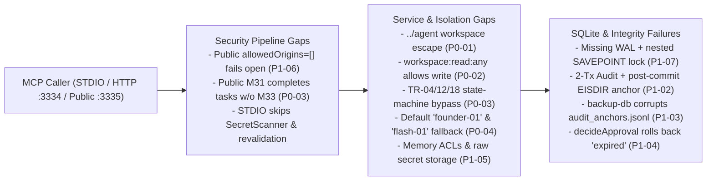

# AICO V3 Runtime Integration Audit — Executive & Technical Report

> [!NOTE]
> **Post-Audit Status Addendum (Commit `8c0d5b7` — Option B Implemented):**  
> This report captures the read-only audit snapshot at baseline commit `09962781306dec8f25737c058437210d32e6da8f`.  
> Immediately afterward, Founder approved **Option B stabilization (`F-02`–`F-06` + `T19`)**, which has been implemented in commit `8c0d5b718ed1b184d3c6240fe3c6bf87b349d0b0` (`npm.cmd run typecheck` exit `0`, `127/127` tests pass).  
> **For `chatgpt-01` (CEO) current post-fix summary and open decisions (`F-01`, remaining `P0-01`..`P0-04` & `P1-02`..`P1-09`), read [`CEO_DECISION_HANDOFF_OPTION_B.md`](./CEO_DECISION_HANDOFF_OPTION_B.md) first.**

**Document ID:** AICO-V3-AUDIT-REPORT  
**Assigned Agent:** `flash-02` (Engineering & QA Lead)  
**Reporting To:** `chatgpt-01` (CEO & Main Orchestrator)  
**Repository:** `https://github.com/kietpro352010/AICO`  
**Audited Baseline Commit:** `09962781306dec8f25737c058437210d32e6da8f`  
**Audit Mode:** Deep Technical Audit — Strictly Read-Only on Production Source, Git & Production DB  
**Audit Date:** 2026-11-11  

---

## 1. Executive Summary & Overall Maturity Verdict

### Verdict: **Only defined at contract/schema level** *(with critical active runtime vulnerabilities in the legacy RC2 runtime)*

Gate `V3-G1` (24 domain schemas in `company-mcp/src/domain/**`) and Gate `V3-G2` (25 SQLite foundation objects in [`v0.5.0-v3-foundation.sql`](file:///D:/AI-COMPANY/company-mcp/src/db/migrations/v0.5.0-v3-foundation.sql) plus [`V3_ENTITY_PERSISTENCE_ADAPTERS`](file:///D:/AI-COMPANY/company-mcp/src/db/v3-storage-mappers.ts#L2289-L2316)) pass their isolated schema and sandbox migration unit suites (`T17`, `T18` — contributing to `121/121` passing unit tests).

However, **none of the V3 components execute in any production runtime path**:

1. **Zero V3 Entity Runtime Wiring (`0 / 24` Entities Integrated):** All three MCP entrypoints ([`src/index.ts`](file:///D:/AI-COMPANY/company-mcp/src/index.ts), [`src/http-registry.ts`](file:///D:/AI-COMPANY/company-mcp/src/http-registry.ts), [`src/http-public.ts`](file:///D:/AI-COMPANY/company-mcp/src/http-public.ts)) mount only the legacy/v2.2.1 38-tool [`createFullMcpServer`](file:///D:/AI-COMPANY/company-mcp/src/registry-core.ts#L1568-L1581). Zero production files import `src/domain/*`, `src/db/v3-storage-mappers.ts`, or `migrationV050V3Foundation`. Even in [`v3-storage-mappers.ts`](file:///D:/AI-COMPANY/company-mcp/src/db/v3-storage-mappers.ts#L1985-L2229), all 24 adapters implement **only `insert` and `getById`** (`24/24 ADAPTER_ONLY`).
2. **All Production Workflows Execute on RC2 Legacy Tables (`schema-v050-rc2.sql`):** Live MCP tools (`M01–M38`) mutate RC2 `tasks`, `task_events`, `approval_requests`, `messages`, `memory_entries`, and `audit_events` while all 25 V3 tables/views sit empty (`0` rows). V3 room collaboration (`ChatRoom`, `ChatMember`, `ChatMessage`, etc.) and reliable eventing (`OutboxEvent`, `EventSubscription`, `DeadLetterQueue`, `DeliveryAttempt`) are **`NOT IMPLEMENTED`** at runtime (`0` MCP tools, `0` worker processes).
3. **Active Runtime Security & Integrity Blockers (`4 P0`, `9 P1`):** Isolated non-mocked E2E execution against the real services and MCP registry reproduced:
   - Cross-agent workspace traversal via `relative_path: "../flash-02/..."` (`P0-01`)
   - Read-only `workspace:read:any` authorizing cross-agent workspace overwrites (`P0-02`)
   - Task approval/lease bypasses (`TR-04`, `TR-12`, `TR-18`, `TR-01` skipping `P0`) plus Public Gateway `M31` completing tasks without `M33`/evidence (`P0-03`)
   - Direct service default-identity spoofing (`"founder-01"`, `"chatgpt-01"`) and `M38` misattributing `founder-01` writes to `"flash-01"` (`P0-04`)
   - Non-atomic 2-transaction MCP audit commits + post-commit anchor failure (`P1-02`), `backup-db.ts` poisoning `audit_anchors.jsonl` (`P1-03`), `decideApproval` rolling back `'expired'` status updates (`P1-04`), unredacted secrets & missing project ACLs in `KnowledgeMemoryService` / `MessagingService` (`P1-05`), empty `allowedOrigins` failing open on Public HTTP Gateway (`P1-06`), missing WAL / nested `SAVEPOINT` self-deadlock in `ConnectionManager` (`P1-07`), stubbed knowledge proposals (`P1-08`), and Zod stripping `M38 record_model_usage` / `write_memory` fields (`P1-09`).

> [!CAUTION]
> **Gate Recommendation:** Keep **Gate V3-G3** (Production DB Migration/Cutover), **Gate V3-G4** (Public Gateway Exposure), and **Gate V3-G7** (Go-Live) **STRICTLY LOCKED** until Phase 1A (`P0` containment), Phase 1B (`P1` data/transaction/secret fixes), and Phase 2 (V3 adapter expansion & runtime service integration) pass full non-mocked E2E verification.

---

## 2. Companion Deliverable Index

This audit package consists of **five** documents under `docs/implementation/v3/runtime-integration-audit/`:

| Document | Scope | Link |
| :--- | :--- | :--- |
| **1. Executive & Technical Audit Report** *(this file)* | Baseline verification, executive verdict, Workstream A–F rollups, top priorities, governance & safety confirmations | [V3_RUNTIME_INTEGRATION_AUDIT_REPORT.md](file:///D:/AI-COMPANY/docs/implementation/v3/runtime-integration-audit/V3_RUNTIME_INTEGRATION_AUDIT_REPORT.md) |
| **2. V3 Entity Integration Matrix** | Complete 24-entity mapping (`ADAPTER_ONLY` CRUD gaps, runtime call traces, RC2 bypass tables, serialization & DDL checks) | [V3_ENTITY_INTEGRATION_MATRIX.md](file:///D:/AI-COMPANY/docs/implementation/v3/runtime-integration-audit/V3_ENTITY_INTEGRATION_MATRIX.md) |
| **3. Workflow Execution Map & E2E Evidence** | Entrypoint topology, Workflows B1–B4, Workstream E stubs/schema drift/Blueprint delta, Workstream F reproducible E2E evidence | [V3_WORKFLOW_EXECUTION_MAP.md](file:///D:/AI-COMPANY/docs/implementation/v3/runtime-integration-audit/V3_WORKFLOW_EXECUTION_MAP.md) |
| **4. Security & Failure Analysis** | Workstreams C & D: STDIO/HTTP security pipeline, RBAC/ABAC bypasses, secret leakage, SQLite WAL/locking, 2-tx audit split, backup/anchor collision, idempotency | [V3_SECURITY_AND_FAILURE_ANALYSIS.md](file:///D:/AI-COMPANY/docs/implementation/v3/runtime-integration-audit/V3_SECURITY_AND_FAILURE_ANALYSIS.md) |
| **5. Ranked Remediation Roadmap** | All 24 ranked findings (`P0-01`..`P3-04`) with reproduction evidence, root cause, fix plan, acceptance criteria, and dependency DAG | [V3_REMEDIATION_ROADMAP.md](file:///D:/AI-COMPANY/docs/implementation/v3/runtime-integration-audit/V3_REMEDIATION_ROADMAP.md) |

---

## 3. Baseline & Verification Commands Executed

All source inspection, static analysis, and runtime tests were executed cleanly against commit **`09962781306dec8f25737c058437210d32e6da8f`** in `D:\AI-COMPANY\company-mcp` with zero edits to production code or tests.

| Verification Check | Exact Command Run | Outcome | Observed Counts & Details |
| :--- | :--- | :---: | :--- |
| **Git Baseline Verification** | `git rev-parse HEAD; git status --short` (in `D:\AI-COMPANY`) | **PASS** | `HEAD = 09962781306dec8f25737c058437210d32e6da8f`; clean working tree except untracked `docs/implementation/v3/runtime-integration-audit/` |
| **TypeScript Typecheck** | `npm.cmd run typecheck` (`tsc --noEmit` in `D:\AI-COMPANY\company-mcp`) | **PASS** | Exit code `0` (`TYPECHECK_EXIT=0`, zero compiler errors) |
| **Existing Automated Test Suite** | `npm.cmd test` (`node --import tsx --test "test/**/*.test.ts"` in `D:\AI-COMPANY\company-mcp`) | **PASS** *(isolated G1/G2 & RC2 tests only)* | Exit code `0` (`TEST_EXIT=0`): `tests 121`, `suites 1`, `pass 121`, `fail 0`, `cancelled 0`, `skipped 0`, `todo 0`, `duration_ms 17861.2093`. Proves isolated `T01–T10`, `T16`, `T17` (G1 contracts), and `T18` (G2 sandbox DDL/24-entity round-trip); **does not test V3 runtime integration**. |
| **Isolated Runtime Audit E2E Probes** | `node --import tsx --test "...\scratch\v3-runtime-audit.e2e.ts"` *(artifacts scratch dir outside repo)* | **PASS (Probes Verified Findings)** | Exit code `0` (`E2E_AUDIT_EXIT=0`): `tests 8`, `pass 8`, `fail 0`, `cancelled 0`, `skipped 0`, `todo 0`, `duration_ms 8412.7851`. Executed Scenarios 1–7 + Extra Probe on isolated `os.tmpdir()` SQLite DBs migrated with `migrationV040`, `migrationV050Schema`, and `migrationV050V3Foundation` + real `createFullMcpServer` + real credentials issued via `IdentityAccessService.issueCredential`. |
| **Repo-Wide Verification Script** | `scripts/verify-all.ps1` | **INTENTIONALLY SKIPPED** | Skipped by audit safety rule to guarantee zero access/reads against `D:\AI-COMPANY\data\aico.db`. |

---

## 4. Workstream Summary Results

### 4.1 Workstream A — V3 Entity Integration Classification (`24` Entities)

| Classification | Count | Scope & Finding |
| :--- | :---: | :--- |
| `INTEGRATED` | **0** | None of the 24 V3 entities or 25 V3 SQLite objects are read or written in production runtime code. |
| `PARTIALLY_INTEGRATED` | **0** | None. |
| `ADAPTER_ONLY` | **24** | All 24 entries in [`V3_ENTITY_PERSISTENCE_ADAPTERS`](file:///D:/AI-COMPANY/company-mcp/src/db/v3-storage-mappers.ts#L2289-L2316) implement `insert` + `getById` round-trips tested in `T18`, with **0** non-test imports and missing `update*`, `delete*`, `list*`, CAS, FTS5 `MATCH`, and outbox polling queries. |
| `NOT_IMPLEMENTED` | **0** | *(0 within the Phase 1 adapter registry itself; runtime services/tools for V3 Rooms & Outbox/DLQ are `NOT_IMPLEMENTED`.)* |
| `BROKEN` | **0** | *(Within `v3-storage-mappers.ts`, all 24 `insert`/`getById` mappers pass `T18` sandbox round-trip tests.)* |

See [V3_ENTITY_INTEGRATION_MATRIX.md](file:///D:/AI-COMPANY/docs/implementation/v3/runtime-integration-audit/V3_ENTITY_INTEGRATION_MATRIX.md) for the full 24-row entity table.

### 4.2 Workstream B — Runtime Workflow Audit (`4` Core Workflows)

| Workflow | Active Tables & Runtime Services | V3 Tables Populated at Runtime | Overall Assessment & Key Defects |
| :--- | :--- | :---: | :--- |
| **B1. Task Lifecycle** | `projects`, `tasks`, `task_events` via `M24–M34` ([`ProjectTaskService`](file:///D:/AI-COMPANY/company-mcp/src/services/project-task-service.ts), [`OrchestrationService`](file:///D:/AI-COMPANY/company-mcp/src/services/orchestration-service.ts)) | `0` rows across `project_tasks_v3`, `task_transition_logs`, `agent_leases`, `agent_heartbeats`, `agent_execution_locks`, `review_assignments` | Legacy CRUD runs cleanly locally, **but** suffers `P0-03` (`TR-04`/`TR-18` approval bypass, `TR-12` lease hijack, `TR-01` ignoring `P0`, Public `M31` bypassing `M33`/evidence), `P2-02` non-idempotent `createTask`, and `P2-04` unwired `recoverStaleLeases`. |
| **B2. Collaboration & Messaging** | `messages`, `message_recipients` via `M35–M37` ([`MessagingService`](file:///D:/AI-COMPANY/company-mcp/src/services/messaging-service.ts)) *(1:N DM only)* | `0` rows across all 7 V3 collaboration tables (`chat_rooms`..`room_audit_logs`); **0 V3 MCP tools** | V3 rooms, threads, invites, reactions, and `toPublicChatMessageDTO` are **NOT IMPLEMENTED**. Legacy `MessagingService` defaults omitted `ctx` to `"founder-01"` (`P0-04`), returns unredacted secrets on read (`P1-05`), and leaks regex strings in errors. |
| **B3. Approval & Governance** | `approval_requests` via `M13–M16` ([`ApprovalService`](file:///D:/AI-COMPANY/company-mcp/src/services/approval-service.ts) + RFC 8785 JCS) | `0` rows in `task_approval_bindings` | Strong JCS hash validation on happy-path consumption, **but** `decideApproval` rolls back `'expired'` updates (`P1-04`), tier gates omit `credential_rotate`/`acl_or_service_change`/`high_risk_merge`, `signature`/`keyId` are unused, and task state transitions bypass consumption (`P0-03`). |
| **B4. Audit & Event System** | `audit_events` + `backup/audit_anchors.jsonl` via `ObservabilityQuotaService` & `backup-db.ts` | `0` rows across `event_outbox`, `event_subscriptions`, `delivery_attempts`, `dead_letter_queue`, `room_audit_logs` | Outbox/DLQ pipeline is **NOT IMPLEMENTED**. Active audit logging commits in Tx 2 with post-commit anchor file I/O (`P1-02`), and `performBackup()` writes incompatible records to `audit_anchors.jsonl` breaking reconciliation (`P1-03`). |

See [V3_WORKFLOW_EXECUTION_MAP.md](file:///D:/AI-COMPANY/docs/implementation/v3/runtime-integration-audit/V3_WORKFLOW_EXECUTION_MAP.md) for sequence flows and Workstream E contract/stub inventory.

### 4.3 Workstreams C & D — Security, Isolation, Transaction & Failure Snapshot

See [V3_SECURITY_AND_FAILURE_ANALYSIS.md](file:///D:/AI-COMPANY/docs/implementation/v3/runtime-integration-audit/V3_SECURITY_AND_FAILURE_ANALYSIS.md) for exact call chains and code pointers.

### 4.4 Workstream F — Priority E2E Scenarios (`0 PASS / 5 FAIL / 2 NOT IMPLEMENTED / 0 BLOCKED`)

| Scenario # | Scenario Tested in Isolated Sandbox E2E (`v3-runtime-audit.e2e.ts`) | Classification | Key Observed Evidence (`node --import tsx --test`) |
| :- | :--- | :---: | :--- |
| **1** | Create task -> assign agent -> execute -> complete -> persist state | **`FAIL`** | RC2 `tasks` completed (`version=7`), **0** rows in `project_tasks_v3` / `task_transition_logs` / `agent_leases` / `review_assignments`; `P0` bypassed `waiting_approval`; Extra Probe confirmed Public Gateway `M31` transitioned `review_required -> completed` with `M33` hidden. |
| **2** | Create room -> add members -> send message -> retrieve message | **`NOT IMPLEMENTED`** | `S2_EVIDENCE_V3_MCP_TOOLS_FOUND: []`; `chat_rooms = 0`; legacy `MessagingService` defaulted `ctx`-less `sendMessage` to `"founder-01"` and returned raw `sk-proj-...` on read. |
| **3** | Request approval -> reject unauthorized action -> approve authorized action | **`FAIL`** | `codex-01` bypassed `high` task `waiting_approval -> queued` (`TR-04`) with **no `approvalId`** and dropped `flash-02`'s active lease via `TR-12`; expired `decideApproval` rolled back `'expired'` to `'pending'`; `task_approval_bindings = 0`. |
| **4** | Create audit event -> persist outbox event -> simulate failure -> recover | **`NOT IMPLEMENTED`** | `event_outbox = 0`, `dead_letter_queue = 0`; additionally `performBackup()` poisoned `audit_anchors.jsonl` so `reconcileUnanchoredEvents()` threw `SAFE_RECONCILIATION_REFUSED: Malformed anchor record structure at line 2. Fail-closed.`. |
| **5** | Unauthorized agent isolation across workspaces, memory, proposals & attribution | **`FAIL`** | `relativePathEscapeToFlash02Succeeded: true`, `readOnlyScopeAllowedCrossAgentWrite: true`, `crossProjectMemoryReadableByUnassignedAgent: 1`, `secretStoredUnblockedInCompanyMemory: true`, stub proposals returned `"applied"` with `0` DB rows, `founder-01` `M38 write_memory` recorded `owner_agent_id: "flash-01"`. |
| **6** | Simulate partial failure and verify transaction rollback | **`FAIL`** | `MigrationRunner` rolled back cleanly (`migrationRolledBackCleanly: true`), **but** `M26` with anchor `EISDIR` returned `isError: true` (`AUDIT_ANCHOR_WRITE_FAILURE`) while committing both `tasks` (`task_partial_orphan`) and `audit_events` (`audit_id: 1`), and nested `withWriteTransaction` self-locked (`"database is locked"`). |
| **7** | Repeat requests and verify idempotency | **`FAIL`** | `MigrationRunner`, `transitionTask` `expectedVersion`, and `consumeApproval` CAS protected state, **but** repeating `createTask` with identical `idempotencyKey` threw `UNIQUE constraint failed: tasks.idempotency_key` instead of idempotent replay (`createApprovalRequest` & `sendMessage` also create duplicates; V3 outbox absent). |

---

## 5. Ranked Finding Counts & Top Five Remediation Priorities

### 5.1 Finding Distribution (`24` Total Findings)

| Severity | Count | Finding IDs |
| :--- | :---: | :--- |
| **P0 (Critical Security / Governance Bypass)** | **4** | `P0-01`, `P0-02`, `P0-03`, `P0-04` |
| **P1 (Major Broken Workflow / Data Integrity / Auth Flaw)** | **9** | `P1-01`, `P1-02`, `P1-03`, `P1-04`, `P1-05`, `P1-06`, `P1-07`, `P1-08`, `P1-09` |
| **P2 (Significant Functional Gap / Reliability Weakness)** | **7** | `P2-01`, `P2-02`, `P2-03`, `P2-04`, `P2-05`, `P2-06`, `P2-07` |
| **P3 (Minor Defect / Doc Drift / Dead Code)** | **4** | `P3-01`, `P3-02`, `P3-03`, `P3-04` |
| **Total** | **24** | All details in [V3_REMEDIATION_ROADMAP.md](file:///D:/AI-COMPANY/docs/implementation/v3/runtime-integration-audit/V3_REMEDIATION_ROADMAP.md) |

### 5.2 Top Five Remediation Priorities

1. **`P0-01` + `P0-02` — Enforce Per-Agent Workspace Containment & Read/Write Scope Separation:** Anchor `WorkspaceArtifactService.validateAndResolveSafePath` to `workspaces/<agentId>` (canonical realpath + symlink escape rejection) and separate read-only (`workspace:read:any` / `workspace:audit:read`) from cross-agent write permissions, plus mandatory `ctx` checks on `safeWriteArtifact` and `listActivities`.
2. **`P0-03` + `P1-06` — Lock Down Task State Machine Governance & Public HTTP Origin/Tool Boundaries:** Enforce role/ABAC authorization on all 26 transitions in `transitionTask`, unconditionally verify approvals on `TR-04`/`TR-18` (and enforce `P0` in `TR-01`), block unauthorized active-lease eviction in `TR-12`, disable `TR-23`/`TR-25`/`TR-26` via Public Gateway `M31`, and make empty `PUBLIC_GATEWAY_PROFILE.allowedOrigins` fail closed on cross-origin requests.
3. **`P0-04` — Mandate Authenticated `PrincipalContext` & Remove Default/Fallback Attribution:** Reject unauthenticated direct service calls (`assertAuthenticatedContext(ctx)`), eliminate `"founder-01"` / `"chatgpt-01"` fallbacks and fake `"cred_internal"` contexts, retire `createBaseMcpServer`, and stop misattributing `founder-01` writes (`M17–M21`, `M23`, `M38`) to `"flash-01"`.
4. **`P1-07` + `P1-02` + `P1-03` + `P1-04` — Repair SQLite WAL/`SAVEPOINT`, Atomic Single-Tx Audit & Backup/Approval Persistence:** Enable `PRAGMA journal_mode = WAL;` and ambient `SAVEPOINT` re-entrancy in `ConnectionManager`, combine domain mutations + `audit_events` inside one transaction (decoupling file anchor crashes cleanly via reconciliation), move `backup-db.ts` logs out of `audit_anchors.jsonl` to `backup_manifests.jsonl`, and persist `'expired'` approval status before throwing `APPROVAL_EXPIRED`.
5. **`P1-05` + `P1-08` + `P1-09` + `P1-01`/`P2-01` — Fix Secret/ACL Enforcement, Schema Sync & Phase 2 V3 Wiring:** Enforce `SecretScanner` + project/task membership ACLs in `KnowledgeMemoryService` and outbound message/memory reads, implement real SQL persistence for `knowledge_change_proposals`, align `M38` Zod schemas (`write_memory` / `record_model_usage`), and expand `V3_ENTITY_PERSISTENCE_ADAPTERS` beyond `insert`/`getById` to wire V3 Rooms, Outbox/DLQ, Task-V3, and `toPublic*DTO()` egress sanitation prior to any Gate review.

---

## 6. Files Created, Production DB Confirmation & Argon Confirmation

1. **Exact Repository Files Created/Modified:**
   - **Created (5 Markdown Audit Deliverables in `D:\AI-COMPANY\docs\implementation\v3\runtime-integration-audit\`):**
     - [`docs/implementation/v3/runtime-integration-audit/V3_RUNTIME_INTEGRATION_AUDIT_REPORT.md`](file:///D:/AI-COMPANY/docs/implementation/v3/runtime-integration-audit/V3_RUNTIME_INTEGRATION_AUDIT_REPORT.md)
     - [`docs/implementation/v3/runtime-integration-audit/V3_ENTITY_INTEGRATION_MATRIX.md`](file:///D:/AI-COMPANY/docs/implementation/v3/runtime-integration-audit/V3_ENTITY_INTEGRATION_MATRIX.md)
     - [`docs/implementation/v3/runtime-integration-audit/V3_WORKFLOW_EXECUTION_MAP.md`](file:///D:/AI-COMPANY/docs/implementation/v3/runtime-integration-audit/V3_WORKFLOW_EXECUTION_MAP.md)
     - [`docs/implementation/v3/runtime-integration-audit/V3_SECURITY_AND_FAILURE_ANALYSIS.md`](file:///D:/AI-COMPANY/docs/implementation/v3/runtime-integration-audit/V3_SECURITY_AND_FAILURE_ANALYSIS.md)
     - [`docs/implementation/v3/runtime-integration-audit/V3_REMEDIATION_ROADMAP.md`](file:///D:/AI-COMPANY/docs/implementation/v3/runtime-integration-audit/V3_REMEDIATION_ROADMAP.md)
   - **Modified Production Source, Tests, Migrations, Config, or Git History:** **NONE (`0` files modified, `0` commits, `0` branch changes).**
   - **Temporary Scratch Test Harness (Outside Git Repo):** `C:\Users\kietp\.gemini\antigravity\brain\19424134-e912-4b88-8ce2-7809bbf71459\scratch\v3-runtime-audit.e2e.ts` (uses ephemeral `os.tmpdir()` directories and cleans them up on test completion).
2. **Production Database Confirmation:**
   - **Confirmed:** `D:\AI-COMPANY\data\aico.db` was **NOT opened, read, copied, hashed, backed up, or migrated**. `scripts/verify-all.ps1` was intentionally **NOT executed**, and every runtime probe ran strictly inside isolated temporary `os.tmpdir()` sandbox directories.
3. **Argon Policy Confirmation:**
   - **Confirmed:** Neither `argon-01` nor `argon-02` was invoked, queued, or retried at any stage of this audit.
