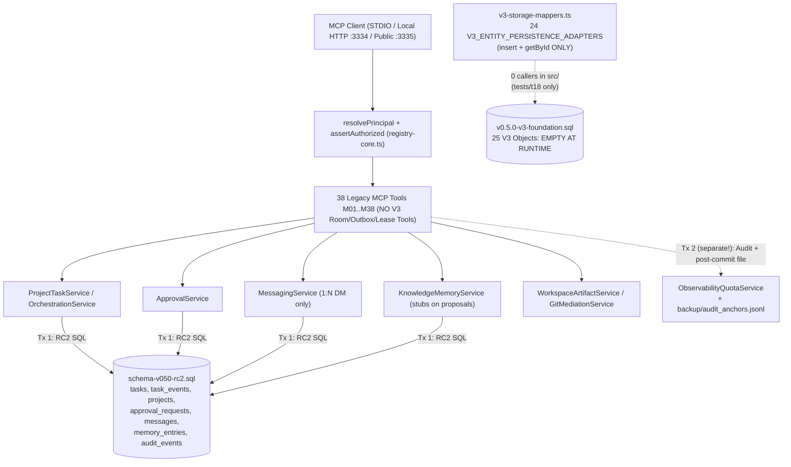
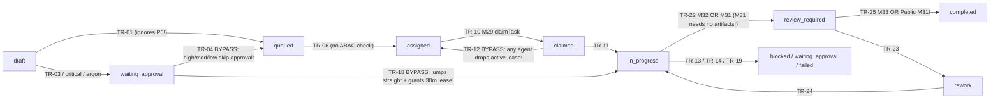

# AICO V3 Runtime Integration Audit — Workflow Execution Map & Contract Analysis

**Document ID:** AICO-V3-AUDIT-WORKFLOWS  
**Repository:** `https://github.com/kietpro352010/AICO`  
**Audited Baseline Commit:** `09962781306dec8f25737c058437210d32e6da8f`  
**Author:** `flash-02` (Engineering & QA Lead)  
**Reporting To:** `chatgpt-01` (CEO & Main Orchestrator)  
**Audit Date:** 2026-11-11  

---

## 1. Runtime Entrypoints & Transport Topology

All three live MCP server entrypoints register the legacy/v2.2.1 38-tool server ([`createFullMcpServer`](file:///D:/AI-COMPANY/company-mcp/src/registry-core.ts#L1568-L1581)), run **zero database migrations**, and never touch V3 domain models or `v3-storage-mappers.ts`:

| Component | Entrypoint / File | Exposed Endpoints / Tools | Auth / Security Pipeline | Migrations Executed | V3 Integration |
| :--- | :--- | :--- | :--- | :--- | :--- |
| STDIO Server | [`src/index.ts`](file:///D:/AI-COMPANY/company-mcp/src/index.ts#L1-L35) | All **38** v2.2.1 tools (`M01–M38`) | [`StdioSecurityPipeline.bootstrap()`](file:///D:/AI-COMPANY/company-mcp/src/security/stdio-security-pipeline.ts#L22-L45) once at startup; never calls `revalidateLivePrincipal` or outbound `SecretScanner` | **None** | **None** |
| Local HTTP Gateway | [`src/http-registry.ts`](file:///D:/AI-COMPANY/company-mcp/src/http-registry.ts#L1-L57) (`127.0.0.1:3334`) | All **38** v2.2.1 tools (`M01–M38`) | [`HttpSecurityPipeline`](file:///D:/AI-COMPANY/company-mcp/src/security/http-security-pipeline.ts#L83-L347) (`LOCAL_GATEWAY_PROFILE`), 1 MiB, 30s, Step 10 inbound body scan | **None** | **None** |
| Public HTTP Gateway *(disabled)* | [`src/http-public.ts`](file:///D:/AI-COMPANY/company-mcp/src/http-public.ts#L1-L65) (`127.0.0.1:3335`, exits if `AICO_PUBLIC_GATEWAY_ENABLED !== "true"`) | **29** tools in [`PUBLIC_TOOL_ALLOWLIST`](file:///D:/AI-COMPANY/company-mcp/src/security/http-security-pipeline.ts#L46-L76) + 4 M38 ops blocked | `HttpSecurityPipeline` (`PUBLIC_GATEWAY_PROFILE`), 256 KiB, 15s, **fails open on `Origin` when `allowedOrigins = []`** (`L235`) | **None** | **None** |
| STDIO-HTTP Bridge | [`src/client-bridge.ts`](file:///D:/AI-COMPANY/company-mcp/src/client-bridge.ts) | 0 tools (JSON-RPC forwarder to `:3334/mcp`) | DPAPI / `.token` / `AICO_STDIO_TOKEN` | **None** | **None** |
| Legacy Base Server *(dead)* | [`registerCompanyTools`](file:///D:/AI-COMPANY/company-mcp/src/registry-core.ts#L129-L257) | 5 unauthenticated tools (`M01–M05`) | **None**; opens raw `DatabaseSync` directly | **None** | **None** |

---

## 2. Workstream B — Core Business Workflows Trace

### Overview Architecture: Active Legacy Execution vs. Disconnected V3 Layer

---

### Workflow B1: Task Lifecycle

- **Entry Points:**
  - Projects: `M24 company_create_project`, `M25 company_list_projects` (`registry-core.ts:1005-1059`).
  - Tasks: `M26 company_create_task`, `M27 company_list_tasks`, `M28 company_get_task`, `M29 company_claim_task`, `M30 company_heartbeat_task`, `M31 company_transition_task`, `M32 company_submit_task_result`, `M33 company_review_task`, `M34 company_record_external_dispatch` ([`registry-core.ts:1061-1361`](file:///D:/AI-COMPANY/company-mcp/src/registry-core.ts#L1061-L1361)).
  - Disconnected background helper: [`ProjectTaskService.recoverStaleLeases`](file:///D:/AI-COMPANY/company-mcp/src/services/project-task-service.ts#L942-L1031) (never called by any server, timer, or CLI).
- **Relevant Files & Functions:**
  - [`ProjectTaskService`](file:///D:/AI-COMPANY/company-mcp/src/services/project-task-service.ts) (`createProject` `L237`, `createTask` `L297`, `listTasks` `L410`, `getTask` `L458`, `heartbeatTask` `L481`, `claimTask` `L512`, `submitTaskResult` `L530`, `reviewTask` `L555`, `transitionTask` `L589–L940`, `recoverStaleLeases` `L942`).
  - [`OrchestrationService.recordExternalDispatchMilestone`](file:///D:/AI-COMPANY/company-mcp/src/services/orchestration-service.ts#L31-L91).
- **Database Tables Involved:** Reads/writes RC2 **`projects`**, **`tasks`**, **`task_events`**, and `approval_requests`. Zero reads/writes to **`project_tasks_v3`**, **`task_transition_logs`**, **`agent_leases`**, **`agent_heartbeats`**, **`agent_execution_locks`**, **`review_assignments`**, or **`artifact_attestations`**.

- **Success Path (Standard Local Task):**
  1. `M26` calls `createTask()` (auto-creates missing project row via `INSERT OR IGNORE INTO projects`), inserts `tasks` (`version = 1`, `execution_status = 'draft'` or `'waiting_approval'` for `critical`/Argon) + `task_events` in Tx 1, then calls `obsService.appendAuditEvent` in **Tx 2**.
  2. `M31` advances `draft -> queued (TR-01) -> assigned (TR-06)`; assignee calls `M29 claimTask` (`TR-10`, sets 30m `lease_expires_at`), extends via `M30 heartbeatTask`, transitions `TR-11` (`in_progress`), submits via `M32 submitTaskResult` (`TR-22`, requires non-empty `output_artifact_ids` & `verification_evidence`), and reviewer/leadership finalizes via `M33 reviewTask` (`TR-25`).
- **Failure & Bypass Paths Identified:**
  1. **`TR-04` / `TR-18` Approval Bypass ([`project-task-service.ts:651-658, 786-795`](file:///D:/AI-COMPANY/company-mcp/src/services/project-task-service.ts#L786-L795)):** `high`, `medium`, and `low` tasks in `waiting_approval` bypass `verifyAndConsumeTaskApproval` completely; `codex-01` was proven live to move `flash-02`'s high-risk task out of `waiting_approval` without `approvalId`.
  2. **Public Gateway `M31` Review/SoD Bypass ([`http-security-pipeline.ts:70`](file:///D:/AI-COMPANY/company-mcp/src/security/http-security-pipeline.ts#L70)):** `M33` is excluded from `PUBLIC_TOOL_ALLOWLIST`, yet `M31` (`company_transition_task`) is allowlisted and runs the same `TR-22`/`TR-23`/`TR-25`/`TR-26` state transitions without artifacts or verification evidence.
  3. **`TR-12` Lease Hijack (`L740-746`):** Any authenticated agent calling `M31` with `claimed -> assigned` evicts another agent's active lease without checking lease expiry, caller role, or incrementing `retry_count`.
  4. **Direct Service & Idempotency Flaws:** `createTask` fails `UNIQUE constraint failed` on repeated `idempotencyKey`; `createProject` ignores `ctx`; `heartbeatTask` allows resurrecting expired leases with no `version` bump and skips ownership when `agentId` is undefined; `recoverStaleLeases` leaves `dispatch_status` stale and has zero scheduler/caller.
- **Missing Links:** Zero V3 task/lease/review persistence; zero task DAG dependencies (`task_dependencies` from Blueprint absent); no automatic lease sweep daemon; `output_artifact_ids` never verified against `artifacts` or `artifact_attestations`.

---

### Workflow B2: Collaboration & Messaging

- **Entry Points:** `M35 company_send_message`, `M36 company_list_inbox`, `M37 company_ack_message` ([`registry-core.ts:1363-1427`](file:///D:/AI-COMPANY/company-mcp/src/registry-core.ts#L1363-L1427)). **Zero Room, Thread, Invite, Reaction, or Attachment tools exist.**
- **Relevant Files & Functions:** [`MessagingService`](file:///D:/AI-COMPANY/company-mcp/src/services/messaging-service.ts#L47-L210) (`sendMessage`, `listInbox`, `ackMessage`, no-op `initSchema`).
- **Database Tables Involved:** Legacy RC2 **`messages`** and **`message_recipients`**. Zero usage of **`chat_rooms`**, **`chat_members`**, **`chat_messages`**, **`message_attachments`**, **`message_reactions`**, **`room_invites`**, **`room_audit_logs`**, or **`toPublicChatMessageDTO`**.
- **Success Path (Legacy 1:N DM Only):** Caller sends direct message via `M35` -> `SecretScanner.scan()` checks `subject` & `bodyMarkdown` -> single `withWriteTransaction` inserts `messages` + `message_recipients` (`stored_in_inbox`) -> recipient queries via `M36 listInbox` (filtered by `ctx.principalId`) -> acknowledges via `M37 ackMessage` (scans `note`).
- **Failure Paths & Gaps:**
  1. **V3 Room Collaboration Non-Existent:** Creating rooms, managing memberships, invites, reactions, attachments, thread lifecycle (`create_thread`, `resolve_thread`), and room-scoped ABAC cannot be executed at all (`0` V3 MCP tools, `0` room services).
  2. **Service Default Spoofing (`L60`):** Direct call `sendMessage()` without `ctx` defaults `fromPrincipalId` to `"founder-01"`.
  3. **Zero Outbound Secret Redaction / No V3 DTO Projection:** `listInbox()` returns raw `body_markdown` directly from SQLite (`S2_EVIDENCE`: returned synthetic test string `sk-proj-<redacted-test-token>` unredacted); exception messages at `L80, L87` append raw `scan.patternMatched` regex text.
  4. **Zero `audit_events` Emission:** `M35`–`M37` never call `obsService.appendAuditEvent()`.

---

### Workflow B3: Approval & Governance

- **Entry Points:** `M13 company_request_approval`, `M14 company_list_approval_requests`, `M15 company_get_approval_request`, `M16 company_decide_approval` (`registry-core.ts:694-819`), plus internal consumption from `ProjectTaskService.transitionTask`.
- **Relevant Files & Functions:** [`ApprovalService`](file:///D:/AI-COMPANY/company-mcp/src/services/approval-service.ts#L31-L439) (`computeCanonicalPayloadHash`, `createApprovalRequest`, `getApprovalRequest`, `listApprovalRequests`, `decideApproval`, `consumeApproval`) and [`rfc8785Canonicalize`](file:///D:/AI-COMPANY/company-mcp/src/security/rfc8785-canonicalize.ts).
- **Database Tables Involved:** RC2 **`approval_requests`** only (`V3` **`task_approval_bindings`** never read or written).
- **Success Path:** Requester calls `M13` with non-null `canonical_payload` -> RFC 8785 canonicalization + SHA-256 -> inserts `approval_requests` (`status = 'pending'`) -> `founder-01` (or `flash-01` for `technical` tier) calls `M16 decideApproval` (`decision: "approved" | "rejected"`, CAS `WHERE approval_id = ? AND status = 'pending'`) -> `consumeApproval` verifies non-expired, exact `action_type`, tier/human decider, non-null target match, and JCS SHA-256 match, flipping `status = 'consumed'` atomically via CAS.
- **Failure Paths & Gaps:**
  1. **Expired Approval Update Rolled Back ([`approval-service.ts:277-280`](file:///D:/AI-COMPANY/company-mcp/src/services/approval-service.ts#L277-L280)):** `decideApproval` executes `UPDATE approval_requests SET status = 'expired'` and immediately throws `APPROVAL_EXPIRED` inside `withWriteTransaction()`, triggering `ROLLBACK;` and reverting `status` to `'pending'`. Same rollback happens when `verifyAndConsumeTaskApproval` throws on `consumeApproval`'s `'expired'` update.
  2. **Task State Machine Bypasses:** Non-critical/non-Argon tasks ignore `waiting_approval` in `TR-04`/`TR-18`; `TR-01` skips `P0` tasks; `TR-06/10/11` skip verification once `task.approval_request_id` is non-null.
  3. **Tier & SoD Weaknesses:** `createApprovalRequest` (`L95-109`) only forces `founder` tier for 7 action types (`critical` risk/Argon/`project_approval`/`critical_task_approval`/`credential_issue`/`db_migration`/`public_gateway_release`) — omitting `credential_rotate`, `acl_or_service_change`, and `high_risk_merge`. `decideApproval` blocks requester SoD (`L303`) but allows `target_agent_id === deciderId`.
  4. **Cryptographic Signature Non-Implemented:** `decideApproval` declares unused `signature`, `credentialId`, `keyId` (`L228-230`); `M16` does not accept Ed25519 `human_signature` specified in `04_MCP_API_AND_EVENT_CONTRACTS.md:467`.
  5. **Direct Call Exposures:** `createApprovalRequest` defaults omitted `ctx` to `"chatgpt-01"`; `consumeApproval` checks no `PrincipalContext`; `getApprovalRequest`/`listApprovalRequests` fail open without `callerCtx`.

---

### Workflow B4: Audit & Event System

- **Entry Points:** Internal `obsService.appendAuditEvent(...)` on 12 MCP tools (`M10–M13, M16, M24, M26, M29, M31–M34`), `obsService.recordMcpActivity(...)` in `maybeRegister`, `M38 company_knowledge_memory_ops` (`get_system_observability`, `record_model_usage`), and CLI [`backup-db.ts`](file:///D:/AI-COMPANY/company-mcp/src/scripts/backup-db.ts). **V3 Outbox, Event Subscriptions, Delivery Attempts, and Dead-Letter Queue have ZERO runtime code.**
- **Relevant Files & Functions:** [`ObservabilityQuotaService`](file:///D:/AI-COMPANY/company-mcp/src/services/observability-quota-service.ts#L45-L654) (`writeAnchorRecord`, `appendAuditEvent`, `verifyAuditChainIntegrity`, `reconcileUnanchoredEvents`, `recordMcpActivity`, `recordModelUsage`, `getSystemStatusAndUsage`).
- **Database Tables Involved:** RC2 **`audit_events`** (with append-only triggers in `schema-v050-rc2.sql`), **`agent_usage_events`**, and JSONL file `backup/audit_anchors.jsonl`. **Zero** reads/writes to **`event_outbox`**, **`event_subscriptions`**, **`delivery_attempts`**, **`dead_letter_queue`**, or **`room_audit_logs`**.
- **Success Path (Legacy Audit Chain):** `appendAuditEvent` reads latest `event_hash_hmac_sha256`, redacts `details` via `SecretScanner.redact`, signs RFC 8785 payload with HMAC-SHA256, inserts `audit_events` inside `withWriteTransaction` (returning anchor metadata), and appends JSON line to `audit_anchors.jsonl`.
- **Failure Paths & Critical Bugs:**
  1. **2-Tx Non-Atomic Split + Post-Commit File Failure (`registry-core.ts:1093`, `observability-quota-service.ts:215-223`):** Business write commits in Tx 1; `appendAuditEvent` commits `audit_events` in Tx 2 *before* calling `writeAnchorRecord`. If anchor write fails (e.g. `EISDIR`), MCP returns `isError: true` (`AUDIT_ANCHOR_WRITE_FAILURE`) while BOTH the domain row and `audit_events` row remain committed without an anchor — breaking continuity.
  2. **Backup Script Anchor File Collision ([`backup-db.ts:46-54`](file:///D:/AI-COMPANY/company-mcp/src/scripts/backup-db.ts#L46-L54)):** `performBackup()` appends `{ timestamp, source_db, backup_file, checksum_sha256, integrity_check }` to `D:/AI-COMPANY/backup/audit_anchors.jsonl` — the **exact default path** read by `ObservabilityQuotaService`. Running one backup poisons `verifyAuditChainIntegrity()` and causes `reconcileUnanchoredEvents()` to abort (`SAFE_RECONCILIATION_REFUSED: Malformed anchor record structure`).
  3. **Unauthenticated/FK-Failing Metering (`L587-602`):** `recordMcpActivity` maps `ctx.agentId === null` (`founder-01`) to `"founder-01"`, failing `FOREIGN KEY REFERENCES agents(agent_id)` and silently catching the exception.
  4. **Outbox/DLQ Pipeline Non-Existent:** Event subscriptions, webhook/agent push dispatch, retry backoff, and DLQ replay do not exist (`V3_PHASE_1_SECURITY_AND_DATABASE_SAFETY.md:81` explicitly deferred Outbox worker to Phase 2).

---

## 3. Contract-vs-Actual Implementation Inventory (Workstream E)

### 3.1 Stubs, Placeholders, In-Memory Stores & Hardcoded Values
- **Stateless Stubs:** `KnowledgeMemoryService.proposeKnowledgeChange` (`L136-L148`) and `approveKnowledgeProposal` (`L150-L160`) return fake success objects (`pending_review` / `applied`) with zero DB writes (`knowledge_change_proposals` count stays `0`).
- **In-Memory Only Storage:** [`TokenBucketRateLimiter`](file:///D:/AI-COMPANY/company-mcp/src/security/rate-limiter.ts#L11-L59) keeps rate-limit buckets strictly in per-process `Map<string, BucketState>`.
- **Hardcoded Return Values:**
  - `CompanyRegistryService`: hardcodes `"2.2.1"`, `"AICO Production v2.2.1"`, `"Hybrid Local-first"`, `"SQLite WAL with Foreign Keys"` (false — `ConnectionManager` never enables WAL).
  - `WorkspaceArtifactService.getWorkspaceMeta`: hardcodes `workspace_mode: "isolated_directory"`, `root_directory: workspaces/${agentId}`, and `allowed_subdirectories: ["inbox", "reports", "artifacts", "src", "output"]` (`L383-L390`) rather than reading `agent_workspaces`.
  - `ObservabilityQuotaService.getSystemStatusAndUsage`: hardcodes `database_status: "online"` (`L647`).
  - `IdentityAccessService.getPrincipalById`: synthesizes hardcoded `credentialId: "cred_internal"` & scopes (`L80-L107`).
- **Silent Parameter Drops & Broken `M38` Schema Mapping:**
  - `M21 company_share_workspace_artifact`: drops `args.description`, never writes RC2 `artifacts`/`artifact_shares`.
  - `M38 write_memory`: passes `args.title`, which is omitted from [`CompanyKnowledgeMemoryOpsInputSchema`](file:///D:/AI-COMPANY/company-mcp/src/contracts/mcp-tool-schemas.ts#L618-L624).
  - `M38 record_model_usage`: reads `args.task_id`, `args.input_tokens`, `args.output_tokens`, `args.cached_tokens` (`registry-core.ts:1536-1539`), none of which exist in `CompanyKnowledgeMemoryOpsInputSchema` (`L625-L630` expects `model_name`, `prompt_tokens`, `completion_tokens`), silently dropping `task_id`/`input_tokens`/`cached_tokens` and ignoring `model_name`!
  - `ApprovalService`: `decideApproval` ignores `signature`/`credentialId`/`keyId`; `createApprovalRequest` ignores `requiredApprover`; `ProjectTaskService.reviewTask` ignores `reviewerId`; `OrchestrationService.recordExternalDispatchMilestone` ignores `notes`.
- **Schema Drift Between `contracts/mcp-tool-schemas.ts` and `registry-core.ts` (`M01–M37`):**
  Only `M38` imports from `mcp-tool-schemas.ts`. Divergent inline `zod/v4` schemas exist on **M10** (`description`), **M13** (different requester/tier fields), **M14** (`tier`), **M18** (`recursive`, `include_hidden`), **M20** (`target_agent_id`), **M24** (drops `approval_request_id`, adds `priority`/`risk_class`), **M26** (omits `priority` & `reviewer_agent_id`, defaults `risk_class` to `'low'` vs service `'medium'`), **M29/M33** (default `expected_version = 1`), **M31** (`approval_id` vs `approval_request_id`), **M32** (`verification_evidence` + required `output_artifact_ids` vs optional + `summary`), **M35** (`message_type` vs `priority`), **M36** (`status`/`limit` vs `{}`), **M37** (`note`).
- **Blueprint V3 Gap (`04_MCP_API_AND_EVENT_CONTRACTS.md` & `03_DOMAIN_AND_DATABASE_DESIGN.md`):** None of the **28 V3 MCP tools** (`company_create_room`, `company_post_message`, `company_renew_lease`, `company_store_memory`, `company_create_context_snapshot`, `company_query_audit_log`, etc.), standard `{ success, data, meta }` error envelopes, or 29-table Blueprint DDL exist in runtime code.
- **Dead Duplicate Modules:** `registerCompanyTools` / `createBaseMcpServer` (`registry-core.ts`), `AgentIdentityService` (`src/agent-identity-service.ts`), `WorkspaceManager` (`src/workspace-manager.ts`), `migrate-v03.ts`, `migrate-v040.ts`, `migrate-v041-manifest-sync.ts`.
- **Internal DDL Drift:** `MigrationRunner.ensureSchemaMigrationsTable()` (`4` columns) conflicts with `schema-v050-rc2.sql` `schema_migrations` (`7` `NOT NULL` columns); `KnowledgeMemoryService.initSchema()` (`source_sha256`, `knowledge_fts.tags`) conflicts with `schema-v050-rc2.sql` (`checksum_sha256`, `tags_text`); `ProjectTaskService.initSchema()` omits RC2 constraints/columns/triggers.

---

## 4. Workstream F — Live Isolated SQLite E2E Scenario Results

**Test Harness:** [`v3-runtime-audit.e2e.ts`](file:///C:/Users/kietp/.gemini/antigravity/brain/19424134-e912-4b88-8ce2-7809bbf71459/scratch/v3-runtime-audit.e2e.ts) (8 tests, real `ConnectionManager`, real `MigrationRunner` with `[migrationV040, migrationV050Schema, migrationV050V3Foundation]`, real `createFullMcpServer`, real `os.tmpdir()` SQLite DBs — zero mocks for SQLite/services).  
**Command:** `node --import tsx --test "...\v3-runtime-audit.e2e.ts"` -> **Exit 0 (`8/8` probes passed asserting exact runtime behaviors below)**.

| # | Priority Scenario | Verdict | What Executed vs. What Failed / Was Absent | Reproducible JSON Evidence Captured |
| :- | :--- | :---: | :--- | :--- |
| 1 | Create task -> assign agent -> execute -> complete -> persist state | **`FAIL`** *(RC2 CRUD executes; V3 & Public governance fail)* | Legacy `tasks` (`version=7`, `completed`) & `task_events` (`7` rows) persisted cleanly on local MCP. **HOWEVER:** all V3 task/lease/review tables remained `0`; `createTask` ignored `P0` gating; and Extra Probe proved Public Gateway `M31` allows completing a task with zero evidence (`M33` blocked). | `S1_EVIDENCE_LEGACY_COMPLETED_V3_COUNTS`: `{"project_tasks_v3":0,"task_transition_logs":0,"agent_leases":0,"agent_heartbeats":0,"agent_execution_locks":0,"review_assignments":0}` & `EXTRA_PROBES`: `{"publicM31CompletedTaskWithoutM33":"completed"}` |
| 2 | Create room -> add members -> send message -> retrieve message | **`NOT IMPLEMENTED`** | `0` V3 room/member/thread MCP tools or services exist; only legacy direct DM `MessagingService` works on RC2 `messages`, defaults omitted `ctx` to `"founder-01"`, and returns raw `sk-proj-...` unredacted on read. | `S2_EVIDENCE_V3_MCP_TOOLS_FOUND`: `[]`; `S2_EVIDENCE_SPOOFED_SENDER_AND_V3_COUNTS`: `{"spoofedFrom":"founder-01","readPathReturnedUnredactedSecret":true,"chat_rooms":0,"chat_members":0,"chat_messages":0,"event_outbox":0}` |
| 3 | Request approval -> reject unauthorized action -> approve authorized action | **`FAIL`** | Happy-path `critical_task_approval` via `ApprovalService` enforced SoD/Founder tier & consumed cleanly. **HOWEVER:** `codex-01` bypassed `waiting_approval -> queued` (`TR-04`) on `high` task with **no `approvalId`**, dropped `flash-02`'s active lease via `TR-12`, expired `decideApproval` rolled back `'expired'` -> `'pending'`, and `task_approval_bindings = 0`. | `S3_EVIDENCE_BYPASS_AND_V3`: `{"bypassedHighRiskWaitingApprovalWithoutApprovalId":"queued","unrelatedAgentDroppedActiveLeaseViaTR12":true,"task_approval_bindings":0}`; `EXTRA_PROBES`: `{"expiredDecideApprovalDbStatusAfterRollback":"pending"}` |
| 4 | Create audit event -> persist outbox event -> simulate delivery failure -> recover | **`NOT IMPLEMENTED`** *(Outbox/DLQ absent; legacy anchor collides)* | Legacy `ObservabilityQuotaService.appendAuditEvent` signed HMAC chain. **HOWEVER:** `event_outbox`, `event_subscriptions`, `delivery_attempts`, and `dead_letter_queue` have zero runtime code (`0` rows), AND `performBackup()` in the default backup dir poisoned `audit_anchors.jsonl` so `reconcileUnanchoredEvents()` threw `SAFE_RECONCILIATION_REFUSED`. | `S4_EVIDENCE_OUTBOX_AND_ANCHOR_COLLISION`: `{"event_outbox":0,"dead_letter_queue":0,"reconcileErrorAfterBackup":"SAFE_RECONCILIATION_REFUSED: Malformed anchor record structure at line 2. Fail-closed."}` |
| 5 | Verify unauthorized agent cannot read or modify another agent's restricted data | **`FAIL`** | Confirmed multiple live cross-agent isolation & secret leaks: (1) `codex-01` read `flash-02`'s workspace via `relative_path: "../flash-02/reports/secret-plan.md"`; (2) `workspace:read:any` allowed overwriting `flash-02`'s file; (3) `KnowledgeMemoryService` exposed other-project memory & stored raw `sk-live-...`; (4) `M38` attributed `founder-01` `write_memory` to `"flash-01"`. | `S5_EVIDENCE`: `{"relativePathEscapeToFlash02Succeeded":true,"readOnlyScopeAllowedCrossAgentWrite":true,"crossProjectMemoryReadableByUnassignedAgent":1,"secretStoredUnblockedInCompanyMemory":true,"stubProposalReturnedStatus":"pending_review","stubApproveFakeProposalReturnedStatus":"applied","knowledgeChangeProposalsDbCount":0,"founderWriteMemoryAttributedTo":{"owner_agent_id":"flash-01","provenance_source":"agent:flash-01"}}` |
| 6 | Simulate partial failure and verify transaction rollback | **`FAIL`** | `MigrationRunner` rolled back crashed DDL cleanly. **HOWEVER:** `M26` with unwritable anchor (`EISDIR`) returned `isError: true` (`AUDIT_ANCHOR_WRITE_FAILURE`) while committing BOTH `tasks` (`task_partial_orphan`) and `audit_events` (`audit_id=1`) with 0 anchors; nested `withWriteTransaction` self-locked (`"database is locked"`). | `S6_EVIDENCE_PARTIAL_FAILURE`: `{"migrationRolledBackCleanly":true,"m26ReturnedError":"AUDIT_ANCHOR_WRITE_FAILURE","taskCommittedDespiteAuditFailure":{"task_id":"task_partial_orphan","execution_status":"draft"},"auditCommittedDespiteAnchorEISDIR":{"audit_id":1,"action_name":"create_task","target_resource":"task:task_partial_orphan"},"nestedWithWriteTransactionError":"database is locked"}` |
| 7 | Repeat requests and verify idempotency where required | **`FAIL`** *(partial pass; task creation non-idempotent)* | `consumeApproval` CAS, `MigrationRunner`, and `transitionTask` version conflicts are idempotent/safe. **HOWEVER:** repeating `createTask` with the same `idempotencyKey` threw `UNIQUE constraint failed: tasks.idempotency_key` instead of returning the existing task cleanly; approvals & messages create duplicate rows; V3 `outbox` idempotency unused. | `S7_EVIDENCE_IDEMPOTENCY`: `{"createTaskDuplicateIdempotencyKeyError":"UNIQUE constraint failed: tasks.idempotency_key","transitionRetryStaleVersionError":"TASK_VERSION_CONFLICT: Optimistic lock failure: expected version 1, but found 2","approvalFirstConsumeValid":true,"approvalSecondConsumeResult":{"valid":false,"error":"Request not in approved state (status: consumed)"},"migrationSecondRunSkipped":["20261106_001_v040_agent_columns","20261106_002_v050_target_tables","20261110_003_v050_v3_foundation"]}` |

**Priority Scenario Tally:** `0 PASS` / `5 FAIL` (Scenarios 1, 3, 5, 6, 7) / `2 NOT IMPLEMENTED` (Scenarios 2, 4) / `0 BLOCKED`.
